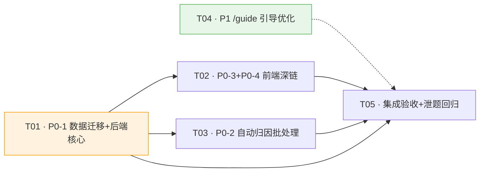

# 架构设计 · V4 增量：错题→知识点深链 + /guide 引导优化

> 增量架构文档。项目已开发约 80%，本文档**只描述相对现状的变更**。
> 撰写：高见远（架构师） · 面向：后端工程师 / 前端工程师
> 依据：`docs/prd-v4-enhance-kp-guide.md`（PRD v1.0，已核实代码事实）

| 项 | 值 |
| --- | --- |
| Language | 中文 |
| 后端 | FastAPI + SQLAlchemy 2.0（双方言 PG / SQLite） |
| 前端 | Vue3 + Vite + TS + Tailwind（目录 `student-web/`） |
| AI Provider | 方舟 / 火山引擎（`app/ai/ark_client.py::ark_respond`） |
| 迁移方式 | 编号裸 SQL 双方言 + `schema_guard` 运行时探测（不引入 Alembic） |
| 新增依赖包 | **无**（不引入 Jiagu / 任何 NLP 库） |

---

## Part A：系统设计

### 1. 实现方案

#### 1.1 核心技术挑战

| # | 挑战 | 方案 |
| --- | --- | --- |
| 1 | **Mistake 表无 kp_id 列**，错题无法携带知识点归属 | 新增 `kp_id` 冗余列（FK→knowledge_points.id），建档时从 `Question.kp_id` 快照写入；存量数据从 questions 继承回填 |
| 2 | **知识点树仅 13 个扁平粗桶**，深链后抽到的题跨全学段 | P0-3 止血：深链同时携带 `grade`，收窄到「同年级 × 同知识点」；知识点树细化留后续需求 |
| 3 | **Question.kp_id 大量为空**，自动归因覆盖率不足 | 规则词典（主力）+ 方舟兜底两级方案，离线批处理脚本 `backfill_kp.py`，归因结果一律 `kp_verified=0` |
| 4 | **practice_guide.py 提示词偏薄**（35 行），`/guide` 追问节奏靠模型自由发挥 | 将 `tutor.py`（63 行）已沉淀的教学法资产裁剪下沉到 practice_guide，产出 patch diff + 回归用例 |
| 5 | **迁移幂等性**：SQLite `ADD COLUMN` 不支持 `IF NOT EXISTS` | 沿用 004 模式：迁移 SQL 包在 `BEGIN/COMMIT` 内 + `schema_guard` 运行时探测兜底 |

#### 1.2 框架与库选型

**沿用现有栈，不引入任何新框架/库。** 具体选型理由：

| 层 | 选型 | 理由 |
| --- | --- | --- |
| 迁移 | 编号裸 SQL（PG + SQLite 各一份） | 项目既有约定（001~004），不引入 Alembic |
| 运行时探测 | `schema_guard.py` 模式 | SQLite `ADD COLUMN` 无 `IF NOT EXISTS`，靠先 `inspect` 探测规避重复执行报错 |
| 自动归因-规则层 | 纯 Python 字符串匹配 + JSON 词典 | 13 个粗桶用关键词词典即可高准确率，无需 NLP 库 |
| 自动归因-兜底层 | `ark_respond`（方舟） | 项目既有 AI Provider，不引入 DeepSeek / Jiagu |
| 前端深链 | Vue Router query + 现有 `startDeepLink()` | 画像页 `RecommendationList.vue → Practice.vue` 深链已实现，复用现成模式 |
| 提示词优化 | 纯文本 patch + 回归用例 | C 不改架构，只产出文档 + 提示词 diff |

#### 1.3 架构模式

本次增量**不改变整体架构**，仅在现有分层内做点状扩展：

```
┌─ 前端 (student-web/) ─────────────────────────────────────────┐
│  Mistakes.vue ──(深链 kp_id+kp_name+grade)──► Practice.vue     │
│      │                    复用 startDeepLink()                   │
│      │ api/chat.ts::MistakeItem 补 kpId/kpName/grade            │
└──────┼──────────────────────────────────────────────────────────┘
       │ GET /api/mistake/list (新增 kp_id 筛选)
┌──────▼─ 后端 (backend/app/) ──────────────────────────────────┐
│  api/mistake.py::_to_item() ── 出参补 kpId/kpName/grade        │
│      │ learning_service.list_mistakes() ── 加 kp_id 筛选       │
│      │ learning_service.record_mistake() ── 快照 Question.kp_id │
│      │                                                         │
│  scripts/backfill_kp.py ── 离线批处理（不入请求链路）           │
│      ├─ seed/kp_keywords.json (规则词典)                        │
│      └─ ark_respond (方舟兜底)                                   │
│                                                                 │
│  ai/prompts/practice_guide.py ── 提示词 patch (VERSION 1.1.0)   │
└─────────────────────────────────────────────────────────────────┘
```

---

### 2. 文件列表

#### 2.1 后端

| # | 相对路径 | 操作 | 职责 |
| --- | --- | --- | --- |
| 1 | `backend/migrations/005_mistake_kp.sql` | **新增** | PG 方言：`mistakes` 表加 `kp_id` 列 + 回填 + 建索引 |
| 2 | `backend/migrations/005_mistake_kp_sqlite.sql` | **新增** | SQLite 方言：同上，`ADD COLUMN` 包在 `BEGIN/COMMIT` 内 |
| 3 | `backend/app/models/learning.py` | **修改** | `Mistake` 模型加 `kp_id` 列 + `kp` relationship |
| 4 | `backend/app/services/importers/schema_guard.py` | **修改** | 新增 `ensure_mistake_kp_column()` 函数，运行时探测兜底 |
| 5 | `backend/app/services/learning_service.py` | **修改** | `record_mistake()` 快照 kp_id；`list_mistakes()` 加 kp_id 筛选 + eager load |
| 6 | `backend/app/api/mistake.py` | **修改** | `_to_item()` 出参补 `kpId`/`kpName`/`grade`；`list_mistakes` 路由加 `kp_id` query |
| 7 | `backend/app/scripts/backfill_kp.py` | **新增** | 知识点自动归因批处理脚本（规则词典 + 方舟兜底，支持 `--dry-run`） |
| 8 | `backend/seed/kp_keywords.json` | **新增** | 13 个知识点的同义词/特征词词典 |
| 9 | `backend/app/ai/prompts/practice_guide.py` | **修改** | 提示词 patch（VERSION 升 1.1.0），下沉 tutor 教学法 |
| 10 | `backend/tests/test_mistake_kp.py` | **新增** | Mistake kp_id 列 + _to_item 出参 + 筛选 集成测试 |
| 11 | `backend/tests/test_backfill_kp.py` | **新增** | 自动归因批处理单元测试（规则匹配 + dry-run） |
| 12 | `backend/tests/test_guide_regression.py` | **新增** | /guide 泄题回归用例（≥10 条，覆盖五类错因 + 泄题红线） |

#### 2.2 前端

| # | 相对路径 | 操作 | 职责 |
| --- | --- | --- | --- |
| 13 | `student-web/src/api/chat.ts` | **修改** | `MistakeItem` 类型补 `kpId`/`kpName`/`grade` |
| 14 | `student-web/src/views/Mistakes.vue` | **修改** | 卡片加知识点条 + 「练同类题」深链按钮；删除 122-130 断点注释 |
| 15 | `student-web/src/views/Practice.vue` | **修改** | `consumeDeepLink()` 扩展读 `route.query.grade` |
| 16 | `student-web/src/stores/practice.ts` | **修改** | `DeepLinkInfo` 加 `grade?`；`startDeepLink()` 透传 grade 到 `startPractice()` |

#### 2.3 文档

| # | 相对路径 | 操作 | 职责 |
| --- | --- | --- | --- |
| 17 | `docs/guide-prompt-optimization.md` | **新增** | /guide 追问逻辑优化清单（节奏规则 + 判定表 + 五类话术 + patch diff + 回归用例） |
| 18 | `docs/sequence-diagram-kp.mermaid` | **新增** | 三流程时序图（建档快照 / 深链跳转 / 自动归因） |
| 19 | `docs/class-diagram-kp.mermaid` | **新增** | 数据结构与接口类图 |

---

### 3. 数据结构和接口

#### 3.1 Mistake 表加列 DDL

**PG 方言（`005_mistake_kp.sql`）**：

```sql
BEGIN;

-- 新增 kp_id 列：FK→knowledge_points.id，ON DELETE SET NULL，nullable，建索引
ALTER TABLE mistakes ADD COLUMN IF NOT EXISTS kp_id UUID REFERENCES knowledge_points(id) ON DELETE SET NULL;

-- 回填（与 ADD COLUMN 同事务）：存量错题从题目继承 kp_id
UPDATE mistakes SET kp_id = (
    SELECT q.kp_id FROM questions q WHERE q.id = mistakes.question_id
) WHERE mistakes.kp_id IS NULL;

COMMIT;

CREATE INDEX IF NOT EXISTS idx_mistakes_kp ON mistakes (kp_id);
COMMENT ON COLUMN mistakes.kp_id IS '关联知识点(建档时从Question.kp_id快照，不被后续修正追溯改写)';
```

**SQLite 方言（`005_mistake_kp_sqlite.sql`）**：

```sql
BEGIN TRANSACTION;

-- SQLite ADD COLUMN 不支持 IF NOT EXISTS，重复执行会报 duplicate column name
-- 生产/开发优先走 schema_guard.py::ensure_mistake_kp_column() 先探测列是否存在
ALTER TABLE mistakes ADD COLUMN kp_id CHAR(36) REFERENCES knowledge_points(id) ON DELETE SET NULL;

-- 回填（与 ADD COLUMN 同事务）：存量错题从题目继承 kp_id
UPDATE mistakes SET kp_id = (
    SELECT q.kp_id FROM questions q WHERE q.id = mistakes.question_id
) WHERE mistakes.kp_id IS NULL;

COMMIT;

CREATE INDEX IF NOT EXISTS idx_mistakes_kp ON mistakes (kp_id);
```

#### 3.2 Mistake 模型变更（`learning.py`）

```python
class Mistake(Base):
    """错题本（学生 × 题目，记录错误类型与是否攻克）。"""

    # ... 既有字段不变 ...

    # ★ 新增：关联知识点（建档时从 Question.kp_id 快照写入）
    kp_id: Mapped[Optional[uuid.UUID]] = mapped_column(
        GUID(),
        ForeignKey("knowledge_points.id", ondelete="SET NULL"),
        nullable=True,
        index=True,
        comment="关联知识点(建档时从Question.kp_id快照)",
    )

    # ★ 新增：知识点关系（用于 _to_item 取 kp_name，避免 N+1）
    kp: Mapped[Optional["KnowledgePoint"]] = relationship()

    # 既有关系不变
    student: Mapped["Student"] = relationship(back_populates="mistakes")
    question: Mapped["Question"] = relationship(back_populates="mistakes")

    __table_args__ = (
        Index("idx_mistakes_student_solved", "student_id", "solved"),
        Index("idx_mistakes_kp", "kp_id"),  # ★ 新增索引
        {"comment": "错题本表"},
    )
```

> **类型检查前向引用**：`KnowledgePoint` 在 `content.py` 定义。`learning.py` 已有 `TYPE_CHECKING` 块引用 `content.Question`，补一行 `from app.models.content import KnowledgePoint` 即可（运行期由 SQLAlchemy registry 解析字符串 `"KnowledgePoint"`）。

#### 3.3 `_to_item()` 出参结构（`api/mistake.py`）

```python
def _to_item(mistake: Mistake) -> Dict[str, Any]:
    """把 Mistake 序列化成 camelCase 出参（时间转 ISO 8601）。

    ⚠️ 本文件是 T03 既有接口，沿用 camelCase 不改。
    kpId/kpName/grade 为新增字段：
      - kpId/kpName 来自 Mistake.kp_id（快照），kp_name 通过 relationship 取
      - grade 来自 Question.grade（通过 question relationship 取）
      - kpId 为空时前端不渲染知识点条 / 不显示「练同类题」按钮
    """
    return {
        "id": str(mistake.id),
        "questionId": str(mistake.question_id),
        "errorType": mistake.error_type,
        "errorReason": mistake.error_reason,
        "note": mistake.note,
        "solved": mistake.solved,
        "solvedAt": mistake.solved_at.isoformat() if mistake.solved_at else None,
        "createdAt": mistake.created_at.isoformat() if mistake.created_at else None,
        # ★ 新增
        "kpId": str(mistake.kp_id) if mistake.kp_id else None,
        "kpName": mistake.kp.name if mistake.kp else None,
        "grade": mistake.question.grade if mistake.question else None,
    }
```

> **eager load 策略**：`list_mistakes()` 内使用 `selectinload(Mistake.kp)` + `selectinload(Mistake.question).load_only(Question.grade)` 避免 N+1。单条 `solve_mistake()` 路径的 lazy load 可接受（单记录 1~2 条额外查询）。

#### 3.4 `list_mistakes()` 签名变更（`learning_service.py`）

```python
def list_mistakes(
    db: Session,
    *,
    student_id: Any,
    state: Optional[str] = None,
    kp_id: Optional[Any] = None,  # ★ 新增：按知识点筛错题
) -> List[Mistake]:
```

路由层 `GET /api/mistake/list` 新增可选 query 参数 `kp_id`（字符串 UUID），透传到 `list_mistakes(kp_id=...)`。

#### 3.5 `record_mistake()` 快照逻辑（`learning_service.py`）

```python
def record_mistake(db, *, student_id, question_id, error_type=None, error_reason=None) -> Mistake:
    # ... 既有幂等检查 ...

    # ★ 新增：从 Question 快照 kp_id
    question_kp_id = db.execute(
        select(Question.kp_id).where(Question.id == qid)
    ).scalar_one_or_none()

    mistake = Mistake(
        student_id=sid,
        question_id=qid,
        error_type=error_type,
        error_reason=error_reason,
        solved=False,
        kp_id=question_kp_id,  # ★ 快照写入（可能为 None）
    )
    # ... 既有 commit 逻辑 ...
```

#### 3.6 `kp_keywords.json` 结构

```json
{
  "version": "1.0.0",
  "rules": [
    {
      "kp_code": "KP_CALC",
      "kp_name": "计算",
      "keywords": ["加", "减", "乘", "除", "和", "差", "积", "商", "口算", "笔算", "简便运算", "运算定律", "竖式"],
      "priority": 10
    },
    {
      "kp_code": "KP_FRACTION",
      "kp_name": "分数",
      "keywords": ["分子", "分母", "约分", "通分", "几分之几", "分数", "真分数", "假分数", "带分数"],
      "priority": 20
    },
    {
      "kp_code": "KP_UNIT",
      "kp_name": "单位换算",
      "keywords": ["千米", "千克", "平方米", "时分秒", "厘米", "毫米", "吨", "克", "升", "毫升", "合", "="],
      "priority": 30
    }
    // ... 其余 10 个知识点 ...
  ]
}
```

> `priority` 用于多桶命中时的消歧：高 priority 的桶优先。`KP_MIXED`（综合）的 priority 设为 0（最低），仅在无其他命中时兜底。

#### 3.7 `backfill_kp.py` 接口

```python
"""知识点自动归因批处理脚本（离线，不入请求链路）。

用法：
    cd backend
    python app/scripts/backfill_kp.py                    # 执行回填
    python app/scripts/backfill_kp.py --dry-run          # 只输出归因分布，不落库
    python app/scripts/backfill_kp.py --limit 100        # 只处理前 100 道空 kp 题
"""

def classify_by_rules(content: str, rules: list[dict]) -> Optional[str]:
    """规则词典匹配。

    Returns: 命中唯一桶的 kp_code；多桶命中或无命中返回 None。
    """

def classify_by_ark(content: str, kp_list: list[dict]) -> Optional[str]:
    """方舟兜底分类：给定 13 个知识点封闭选项做单选。

    Returns: kp_code 或 None（方舟调用失败时）。
    """

def backfill(db: Session, *, dry_run: bool = False, limit: Optional[int] = None) -> dict:
    """批处理回填。

    Returns: {
        "total_empty": int,          # kp_id 为空的题目总数
        "rule_matched": int,         # 规则词典命中数
        "ark_matched": int,          # 方舟兜底命中数
        "unmatched": int,            # 两级都未命中数
        "distribution": dict,        # {kp_code: count} 归因分布
    }
    """
```

> **归因安全**：所有自动归因结果一律 `kp_verified=0`（不污染可归因池），`kp_id` 落库但题目的 `kp_verified` 保持 0。`_candidates` 的可归因池条件是 `kp_verified=1 AND kp_id IS NOT NULL`，自动归因的题默认只进「放开后的全 L1 安全池」。

#### 3.8 前端类型变更

**`api/chat.ts` → `MistakeItem`**：

```typescript
export interface MistakeItem {
  id: string
  questionId: string
  errorType: string | null
  errorReason: string | null
  solved: boolean
  solvedAt: string | null
  createdAt: string | null
  note?: string | null
  // ★ 新增
  kpId: string | null
  kpName: string | null
  grade: number | null
}
```

**`stores/practice.ts` → `DeepLinkInfo`**：

```typescript
interface DeepLinkInfo {
  kp_id: string
  kp_name: string
  grade?: number  // ★ 新增：P0-3 止血——深链同时带 grade 收窄抽题范围
}
```

**`stores/practice.ts` → `startDeepLink()`**：

```typescript
export async function startDeepLink(info: DeepLinkInfo, count: number = 10): Promise<boolean> {
  // ★ 透传 grade 到 startPractice
  const ok = await startPractice({ kp_id: info.kp_id, grade: info.grade, count })
  practiceState.deep_link = { kp_id: info.kp_id, kp_name: info.kp_name, grade: info.grade }
  return ok
}
```

---

### 4. 程序调用流程

> 完整时序图见 `docs/sequence-diagram-kp.mermaid`

#### 4.1 流程一：错题建档时快照 kp_id

```
前端 POST /api/mistake { questionId, errorType, errorReason }
  → api/mistake.py::create_mistake()
    → learning_service.record_mistake(student_id, question_id, ...)
      → 幂等检查：已有未攻克记录？→ 是则直接返回
      → ★ 新增：SELECT kp_id FROM questions WHERE id = question_id  （标量查询）
      → Mistake(kp_id=question.kp_id, ...)  快照写入
      → db.commit()
    ← 返回 { id, solved }
```

**finish_session 自动入本路径**（`practice_service.finish_session` → `learning_service.record_mistake`）同样走快照逻辑，无需额外改动。

#### 4.2 流程二：错题本深链跳转

```
Mistakes.vue
  → GET /api/mistake/list → _to_item() 出参含 kpId/kpName/grade
  → 用户点「练同类题」
  → router.push({ name: 'practice', query: { kp_id, kp_name, grade } })  ← snake_case 直传
    → Practice.vue onMounted → consumeDeepLink()
      → 读 route.query.kp_id / kp_name / grade
      → router.replace({ name: 'practice' })  摘掉 query
      → startDeepLink({ kp_id, kp_name, grade })
        → startPractice({ kp_id, grade, count })
          → POST /api/practice/session { kp_id, grade, count }  ← DrawRequest 已支持
            → practice_service.draw_questions(kp_id=..., grade=...)
              → _candidate_rows(attributable_only=True, kp_id=..., grade=...)
                → 可归因池（kp_verified=1 AND kp_id=匹配）+ grade 过滤
                → 不够 → 放开到全 L1 安全池（仍带 kp_id + grade）
              → random.sample → create_session
            ← { session_id, questions, pool_size, ... }
          → 进入答题态（不停在筛选页）
```

#### 4.3 流程三：自动归因批处理（离线）

```
运维执行: python app/scripts/backfill_kp.py --dry-run
  → backfill(db, dry_run=True)
    → SELECT id, content FROM questions WHERE kp_id IS NULL  （查空 kp 题）
    → for each question:
        → classify_by_rules(content, rules)
          → 加载 seed/kp_keywords.json
          → 遍历 13 个桶的 keywords，统计命中数
          → 命中唯一桶 → 返回 kp_code
          → 多桶/无命中 → 返回 None
        → if None: classify_by_ark(content, kp_list)
          → 构造封闭选项 prompt（13 个知识点单选）
          → ark_respond(messages=[...])  → 解析返回的 kp_code
        → 记录归因结果到 distribution
    → dry_run=True：只输出分布统计，不落库
    → dry_run=False：UPDATE questions SET kp_id=..., kp_verified=0 WHERE id=...
  ← 输出归因分布报告
```

---

### 5. 待明确事项

| # | 事项 | 影响 | 当前假设 |
| --- | --- | --- | --- |
| 1 | **`_to_item` 补 `grade` 字段**：PRD 显式只提了 `kpId`/`kpName`，但 UI 草图的「🏷 计算 · 四年级」需要 `grade`（来自 Question）。 | 决定前端是否需要额外请求。 | **假设补 `grade`**——通过 `mistake.question.grade` relationship 取，eager load 避 N+1。若产品经理不同意，前端需单独调接口取题面，体验更差。 |
| 2 | **`backfill_kp.py` 回填后是否需要二次回填错题**：PRD Q3 建议错题回填执行两次（005 迁移继承 → backfill 补题目 kp → 再跑一次错题继承）。 | 决定批处理执行顺序。 | **假设执行两次**：005 迁移时继承一次（存量题 kp 为空则错题也为空）；backfill 补题目后，脚本末尾追加 `UPDATE mistakes SET kp_id = (SELECT q.kp_id FROM questions q WHERE q.id = mistakes.question_id) WHERE mistakes.kp_id IS NULL`。 |
| 3 | **practice_guide.py patch 是否本轮合入**：PRD P1-2 说「以 diff 形式给出建议改动……提示词是否合入由负责人评审后决定」。 | 决定 T04 是否包含代码改动还是纯文档。 | **假设产出 patch diff 文档 + 可选合入**：文档里给 diff，代码里用注释标记建议改动点，VERSION 暂不升；负责人评审通过后再取消注释、升版本。`leaks_answer()` 闸门始终保留。 |

---

## Part B：任务分解

### 6. 依赖包列表

**本轮无新增第三方包。**

```
# requirements.txt 无变更
# 不引入 Jiagu（通用 NLP 库，与 K12 数学知识点体系无对应关系）
# 不引入 DeepSeek（统一走方舟 ark_respond）
# 不引入 Alembic（沿用编号裸 SQL 双方言）
# 规则词典用纯 Python str 匹配，无需任何 NLP 库
```

---

### 7. 任务列表（按依赖顺序）

#### T01 · P0-1 数据迁移 + 后端核心链路

| 项 | 内容 |
| --- | --- |
| **任务名** | 数据迁移 + 后端核心链路（Mistake 加 kp_id + 出参 + 快照 + 筛选） |
| **源文件** | `backend/migrations/005_mistake_kp.sql`（新增）<br>`backend/migrations/005_mistake_kp_sqlite.sql`（新增）<br>`backend/app/models/learning.py`（修改）<br>`backend/app/services/importers/schema_guard.py`（修改）<br>`backend/app/services/learning_service.py`（修改）<br>`backend/app/api/mistake.py`（修改）<br>`backend/tests/test_mistake_kp.py`（新增） |
| **依赖** | 无（**设计可立即做**；代码实现需等用户 git push 完成后动） |
| **优先级** | P0 |
| **可立即做** | 迁移 SQL 设计 + 模型变更设计（本文档已给出） |
| **需等 A** | 代码落地（模型改列、service 改方法、api 改出参） |

**验收**：
- PG / SQLite 双方言迁移可重复执行不报错
- `GET /api/mistake/list` 出参含 `kpId`/`kpName`/`grade`；支持 `kp_id` 筛选
- `record_mistake()` 建档时从 `Question.kp_id` 快照写入
- 存量错题回填后 `kp_id` 与所属题目一致

#### T02 · P0-3 + P0-4 前端深链闭环

| 项 | 内容 |
| --- | --- |
| **任务名** | 前端深链闭环（错题本知识点入口 + grade 收窄） |
| **源文件** | `student-web/src/views/Mistakes.vue`（修改）<br>`student-web/src/api/chat.ts`（修改）<br>`student-web/src/views/Practice.vue`（修改）<br>`student-web/src/stores/practice.ts`（修改） |
| **依赖** | T01（需要后端出参含 kpId/kpName/grade） |
| **优先级** | P0 |
| **需等 A** | 全部（前端代码改动需等 git push） |

**验收**：
- 错题卡片显示「🏷 kpName · n年级」行；`kpId` 为空时整行不渲染
- 点「练同类题」→ 练习页**直接开练**，抽到的题 kp_id 与错题一致、grade 一致
- `Mistakes.vue:122-130` 断点注释已删除
- 练习页顶部显示「正在练：计算（来自你的错题）」

#### T03 · P0-2 知识点自动归因批处理

| 项 | 内容 |
| --- | --- |
| **任务名** | 知识点自动归因批处理（规则词典 + 方舟兜底） |
| **源文件** | `backend/app/scripts/backfill_kp.py`（新增）<br>`backend/seed/kp_keywords.json`（新增）<br>`backend/tests/test_backfill_kp.py`（新增） |
| **依赖** | T01（需要 `mistakes.kp_id` 列存在；补题目 kp 后回填错题） |
| **优先级** | P0 |
| **可立即做** | `kp_keywords.json` 词典编写（不依赖代码） |
| **需等 A** | `backfill_kp.py` 脚本代码 |

**验收**：
- `--dry-run` 可输出归因分布（各 kp_code 命中数、规则 vs 方舟占比、未命中数）
- 归因结果一律 `kp_verified=0`，不改变现有可归因池规模
- 三级全部失败 → `kp_id` 留空，不阻塞
- 脚本末尾二次回填错题 kp_id

#### T04 · P1 /guide 引导逻辑优化

| 项 | 内容 |
| --- | --- |
| **任务名** | /guide 追问逻辑优化文档 + 提示词 patch |
| **源文件** | `docs/guide-prompt-optimization.md`（新增）<br>`backend/app/ai/prompts/practice_guide.py`（修改——patch diff）<br>`backend/tests/test_guide_regression.py`（新增） |
| **依赖** | 无（与 B 无耦合，**可并行**） |
| **优先级** | P1 |
| **可立即做** | **全部**（文档撰写 + 提示词 patch 设计 + 回归用例编写，不依赖 git push） |

**验收**：
- 文档含：分步追问节奏、给提示 vs 沉默判定表、五类错因话术（各 2~3 条示例 + 反例）、`practice_guide.py` patch diff、≥10 条回归用例
- `leaks_answer()` 闸门保留不动
- 若合入提示词改动，`VERSION` 升至 1.1.0，泄题回归全过

#### T05 · 集成验收 + 泄题回归

| 项 | 内容 |
| --- | --- |
| **任务名** | 端到端集成验收 + 泄题回归测试 |
| **源文件** | `backend/tests/test_mistake_kp.py`（扩展——端到端）<br>`backend/tests/test_guide_regression.py`（扩展——泄题红线）<br>`docs/验收对照.md`（新增——验收清单） |
| **依赖** | T01, T02, T03, T04 |
| **优先级** | P0 |
| **需等 A** | 全部（需 T01~T04 代码全部落地） |

**验收**：
- B-1~B-5、C-1~C-2 全部通过（对照 PRD §7 验收标准）
- 泄题回归：提示词改动后 `sanitize_guide_reply()` + `leaks_answer()` 双闸门全过
- `Mistakes.vue` 断点注释删除后功能正常

---

### 8. 共享知识（跨文件约定）

#### 8.1 camelCase vs snake_case 边界

| 接口 | 风格 | 说明 |
| --- | --- | --- |
| `GET /api/mistake/list` 出参 | **camelCase** | T03 既有接口约定，`_to_item()` 沿用。新增 `kpId`/`kpName`/`grade` 也用驼峰 |
| `POST /api/mistake` 出参 | **camelCase** | 同上 |
| `PUT /api/mistake/{id}/solve` 出参 | **camelCase** | 同上 |
| `GET /api/mistake/list` 入参 `kp_id` | **snake_case** | query 参数沿用后端字段名（与 `/api/practice/session` 的 `kp_id` 一致） |
| `POST /api/practice/*` 全部 | **snake_case** | 题库消费层既有约定（`schemas/practice.py::PracticeBase`） |
| 前端深链 query | **snake_case** | `kp_id`/`kp_name`/`grade` 直传，不转驼峰（与 `RecommendationList.vue` 一致） |
| `/api/profile/*` 新接口 | **snake_case** | T04 新接口约定 |

#### 8.2 kp_verified 语义（不改动）

- **存量题**：`kp_verified=1`（默认 True，视为已复核）——V7 线上事故坑的防护，不改。
- **docx 导入新题**：`kp_verified=0`（显式传 False）。
- **自动归因结果**：一律 `kp_verified=0`（未复核），不污染可归因池（`kp_verified=1 AND kp_id IS NOT NULL`）。
- **语义倒挂**：老题没核=1、新归因核过=0。这是已知的设计权衡，本次不改动（PRD Q4 已确认）。

#### 8.3 快照语义

- `Mistake.kp_id` 是**建档时的快照**，不是实时 JOIN。
- 题目的 kp 后续被修正时，历史错题的归因**不应被追溯改写**。
- `record_mistake()` 建档时从 `Question.kp_id` 快照写入；后续不自动同步。

#### 8.4 离线批处理不入请求链路

- `backfill_kp.py` 是**离线脚本**，由运维手动执行，不在 HTTP 请求链路里跑 NLP/方舟调用。
- 支持 `--dry-run` 输出归因分布供人工抽检。
- 方舟兜底分类有网络调用和延迟，绝不能放在用户请求路径里。

#### 8.5 kp_id 为空的降级策略

- `Mistake.kp_id` 为空 → 前端不渲染知识点条，不显示「练同类题」按钮。
- **绝不允许硬编一个 kp_id 兜底**——抽到不相干的题比不深链更糟（PRD §4.1 明确）。
- `Question.kp_id` 为空 → 不进可归因池，只进「放开后的全 L1 安全池」。

#### 8.6 泄题闸门（C 必须保留）

- `practice_service.sanitize_guide_reply()` + `judge_engine.leaks_answer()` 是**代码层硬约束**。
- 提示词是**软约束**，两者不能互相替代。
- 提示词改动后必须重跑泄题回归（`test_guide_regression.py`）。

---

### 9. 风险与回滚

#### 9.1 迁移失败回滚

| 风险 | 回滚方案 |
| --- | --- |
| 005 迁移 SQL 执行失败（PG） | `ALTER TABLE mistakes DROP COLUMN IF EXISTS kp_id; DROP INDEX IF EXISTS idx_mistakes_kp;`——列可安全删除，存量错题无数据损失（kp_id 本就是新增的冗余列） |
| 005 迁移 SQL 执行失败（SQLite） | SQLite 不支持 `DROP COLUMN`（老版本）；若 `ADD COLUMN` 已执行但回填失败，`kp_id` 列会全为 NULL——**不影响现有功能**（前端 kpId 为空时不渲染知识点条）。修复回填 SQL 后重跑即可。 |
| 回填数据错误（kp_id 指向错误知识点） | `UPDATE mistakes SET kp_id = NULL WHERE id IN (...);` 清空错误数据，重跑回填。Mistake.kp_id 是冗余快照，清空不影响错题本核心功能。 |
| `backfill_kp.py` 归因质量差 | `UPDATE questions SET kp_id = NULL, kp_verified = 0 WHERE kp_id IS NOT NULL AND kp_verified = 0;` 清空所有自动归因结果，题库回到归因前状态。存量题的 `kp_verified=1` 不受影响。 |

#### 9.2 提示词改动泄题回归

| 风险 | 回滚方案 |
| --- | --- |
| `practice_guide.py` patch 后模型泄题率上升 | `sanitize_guide_reply()` 代码闸门会拦截泄题回复改用兜底话术——**用户体验降级但不泄题**。回滚提示词到 v1.0.0 即可恢复。 |
| `VERSION` 升 1.1.0 后回归不通过 | git revert 提示词改动，VERSION 回 1.0.0。`guide_question()` 返回的 `prompt_version` 会自动反映回滚。 |
| 回归用例覆盖不足 | T04 要求 ≥10 条回归用例（五类错因各 1 条 + 泄题红线 2 条）。上线前必须全过。 |

#### 9.3 前端深链回归

| 风险 | 回滚方案 |
| --- | --- |
| `Practice.vue` 扩展 grade 参数后破坏画像页深链 | grade 是可选参数（`DeepLinkInfo.grade?`），不传时行为与现状完全一致。画像页 `RecommendationList.vue` 不传 grade，不受影响。 |
| `Mistakes.vue` 删除断点注释后功能异常 | 断点注释（122-130 行）只是说明「做不了知识点直达」，删除后逻辑不变。新增的知识点条在 kpId 为空时不渲染，与原「去练习」按钮行为一致。 |

---

### 10. 任务依赖图



> **关键路径**：T01 → T02 → T05（B 的首次可感知闭环）
> **并行路径**：T04（C 文档 + 提示词 patch，与 B 无耦合，可立即开始）
> **覆盖率放大**：T03（自动归因，不阻塞首次交付，提升深链覆盖率）

---

*文档版本 v1.0 · 架构师 高见远*
