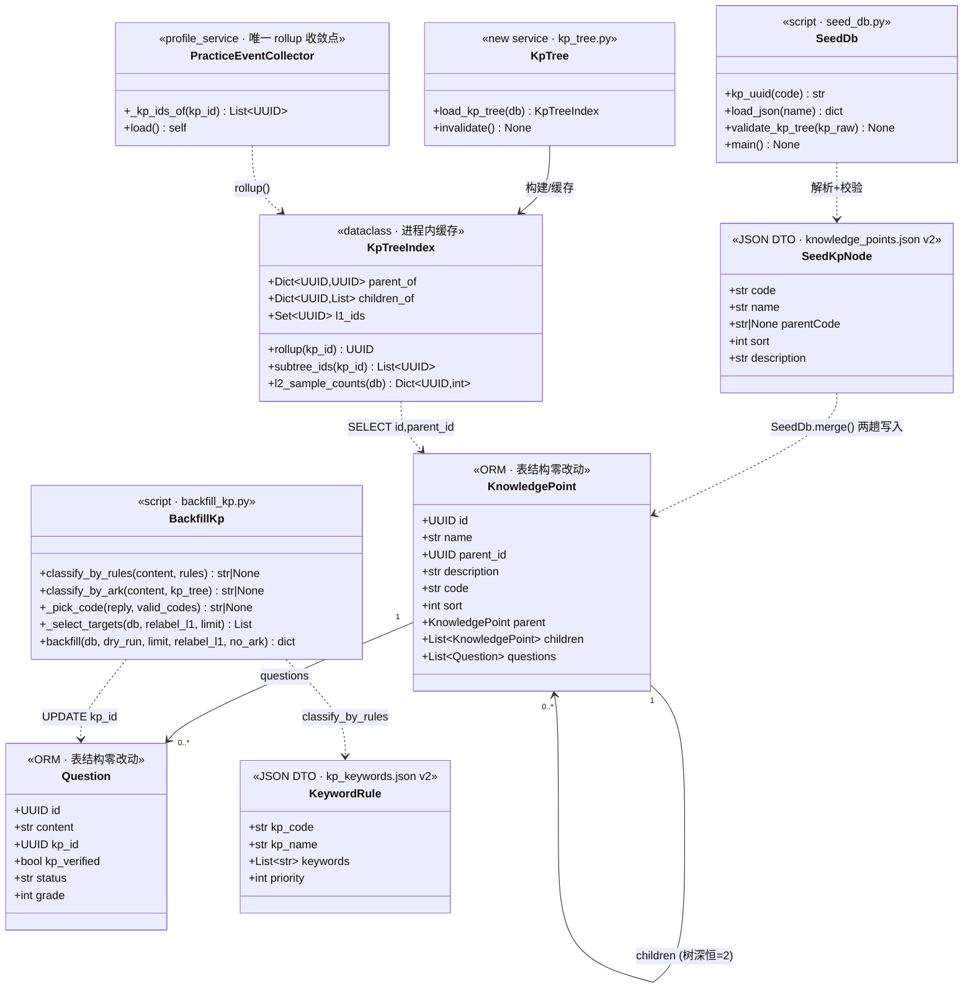
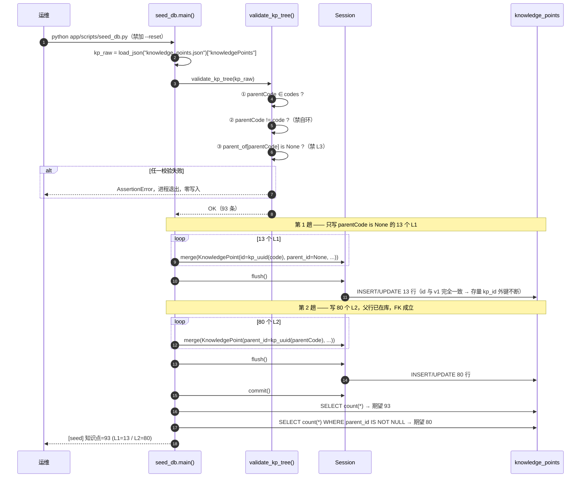
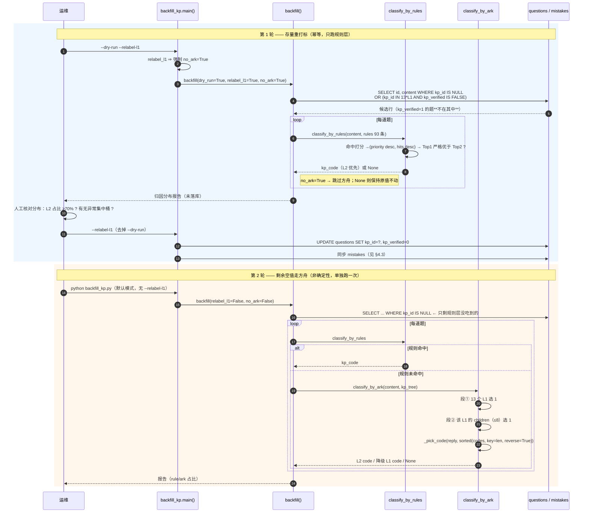
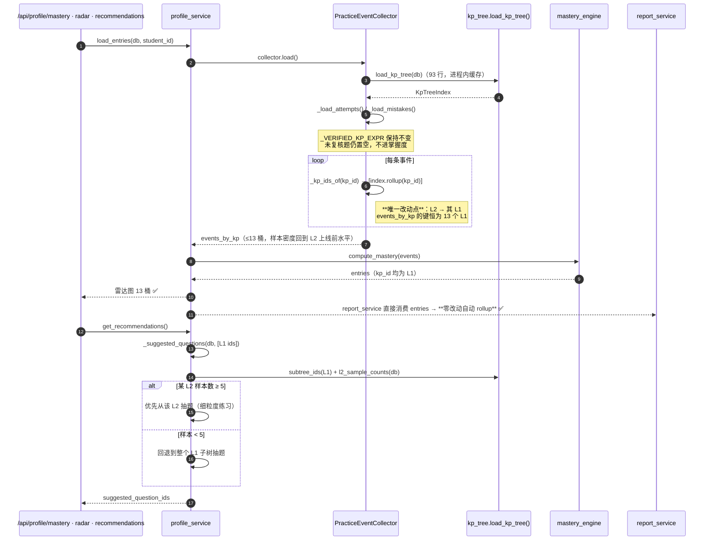
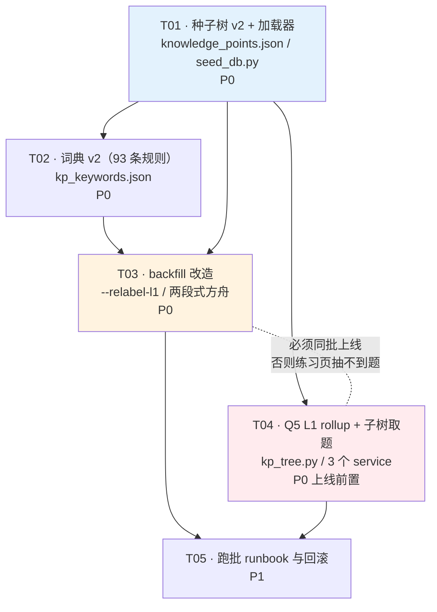

# 系统设计 · KF 知识树 L2 二级分类

- 上游输入: `docs/prd-kf-tree-l2.md`（PM 许清楚）
- 架构师: 高见远
- 项目: `kf_knowledge_tree_l2`
- 状态: 已定稿（Q1–Q5 由交付总监拍板，见 §0）

---

## 0. 已拍板决策（不再回抛）

| # | 决策 | 对设计的约束 |
|---|---|---|
| Q1 | **不新增 L1**，维持 13 L1 / 80 L2 / **93 节点** | 节点表就是 PRD §3.2–3.14 原表，`KP_MIX_FUNCTION` 继续挂 `KP_MIXED` |
| Q2 | **做 `--relabel-l1`**，该模式强制只跑规则层 | `backfill_kp.py` 新增 2 个开关 |
| Q3 | **年级不落库** | `KnowledgePoint` 表结构零改动，无 alembic revision |
| Q4 | **保留 `KP_MIXED` 5 个 L2** | 无额外动作 |
| Q5 | **统计口径改 L1 rollup**，L2 样本 ≥5 才用 L2 出题 | 新增 `app/services/kp_tree.py`，改 3 个 service |

### 0.1 路径勘误（重要，工程师照此为准）

任务书里给的 `backend/app/scripts/knowledge_points.json` / `kp_keywords.json` **不存在**。
实际位置由 `seed_db.py:28` 的 `SEED_DIR = BACKEND_DIR / "seed"` 与
`backfill_kp.py:42` 的 `RULES_PATH = BACKEND_DIR / "seed" / "kp_keywords.json"` 决定：

- 种子数据：`backend/seed/knowledge_points.json`
- 关键词词典：`backend/seed/kp_keywords.json`
- 脚本：`backend/app/scripts/seed_db.py`、`backend/app/scripts/backfill_kp.py`

---

## 1. 实现方案与选型

### 1.1 结论：零新技术、零迁移、零 DDL

沿用既有栈，不引入任何新依赖：

| 层 | 技术 | 本次是否改动 |
|---|---|---|
| 运行时 | Python 3 / FastAPI | 否 |
| ORM | SQLAlchemy 2.x（`Mapped` 声明式） | 否 |
| 数据库 | 开发 SQLite（`sqlite:///./dev.db`），生产 PG（`DATABASE_URL` 切换） | **表结构零改动** |
| 迁移 | alembic（`backend/migrations`） | **不新增 revision** |
| 种子/批处理 | 纯脚本 + ORM `session.merge()` | 改 2 个脚本 |
| AI 兜底 | `app.ai.ark_client.ark_respond` | 调用方式改两段式，客户端不动 |

### 1.2 三个核心技术难点与解法

**难点 1 · 无迁移把平铺升级成树。**
`KnowledgePoint` 已自带 `parent_id`（自引用 FK，`ondelete="SET NULL"`）与 `code UNIQUE String(32)`，
字段完全够用。真正的难点是**外键时序**：写 L2 时父行必须已在库。
解法 = **两趟写入**（L1 全部 `merge` + `flush` → 再 L2）。
主键 `kp_uuid(code) = uuid5(NAMESPACE_DNS, "aicoach:kp:" + code)` 是**确定性**的，
所以 `parent_id` 无需查库、可直接由 `parentCode` 算出；`merge()` 按 PK upsert 保证幂等。
存量 13 个 L1 的 id 不变 → **2174 道题的 `kp_id` 外键一个都不会断**，这就是"零迁移升级"的全部原理。

**难点 2 · 分类粒度变细后规则冲突。**
`classify_by_rules()` 的排序是 `(priority desc, hits desc)` 且要求 Top1 严格优于 Top2。
不改一行代码就能支持 L2——只要用 **priority 数值分层**（L1 0–30 / L2 100–199）让 L2 天然压过 L1，
再用 L2 内部梯度（180/150/110）避免兄弟节点同分互锁。
**代码零改动、行为全升级**，这是本方案性价比最高的一处。

**难点 3 · 桶数 ×7 导致统计稀疏。**
93 桶下单桶样本量骤降约 6 倍，雷达图/薄弱 TopN 会被噪声击穿。
解法 = **读侧 rollup**，写侧仍存 L2 精细值：分组键统一改成 `COALESCE(kp.parent_id, kp.id)`。
关键是找到**唯一收敛点**——`PracticeEventCollector._kp_ids_of()`
（`profile_service.py:215`，代码注释里已经写明"将来加多对多映射表时只要改这一处"）。
掌握度、雷达、error-patterns、周报（`report_service` 消费 profile 产物）全部经由它，
**改 1 个函数 = 4 个下游同时 rollup**，`report_service.py` 一行都不用动。

### 1.3 架构模式

- **数据驱动**：93 节点、93 条规则全在 JSON 里，代码只负责加载与校验。教研改词典不需要发版。
- **Fail-fast 加载器**：脏数据在 `seed` 阶段就炸，绝不静默入库。
- **读写分离口径**：写侧存最细粒度（L2），读侧按需 rollup（L1）。不做"降级存储"。
- **dialect-agnostic**：全程 ORM 表达式，禁止手写 `WITH RECURSIVE`（SQLite 老版本不保证）；
  树只有 2 层，一次 `SELECT id, parent_id FROM knowledge_points` 全量载入内存（93 行）即可，
  比递归 CTE 更快也更可移植。

---

## 2. 文件清单

### 2.1 新建

| 路径 | 说明 | 归属任务 |
|---|---|---|
| `backend/app/services/kp_tree.py` | **新增唯一模块**。知识树 rollup 工具：`load_kp_tree()` / `rollup_to_l1()` / `subtree_ids()` / `l2_sample_counts()`，带进程内缓存 | T04 |
| `backend/tests/test_kp_tree_seed.py` | 种子数据与加载器契约测试（93/80/树深/自环/code 长度） | T01 |
| `backend/tests/test_kp_keywords_l2.py` | 词典质量测试（覆盖率/单字词红线/priority 分层/PRD §5.4 三例回归） | T02 |
| `backend/tests/test_kp_tree_rollup.py` | Q5 rollup 行为测试 | T04 |
| `docs/runbook-kf-tree-l2.md` | 上线跑批 runbook + 校验 SQL + 回滚预案 | T05 |
| `docs/class-diagram-kf-tree-l2.mermaid` | 类图（本文 §3 抽取） | T01 |
| `docs/sequence-diagram-kf-tree-l2.mermaid` | 时序图（本文 §4 抽取） | T01 |

### 2.2 修改

| 路径 | 改动要点 | 预计行数 | 归属任务 |
|---|---|---|---|
| `backend/seed/knowledge_points.json` | v1 平铺 13 条 → **v2 树 93 条**，加 `version` + `parentCode` | 全量重写 | T01 |
| `backend/app/scripts/seed_db.py` | 两趟写入 + 三条校验 | **≤20 行**（硬约束） | T01 |
| `backend/seed/kp_keywords.json` | 13 条 → **93 条**；L1 收紧单字词，L2 新增 80 条 | 全量重写 | T02 |
| `backend/app/scripts/backfill_kp.py` | `--relabel-l1` / `--no-ark` / 两段式方舟 / 最长匹配优先 / mistakes 同步 | ~120 行 | T03 |
| `backend/app/services/profile_service.py` | `_kp_ids_of` rollup；`_suggested_questions` 子树展开 | ~15 行 | T04 |
| `backend/app/services/practice_service.py` | `_candidate_rows` 按子树取题；`_weak_kps` rollup | ~12 行 | T04 |
| `backend/app/services/learning_service.py` | 错题按 kp 筛选支持 L1 → 子树 | ~5 行 | T04 |

### 2.3 明确不改（防止工程师"顺手优化"）

- `backend/app/models/content.py` —— **一个字符都不许动**。加列 = 违反零迁移硬约束。
- `backend/migrations/**` —— 不新增 revision。
- `backend/app/services/report_service.py` —— 它消费 `profile_service` 的产物，rollup 自动继承，改它反而会二次聚合出错。
- `backend/app/ai/ark_client.py` —— 只改调用方，不改客户端。
- `backend/seed/questions.json` —— 909 道 seed 题的 `kpCode` 保持 L1 不变，细化交给 backfill。

---

## 3. 数据结构与接口

### 3.1 `knowledge_points.json` v2 —— JSON Schema

```jsonc
{
  "$schema": "http://json-schema.org/draft-07/schema#",
  "type": "object",
  "required": ["version", "knowledgePoints"],
  "properties": {
    "version": { "const": "2.0.0" },
    "knowledgePoints": {
      "type": "array",
      "minItems": 93,
      "maxItems": 93,
      "items": {
        "type": "object",
        "required": ["code", "name", "parentCode", "sort", "description"],
        "additionalProperties": false,
        "properties": {
          "code":        { "type": "string", "pattern": "^KP_[A-Z0-9_]{1,28}$", "maxLength": 32 },
          "name":        { "type": "string", "maxLength": 64 },
          "parentCode":  { "type": ["string", "null"] },
          "sort":        { "type": "integer", "minimum": 0 },
          "description": { "type": "string", "maxLength": 200 }
        }
      }
    }
  }
}
```

> 不落 JSON Schema 文件，上述约束由 `seed_db.py` 的三条断言 + `test_kp_tree_seed.py` 承接。
> `parentCode` **必须显式写出**（L1 写 `null`），禁止省略——`kp.get("parentCode")` 与
> `kp["parentCode"]` 的差异会掩盖漏填。

字段语义：

| 字段 | 类型 | 落库列 | 说明 |
|---|---|---|---|
| `code` | string ≤32 | `knowledge_points.code` | 全局唯一，大写下划线。受 `String(32)` 限制，最长现值 `KP_SHAPE_CIRCLE_PROP`(20) |
| `name` | string ≤64 | `knowledge_points.name` | |
| `parentCode` | string\|null | 经 `kp_uuid()` → `parent_id` | L1 为 `null`；L2 填父 L1 的 code |
| `sort` | int | `knowledge_points.sort` | **同层内**排序；L1 沿用 10/20/…/900，L2 同父下 10 起步步长 10 |
| `description` | string | `knowledge_points.description` | 会进方舟 prompt，写准了直接提升分类准确率 |

**不加 `level`**（可由 `parentCode` 推导）、**不加 `grade`/`stage`**（Q3 已否）。

### 3.2 `kp_keywords.json` v2 —— 规则结构

```jsonc
{
  "version": "2.0.0",
  "rules": [
    {
      "kp_code": "KP_CALC",          // 必须存在于 knowledge_points.json
      "kp_name": "计算",              // 冗余，仅供人读
      "keywords": ["口算", "笔算", "竖式", "运算定律"],
      "priority": 10                  // L1: 0–30
    },
    {
      "kp_code": "KP_RATIO_SCALE",
      "kp_name": "比例尺",
      "keywords": ["比例尺", "图上距离", "实际距离", "地图上", "放大图", "缩小图"],
      "priority": 180                 // L2 专有名词型
    }
  ]
}
```

**priority 分层表（硬约定，工程师与教研共同遵守）**

| 层 | 类型 | priority | 判定标准 | 示例 |
|---|---|---|---|---|
| L1 | 兜底 | **0 – 30** | 沿用现值，**一个都不许改** | `KP_MIXED`=0, `KP_WORD`=5, `KP_CALC`=10, `KP_UNIT`=30 |
| L2 | 专有名词型 | **180** | 关键词是**唯一指向该 L2 的术语**，几乎不可能误命中 | 比例尺 / 勾股定理 / 鸡兔同笼 / 分解质因数 / 垂径定理 |
| L2 | 明确运算型 | **150** | 有稳定运算特征词，但与兄弟节点存在少量重叠 | 分数乘除法 / 小数加减法 / 一元一次方程 |
| L2 | 宽泛 / 兜底子节点 | **110** | 语义宽，靠 hits 数取胜；不能压过同父的窄节点 | 一般应用题 / 其他综合 / 百分数应用题 / 复名数与单位综合 |

不变式（`test_kp_keywords_l2.py` 断言）：

1. `max(L1.priority) = 30 < 100 ≤ min(L2.priority)` —— **任一 L2 命中必胜任一 L1**。
2. 同一父节点下，"兜底子节点"的 priority 必须**严格小于**同父其它 L2。
3. 全部 93 个 `kp_code` 都有且仅有一条规则；`kp_code` 必须在种子表里存在。

### 3.3 类图



### 3.4 关键函数签名

**`seed_db.py`（新增 1 个函数 + 改 1 段循环，合计 ≤20 行）**

```python
def validate_kp_tree(kp_raw: list[dict]) -> None:
    """三条校验，任一不过立即抛 AssertionError（fail-fast，禁止静默入库）。

    1. parentCode 存在性：pc in {n["code"] for n in kp_raw}
    2. 禁自环：       pc != node["code"]
    3. 禁 L3：        parent_of[pc] is None
    """
```

```python
# main() 内知识点段落改为两趟
validate_kp_tree(kp_raw)
for is_l1_pass in (True, False):
    for kp in kp_raw:
        if (kp["parentCode"] is None) != is_l1_pass:
            continue
        s.merge(KnowledgePoint(
            id=kp_uuid(kp["code"]),
            code=kp["code"], name=kp["name"],
            description=kp.get("description"), sort=kp.get("sort", 0),
            parent_id=kp_uuid(kp["parentCode"]) if kp["parentCode"] else None,
        ))
    s.flush()
```

**`backfill_kp.py`**

```python
def _pick_code(reply: str, valid_codes: set[str]) -> str | None:
    """从模型回复里解析编码。精确匹配优先；模糊匹配按 **最长优先**。

    修 backfill_kp.py:221-223 的前缀歧义：valid_codes 是 set，遍历顺序不确定，
    "KP_CALC_ADD" 可能被 "KP_CALC" 抢先命中 → 结果不可复现。
    实现：for code in sorted(valid_codes, key=len, reverse=True)
    """

def classify_by_ark(content: str, kp_tree: dict) -> str | None:
    """两段式：13 选 1 定 L1 → 在该 L1 的 children（≤8）里选 L2。
    第二段无候选或未命中 → 降级返回第一段的 L1 code（不返回 None，保 recall）。
    任一段抛异常 → 返回 None（方舟失败绝不炸批处理，沿用现有语义）。
    """

def _select_targets(db, *, relabel_l1: bool, limit: int | None) -> list[Row]:
    """待处理题目集合。
    默认:        Question.kp_id IS NULL
    --relabel-l1: Question.kp_id IS NULL
                  OR (Question.kp_id IN <13 个 L1 id> AND Question.kp_verified IS FALSE)
    ⚠️ 红线：kp_verified=1 的题在任何模式下都不得进入该集合。
    """

def backfill(db, *, dry_run=False, limit=None, relabel_l1=False, no_ark=False) -> dict:
    """新增 relabel_l1 / no_ark 两参。
    CLI 层强制：--relabel-l1 隐含 --no-ark（幂等保证），若用户显式同时传 --ark 则报错退出。
    """
```

**`app/services/kp_tree.py`（新模块）**

```python
@dataclass(frozen=True)
class KpTreeIndex:
    parent_of: dict[UUID, UUID | None]
    children_of: dict[UUID, list[UUID]]
    l1_ids: frozenset[UUID]

    def rollup(self, kp_id: UUID | None) -> UUID | None:
        """L2 → 其 L1；L1 → 自身；None → None。等价 COALESCE(parent_id, id)。"""

    def subtree_ids(self, kp_id: UUID) -> list[UUID]:
        """L1 → [自身] + children；L2 → [自身]。用于"按 L1 取题覆盖全部 L2"。"""

def load_kp_tree(db: Session) -> KpTreeIndex:
    """一次 SELECT id, parent_id FROM knowledge_points（93 行）建索引，进程内缓存。
    ⚠️ 禁止 WITH RECURSIVE —— 树深恒为 2，全量载入更快且 dialect-agnostic。"""

def invalidate() -> None:
    """清缓存。seed 跑批后 / 单测 fixture 里调用。"""

def l2_sample_counts(db: Session) -> dict[UUID, int]:
    """{kp_id: 该 kp 名下 status='active' 的题数}，供"L2 样本 ≥5 才出 L2 题"判定。"""

L2_MIN_SAMPLES: int = 5   # Q5 阈值，单点定义，禁止散落魔数
```

---

## 4. 程序调用流程

### 4.1 时序图 A · seed 跑批（两趟 + 三条校验）



**幂等性论证**：`id = uuid5(NS, "aicoach:kp:" + code)` 对同一 code 恒定 →
`merge()` 走 UPDATE 而非 INSERT → 重跑 N 次结果与跑 1 次完全一致。
v1→v2 的"迁移"本质就是第二次 merge 时把 13 个 L1 的 `parent_id` 写成 `NULL`（本来就是）
并新插 80 行 L2，**不需要 alembic**。

### 4.2 时序图 B · backfill 跑批（--relabel-l1 仅规则层 / 方舟单独）



**为什么 `--relabel-l1` 必须绑定 `--no-ark`**：规则层是纯字符串匹配（确定性），
方舟层是 LLM（非确定性）。若重打标带方舟，每跑一次存量题的归因都会抖动，
掌握度曲线会莫名跳变，且事故无法复现。**幂等性优先于覆盖率。**

### 4.3 mistakes 同步（PRD §6.2.5 的架构裁决）

现有 SQL 是 `UPDATE mistakes ... WHERE mistakes.kp_id IS NULL`。
重打标后 `questions.kp_id` 升到 L2 而 `mistakes.kp_id` 仍停在 L1 → **两边漂移**。

**裁决：扩展条件，但不加 `mistakes.kp_verified` 字段**（加列 = 违反零迁移）。
`mistakes` 是 `questions` 的派生数据，人工复核的权威源头在 `questions.kp_verified`，
用 EXISTS 子查询挂到题目侧即可，dialect-agnostic：

```sql
UPDATE mistakes
SET kp_id = (SELECT q.kp_id FROM questions q WHERE q.id = mistakes.question_id)
WHERE mistakes.kp_id IS NULL
   OR EXISTS (
        SELECT 1 FROM questions q
        WHERE q.id = mistakes.question_id
          AND q.kp_verified = 0        -- 题目侧未复核才允许覆盖
          AND q.kp_id IS NOT NULL
          AND mistakes.kp_id <> q.kp_id
      );
```

### 4.4 时序图 C · 读侧 L1 rollup（Q5）



### 4.5 Q5 逐点改动清单（工程师照此改，不要自由发挥）

| # | 位置 | 现状 | 改法 | 不改会怎样 |
|---|---|---|---|---|
| R1 | `profile_service.py:215 _kp_ids_of()` | `return [kp_id] if kp_id else []` | `return [idx.rollup(kp_id)] if kp_id else []` | 雷达图从 13 桶炸成 93 桶，每桶 1–2 题，掌握度全是噪声 |
| R2 | `profile_service.py:756 _suggested_questions()` | `Question.kp_id.in_(targets)` | targets 先经 `subtree_ids()` 展开 | entries 是 L1，而题目已挂 L2 → **推荐题恒为空** |
| R3 | `practice_service.py:221 _candidate_rows()` | `Question.kp_id == kp_id` | `Question.kp_id.in_(idx.subtree_ids(kp_id))` | **P0 事故**：前端按 L1 请求练习，backfill 后题目已挂 L2 → 抽不到题，练习页白屏 |
| R4 | `practice_service.py:677 _weak_kps()` | `group by Question.kp_id` | 分组键先 `rollup()`，`kp_name` 取 L1 名 | 薄弱 TopN 被稀疏 L2 灌满，推荐失真 |
| R5 | `learning_service.py:241` | `Mistake.kp_id == kid` | `Mistake.kp_id.in_(idx.subtree_ids(kid))` | 错题本按 L1 筛选漏掉已升到 L2 的错题 |
| R6 | `report_service.py` | 消费 profile 产物 | **不动** | 动了会二次聚合，delta 对不上 |

> **R3 是本次唯一的线上事故风险点**：它不是"优化"，是 backfill 落库后**必然**触发的
> 功能中断。工程师必须与 T03 同批上线，或先上 T04 再跑 backfill。

---

## 5. 依赖包

### 5.1 结论：**零新增第三方包**

已核对 `backend/requirements.txt` 覆盖的既有依赖，本次全部够用：

| 包 | 用途 | 本次是否用到 | 是否新增 |
|---|---|---|---|
| `sqlalchemy` | ORM、`merge()`、`select().in_()` | ✅ | 否 |
| `pydantic-settings` | `app/core/config.py` 读 `DATABASE_URL` | ✅ | 否 |
| `fastapi` / `uvicorn` | 服务层（读侧 rollup 经由既有 API） | ✅ | 否 |
| `python-docx` | docx 题库解析（**本次不涉及**，仅确认存量依赖完好） | ➖ | 否 |
| `pytest` | 4 个新测试文件 | ✅ | 否 |
| `alembic` | 迁移框架 | ❌ **本次刻意不用** | 否 |

标准库即可满足的部分：`json`（种子/词典加载）、`uuid`（uuid5 确定性主键）、
`argparse`（CLI 开关）、`dataclasses`（`KpTreeIndex`）、`functools.lru_cache`（树缓存）。

> **红线**：如果工程师觉得"需要装个 jieba/pypinyin 做分词提升关键词命中"——**不要**。
> 现有 `classify_by_rules` 是纯 `in` 子串匹配，中文子串匹配对本场景足够，
> 引入分词会破坏"教研改 JSON 即生效、结果确定可复现"这条核心性质。

---

## 6. 共享知识（跨文件约定，工程师必读）

### K1 · uuid5 确定性主键公式

```python
NS = uuid.NAMESPACE_DNS
def kp_uuid(code: str) -> str:
    return str(uuid.uuid5(NS, "aicoach:kp:" + code))
```

- **公式绝对不能改**。改了 = 13 个 L1 的 id 全变 = 2174 道题的 `kp_id` 外键集体指向不存在的行。
- 这是 seed 幂等的地基，也是"`parent_id` 不查库直接算"的前提。
- 题目侧对应 `q_uuid(bank_id) = uuid5(NS, "aicoach:q:" + bank_id)`，同理不可改。

### K2 · seed 幂等 = `merge()` + 确定性 uuid5

`session.merge()` 按主键 upsert。主键确定 → 重跑只 UPDATE 不 INSERT。
**生产环境永远不要加 `--reset`**（`seed_db.py:45-50` 是 `drop_all + create_all`，会清空全库）。

### K3 · priority 分层规则

见 §3.2。一句话记忆：**L1 ≤ 30 < 100 ≤ L2 ≤ 199；L2 内部 180 专有 / 150 运算 / 110 兜底。**

### K4 · L2 关键词编写红线（PRD §5.3，违反即 PR 打回）

1. **只写区分性词，不写父桶通用词。**
   反例：`KP_GEO_SURFACE` 和 `KP_GEO_VOLUME` 都写「圆柱」→ 同 priority 同 hits → `classify_by_rules` 返回 `None` → 白白掉进方舟。
   正解：`KP_GEO_SURFACE` = 表面积/侧面积/展开图/贴纸/涂漆；`KP_GEO_VOLUME` = 体积/容积/排水/浸没/容纳；「圆柱」留在 L1。
2. **禁单字词。** `in` 是子串匹配，「和」「差」「积」「商」「比」会疯狂误命中。
   现有 `KP_CALC` 词表里的 `"加" "减" "乘" "除" "和" "差" "积" "商"` 属遗留问题，**本次一并删除**。
3. 每个 L2 **6–12 个**关键词，宁缺毋滥。少了漏召，多了互撞。
4. 同一父下**兄弟节点关键词不得重叠**；确需共用的词上提到 L1。

### K5 · 树深恒为 2，禁止递归查询

- 读侧一律用 `kp_tree.load_kp_tree()` 的内存索引，**禁止 `WITH RECURSIVE`**（SQLite 兼容性 + 无谓开销）。
- 加载器有 fail-fast 校验拒绝 L3，所以内存索引可以安全假设深度 = 2。

### K6 · 归因安全红线

- 自动归因结果**一律 `kp_verified=False`**（沿用现状）。
- **`kp_verified=1` 的题在任何自动流程中都不许被覆盖**——它是可归因池的地基。
- ⚠️ 注意 `Question.kp_verified` 的 ORM 默认值是 **True**（`content.py:147`，V7 事故教训），
  所以 `--relabel-l1` 的筛选条件必须写 `kp_verified IS FALSE`（显式），不能靠"默认没复核"的直觉。

### K7 · 数据文件真实路径

`backend/seed/knowledge_points.json`、`backend/seed/kp_keywords.json`
（**不在** `app/scripts/` 下，别找错）。

### K8 · dialect-agnostic

SQLite（dev）与 PostgreSQL（prod）都要跑通。ORM 表达式优先；
必须写裸 SQL 时（如 §4.3 的 mistakes 同步）只用 ANSI 子集，
禁止 `ON CONFLICT` / `RETURNING` / `ILIKE` / 方言函数。

---

## 7. 任务列表（5 个任务，按依赖排序）

### T01 · 知识树种子数据 v2 + 加载器改造 【P0】

- **依赖**：无
- **输入**：`docs/prd-kf-tree-l2.md` §3.2–3.14（93 节点全表）
- **产出文件**：
  - `backend/seed/knowledge_points.json`（重写，v2 / 93 条）
  - `backend/app/scripts/seed_db.py`（改，**≤20 行**）
  - `backend/tests/test_kp_tree_seed.py`（新建）
  - `docs/class-diagram-kf-tree-l2.mermaid`、`docs/sequence-diagram-kf-tree-l2.mermaid`（从本文 §3.3 / §4.1 抽取）
- **要点**：
  1. 逐条转录 PRD §3.2–3.14，**93 条一条不多一条不少**；`适用学段` 列**不转录**。
  2. 13 个 L1 的 `code`/`name`/`sort`/`description` 与现有 v1 文件**逐字节一致**，只加 `"parentCode": null`。
  3. 顶层加 `"version": "2.0.0"`。
  4. `seed_db.py` 新增 `validate_kp_tree()` + 两趟 merge（伪代码见 §3.4）。
- **验收**：
  - `python app/scripts/seed_db.py`（不加 `--reset`）跑通，打印 `知识点=93`
  - `SELECT count(*) FROM knowledge_points` = 93；`WHERE parent_id IS NOT NULL` = 80
  - 13 个 L1 的 id 与升级前完全一致（用 §8.1 的校验 SQL 对比）
  - 连跑 3 次结果不变（幂等）
  - 单测覆盖：93 条 / 80 条有父 / 无自环 / 无 L3 / code 唯一且 ≤32 / L1 sort 未被改动

### T02 · 关键词词典 v2（13 L1 收紧 + 80 L2 新增）【P0】

- **依赖**：T01（`kp_code` 必须能在种子表里找到）
- **输入**：PRD §5.2 priority 分层、§5.3 编写规范、§5.4 三个校验示例；本文 §3.2、K4
- **产出文件**：
  - `backend/seed/kp_keywords.json`（重写，93 条规则）
  - `backend/tests/test_kp_keywords_l2.py`（新建）
- **要点**：
  1. 13 条 L1 规则：`kp_code`/`priority` **原样保留**，仅从 `keywords` 里**删除全部单字词**
     （`KP_CALC` 的 加/减/乘/除/和/差/积/商 共 8 个）。
  2. 80 条 L2 规则：每条 6–12 个区分性关键词，按 §3.2 分档给 180 / 150 / 110。
  3. 同父兄弟节点关键词零重叠；共用词上提 L1。
- **验收**：
  - 93 条规则，`kp_code` 与种子表**双向一一对应**（无缺、无多、无孤儿）
  - `max(L1.priority)=30 < 100 ≤ min(L2.priority)`
  - 全表**无长度为 1 的关键词**
  - 同父兄弟 `keywords` 交集为空
  - PRD §5.4 三个示例回归通过：
    「解方程：3x+5=20」→ `KP_EQ_LINEAR1`；
    「用简便方法计算 25×32×125」→ `KP_CALC_SIMPLE`；
    「比例尺 1:5000 …求实际距离」→ `KP_RATIO_SCALE`（存量误判为 `KP_UNIT` 的 bug 顺带修掉）

### T03 · backfill_kp.py 改造（--relabel-l1 / --no-ark / 两段式方舟 / 最长匹配）【P0】

- **依赖**：T01、T02
- **产出文件**：
  - `backend/app/scripts/backfill_kp.py`（改）
  - `backend/tests/test_backfill_kp.py`（扩充既有文件）
- **要点**（4 项，函数签名见 §3.4）：
  1. **`--relabel-l1`**：`_select_targets()` 条件扩为
     `kp_id IS NULL OR (kp_id IN <13 L1 ids> AND kp_verified IS FALSE)`。
     13 个 L1 id 从库里查 `WHERE parent_id IS NULL`，**不要硬编码**。
  2. **`--no-ark`**：跳过方舟层；CLI 里 `--relabel-l1` **隐含** `--no-ark`。
  3. **`classify_by_ark` 两段式**：13 选 1 → 该 L1 children（≤8）选 1；
     第二段失败降级返回第一段 L1（保 recall），异常返回 `None`。
  4. **`_pick_code` 最长匹配优先**：`sorted(valid_codes, key=len, reverse=True)`，
     修 `backfill_kp.py:221-223` 的前缀歧义（`KP_CALC` / `KP_WORD` / `KP_RATIO` / `KP_SHAPE` / `KP_UNIT` 五对）。
  5. mistakes 同步 SQL 按 §4.3 扩展。
- **验收**：
  - `--dry-run --relabel-l1` 跑 2174 道题，**L2 归因占比 ≥ 70%**（G1）
  - `kp_verified=1` 的题**一条都没被 UPDATE**（单测断言）
  - 同一输入连跑 2 次 `--relabel-l1`，`distribution` 完全一致（幂等）
  - 单测：`_pick_code("KP_CALC_ADD", {"KP_CALC","KP_CALC_ADD"})` 返回 `KP_CALC_ADD`
  - 方舟 mock 抛异常时批处理不中断，`unmatched` 计数正确

### T04 · Q5 · L1 rollup 统计口径 + 子树取题 【P0，上线前置】

- **依赖**：T01（需要 `parent_id` 已落库）；与 T03 **必须同批上线**（R3 是硬故障）
- **产出文件**：
  - `backend/app/services/kp_tree.py`（新建）
  - `backend/app/services/profile_service.py`（改 R1 / R2）
  - `backend/app/services/practice_service.py`（改 R3 / R4）
  - `backend/app/services/learning_service.py`（改 R5）
  - `backend/tests/test_kp_tree_rollup.py`（新建）
- **要点**：严格按 §4.5 的 R1–R6 六点清单改，`report_service.py` **不动**。
  `L2_MIN_SAMPLES = 5` 单点定义在 `kp_tree.py`。
- **验收**：
  - 掌握度雷达返回桶数 **≤ 13**，且全部是 L1
  - 按 L1 请求练习（`kp_id=KP_CALC`）能抽到已挂 `KP_CALC_ADD` 的题（R3 回归）
  - 某 L2 题数 ≥5 时推荐走 L2，<5 时回退 L1
  - **既有测试全绿**：`test_t04_profile.py` / `test_t04_mastery_engine.py` /
    `test_practice.py` / `test_epic6_report.py` / `test_mistake_kp.py` 零回归

### T05 · 上线跑批、校验与回滚预案 【P1】

- **依赖**：T01–T04 全部完成且测试通过
- **产出文件**：`docs/runbook-kf-tree-l2.md`
- **执行顺序**（严格按序，见 §8）：
  1. 备份 `backend/dev.db`（生产则 `pg_dump`）
  2. 跑 `seed_db.py`（**禁 `--reset`**）→ 校验 93/80
  3. `backfill_kp.py --dry-run --relabel-l1` → 人工核对分布
  4. 分布合理 → `backfill_kp.py --relabel-l1` 正式落库
  5. `backfill_kp.py`（默认模式，方舟单跑）处理剩余空值
  6. 回归：雷达 ≤13 桶、练习能抽到题、周报 delta 正常
- **验收**：runbook 可被非作者照抄执行；含每步的校验 SQL 与失败回滚指令。

### 7.1 依赖图



**并行建议**：T02（教研写词典，工作量大但纯数据）与 T04（改 service，纯代码）
在 T01 完成后**可并行**，两者无文件重叠。T03 等 T02。

---

## 8. 上线校验 SQL（T05 用，dialect-agnostic）

```sql
-- ① 节点数：期望 93 / 13 / 80
SELECT count(*) AS total,
       sum(CASE WHEN parent_id IS NULL THEN 1 ELSE 0 END) AS l1,
       sum(CASE WHEN parent_id IS NOT NULL THEN 1 ELSE 0 END) AS l2
FROM knowledge_points;

-- ② 禁 L3：期望 0 行（孙节点）
SELECT c.code FROM knowledge_points c
JOIN knowledge_points p ON c.parent_id = p.id
WHERE p.parent_id IS NOT NULL;

-- ③ 存量题外键完好：期望 0（无悬空 kp_id）
SELECT count(*) FROM questions q
WHERE q.kp_id IS NOT NULL
  AND NOT EXISTS (SELECT 1 FROM knowledge_points k WHERE k.id = q.kp_id);

-- ④ G1 达成度：L2 占比应 ≥ 70%
SELECT sum(CASE WHEN k.parent_id IS NOT NULL THEN 1 ELSE 0 END) * 1.0 / count(*) AS l2_ratio
FROM questions q JOIN knowledge_points k ON k.id = q.kp_id;

-- ⑤ 归因安全红线：--relabel-l1 前后该值必须完全相同
SELECT count(*) FROM questions WHERE kp_verified = 1;

-- ⑥ rollup 后视图仍是 13 桶
SELECT COALESCE(k.parent_id, k.id) AS l1_id, count(*) AS n
FROM questions q JOIN knowledge_points k ON k.id = q.kp_id
GROUP BY COALESCE(k.parent_id, k.id);
```

**回滚**：整个方案在数据库层只有 INSERT 80 行 + UPDATE `questions.kp_id`。
回滚 = 恢复 `dev.db` 备份（或 `pg_restore`）+ `git revert`。
**绝不能用 `DELETE FROM knowledge_points WHERE parent_id IS NOT NULL` 回滚**——
`children` 与 `questions` 都是 `cascade="all, delete-orphan"`，
ORM 层删 L2 会连带删掉挂在它下面的题目。要删只能走裸 SQL 且先把 `questions.kp_id` 置回 L1。

---

## 9. 待明确事项（列给交付总监，不抛用户）

| # | 事项 | 我的建议 | 影响 | 阻塞性 |
|---|---|---|---|---|
| A1 | **`kp_keywords.json` 的 80 条 L2 词表由谁写？** 这是本次唯一的重人力项（约 600–900 个关键词），且质量直接决定 G1「L2 占比 ≥70%」能否达标。 | 由工程师按 §3.2/K4 先出**首版草稿**（可从各 L2 的 `description` 抽词起步），跑 `--dry-run` 看分布后迭代 1–2 轮。不必等教研。 | T02 排期 | 非阻塞，但需确认责任人 |
| A2 | **G1「L2 占比 ≥70%」达不到时怎么办？** 现有题库以计算/应用题为主，`KP_WORD_GENERAL`、`KP_MIX_OTHER` 这类兜底子节点可能吃掉大量样本——它们**是 L2，会计入 70%**，指标看着达标但细度没提升。 | 建议把验收指标改为**双口径**：L2 总占比 ≥70% **且** 落在"非兜底 L2"的占比 ≥50%。请总监确认是否收紧。 | T03 验收标准 | 需在 T03 验收前确认 |
| A3 | **`--relabel-l1` 只跑规则层，剩下的题永远停在 L1。** 规则层覆盖不到的存量题（预计 20–30%）在 Q2 决策下不会被方舟处理（第 2 轮方舟只捞 `kp_id IS NULL`，而它们 `kp_id` 非空）。 | 建议接受现状（幂等优先），后续如需提升覆盖率，单开一个 `--relabel-l1 --ark --once` 的一次性任务并留存结果快照。**本期不做。** | 覆盖率上限 | 非阻塞，记录即可 |
| A4 | **前端是否需要配套改动？** 后端 rollup 后 API 返回的 `kp_id`/`kp_name` 仍是 13 桶，字段结构不变，前端**理论上零改动**。但 PRD §6.3 提到"点开 L1 展开 L2 明细"的钻取交互——这是**新功能**，不在本次范围。 | 本期后端只做 rollup，**不做钻取 API**。钻取需求另立需求单。 | 范围边界 | 需总监确认不在本期 |
| A5 | **`dev.db` 有 `-wal` / `-shm` 文件（WAL 模式）**，备份时只拷 `dev.db` 会丢未 checkpoint 的数据。 | T05 runbook 里备份步骤必须先执行 `PRAGMA wal_checkpoint(TRUNCATE);` 再拷贝三个文件。已写入 T05 要点。 | 备份完整性 | 已在设计中处理 |

### 9.1 假设（若与事实不符请纠正）

1. 假设 `backend/seed/questions.json` 的 909 道题 `kpCode` 仍指向 13 个 L1，本次不重写该文件。
2. 假设生产环境尚未切 PG，当前仍是 SQLite（`config.py:46` 默认值 + 存在 `dev.db`）；
   若已切 PG，T05 的备份/回滚指令需换成 `pg_dump`/`pg_restore`，方案本身无需改动。
3. 假设 `ark_respond` 支持连续两次独立调用（两段式方舟），不需要多轮 session 状态。
4. 假设前端不依赖"知识点列表恒为 13 条"的硬编码——若有，`GET` 知识点树的接口
   在 L2 上线后会返回 93 条，需前端加 `parentId` 过滤。**建议 T05 回归时顺手验证一次。**
