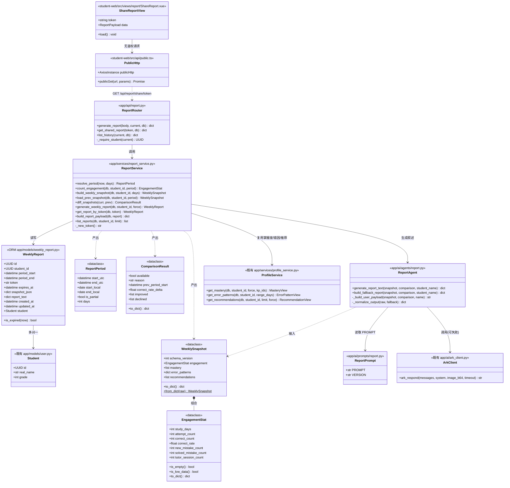
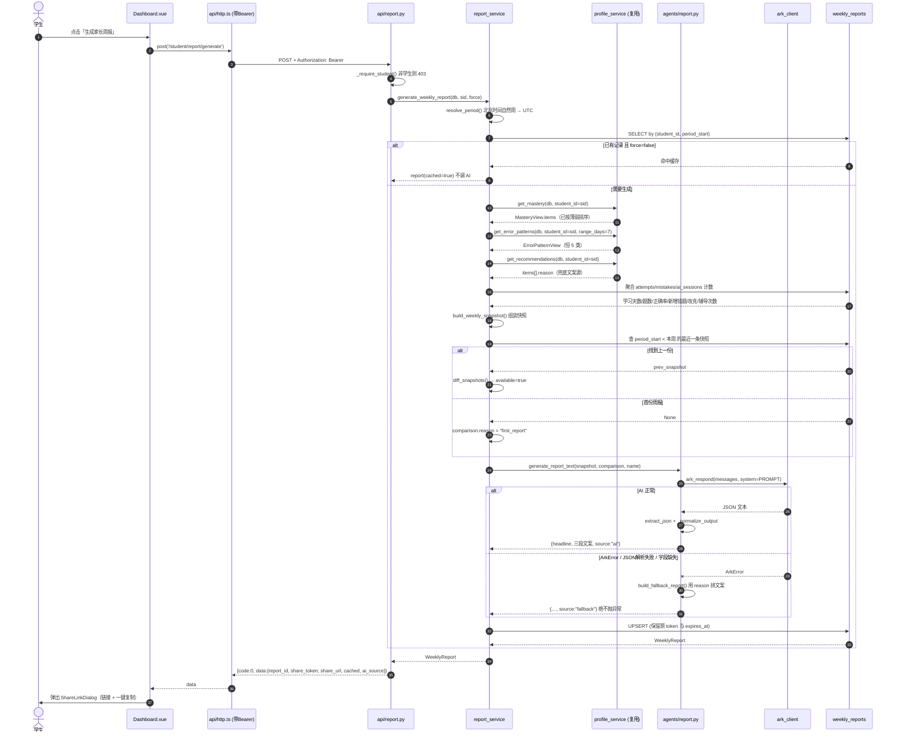
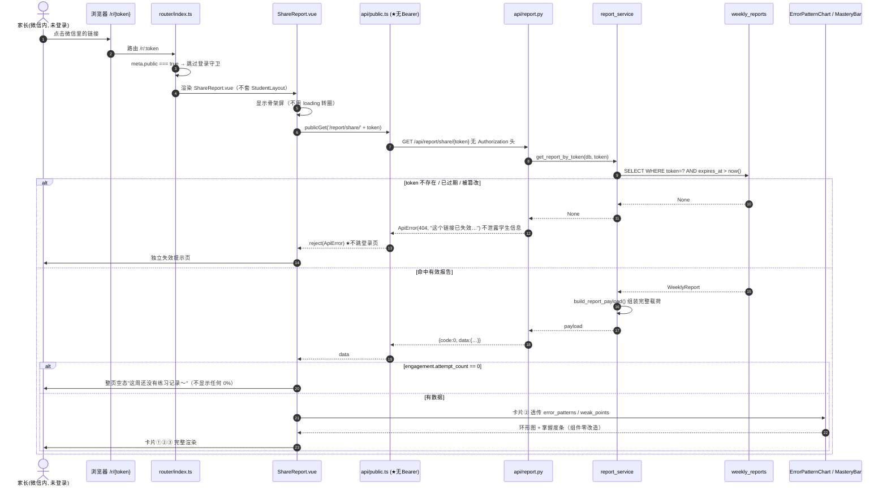
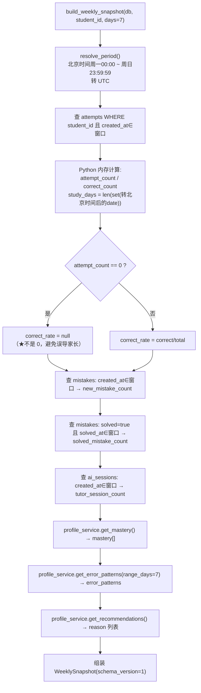
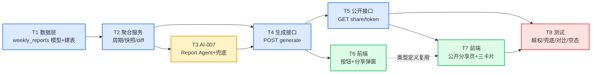

# Epic6 家长周报告 · 架构设计 + 任务分解

> 版本 v1.0 ｜ 撰写：架构师 高见远 ｜ 日期：D3
> 上游输入：`docs/epic6-parent-report-prd.md`（产品经理 许清楚）
> 关联任务：**AI-007 Report Agent** ／ **BACK-009 报告接口** ／ **FE-006 家长报告页**
> 本文所有代码引用均已对照仓库真实文件核实，标注为 `文件:行号`。

---

## 0. 给老板的三句话

| # | 关键决策 | 一句话解释 |
|---|---|---|
| 1 | **不建家长账号，用"带令牌的分享链接"** | 家长在微信里点开就能看，零注册。链接 30 天有效，过期让孩子重发一条。 |
| 2 | **新建一张 `weekly_reports` 快照表** | 现有系统只存"当前水平"、不存历史（`upsert_mastery` 覆盖式写入）。所以每次生成周报时顺手把当周数据"拍照存档"，下周才能算出"比上周进步了多少"。 |
| 3 | **AI 挂了也必须出报告** | 报告第三张卡片（AI 老师建议）如果大模型调用失败，自动降级用后端已经拼好的中文推荐理由，家长完全无感知，页面不报错。 |

**工期预估**：后端 5 个任务 + 前端 2 个任务 + 测试 1 个任务，共 8 个任务，串行约 2.5 个工作日，前后端并行约 1.5 天。

---

## 1. 现状核查结论（先读代码，再做设计）

本章是设计的地基。以下结论**全部来自真实代码**，不是假设。

### 1.1 可以直接复用的资产（不重复造轮子）

| 资产 | 位置 | 复用方式 | 核实结论 |
|---|---|---|---|
| 错因分布 | `profile_service.get_error_patterns()` `profile_service.py:671` | 直接传 `range_days=7` | ✅ 签名为 `(db, *, student_id, range_days)`，返回 `ErrorPatternView`，恒返回 5 类 |
| 五类错因枚举 | `core/error_categories.py:33` | 唯一真相源 | ✅ `ERROR_CATEGORIES` = KNOWLEDGE/METHOD/READ/CHECK/CALC，前后端已统一 |
| 知识点掌握度 | `profile_service.get_mastery()` `profile_service.py:613` | 取 `items[:3]` 即 Top3 薄弱项 | ✅ `profile_service.py:660` 已按「等级升序 → 错误率降序」排好，取前 3 条即可 |
| 推荐理由（AI 兜底文案） | `profile_service.get_recommendations()` `profile_service.py:751` | 取 `items[].reason` | ✅ `api/profile.py:89` 确认 `reason` 是后端拼好的完整中文句子 |
| 大模型调用 | `ai/ark_client.py:198` `ark_respond(messages=..., system=...)` | Report Agent 原样复用 | ✅ 失败抛 `ArkError`（`ark_client.py:50`），已内置 1 次重试 |
| 脏 JSON 解析 | `ai/agents/_json_utils.py::extract_json` | Report Agent 解析模型输出 | ✅ `agents/exercise.py:16` 已是这个用法 |
| 统一响应体 | `core/response.py` `ok()` / `fail()` / `ApiError` | 全部新接口沿用 | ✅ `{code, msg, data}`，`CODE_NOT_FOUND=404`（`response.py:33`） |
| 错因环形图组件 | `student-web/src/components/profile/ErrorPatternChart.vue` | **零改造复用** | ✅ props 为 `{ data: ErrorPatternData, loading, error }`，只要周报接口原样吐 `error_patterns` 结构即可 |
| 掌握度进度条 | `student-web/src/components/common/MasteryBar.vue` | **零改造复用** | ✅ props 为 `{ score, level, label }` |
| 五类错因中文标签/配色 | `student-web/src/types/profile.ts` 末尾 | 直接 import | ✅ `ERROR_CATEGORY_LABEL` / `ERROR_CATEGORY_COLOR` |

### 1.2 必须绕开的坑（4 个硬约束）

| # | 坑 | 证据 | 我们的对策 |
|---|---|---|---|
| **K1** | `/api/profile/*` 全部强制 `role=="student"`，否则 **403** | `api/profile.py:46-65` 的 `_require_student()`；`profile.py:137 / 183 / 231` 三个路由首行都调它 | 家长是**未登录**访问，**绝不能复用这些路由**。新建一条独立的公开路由 `GET /api/report/share/{token}`，走 token 校验、完全不碰 `get_current_user` |
| **K2** | `student_mastery` 是 upsert 覆盖式，**没有任何历史** | `profile_service.py:392` `upsert_mastery` 对 `(student_id, knowledge_point_id)` 唯一约束，重算直接覆盖同一行、刷新 `computed_at` | 新建 `weekly_reports` 快照表，生成周报时把当周掌握度+错因+计数**整体存档**，下周做 diff |
| **K3** | `attempts.duration_sec` **字段存在但全仓库零写入** | `models/learning.py:107` 定义了该列；`learning_service.record_attempt()` 创建 Attempt 时不传此参数 | **本期不做"学习时长"**。周报改用「学习天数 / 做题数 / 辅导次数」三个 100% 真实的计数（已锁决策 #2） |
| **K4** | 前端默认 axios 实例会注入 Bearer token，且 401 时**强制跳登录页** | `student-web/src/api/http.ts` 的 `handleUnauthorized()` 与请求拦截器 | 分享页必须用**独立的无鉴权 axios 实例**（新建 `api/public.ts`），且路由必须标 `meta.public`（`router/index.ts` 的 `beforeEach` 只放行 `meta.public`） |

### 1.3 对 PRD 与任务书的三处路径修正

> 以下三处，PRD / 任务书写的路径与仓库现状不符，**以本文为准**。

| # | 原稿写法 | 仓库实际 | 修正 |
|---|---|---|---|
| M1 | prompt 放 `prompts/report_system.txt` | `app/ai/prompts/` 下**全是 `.py`**，每个模块导出 `PROMPT` + `VERSION` 两个常量（`prompts/__init__.py` 已写死此约定） | 改为 `app/ai/prompts/report.py`，导出 `PROMPT`、`VERSION` |
| M2 | 前端画像页在 `views/profile/` | 仓库无此目录，画像页是 **`src/views/Dashboard.vue`**，路由名 `dashboard`，组件在 `src/components/profile/` | 「生成家长周报」按钮加在 `views/Dashboard.vue` |
| M3 | 建表走 migration | 项目**没有 Alembic**，只有手写 SQL：`migrations/001_init.sql`(PG) / `001_init_sqlite.sql` / `002_question_status.sql`，另有 `scripts/seed_db.py:84 ensure_schema()` | 建表 = ORM 模型 + 在 `models/__init__.py` 登记（测试靠 `create_all`）+ 补两份 SQL 供生产执行 |

---

## 2. 实现方案与技术选型

### 2.1 核心技术难点与解法

| 难点 | 解法 | 为什么这么选 |
|---|---|---|
| **家长免登录、又不能越权** | 服务端随机令牌（`secrets.token_urlsafe(24)`）落库，唯一索引 + `expires_at`；查询时按 token 精确匹配且校验未过期，任何不匹配统一返回 **404**（不区分"不存在"与"已过期"，避免探测） | 不选 JWT：JWT 无法主动撤销（P1 需求 R-12 要"学生可让链接失效"），且密钥轮换会让所有已发出的链接一起失效。随机令牌 + DB 查询最简单、可撤销、可审计 |
| **算不出"和上周比"** | 生成周报时落一张 `weekly_reports` 快照（`snapshot_json` 存当周掌握度+错因+计数），下次生成时读**上一条**快照做 diff | 报告本来就要缓存（避免重复烧 AI token），存快照的边际成本≈0，且顺带满足 P1 的历史周报列表（R-08） |
| **AI 不可靠** | Report Agent 分两层：`generate_report_text()` 调方舟；任何异常（`ArkError` / JSON 解析失败 / 字段缺失）都 catch 住，转调 `build_fallback_report()`，用 `get_recommendations().reason` 拼降级文案，并把 `source` 标为 `"fallback"` | 家长视角零感知，符合 PRD 验收项 V4；`source` 字段留给运营侧统计 AI 成功率 |
| **"自然周"与 UTC 存储冲突** | 库里全是 UTC（`models/base.py::utcnow`），但"这周"是北京时间概念。统一在 `report_service` 里用 `Asia/Shanghai`(UTC+8) 算出周一 00:00 ~ 周日 23:59:59，再转成 UTC 去查库 | 不处理会导致周日晚上生成的报告把周日整天算到"下周"，家长直接看出数字不对 |
| **"学习天数"跨方言难算** | 不用 SQL 的 `date()`（PG 与 SQLite 语法不同），改为把窗口内 `attempts.created_at` 全部取出，在 Python 里转北京时间后 `len(set(d.date()))` | 项目强制双方言兼容（`models/base.py` 开头已声明），单学生周内作答量级 < 200 行，内存计算无性能问题 |
| **重复点击"生成"** | `(student_id, period_start)` 唯一约束。重复生成 = **原地更新** `snapshot_json` / `report_text`，**但保留原 token 与 expires_at** | 关键：家长可能已经收到链接了。如果重新生成时换 token，家长手上的链接会直接失效——这是最容易踩的产品事故 |

### 2.2 框架选型（全部沿用现有栈，零新增基础设施）

| 层 | 选型 | 说明 |
|---|---|---|
| 后端框架 | FastAPI（现有） | 新增 `app/api/report.py` 一个 router，在 `app/api/__init__.py` 收口 |
| ORM | SQLAlchemy 2.0 Declarative（现有） | 复用 `models/base.py` 的 `GUID` / `JSONType` / `uuid_pk` 跨方言类型 |
| 大模型 | 火山方舟 Responses API（现有 `ark_client`） | **不新增任何 SDK** |
| 令牌生成 | Python 标准库 `secrets` | 无新依赖 |
| 时区 | Python 标准库 `datetime.timezone(timedelta(hours=8))` | 不引 `pytz`；不用 `zoneinfo`（Windows 需额外装 tzdata） |
| 前端 | Vue3 + Vite + TS + Tailwind（现有） | **零新增 npm 依赖**（图表是原生 SVG，无 ECharts） |
| 前端状态 | 轻量 `reactive()` 模块（现有约定，项目**未引 pinia**） | 见 `stores/auth.ts` 开头注释 |

### 2.3 架构分层图

```mermaid
graph TB
    subgraph FE["前端 student-web"]
        DASH["Dashboard.vue<br/>学习画像页<br/>+ 生成周报按钮"]
        DLG["ShareLinkDialog.vue<br/>链接弹窗 + 复制"]
        SHARE["views/report/ShareReport.vue<br/>公开分享页 meta.public"]
        CARDS["ReportOverviewCard<br/>ReportProgressCard<br/>ReportAdviceCard"]
        REUSE["复用: ErrorPatternChart<br/>MasteryBar / DonutChart"]
        HTTP["api/http.ts<br/>带 Bearer"]
        PUB["api/public.ts<br/>★无鉴权实例"]
    end

    subgraph API["接口层 app/api/report.py"]
        GEN["POST /api/student/report/generate<br/>鉴权: 学生本人"]
        SH["GET /api/report/share/token<br/>★公开 无登录"]
        HIS["GET /api/student/report/history<br/>P1"]
    end

    subgraph SVC["服务层 app/services/report_service.py"]
        PERIOD["resolve_period 自然周"]
        SNAP["build_weekly_snapshot 聚合"]
        DIFF["diff_snapshots 环比"]
        GENSVC["generate_weekly_report 编排"]
        TOKEN["get_report_by_token 校验"]
    end

    subgraph AI["AI 层 app/ai"]
        AGENT["agents/report.py<br/>generate_report_text<br/>+ build_fallback_report"]
        PROMPT["prompts/report.py<br/>PROMPT / VERSION"]
        ARK["ark_client.ark_respond"]
    end

    subgraph REUSESVC["复用: profile_service"]
        GM["get_mastery"]
        GEP["get_error_patterns range_days=7"]
        GR["get_recommendations"]
    end

    subgraph DB["数据层"]
        WR[("weekly_reports<br/>★新建")]
        OLD[("attempts / mistakes<br/>ai_sessions / students")]
    end

    DASH --> DLG
    DASH --> HTTP
    SHARE --> CARDS
    SHARE --> REUSE
    SHARE --> PUB
    HTTP --> GEN
    PUB --> SH
    GEN --> GENSVC
    SH --> TOKEN
    HIS --> GENSVC
    GENSVC --> PERIOD
    GENSVC --> SNAP
    GENSVC --> DIFF
    GENSVC --> AGENT
    AGENT --> PROMPT
    AGENT --> ARK
    AGENT -. AI失败兜底 .-> GR
    SNAP --> GM
    SNAP --> GEP
    SNAP --> GR
    SNAP --> OLD
    GENSVC --> WR
    TOKEN --> WR
```



---

## 3. 文件列表

> 图例：🆕 新增 ｜ ✏️ 修改 ｜ 路径均相对仓库根 `D:/制作网页/cuotixiaolaoshi/`

### 3.1 后端

| 状态 | 文件 | 职责 | 归属任务 |
|---|---|---|---|
| 🆕 | `backend/app/models/weekly_report.py` | `WeeklyReport` ORM 模型 | T1 |
| ✏️ | `backend/app/models/__init__.py` | 登记新模型（**不登记 `create_all` 不建表，测试会全挂**，见文件头警告） | T1 |
| 🆕 | `backend/migrations/003_weekly_reports.sql` | PostgreSQL 建表 DDL | T1 |
| 🆕 | `backend/migrations/003_weekly_reports_sqlite.sql` | SQLite 建表 DDL | T1 |
| ✏️ | `backend/app/core/constants.py` | 追加 `REPORT_*` 常量（周期天数、token 长度、有效期天数、错误码） | T1 |
| 🆕 | `backend/app/services/report_service.py` | 周期计算 / 快照聚合 / 环比 diff / 生成编排 / token 查询 | T2、T4、T5 |
| 🆕 | `backend/app/ai/prompts/report.py` | 家长周报提示词，导出 `PROMPT` + `VERSION` | T3 |
| ✏️ | `backend/app/ai/prompts/__init__.py` | 追加 `report` 到 import 与 `__all__` | T3 |
| 🆕 | `backend/app/ai/agents/report.py` | Report Agent：`generate_report_text()` + `build_fallback_report()` | T3 |
| ✏️ | `backend/app/ai/agents/__init__.py` | 导出 Report Agent | T3 |
| 🆕 | `backend/app/schemas/report.py` | 响应 Pydantic 模型（**snake_case，禁止继承 `BaseSchema`**，见 `schemas/profile.py:1-13` 的说明） | T4 |
| 🆕 | `backend/app/api/report.py` | 三条路由 + 学生鉴权 helper + 公开路由 | T4、T5 |
| ✏️ | `backend/app/api/__init__.py` | `api_router.include_router(report.router)` | T4 |
| ✏️ | `backend/app/core/config.py` | 新增 `public_base_url` 配置项（拼分享 URL 用） | T4 |
| ✏️ | `backend/.env.example` | 补 `PUBLIC_BASE_URL=` 示例 | T4 |
| 🆕 | `backend/tests/test_epic6_report.py` | Epic6 全量测试（12+ 用例） | T8 |
| 🆕 | `backend/tests/e6_helpers.py` | 造数 helper（建学生、灌 attempts/mistakes/sessions） | T8 |

### 3.2 前端

| 状态 | 文件 | 职责 | 归属任务 |
|---|---|---|---|
| 🆕 | `student-web/src/types/report.ts` | 周报数据类型定义（与后端 snake_case 一一对应） | T6 |
| 🆕 | `student-web/src/api/public.ts` | **无鉴权 axios 实例**（不注入 token、401 不跳登录） | T7 |
| 🆕 | `student-web/src/api/report.ts` | `generateReport()`（走 http.ts）+ `getSharedReport()`（走 public.ts） | T6、T7 |
| 🆕 | `student-web/src/components/report/ShareLinkDialog.vue` | 生成成功弹窗：展示链接 + 一键复制 | T6 |
| ✏️ | `student-web/src/views/Dashboard.vue` | 顶部加「生成家长周报」按钮 + 挂弹窗 | T6 |
| 🆕 | `student-web/src/components/report/ReportOverviewCard.vue` | 卡片①本周学习概览（三个大数字 + 次要计数） | T7 |
| 🆕 | `student-web/src/components/report/ReportProgressCard.vue` | 卡片②能力变化（错因环形图 + Top3 掌握度条 + 环比） | T7 |
| 🆕 | `student-web/src/components/report/ReportAdviceCard.vue` | 卡片③AI 老师给家长的话 | T7 |
| 🆕 | `student-web/src/views/report/ShareReport.vue` | 公开分享页（极简布局，不套 `StudentLayout`） | T7 |
| ✏️ | `student-web/src/router/index.ts` | 注册 `/r/:token` 路由，**必须 `meta: { public: true }`** | T7 |

**统计**：新增 20 个文件，修改 8 个文件。前端零新增 npm 依赖，后端零新增 pip 依赖。

---

## 4. 数据结构与接口

### 4.1 `weekly_reports` 表结构

| 字段 | 类型 | 约束 | 说明 |
|---|---|---|---|
| `id` | GUID | PK | `uuid_pk()`，Python 侧 `uuid4()` 生成 |
| `student_id` | GUID | FK→`students.id` ON DELETE CASCADE, index | 所属学生 |
| `period_start` | DateTime(tz) | NOT NULL | 周期起（北京时间周一 00:00 → 存 UTC） |
| `period_end` | DateTime(tz) | NOT NULL | 周期止（北京时间周日 23:59:59 → 存 UTC） |
| `token` | String(64) | **NOT NULL, UNIQUE, index** | 分享令牌，`secrets.token_urlsafe(24)`（32 字符） |
| `expires_at` | DateTime(tz) | NOT NULL, index | 生成时刻 + 30 天 |
| `snapshot_json` | JSONType | NOT NULL, default `{}` | 当周快照：掌握度 + 错因 + 计数（详见 §4.2） |
| `report_text` | JSONType | NOT NULL, default `{}` | Report Agent 输出（headline / 三段文案 / source） |
| `created_at` | DateTime(tz) | NOT NULL, default `utcnow` | 首次生成时间 |
| `updated_at` | DateTime(tz) | NOT NULL, onupdate `utcnow` | 最近重新生成时间（前端显示"更新于"） |

**索引与约束**：

```sql
UNIQUE (student_id, period_start)        -- 同一学生同一周只有一份，重复生成 = 原地更新
UNIQUE (token)                           -- 令牌全局唯一
INDEX  idx_weekly_reports_student_period (student_id, period_start DESC)  -- 查上一份快照 / 历史列表
INDEX  idx_weekly_reports_token_expires  (token, expires_at)              -- 公开接口查询路径
```

> ⚠️ **重复生成时 `token` 与 `expires_at` 保持不变**。原因：家长可能已经拿到链接了，换 token 会让在手的链接直接失效。
> 只有当 `expires_at` 已过期时，才顺手把它续到 `now + 30d`（相当于"重新激活"）。

### 4.2 `snapshot_json` 结构（快照契约，跨周比较的基石）

```jsonc
{
  "schema_version": 1,                    // ★ 必须有：以后改结构时 diff 逻辑要能识别老快照
  "engagement": {
    "study_days": 4,                      // 窗口内 attempts.created_at 去重日期数（北京时间）
    "attempt_count": 32,                  // 窗口内 attempts 行数
    "correct_count": 25,
    "correct_rate": 0.7813,               // attempt_count=0 时为 null，不是 0
    "new_mistake_count": 5,               // mistakes.created_at 落窗口
    "solved_mistake_count": 3,            // mistakes.solved=true 且 solved_at 落窗口
    "tutor_session_count": 6              // ai_sessions.created_at 落窗口
  },
  "mastery": [                            // 全量，取自 get_mastery().items（已按薄弱排序）
    { "kp_id": "...", "kp_name": "分数加减法", "score": 0.42, "level": 1, "error_rate": 0.6 }
  ],
  "error_patterns": {                     // ★ 与 GET /api/profile/error-patterns 的 data 完全同构
    "student_id": "...",
    "error_patterns": [ { "category": "CALC", "label": "计算错", "count": 8, "ratio": 0.47, "sample_hits": [] } ],
    "total_mistakes": 17,
    "unmapped_mistakes": 0,
    "range_days": 7,
    "computed_at": "2026-01-11T12:30:00+00:00",
    "mode": "fresh"
  },
  "recommendations": [                    // 取自 get_recommendations()，只留兜底所需字段
    { "kp_id": "...", "kp_name": "分数加减法", "reason": "「分数加减」错了 60%……", "top_error_category": "CALC" }
  ]
}
```

> **为什么 `error_patterns` 要嵌套一层同名字段？**
> 因为要让前端 `ErrorPatternChart.vue` **零改造**复用——它的 props 就是 `ErrorPatternData` 这个完整结构（`components/profile/ErrorPatternChart.vue:20-24`）。多包一层，省掉前端一层字段映射和一批潜在 bug。

### 4.3 `report_text` 结构（Report Agent 输出契约）

```jsonc
{
  "headline": "小明这周挺用功，练了 32 道题，主要卡在分数加减的计算上。",
  "overview_text": "这周小明学了 4 天，一共做了 32 道题……",     // 对应卡片③第①段
  "progress_text": "和上周比，正确率提高了 6%……",                // 对应卡片③第②段
  "advice_items": [                                              // 2~3 条，每条必须"做什么+多少"
    "每天 10 分钟分数加减口算，连做 5 天",
    "做完让他自己检查一遍再交",
    "小数乘法的错题重做一次"
  ],
  "source": "ai",                        // "ai" | "fallback"，运营侧统计 AI 成功率用
  "prompt_version": "1.0.0"              // 对齐 prompts/report.py 的 VERSION，便于回溯
}
```

### 4.4 接口契约

#### ① `POST /api/student/report/generate` — 生成周报（鉴权：学生本人）

| 项 | 内容 |
|---|---|
| 鉴权 | `Depends(get_current_user)` + 本模块 `_require_student()`（同 `api/profile.py:46` 口径，非学生 403） |
| 入参（body，全可选） | `{ "force": false }` — `force=true` 跳过缓存强制重算 + 重调 AI |
| 幂等 | 同一 `(student_id, 本周period_start)` 已有记录且 `force=false` → **直接返回缓存**，不烧 AI token |

```jsonc
// 200 OK
{ "code": 0, "msg": "ok", "data": {
    "report_id":    "9f1c…",
    "share_token":  "kJ3xQ7…",
    "share_url":    "https://xxx/r/kJ3xQ7…",     // settings.public_base_url + /r/{token}
    "period_start": "2026-01-05T00:00:00+08:00",
    "period_end":   "2026-01-11T23:59:59+08:00",
    "is_partial":   true,                         // 本周还没结束
    "expires_at":   "2026-02-10T12:30:00+00:00",
    "cached":       false,                        // true=命中缓存未重算
    "ai_source":    "ai"                          // ai | fallback
}}
```

**错误口径**：401 未登录 ／ 403 非学生本人 ／ **计算失败仍返回 HTTP 200 + `code=5001`**（沿用 `api/profile.py:98-112` 的降级约定）。

#### ② `GET /api/report/share/{token}` — 公开只读（★无登录）

| 项 | 内容 |
|---|---|
| 鉴权 | **无**。路由函数签名里**不得出现 `Depends(get_current_user)`** |
| 校验 | `token` 精确匹配 且 `expires_at > now()` |
| 失败 | 一律 `ApiError(404, "这个链接已失效，请让孩子重新生成一份")`，**不区分不存在/已过期**，不泄露学生是否存在 |

```jsonc
// 200 OK — 完整周报载荷（前端直接渲染，不做二次计算）
{ "code": 0, "msg": "ok", "data": {
  "student":  { "display_name": "小明", "grade": 4 },      // real_name 为空时降级为「孩子」
  "period":   { "start": "2026-01-05", "end": "2026-01-11", "is_partial": true },

  "engagement": {
    "study_days": 4, "attempt_count": 32, "correct_count": 25, "correct_rate": 0.7813,
    "new_mistake_count": 5, "solved_mistake_count": 3, "tutor_session_count": 6
  },

  "error_patterns": { /* 与 /api/profile/error-patterns 的 data 同构 → ErrorPatternChart 零改造 */ },

  "weak_points": [                                          // Top3，字段直喂 MasteryBar
    { "kp_id": "...", "kp_name": "分数加减法", "score": 0.42, "level": 1,
      "error_rate": 0.6, "prev_score": 0.34, "delta": 0.08 }
  ],

  "comparison": {
    "available": false,                                     // 首份周报为 false
    "reason": "first_report",                               // first_report | ok
    "prev_period_start": null,
    "correct_rate_delta": null,                             // 例：+0.06
    "improved": [ { "kp_name": "小数乘法", "delta": 0.12 } ],
    "declined": []
  },

  "narrative": { "headline": "…", "overview_text": "…", "progress_text": "…",
                 "advice_items": ["…"], "source": "ai" },

  "empty_state": { "is_empty": false, "message": null },    // 本周零练习时 is_empty=true
  "low_data":    { "is_low": false, "message": null },      // 练习 <3 题时给"仅供参考"提示

  "generated_at": "2026-01-11T20:30:00+08:00",
  "expires_at":   "2026-02-10T20:30:00+08:00"
}}
```

#### ③ `GET /api/student/report/history` — 历史周报列表（P1，鉴权：学生本人）

```jsonc
{ "code": 0, "msg": "ok", "data": { "items": [
    { "report_id": "…", "period_start": "2026-01-05", "period_end": "2026-01-11",
      "share_token": "…", "expires_at": "…", "created_at": "…", "is_expired": false }
], "total": 3 }}
```

### 4.5 类图



---

## 5. 程序调用流程

### 5.1 主流程①：学生生成周报（含 AI 兜底）



### 5.2 主流程②：家长打开分享链接（免登录）



### 5.3 关键分支：`build_weekly_snapshot` 内部聚合



---

## 6. 依赖包列表

### 6.1 后端 — **零新增依赖**

| 包 | 状态 | 用途 |
|---|---|---|
| `fastapi` / `sqlalchemy` / `pydantic` / `httpx` | ✅ 已在 `requirements.txt` | 无需改动 |
| `secrets`（标准库） | 内置 | 生成分享令牌 `token_urlsafe(24)` |
| `datetime.timezone` / `timedelta`（标准库） | 内置 | UTC+8 周期计算，**不引 pytz / zoneinfo** |

> **明确不引入**：`APScheduler`（定时生成已排 P2）、`pyjwt` 二次封装（令牌用随机串不用 JWT）、`pytz`。

### 6.2 前端 — **零新增依赖**

| 包 | 状态 | 用途 |
|---|---|---|
| `axios@^1.7.7` | ✅ 已有 | `api/public.ts` 用 `axios.create()` 建独立实例 |
| `vue@^3.4.38` / `vue-router@^4.4.5` / `tailwindcss@^3.4.11` | ✅ 已有 | 无需改动 |

> **明确不引入**：ECharts / Chart.js（现有 `DonutChart.vue` 是原生 SVG，够用）、二维码库（P1 再说）、`clipboard.js`（用原生 `navigator.clipboard` + `document.execCommand` 兜底）。

### 6.3 新增配置项

| 环境变量 | 默认值 | 说明 |
|---|---|---|
| `PUBLIC_BASE_URL` | `http://localhost:5173` | 拼分享链接的站点前缀。生产必须改成真实域名，否则发给家长的链接打不开 |

---

## 7. 任务列表（按实现顺序，含依赖）

### 7.1 任务总览

| ID | 任务 | 归属 | 涉及文件数 | 依赖 | 优先级 | 预估 |
|---|---|---|---|---|---|---|
| **T1** | 数据层：`weekly_reports` 模型 + 建表 + 常量 | BACK-009 | 5 | — | P0 | 0.5h |
| **T2** | 聚合服务：周期计算 + `build_weekly_snapshot` + diff | BACK-009 | 1 | T1 | P0 | 3h |
| **T3** | AI-007：Report Agent + Prompt + 兜底 | AI-007 | 4 | T2 | P0 | 3h |
| **T4** | 生成接口 `POST /student/report/generate` | BACK-009 | 6 | T2, T3 | P0 | 2h |
| **T5** | 公开接口 `GET /report/share/{token}` + 历史列表 | BACK-009 | 2 | T4 | P0 | 1.5h |
| **T6** | 前端：生成按钮 + 分享弹窗 | FE-006 | 4 | T4 | P0 | 2h |
| **T7** | 前端：公开分享页 + 三张卡片 | FE-006 | 6 | T5 | P0 | 4h |
| **T8** | 测试：越权 / 兜底 / 快照对比 / 空态 | 全部 | 2 | T5, T7 | P0 | 3h |

**合计 8 个任务，约 19 人时。**

### 7.2 并行波次（前后端协作建议）

| 波次 | 可同时开工的任务 | 说明 |
|---|---|---|
| W1 | T1 | 地基，必须最先做完 |
| W2 | T2 → T3 | 后端串行 |
| W3 | **T4 ‖ T6 前置准备** | T4 完成即可解锁 T6；前端可先按 §4.4 契约写 `types/report.ts` mock 联调 |
| W4 | **T5 ‖ T6** | 后端做公开接口，前端做生成按钮 |
| W5 | **T7 ‖ T8 后端部分** | 前端做分享页，测试可先写后端用例 |
| W6 | T8 收口 | 全链路验收 |

### 7.3 任务详情

---

#### **T1 · 数据层：`weekly_reports` 模型 + 建表 + 常量**

| 项 | 内容 |
|---|---|
| 依赖 | 无（第一个任务） |
| 涉及文件 | 🆕 `backend/app/models/weekly_report.py`<br>✏️ `backend/app/models/__init__.py`<br>🆕 `backend/migrations/003_weekly_reports.sql`<br>🆕 `backend/migrations/003_weekly_reports_sqlite.sql`<br>✏️ `backend/app/core/constants.py` |

**做什么**
1. 按 §4.1 建 `WeeklyReport` 模型。**必须**复用 `models/base.py` 的 `GUID()` / `JSONType()` / `uuid_pk()` / `utcnow`，禁止直接用 PG 专属类型（项目强制 PG+SQLite 双方言）。
2. 加 `is_expired(now=None) -> bool` 实例方法。
3. **在 `app/models/__init__.py` 登记**（import + `__all__`）。该文件头部有明确警告：不登记 `create_all()` 不会建表，测试全挂。
4. 两份 SQL DDL，风格参照 `migrations/002_question_status.sql`（含幂等说明注释）。
5. `constants.py` 追加：`REPORT_PERIOD_DAYS=7`、`REPORT_TOKEN_BYTES=24`、`REPORT_SHARE_TTL_DAYS=30`、`REPORT_WEAK_POINT_TOP_N=3`、`REPORT_LOW_DATA_THRESHOLD=3`、`REPORT_SNAPSHOT_SCHEMA_VERSION=1`、`CODE_REPORT_GENERATE_FAILED=5002`、`LOCAL_TZ_OFFSET_HOURS=8`。

**完成标志**：`pytest` 全绿（118 条不掉）；`python -c "from app.models import WeeklyReport"` 成功；SQLite 内存库 `create_all()` 能建出 `weekly_reports` 表。

---

#### **T2 · 聚合服务：周期计算 + 快照构建 + 环比 diff**

| 项 | 内容 |
|---|---|
| 依赖 | **T1** |
| 涉及文件 | 🆕 `backend/app/services/report_service.py`（本任务只写纯计算部分，不碰 AI 与落库） |

**做什么**
1. `resolve_period(now=None, days=7) -> ReportPeriod`：用 `LOCAL_TZ = timezone(timedelta(hours=8))` 算北京时间自然周（周一 00:00:00 ~ 周日 23:59:59），转 UTC 返回；`is_partial = 今天 < 周日`。
2. `count_engagement(db, student_id, period) -> EngagementStat`：
   - `attempts`：窗口内取 `created_at` 与 `is_correct`，Python 内存算 `attempt_count` / `correct_count` / `study_days`（**`created_at` 先转北京时间再取 `.date()` 去重**）。
   - **`attempt_count == 0` 时 `correct_rate` 必须是 `None`，不是 `0.0`**（PRD G3/R-06 硬要求）。
   - `mistakes`：`created_at ∈ 窗口` → 新增数；`solved == True 且 solved_at ∈ 窗口` → 攻克数。
   - `ai_sessions`：`created_at ∈ 窗口` → 辅导次数。
   - ⚠️ **禁止用 SQL 的 `date()` / `DATE_TRUNC`**（PG 与 SQLite 语法不同）。
3. `build_weekly_snapshot(db, student_id, days=7) -> WeeklySnapshot`：调 §1.1 三个 `profile_service` 函数 + `count_engagement`，组装成 §4.2 结构。`error_patterns` **必须保持与 `/api/profile/error-patterns` 的 data 完全同构**（含 `student_id`/`computed_at`/`mode` 字段），前端才能零改造。
4. `load_prev_snapshot(db, student_id, period)`：查 `period_start < 本周 period_start` 的最近一条，`ORDER BY period_start DESC LIMIT 1`。
5. `diff_snapshots(curr, prev) -> ComparisonResult`：`prev is None` → `available=false, reason="first_report"`；否则算整体 `correct_rate_delta`（任一侧为 `None` 时该项也给 `None`）+ 按 `kp_id` 匹配算 `improved` / `declined`（阈值 ±0.05 才算变化，避免噪声）。兼容老 `schema_version`。

**完成标志**：单测覆盖 —— 跨周边界（周日 23:59 与周一 00:01 分属两周）、零数据学生（`correct_rate is None`）、首周无基线、快照往返序列化。

---

#### **T3 · AI-007：Report Agent + Prompt + 兜底**

| 项 | 内容 |
|---|---|
| 依赖 | **T2**（需要 `WeeklySnapshot` / `ComparisonResult` 结构） |
| 涉及文件 | 🆕 `backend/app/ai/prompts/report.py`<br>✏️ `backend/app/ai/prompts/__init__.py`<br>🆕 `backend/app/ai/agents/report.py`<br>✏️ `backend/app/ai/agents/__init__.py` |

**做什么**
1. `prompts/report.py`：导出 `PROMPT` + `VERSION="1.0.0"`（**这是 `prompts/__init__.py` 里写死的模块契约，必须两个都有**）。
   - 底稿取自旧 Demo `index.html:677` 的 `REPORT_PROMPT` 与 `index.html:2136` 的 `WEEKLY_PROMPT`。
   - **必须把旧的四类错因改成现行五类**（`error_categories.ERROR_LABELS`：读题错/方法错/计算错/知识点缺/检查漏）。
   - 硬约束写进 Prompt：① 读者是家长不是学生 ② 不得臆造任何知识点，只能用输入里给的 ③ 不出现"掌握度 0.62""EWMA""CALC"等黑话 ④ 不出现"AI"字样 ⑤ 弱项用中性词（"还需要多练"）不吓唬家长 ⑥ 建议 2~3 条，每条必须含"做什么 + 多少量" ⑦ **只输出 JSON**，结构见 §4.3。
2. `agents/report.py`：
   - `generate_report_text(snapshot, comparison, student_name) -> dict`：`_build_user_payload()` 把快照压成紧凑中文描述（**只喂真实知识点名与真实数字**）→ `ark_respond(messages=[{"role":"user","content":payload}], system=report_prompt.PROMPT)` → `_json_utils.extract_json()` → `_normalize_output()` 收敛字段。
   - `build_fallback_report(snapshot, comparison, student_name) -> dict`：用 `snapshot.recommendations[].reason` 拼 `advice_items`（取前 3 条），`headline` 用模板拼真实计数，`source="fallback"`。
   - **`generate_report_text` 内部 catch `ArkError` 与所有解析异常，直接返回 `build_fallback_report()` 的结果，对外永不抛异常、永不返回空**。
   - 结构参照 `agents/exercise.py`（同构：`_normalize_*` 系列 + 模块级 `__all__`）。

**完成标志**：monkeypatch `ark_respond` 抛 `ArkError` → 仍返回完整结构且 `source == "fallback"`；返回脏 JSON（带 ```json 包裹 / 缺字段）→ 能正常收敛；`advice_items` 恒为 2~3 条非空字符串。

---

#### **T4 · 生成接口 `POST /api/student/report/generate`**

| 项 | 内容 |
|---|---|
| 依赖 | **T2, T3** |
| 涉及文件 | ✏️ `backend/app/services/report_service.py`（补落库编排）<br>🆕 `backend/app/schemas/report.py`<br>🆕 `backend/app/api/report.py`<br>✏️ `backend/app/api/__init__.py`<br>✏️ `backend/app/core/config.py`<br>✏️ `backend/.env.example` |

**做什么**
1. `report_service.generate_weekly_report(db, student_id, force=False) -> WeeklyReport`：
   - 查 `(student_id, period_start)`；命中且 `force=False` → 直接返回（`cached=True`），**不调 AI**。
   - 否则 `build_weekly_snapshot` → `load_prev_snapshot` → `diff_snapshots` → `ReportAgent`。
   - **UPSERT 规则（关键）**：已有记录则原地更新 `snapshot_json` / `report_text` / `updated_at`，**保留原 `token`**；仅当 `expires_at` 已过期才续期到 `now + 30d`。新建时 `token = secrets.token_urlsafe(24)`，`expires_at = now + 30d`。
   - `db.commit()` 在服务层做（与 `profile_service` 现有风格一致）。
2. `app/schemas/report.py`：Pydantic 响应模型。**必须直接继承 `pydantic.BaseModel`，禁止继承 `schemas/common.BaseSchema`**——后者的 `alias_generator` 会把 `kp_id` 变成 `kpId`，前端复用直接报废（原因见 `schemas/profile.py:1-13`）。
3. `app/api/report.py`：
   - 本模块自带 `_require_student(current)`，逐字对齐 `api/profile.py:46-65`（非学生 / 未绑定 → `ApiError(CODE_FORBIDDEN)`）。
   - 用**同步 `def`** 路由（与 `profile.py` / `mistake.py` 一致，FastAPI 自动丢线程池）。
   - 异常时 `db.rollback()` + 返回 `fail(CODE_REPORT_GENERATE_FAILED, ..., 空壳)`，**HTTP 仍 200**（沿用 `api/profile.py:98-112`）。
4. `config.py` 加 `public_base_url: str = "http://localhost:5173"`；`share_url = f"{settings.public_base_url.rstrip('/')}/r/{token}"`。
5. `api/__init__.py` 追加 `from app.api import report` 与 `api_router.include_router(report.router)`，并在文件头注释里登记（该文件是团队约定的"路由注册中心"）。

**完成标志**：学生 token 调用返回 `share_url`；重复调用 `cached=true` 且 `share_token` **不变**；非学生角色 403；`/docs` 能看到新接口。

---

#### **T5 · 公开接口 `GET /api/report/share/{token}` + 历史列表**

| 项 | 内容 |
|---|---|
| 依赖 | **T4** |
| 涉及文件 | ✏️ `backend/app/services/report_service.py`（补 `get_report_by_token` / `build_report_payload` / `list_reports`）<br>✏️ `backend/app/api/report.py` |

**做什么**
1. `get_report_by_token(db, token) -> WeeklyReport | None`：`WHERE token == ? AND expires_at > utcnow()`。空 token / 超长 token 直接返 `None`，不进 DB。
2. `build_report_payload(db, report) -> dict`：按 §4.4② 组装完整载荷。
   - `student.display_name`：`students.real_name` 为空时降级为 `"孩子"`（**绝不显示手机号或 ID**）。
   - `weak_points`：取快照 `mastery[:3]`（已排序），逐条附 `prev_score` / `delta`。
   - `empty_state.is_empty = (engagement.attempt_count == 0)`。
   - `low_data.is_low = (0 < attempt_count < 3)`。
3. 路由 `GET /report/share/{token}`：
   - ⚠️ **函数签名里绝对不能出现 `Depends(get_current_user)`**，否则家长会吃 401。
   - 命中失败 → `raise ApiError(CODE_NOT_FOUND, "这个链接已失效，请让孩子重新生成一份")`，**不区分"不存在"与"已过期"**（PRD R-07 防探测）。
4. 路由 `GET /student/report/history`（P1）：鉴权同 T4，返回该学生全部周报摘要，按 `period_start DESC`。

**完成标志**：无 Authorization 头能拿到完整报告；伪造 token → 404 且响应体不含任何学生信息；过期报告 → 404。

---

#### **T6 · 前端：生成按钮 + 分享弹窗**

| 项 | 内容 |
|---|---|
| 依赖 | **T4** |
| 涉及文件 | 🆕 `student-web/src/types/report.ts`<br>🆕 `student-web/src/api/report.ts`（先只写 `generateReport`）<br>🆕 `student-web/src/components/report/ShareLinkDialog.vue`<br>✏️ `student-web/src/views/Dashboard.vue` |

**做什么**
1. `types/report.ts`：严格对照 §4.4 写 snake_case 接口类型；**复用** `types/profile.ts` 已有的 `ErrorPatternData` / `MasteryLevel` / `ERROR_CATEGORY_LABEL` / `ERROR_CATEGORY_COLOR`，不重复定义。
2. `api/report.ts`：`generateReport(force?)` → `post<GenerateResult>('/student/report/generate', { force })`（走带鉴权的 `http.ts`）。
3. `ShareLinkDialog.vue`：展示 `share_url`，「复制链接」按钮（`navigator.clipboard.writeText` + `document.execCommand('copy')` 兜底，微信内置浏览器兼容），提示"链接 30 天有效，发给家长即可查看"。
4. `Dashboard.vue`：顶部加「📤 生成家长周报」按钮。生成中禁用并显示"正在生成…（约 10 秒）"（AI 调用慢，`http.ts` 超时已设 90s）。失败用 `toMessage(err)` 提示，**不跳页**。

**完成标志**：`npm run typecheck` 通过；点击按钮能拿到链接并复制成功；重复点击不报错。

---

#### **T7 · 前端：公开分享页 + 三张卡片**

| 项 | 内容 |
|---|---|
| 依赖 | **T5**（也可先用 mock 数据并行开发） |
| 涉及文件 | 🆕 `student-web/src/api/public.ts`<br>✏️ `student-web/src/api/report.ts`（补 `getSharedReport`）<br>🆕 `student-web/src/components/report/ReportOverviewCard.vue`<br>🆕 `student-web/src/components/report/ReportProgressCard.vue`<br>🆕 `student-web/src/components/report/ReportAdviceCard.vue`<br>🆕 `student-web/src/views/report/ShareReport.vue`<br>✏️ `student-web/src/router/index.ts` |

**做什么**
1. `api/public.ts`：`axios.create({ baseURL: '/api', timeout: 20000 })`。
   - **不注册请求拦截器**（不注入 Bearer）。
   - 响应拦截**只拆 `{code,msg,data}` 外壳**，`code !== 0` 时 reject `ApiError`，**绝不调 `handleUnauthorized()`、绝不 `router.replace('/login')`**——这是本任务最容易抄错的地方。
2. `router/index.ts`：加**顶层**路由（不能放在 `StudentLayout` 的 children 下，家长页不要左侧导航）：
   ```ts
   { path: '/r/:token', name: 'share-report',
     component: () => import('@/views/report/ShareReport.vue'),
     meta: { public: true, title: '学习周报' } }
   ```
   ⚠️ 现有兜底路由 `{ path: '/:pathMatch(.*)*', redirect: { name: 'dashboard' } }` 在数组末尾，新路由必须加在它**之前**。
3. `ShareReport.vue`：从 `route.params.token` 取 token → 骨架屏 → `getSharedReport(token)`。
   - 失败（404）→ 独立失效提示页。
   - `empty_state.is_empty` → 整页鼓励性空态，**不渲染任何卡片、不出现 0%**。
   - 顶部极简品牌栏，底部"数据来自孩子 X~Y 的真实练习" + 转化入口。移动优先，`max-w-[480px] mx-auto`，375px 下无横向滚动。
4. 三张卡片：
   - `ReportOverviewCard`：三个大数字（题数 / 正确率 / 学习天数）+ 一行小字（新增错题、已攻克、辅导次数）。`correct_rate === null` 时显示 `—` 而非 `0%`。
   - `ReportProgressCard`：**直接把 `data.error_patterns` 透传给 `ErrorPatternChart`**（`:data / :loading="false" / :error="''"`，零改造）；Top3 用 `MasteryBar :score :level :label="kp_name"`；底部环比行 —— `comparison.available === false` 时显示"这是第一份周报，下周起可以看到进步对比 📈"；`low_data.is_low` 时加"本周练习较少，能力判断仅供参考"。
   - `ReportAdviceCard`：`headline` 加粗 → `overview_text` → `progress_text` → `advice_items` 有序列表。**`source==='fallback'` 时页面表现与 `'ai'` 完全一致**，不得出现任何"AI 生成失败"字样。

**完成标志**：`npm run typecheck` 通过；未登录隐身窗口直接打开 `/r/{token}` 能看到完整报告且**不跳登录页**；375px 无横向滚动；伪造 token 显示失效页。

---

#### **T8 · 测试：越权 / 兜底 / 快照对比 / 空态**

| 项 | 内容 |
|---|---|
| 依赖 | **T5, T7** |
| 涉及文件 | 🆕 `backend/tests/test_epic6_report.py`<br>🆕 `backend/tests/e6_helpers.py` |

**做什么**（用例清单，对齐 PRD §7 验收标准）

| 用例 | 覆盖 | 对应验收 |
|---|---|---|
| C1 | 学生生成周报 → 三块数据齐全，含 `share_token` / `share_url` | V1 |
| C2 | **无 Authorization 头** GET share → 200 且数据完整 | V2 |
| C3 | 伪造 / 篡改 token → 404，响应体不含任何学生字段 | V3 / R-07 |
| C4 | 手动把 `expires_at` 改到过去 → 404 | V3 / R-07 |
| C5 | monkeypatch `ark_respond` 抛 `ArkError` → 报告仍生成，`narrative.source == "fallback"`，`advice_items` 非空 | V4 |
| C6 | 零数据学生生成 → `empty_state.is_empty == true`，`correct_rate is None`（**断言不是 0**） | V5 |
| C7 | 报告中所有 `weak_points[].kp_name` 均能在该学生真实练习数据中查到 | V6 |
| C8 | 非学生角色（`role="parent"`）调 generate → **403** | K1 |
| C9 | 重复 generate（`force=false`）→ `cached == true` 且 `share_token` **不变** | 缓存/防换链接 |
| C10 | 造两周数据 → 第二份周报 `comparison.available == true` 且 `correct_rate_delta` 正确；第一份 `reason == "first_report"` | 已锁决策 #5 |
| C11 | 跨周边界：北京时间周日 23:59 与周一 00:01 的 attempt 分属不同周期 | 时区正确性 |
| C12 | `study_days` 去重正确（同一天 5 次作答只算 1 天） | 计数真实性 |
| C13 | `GET /student/report/history` 返回按 `period_start DESC` 排序 | P1 R-08 |

**约定**：用 `tests/conftest.py` 已有的 `client` / `auth_headers` / `new_phone` fixture；每个用例用 `new_phone()` 造独立学生（内存库是**会话级共享**的，不隔离会互相污染，见 `conftest.py` 中该 fixture 的说明）。

**完成标志**：`pytest` 从 118 → **131+** 全绿，无既有用例回归。

### 7.4 任务依赖图



---

## 8. 共享知识（跨文件约定 · 工程师必读）

> 这一章是给寇豆码的"施工规范"。**违反任何一条都会导致返工**。

### 8.1 后端硬约定

| # | 约定 | 违反后果 |
|---|---|---|
| S1 | 响应外壳恒为 `{code, msg, data}`，用 `core/response.py` 的 `ok()` / `fail()` / `ApiError`，**不要自己拼 dict** | 前端 `http.ts` 拆封失败 |
| S2 | **所有出参 snake_case**。Pydantic 模型直接继承 `pydantic.BaseModel`，**禁止继承 `schemas/common.BaseSchema`**（它会 alias 成 camelCase） | `kp_id` 变 `kpId`，前端组件复用全废 |
| S3 | 时间：**库里一律 UTC**（`models/base.py::utcnow`）；只有算"自然周"时才转北京时间；出参用 ISO 8601 字符串 | 周期边界算错，家长看到的数字对不上 |
| S4 | **禁止在 SQL 里用 `date()` / `DATE_TRUNC` / `strftime`**（PG 与 SQLite 语法不同）。日期聚合一律取出后在 Python 里算 | SQLite 测试过、PG 生产挂 |
| S5 | 新 ORM 模型**必须**在 `app/models/__init__.py` 登记 | `create_all()` 不建表，全量测试崩 |
| S6 | 新 router **必须**在 `app/api/__init__.py` 用 `include_router` 收口，并更新文件头注释 | 接口 404 |
| S7 | 计算类失败**不抛 500**：`db.rollback()` + 返回 `fail(5001/5002, ..., 空壳数据)`，**HTTP 仍 200**（照抄 `api/profile.py:98-112`） | 家长页整页崩，违反 R-06 |
| S8 | 鉴权失败才用真 HTTP 4xx：401 未登录 / 403 非学生 / 404 token 失效 | — |
| S9 | 用**同步 `def`** 定义路由（与 `profile.py`、`mistake.py` 一致），不要写 `async def` 里跑同步 DB | 阻塞事件循环 |
| S10 | 大模型只走 `ai/ark_client.ark_respond(messages=..., system=...)`，Prompt 放 `ai/prompts/xxx.py` 且**必须**导出 `PROMPT` + `VERSION` 两个常量 | 破坏 `prompts/__init__.py` 的模块契约 |
| S11 | 模型脏输出统一用 `ai/agents/_json_utils.extract_json()` 解析，再走 `_normalize_*()` 收敛 | 崩在 `json.loads` |
| S12 | **零数据 ≠ 0**：`correct_rate` 在无作答时必须是 `None`，前端渲染 `—`。任何"0%"都是产品事故（PRD G3） | 家长信任崩塌 |

### 8.2 分享令牌安全约定

| # | 约定 |
|---|---|
| S13 | 令牌 = `secrets.token_urlsafe(24)`（32 字符 URL-safe）。**不要用 `uuid4()`**（可预测性讨论多、也不够短），**不要用 JWT**（无法撤销） |
| S14 | 公开路由函数签名里**绝对不能出现 `Depends(get_current_user)`**，也不要 import `_require_student` |
| S15 | token 查不到 / 已过期 → **统一 404 同一句文案**，不区分两种情况，响应体 `data` 给 `{}`，**不回显 token 本身**，日志里只打 token 前 6 位 |
| S16 | 重新生成周报**不换 token**（除非已过期）。家长手上的链接必须一直可用 |
| S17 | 分享载荷里**只出现** `real_name`（空则"孩子"）+ `grade`，**绝不出现** 手机号 / `student_id` / `user_id` / 题目原文 / 错题图片 |

### 8.3 前端硬约定

| # | 约定 | 违反后果 |
|---|---|---|
| S18 | 分享页**必须**用 `api/public.ts` 的独立实例。默认 `api/http.ts` 会注入 Bearer 并在 401 时 `router.replace('/login')` | 家长被弹去登录页，V2 验收直接失败 |
| S19 | 分享页路由**必须**标 `meta: { public: true }`。`router/index.ts` 的 `beforeEach` 只放行 `meta.public` | 同上 |
| S20 | 分享页**不要**套 `layouts/StudentLayout.vue`（有左侧导航），用独立极简布局 | 家长看到学生端导航，体验错乱 |
| S21 | 分享页新路由必须加在兜底路由 `/:pathMatch(.*)*` **之前** | 直接被 redirect 到 dashboard |
| S22 | 周报接口的 `error_patterns` 字段与 `ErrorPatternData` 同构 → `ErrorPatternChart.vue` **原样透传，零改造** | 白写一层字段映射 |
| S23 | `MasteryBar` props 是 `{ score, level, label }`；`DonutChart` props 是 `{ segments, size, thickness }` | 组件不渲染 |
| S24 | 五类错因标签/配色统一 import `types/profile.ts` 的 `ERROR_CATEGORY_LABEL` / `ERROR_CATEGORY_COLOR`，**不要重新定义** | 前后端配色不一致 |
| S25 | 项目**未引 pinia**，状态用 `reactive()` 模块（见 `stores/auth.ts`）。分享页是一次性读取，**直接组件内 `ref` 即可，不必建 store** | 无谓复杂度 |
| S26 | 加载态用**骨架屏**，不用转圈 loading（微信内白屏转圈体验差，PRD §5.4） | — |
| S27 | 移动优先：`max-w-[480px] mx-auto`，375px 下不得出现横向滚动 | V8 验收失败 |

### 8.4 命名与错误码登记

| 项 | 值 |
|---|---|
| 表名 | `weekly_reports` |
| 分享路由（前端） | `/r/:token`（短，微信里好转发） |
| 分享路由（后端） | `GET /api/report/share/{token}` |
| 生成路由 | `POST /api/student/report/generate` |
| 历史路由 | `GET /api/student/report/history` |
| 新错误码 | `CODE_REPORT_GENERATE_FAILED = 5002`（沿用 `5001` 是画像计算失败，不要复用） |
| 快照版本 | `REPORT_SNAPSHOT_SCHEMA_VERSION = 1` |
| Prompt 版本 | `prompts/report.py::VERSION = "1.0.0"`，改 Prompt 必须升版 |

---

## 9. 待明确事项（Anything UNCLEAR）

> 前 3 条我已按已锁决策与代码现状**做了默认选择并写进设计**，工程师可直接开工；老板若不同意再回退。
> 后 2 条建议现在拍一下，成本很低但影响上线。

| # | 事项 | 我的默认选择（已写进设计） | 需要老板确认吗 |
|---|---|---|---|
| **U1** | 重新生成周报时，是否更换分享 token？ | **不换**。家长可能已收到链接，换 token 会让在手链接失效。仅当已过期才续期 30 天 | 建议确认（这是产品体感问题，不是技术问题） |
| **U2** | 分享链接前端路径 | 用短路径 `/r/{token}`（微信里转发好看）。需配 `PUBLIC_BASE_URL` 环境变量 | 无需，但**上线前必须把生产域名填进 `.env`**，否则发给家长的链接指向 localhost |
| **U3** | Prompt 文件命名 | PRD §4.4-C5 写 `agents/reporter.py`，任务书写 `agents/report.py`。我选 **`report.py`**（与 `prompts/report.py` 同名，且现有 agent 均为单词命名：`diagnose`/`exercise`/`tutor`/`question`） | 无需 |
| **U4** | 家长打开链接要不要打点？ | **本期不做**。PRD R-16（满意度打点）是 P2 | ⚠️ 建议现在加一个极简的"打开次数 +1"字段（`view_count`，加一列 5 分钟）。否则 20 位家长测试完，我们**无法回答"到底有几个家长真的点开了"**——而这正是 MVP 要验证的核心假设 |
| **U5** | 学生端要不要能预览自己的周报？ | 本期学生只拿到链接，自己点链接也能看（同一个公开页） | 无需，但若希望学生端内嵌预览，追加 0.5h |

### 附：本期明确不做（与 PRD 非目标对齐）

家长账号体系 / 微信模板消息推送 / 多科目 / 家长与 AI 双向对话 / 定时自动生成（P2 R-13）/ 报告长图导出（P1 R-11）/ 链接主动撤销（P1 R-12）/ 真实学习时长计时（V4.2，见 K3）。

---

> **文档结束**。工程师请从 §7.3 的 T1 开始，逐任务执行；每完成一个任务跑一次 `pytest` 确保 118 条既有用例不回归。
