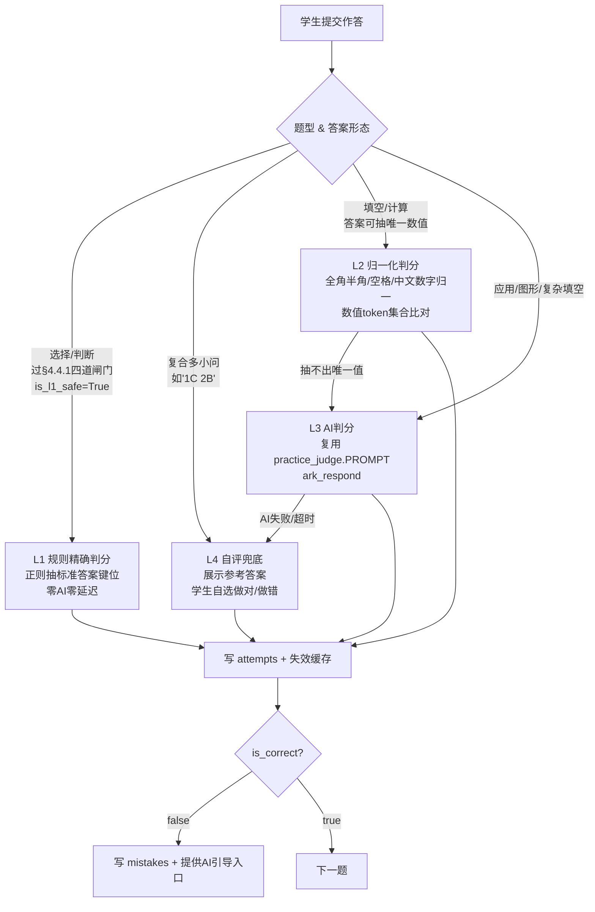

# 题库消费层 PRD（Exercise Bank Consumer）· 简单 PRD

> 版本 v1.0 ｜ 撰写：产品经理 许清楚 ｜ 关联：题库已入库但零消费
> 状态：待老板拍板第 5 章「待确认问题」后进入架构设计
> **本 PRD 全部结论基于仓库真实代码 + `backend/dev.db` 真实数据实测，非推测**

---

## 0. 项目信息

| 项 | 内容 |
|---|---|
| 项目名 | `exercise_bank_consumer`（题库消费层） |
| 所属产品 | AI 数学教练 V4 |
| 技术栈 | 后端 FastAPI + SQLAlchemy（双方言 PG/SQLite，无 Alembic）；前端 Vue3 + Vite + TS + Tailwind，无 pinia |
| 原始需求 | 题库已入库但没有任何功能能推给学生做。要做「抽题 → 练习 → 判分 → 学习报告 + 针对性教学」的闭环 |

---

## 1. 现状核查（先说结论，这决定了 MVP 范围）

### 1.1 三个必须先纠正的事实

| # | 团队现有认知 | 实测结论 | 影响 |
|---|---|---|---|
| **F1** | epic6 家长报告在 `feature/epic6-parent-report`(cfb4a79) **未合并** | ❌ **已合并**。`develop` 上 commit `25e5cea` 已含 `app/api/report.py`、`views/report/ShareReport.vue`、`components/report/*`；该 feature 分支反而**落后** develop 8226 行（缺 importers 全套）。<br>**该分支应直接废弃，不要再 merge，否则会回滚题库导入器** | 无需做"分支协调"，只需保证 attempts 写入格式 |
| **F2** | 可用题 **917 道** | ❌ **active 合计 1810 道** = 893 道 seed 老题 + 917 道 docx 新题；另有 archived 253 道 | 抽题池比预期大一倍，但**质量两极分化**（见 1.2） |
| **F3** | 题库可以按知识点抽题 / 能喂进掌握度 | ❌ **917 道 docx 新题的 `kp_id` 全部为 NULL、`kp_verified` 全部为 False、`difficulty` 全部为 NULL** | **闭环在此处断裂**：学生刷这 917 道题，`profile_service` 的 `_VERIFIED_KP_EXPR` 会把 kp 置空 → 不进掌握度 → 不进家长周报。**产品卖点"家长掌握孩子薄弱点"直接落空**。这是本期最大风险，见 Q2 |

### 1.2 题库真实盘点（`dev.db`，`status='active'`）

**按来源分层**

| 分层 | 数量 | kp_id | kp_verified | difficulty | edition/section |
|---|---|---|---|---|---|
| seed 老题（`source_doc IS NULL`） | 893 | ✅ 齐全 | ✅ True | ✅ 1/3/5 | ❌ 全空 |
| docx 新题（青岛版 631 + 苏教版 286） | 917 | ❌ 全 NULL | ❌ 全 False | ❌ 全 NULL | ✅ 齐全 |

**按题型（active 1810）**

| 题型 | 选择 | 填空 | **NULL（无题型）** | 应用 | 计算 | 图形 | 判断 |
|---|---|---|---|---|---|---|---|
| 数量 | 618 | 370 | **291** | 250 | 190 | 46 | 45 |

> ⚠️ 291 道无题型题**全部来自 docx 新题**（占新题 31.7%），前端无法决定渲染方式，**MVP 必须排除**。

**「可判分 × 可归因」四象限（这是抽题池的唯一依据）**

|  | 可归因（kp 非空 + verified） | 不可归因 |
|---|---|---|
| **有标准答案** | **833** ✅ 黄金池 | 748 ⚠️ 能判分但不进报告 |
| **无标准答案** | 60 ❌ | 169 ❌ |

**判分可行性实测（关键工作量依据）**

| 题型 | 有答案 | 规则可判 | 实测发现 |
|---|---|---|---|
| 选择 | 596 | **✅ 可（规则精确）** | `options` 有**两种形态**：dict `{"A":"12","B":"15"}`（seed）和 **list** `["5","6","7"]`（新题）→ 前端渲染 + 后端判分都必须兼容两种。<br>`correct_answer` **不是纯字母**，实测四种格式：`'选C。C．16'`、`'B'`、`'A 提示根据余数比除数小…'`、`'A8. A'` |
| 判断 | 42 | **✅ 可（规则精确）** | 单值 `×` / `✔`；另有复合脏数据 `(1)× ×1 ×1 (2)× (3)×` 必须踢出 |
| 填空 | 337 | ❌ 不可 | 答案是自然语言长句：`'现在是 8 时，再过 1 小时是 9 时'`、`'米；厘米'`、`'①④'`、`'6 个：25 、 28 、 52 …'` |
| 计算 | 179 | ⚠️ 部分 | 答案含过程：`'8 颗（3+5=8）'`、`'能装满 4 盒，还剩 3 个（23÷5=4……3）'` → 可抽数值 token |
| 应用 | 208 | ⚠️ 部分 | `'9-4=5，还剩 5 只'`、`'12÷4=3，每人分 3 个'` |
| 图形 | 25 | ❌ 不可 | 需 AI 判分 |

**结论：L1 规则精确可判池 = 选择题 + 判断题中，通过 §4.4.1 四道闸门的那一部分；其中"可归因、能进家长周报"的是它与 `kp_verified=1 AND kp_id IS NOT NULL` 的交集。**

> 🔑 **本 PRD 不承诺 L1 池的具体规模数字，只承诺口径。**
> 池规模是判分规则的**派生值**，随规则调整和每一批新题入库而变化。本项目已为此返工四轮——文档里先后出现过 595 / 591 / 589 / 594 四个版本，全部"实测自同一个库"，每次都是有人用临时脚本人肉重算后发现和文档对不上。
> **根因不是谁算错，而是把「数据的当前事实」当成「设计契约」写进了文档。**
> **唯一真相源 = `backend/app/services/judge_engine.py::is_l1_safe()`**（口径见 §4.4.1）。要看当前规模，跑：
> ```
> cd backend && pytest tests/test_practice.py::TestL1PoolInvariantOnRealBank -v
> ```
> 任何人改判分规则，只需保证该不变式测试仍全绿即可，**不需要也不允许回来更新任何数字**。

### 1.3 白捡的现成资产（能省掉大量工作量）

| 资产 | 位置 | 状态 | 用途 |
|---|---|---|---|
| **`PROMPT` 判题模板** | `app/ai/prompts/practice_judge.py` | ✅ 已写好，`PROMPT`+`VERSION`+`PLACEHOLDERS` 齐全，**全仓库零调用** | 直接接上就是 AI 判分。返回 `{"correct":bool,"feedback":str}`，且模板里已明确写着「不要直接替孩子写完整解法」——**天然符合首轮不给答案铁律**，零 Prompt 设计成本 |
| **`PROMPT` 过程辅导模板** | `app/ai/prompts/practice_guide.py` | ✅ 同上，零调用 | 做错后的启发式引导，返回 `{"reply","askFinalConfirm"}` |
| `record_attempt()` | `services/learning_service.py` | ✅ 已幂等（`client_event_id` 唯一键 + 并发回查） | 作答落库，**profile_service 已在消费它**，格式天然被报告吸收 |
| `record_mistake()` | 同上 | ✅ 已幂等（同题未攻克不重复建档） | 错题自动入本 |
| `invalidate_cache_for_question()` | `services/profile_service.py` | ✅ 已有 | 答题后让掌握度缓存失效 |
| `LearningTask` 表 | `models/learning.py` | ✅ 已建表，字段完全够用 | 练习会话载体，**不用新建表**（见 Q4） |
| `DonutChart` / `MasteryBar` | `components/common/` | ✅ 无第三方依赖 | 结果页复用 |

> ⚠️ `components/QuestionCard.vue` 的 props 绑的是 `Exercise`（AI 生成题结构），与题库 Question 结构不同，**不能直接复用**，需新建 `BankQuestionCard.vue`。

---

## 2. 产品目标

**一句话**：让孩子在 App 里点一下「开始练习」，就能从真实教材题库里抽到一组适合自己年级/单元的题，逐题作答、立刻知道对错、做错了有 AI 老师启发式带（不直接给答案），做完看到一张成绩单；这一切自动沉淀进掌握度与家长周报，形成「练 → 诊 → 教 → 报」的完整闭环。

**三条正交成功标准**

| # | 目标 | 可衡量标准 |
|---|---|---|
| G1 | **抽得到、做得完** | 任意 1~6 年级学生点「开始练习」，3 秒内拿到 10 道可正常渲染、可作答的题；全流程无一道题因缺答案/缺选项/缺题型而白屏或卡死。抽题成功率 100% |
| G2 | **判得准、说人话** | 规则判分池（选择/判断）判分准确率 100%（可测）；非规则池由 AI 判分，`feedback` **不得出现完整解法**（抽检 20 条，0 条泄题） |
| G3 | **进得了报告** | 一次练习产生的 attempts，**无需任何额外操作**即被 `profile_service.get_mastery()` 与家长周报吸收；练完刷新 `/dashboard`，掌握度数字发生变化 |

**非目标（本期明确不做）**

- 不做 AI 现场出题（`/api/exercise/gen` 保持原样，零改动）
- 不做限时考试 / 交卷倒计时
- 不做多人 PK、排行榜、积分体系
- 不做题库后台管理界面（`/api/admin/questions` 另立项）
- 不做 917 道新题的知识点批量补标（这是**前置数据工程**，见 Q2，不属于消费层）

---

## 3. 用户故事

| # | 用户故事 | 优先级 |
|---|---|---|
| US-1 | 作为**学生**，我想点一下就开始做题，不用自己挑，**这样**我不会因为不知道做什么而放弃 | P0 |
| US-2 | 作为**学生**，我想每答完一题立刻知道对不对，**这样**我有即时反馈、愿意继续做下去 | P0 |
| US-3 | 作为**学生**，我做错了不想直接看答案，我想让 AI 老师问我几个问题带我想明白，**这样**我是真的学会了而不是抄答案 | P0 |
| US-4 | 作为**学生**，我想做完一组题后看到"对了几道、错在哪、哪个知识点弱"，**这样**我知道下次该练什么 | P0 |
| US-5 | 作为**学生**，我做错的题应该自动进错题本，**这样**我不用手动记，过几天能回来重做 | P0 |
| US-6 | 作为**家长**，孩子每次刷题的结果都应该自动出现在我看的周报里，**这样**我不用问孩子也知道他这周练了什么、卡在哪 | P0 |
| US-7 | 作为**学生**，我想按"我的年级 + 这学期哪一块（温故/预习/提优/摸底/专项）"挑题，**这样**能配合学校进度 | P1 |
| US-8 | 作为**学生**，我想让系统直接推我最弱的知识点的题，**这样**我把时间花在刀刃上 | P1 |
| US-9 | 作为**学生**，我做到一半退出后再进来，想接着上次的题继续，**这样**不用从头再来 | P1 |

---

## 4. 需求池

> P0 = MVP 必须有｜P1 = 重要可后补｜P2 = 锦上添花
> 「归属」列：BE=后端 / AI=AI 层 / FE=前端 / DATA=数据工程

### 4.1 P0 · MVP 必做（建议 MVP = 抽题 → 练习 → 判分 → 报告联动最小闭环）

| ID | 需求 | 说明 | 验收标准 | 归属 |
|---|---|---|---|---|
| **R-01** | **抽题池安全闸门** | 抽题**必须**过滤：`status='active'` **且** 有非空 `correct_answer` **且** `type` 非空 **且**（选择题必须有可解析 options）。绝不把残缺题推给学生 | 抽 200 次共 2000 题，0 道出现"无选项的选择题""无答案题""无题型题" | BE |
| **R-02** | **抽题接口** | 按 grade / edition / section / type / difficulty / kp_id 组合筛选，随机抽 N 道（默认 10）。**排除该学生最近 7 天已做过的题**，池子不足时再放开 | 同一学生连续开 3 组练习，题目重复率 < 10%；筛选条件全组合可用 | BE |
| **R-03** | **练习会话** | 复用 `LearningTask`（**不新建表**，见 Q4）。`items` JSON 承载逐题状态；`status` 走 pending→doing→done | 断网重进能恢复到上次那道题；同一会话重复提交同一题不产生重复 attempt | BE |
| **R-04** | **分层判分引擎** | 见 §4.4 判分分层方案。L1 规则 / L2 归一化 / L3 AI / L4 自评兜底，**逐级降级，绝不返回"判不了"** | L1 规则池判分准确率 100%（含 C2 复合题反例）；AI 挂掉时自动落到 L4，页面不报错 | BE + AI |
| **R-04b** | **看答案审计埋点** | `/reveal` 每次调用落审计（student_id + question_id + revealed_at）；前端先二次确认再带 `confirmed=true` 调用，否则 4xx 拒绝 | 审计表可查每题泄题时间；未经二次确认直接调用返回 4xx | BE |
| **R-05** | **作答落库（报告闭环）** | 每题判完调 `record_attempt()` 落 `attempts`，并调 `invalidate_cache_for_question()` 失效缓存 | 做完 10 题后 `GET /api/profile/mastery` 数字发生变化；家长周报本周题数 +10 | BE |
| **R-06** | **错题自动入本** | `is_correct=false` 时调 `record_mistake()`，`error_type`/`error_reason` 由判分层给（AI 判分时取 feedback 摘要，规则判分时留空待 AI 补） | 错题立即出现在 `/mistakes` 页；同题连错两次不重复建档 | BE |
| **R-07** | **做错 → AI 启发式引导** | 做错后展示「让老师带我想一想」按钮 → 复用 `practice_guide.py` 多轮引导。**首轮绝不给答案**（V1 铁律） | 抽检 20 轮首轮回复，0 条出现最终答案或完整解法 | AI + FE |
| **R-08** | **刷题页 `/practice`** | StudentLayout 子路由（**非 public**）。移动优先 375px 无横向滚动。逐题卡片式，含进度条 | 375px 下无横向滚动；单手可完成全流程 | FE |
| **R-09** | **结果页** | 正确率 / 用时 / 逐题对错清单 / 薄弱知识点 / 三个出口（再来一组、去错题本、看画像） | 数据与 attempts 完全一致，无凭空数字 | FE |
| **R-10** | **Dashboard 衔接** | `/dashboard` 现有 `handlePractice()` 目前跳 `/ai`，改跳 `/practice`；`RecommendationList` 的推荐项加「练这个知识点」按钮（P1 生效） | 点击可达，跳转带上筛选参数 | FE |
| **R-11** | **空态与降级** | 筛选后无题：给出「换个条件试试」+ 一键放宽；AI 判分失败：落 L4 自评；接口失败：局部空态不整页崩 | 构造零结果条件与断 AI 场景，页面均可用 | BE + FE |
| **R-12** | **幂等与防重复提交** | 每题提交带 `client_event_id`（会话 ID + 题序号拼），重复点击只落一条 attempt | 同一题狂点 10 次提交，DB 只有 1 条 attempt | BE + FE |

### 4.2 P1 · 重要可后补

| ID | 需求 | 说明 |
|---|---|---|
| R-13 | **薄弱知识点推题** | 接 `profile_service.get_mastery()` 取 level 最低的 Top3 kp → 抽对应题。⚠️ 依赖 Q2 解决，否则只能命中 893 道 seed 题 |
| R-14 | 错题重练 | 从 `/mistakes` 选未攻克错题组一组练习；连续答对 N 次自动标 `solved` |
| R-15 | 断点续做 | 进 `/practice` 时若有 `status='doing'` 的会话，提示「继续上次练习」 |
| R-16 | 真实作答计时 | 前端记录逐题起止 → 写 `attempts.duration_sec`。**该字段目前全仓库零写入**（epic6 F1 已记录），消费层是唯一有机会补上的地方，见 Q5 |
| R-17 | 筛选项接口 | `GET /api/practice/filters` 返回当前题库真实可选的 grade/edition/section 及各自题量，避免前端硬编码出空池 |
| R-18 | L2 归一化判分 | 填空/计算的数值型答案自动判（见 §4.4），减少 AI 调用成本 |

### 4.3 P2 · 锦上添花

| ID | 需求 |
|---|---|
| R-19 | 每日推荐一组题（`task_type='daily'`），首页显示「今日任务」 |
| R-20 | 摸底测（`task_type='exam'`，抽 20 题跨知识点）→ 生成入学诊断报告 |
| R-21 | 连续答对动效 / 打卡天数（注意：`students.streak_days` 目前恒为 0，需一并补写入） |
| R-22 | 题目纠错反馈（学生标「这题答案不对」→ 进人工复核队列，反哺题库质量） |
| R-23 | 判分准确率打点，用于迭代 `practice_judge` Prompt |

### 4.4 判分分层方案（P0 核心，决定后端工作量）



**分层规格**

| 层 | 适用 | 判定规则 | 覆盖量 | 成本 | MVP |
|---|---|---|---|---|---|
| **L1 规则精确** | 选择、判断 | 见下方 §4.4.1 **四道闸门（唯一真相源 `is_l1_safe()`）** | 运行期派生，不写死 | 0 | ✅ **P0 抽题池就锁在这一层** |
| **L2 归一化** | 填空、计算 | 归一化（全角→半角、去空格、中文数字→阿拉伯、`……`→`...`）后，从标准答案抽数值/单位 token 集合；学生答案 token 集合 ⊇ 标准集合即判对。**抽不出唯一短答案则跳 L3** | ~300 道 | 0 | P1（R-18） |
| **L3 AI 判分** | 应用、图形、复杂填空 | `ark_respond(system=practice_judge.PROMPT)`，注入 `{{QUESTION}}/{{ANSWER}}/{{WORK}}`，解析 `{"correct":bool,"feedback":str}` | 剩余 | 每题 1 次调用 | P1 |
| **L4 自评兜底** | 全部（降级用） | AI 超时/解析失败 → 展示参考答案 + 「我做对了 / 我做错了」二选一，attempt 照常落库 | — | 0 | ✅ P0（作为 L1 之外的保底） |

> **产品判断**：MVP **只放 L1 安全池进抽题池**。理由：
> 1. 判分 100% 可靠，不会出现"明明做对了判我错"这种直接劝退的体验事故；
> 2. 零 AI 成本、零延迟，做题手感流畅；
> 3. 后端工作量最小（一个正则解析器 + 一个二值归一化），**1~2 天可交付可用闭环**；
> 4. 该池规模（数百道量级）对单个学生足够刷很久，不构成内容瓶颈。
> L2/L3 作为 P1 分批放开题池，风险可控、可回滚。

#### 4.4.1 L1 四道闸门（口径唯一真相源 = `judge_engine.is_l1_safe()`）

> 🔑 **本节定义规则，不定义数字。** 规则是设计契约，改规则才算改口径；池规模是规则的派生值，**任何人不得把它写进本文档**。
> 代码真相源：`backend/app/services/judge_engine.py::is_l1_safe(q_type, options, correct_answer) -> bool`。
> 抽题层（`practice_service._candidate_rows`）与不变式测试（`tests/test_practice.py::TestL1PoolInvariantOnRealBank`）**都只调这一个函数**，禁止在别处复写口径。

**四道闸门** —— 全部通过才准入 L1，任一不过 → 踢出 L1（进 L3/L4）。**选择题与判断题一视同仁**：

| # | 闸门 | 判据 | 为什么 |
|---|---|---|---|
| 1 | **题型受支持** | `q_type ∈ {选择, 判断}` | MVP 只有这两类能做到规则精确判分 |
| 2 | **标准答案非空** | `correct_answer` 去空白后不为空串 | 没有标准答案就没有对错可判 |
| 3 | **非复合多小问**（🔴 铁律 C2） | 答案里 `(n)` / `（n）` 小问编号（半/全角数字皆算）出现次数 **< 2** | **见下方红线**——一格塞多小问的答案既无法可靠判分，也无法给孩子逐问反馈 |
| 4 | **标准答案可被 L1 唯一解析** | **选择**：本题选项键位非空，**且**标准答案能唯一抽出一个**落在这些键位内**的键位（抽到多个不同键位 = 歧义，不准入）<br>**判断**：标准答案能唯一归一成布尔（多符号并存 = 歧义，不准入） | 抽不出键位 / 键位不在选项里 → 孩子无论怎么选都判不出对错。实测两类脏数据：答案指向**不存在的选项键位**（答案 `'C'` 但选项只有 A/B）、docx 导入把**解析文本串进答案格**（`'A 提示：在直角三角形中…'`） |

**闸门 4 是防漂移的关键设计**：它**复用判分层同一组解析器**（`extract_choice_key` / `normalize_judge_value`），把「能不能进池」与「能不能判分」焊死在同一段代码上——解析规则一改，两边同时生效，不可能再对不上。

由此得到一条**可证明的不变式（进池 ⟺ 可判分）**：

```
is_l1_safe(...) is True  ⟺  judge(..., 标准答案, 标准答案) 返回 level=1 且 is_correct=True
```

**判断题 token 集**（归一化真相源）：真 `√` `✔` `✓` `对` `正确` `对的` `是` `T` `true` `Y` `yes` `1`；假 `×` `✗` `✘` `x` `错` `错误` `错的` `否` `不对` `F` `false` `N` `no` `0`。符号夹在其它字符里（如 `答案：√`）时，**有且仅有一个**符号才敢判；多符号（如 `(1)× ×1 (2)√`）一律判为歧义，交 L4。

> 🔴 **红线（铁律 C2，务必遵守）**：**复合多小问答案绝不允许自动判分**，选择题和判断题**一视同仁**。
> 典型反例 `'(1)C (2)B'`：若用宽松正则抓首字母判成 `C`，则一个第 2 小问答对的孩子会被判错。
> 这正是 G2「判分准确率 100%」要防的事故，也是 MVP 锁 L1 的全部意义。
> 判断题的 `'(1)× ×1 ×1 (2)× (3)×'` 与它是**同一类缺陷**——两者必须用同一条规则排除，不能只排一个。

**关于排除量**：各闸门的排除计数存在重叠、且随每批新题入库而变，**故本文档不列计数**。需要看当前分布时跑 §7 V3 的不变式测试，或临时统计——但**统计结果不要回写进文档**，那正是导致本项目返工四轮的做法。

### 4.5 接口草案（产品视角，字段与形态由架构师最终定）

> 硬约束：响应外壳恒 `{code,msg,data}`；出参 **snake_case**；Schema **直接继承 `pydantic.BaseModel`，禁止继承 `schemas/common.BaseSchema`**（后者会 alias 成 camelCase，会打断与 `/api/profile/*` 的复用）。

```jsonc
// POST /api/practice/session   开一组练习
// req
{
  "grade": 4,                    // 升入年级，U1 铁律：不做 grade-1 换算
  "edition": "青岛版",            // 可选
  "section": "温故",              // 可选：温故/预习/提优/摸底/专项/自测
  "type": "选择",                 // 可选
  "difficulty": 3,               // 可选 1/3/5
  "kp_id": null,                 // 可选，P1 薄弱点推题用
  "count": 10,
  "client_event_id": "..."       // 幂等
}
// resp.data
{
  "session_id": "uuid",          // = learning_tasks.id
  "task_type": "daily",
  "total": 10,
  "current_index": 0,
  "items": [
    {
      "index": 0,
      "question_id": "uuid",
      "content": "下面哪个图形是正方形？",
      "type": "选择",
      "options": {"A": "三角形", "B": "长方形", "C": "正方形"},  // dict 或 list，前端需兼容
      "image_url": null,
      "difficulty": 3,
      "kp_name": "平面图形的认识",   // 可为 null（917 新题 kp 全空）
      "answered": false
      // ⚠️ 绝不下发 correct_answer / analysis，防止 F12 查看答案
    }
  ]
}
```

```jsonc
// POST /api/practice/session/{session_id}/answer   逐题提交并即时判分
// req
{ "index": 0, "question_id": "uuid", "answer": "C", "duration_sec": 23,
  "client_event_id": "sess-uuid#0" }
// resp.data
{
  "is_correct": false,
  "judge_mode": "rule",          // rule | normalized | ai | self
  "correct_answer": "C",         // ⚠️ 见 Q3：做错时是否立即下发
  "analysis": "……",              // 同上
  "feedback": "你选了 B。再看看题目里说的…",   // AI 判分时有，不含完整解法
  "mistake_id": "uuid",          // 自动入错题本后返回
  "can_ask_teacher": true,       // 可否转 AI 老师启发引导
  "next_index": 1,
  "progress": { "answered": 1, "correct": 0, "total": 10 }
}
```

```jsonc
// POST /api/practice/session/{session_id}/finish   结束并出成绩单
// resp.data
{
  "session_id": "uuid",
  "total": 10, "correct": 7, "accuracy": 0.7,
  "duration_sec": 412,
  "items": [{ "index":0, "question_id":"uuid", "is_correct":false, "type":"选择" }],
  "weak_kps": [{ "kp_id":"uuid", "kp_name":"分数加减", "wrong":2, "total":3 }],
  "new_mistakes": 3,
  "unmapped_count": 4            // 本组里 kp 为空、无法归因的题数（诚实披露，见 Q2）
}
```

```jsonc
// POST /api/practice/session/{session_id}/reveal   看参考答案（承载 Q3 二次确认）
// req
{ "index": 2, "question_id": "uuid", "confirmed": true }
//   confirmed=true 表示前端已走完「确定要看答案吗？」二次确认；false 直接 4xx 拒绝
// resp.data
{
  "correct_answer": "C",
  "analysis": "……",
  "revealed_at": "2026-08-05T03:19:17Z"   // 服务端记录调用时间
}
// ⚠️ 产品约束：服务端必须落审计日志（student_id + question_id + revealed_at），
//    用于统计泄题率与 Q3 摩擦效果（见 R-04b / C11）
```

```jsonc
// POST /api/practice/session/{session_id}/guide   AI 启发式引导（复用 practice_guide.PROMPT）
// req
{ "index": 2, "question_id": "uuid", "user_reply": "我觉得是平均分", "turn": 1 }
// resp.data
{
  "reply": "为什么你认为是平均分呢？题目里说'平均分给4个小朋友'……",
  "ask_final_confirm": false,
  "leak_checked": true          // 服务端已校验首轮回复不含最终答案/完整解法（V7）
}
// ⚠️ 产品约束：turn=1（首轮）必须过 no-leak 校验，含最终答案/完整解法直接拦截并重写
//    （首轮不给答案铁律，见 R-07 / C12）
```

**其余接口**：`GET /api/practice/session/{id}`（断点续做，P1）、`GET /api/practice/filters`（P1）。
**本期共 5 个写接口**：`/session`(开) · `/session/{id}/answer`(判分) · `/session/{id}/finish`(出成绩单) · `/session/{id}/reveal`(看答案) · `/session/{id}/guide`(AI 引导)。

---

## 5. UI 设计稿

### 5.1 设计原则

1. **移动优先**：375px 起，单手可完成全流程；桌面端居中限宽，不做两栏。
2. **一屏一题**：不做长列表滚动答题，避免小学生视线丢失。
3. **即时反馈**：提交后原地展开结果条，**不跳页**，保持节奏感。
4. **不打击**：做错用中性色（琥珀），不用大红叉；文案是「再想想」不是「错了」。
5. **不泄题**：题目下发**不含** `correct_answer`，答案只在提交后由服务端返回。

### 5.2 入口与信息架构

```
/dashboard （学习画像，现有首页）
   ├─ [开始练习] ← 现有 handlePractice() 从跳 /ai 改跳 /practice
   └─ RecommendationList 每项右侧 [练这个知识点] → /practice?kp_id=xxx   (P1)

/practice          刷题页（新增，StudentLayout 子路由，非 public）
   ├─ 起始态：筛选卡 → [开始练习]
   ├─ 答题态：逐题卡片
   └─ 结果态：成绩单

/mistakes （现有错题本）  ← 做错的题自动流入
/ai       （现有 AI 老师）← 做错点「让老师带我想一想」跳入，带 question_id
```

### 5.3 起始态（选题）

```
┌───────────────────────────────┐  375px
│  ← 练习                        │
├───────────────────────────────┤
│  今天想练什么？                 │
│                               │
│  年级   [ 四年级 ▾ ]           │  ← 默认取 students.grade
│  教材   [ 不限 ▾ ]  青岛版/苏教版│
│  内容   [ 不限 ▾ ]             │
│         温故 预习 提优 摸底 专项 │
│  题型   [ 选择题 ▾ ]           │  ← MVP 默认锁在 L1 池
│  题量   [ 10 ] ○5 ●10 ○20     │
│                               │
│  ┌─────────────────────────┐  │
│  │ 📚 符合条件 128 道         │  │  ← 实时回显池子大小(P1 R-17)
│  └─────────────────────────┘  │
│                               │
│  [      开始练习      ]        │
│                               │
│  ─────── 或者 ───────         │
│  [ 🎯 练我最弱的知识点 ]  (P1)  │
│  [ 📕 重做错题 ]         (P1)  │
└───────────────────────────────┘
```

**空态**：池子为 0 时按钮置灰，提示「这个条件下暂时没有题，试试把"内容"改成不限？」+ 一键放宽按钮。

### 5.4 答题态（核心页）

```
┌───────────────────────────────┐
│  ← 退出        第 3 / 10 题     │
│  ▓▓▓░░░░░░░  30%              │  ← 进度条
├───────────────────────────────┤
│  ┌─ 选择题 · 四年级 · 温故 ──┐  │  ← 元信息胶囊（kp 为空时不显示 kp）
│  └──────────────────────────┘  │
│                               │
│  小明有 24 颗糖，平均分给 4 个    │
│  小朋友，每人分到几颗？          │
│                               │
│  ( A )  4 颗                   │  ← 单选，点选即高亮
│  ( B )  6 颗                   │     options 兼容 dict / list
│  ( C )  8 颗                   │
│                               │
│  [        提  交        ]      │
└───────────────────────────────┘
```

**提交后 · 答对**（原地展开，不跳页）

```
│  ┌──────────────────────────┐  │
│  │ ✅ 答对了！用时 12 秒       │  │  ← 绿色，1.5s 后自动下一题
│  └──────────────────────────┘  │
│  [ 下一题 → ]                  │
```

**提交后 · 答错**（关键交互，兑现"首轮不给答案"）

```
│  ┌──────────────────────────┐  │
│  │ 🤔 再想想～ 你选的是 A      │  │  ← 琥珀色，非红色
│  │                          │  │
│  │ 已经放进错题本了 📕        │  │
│  └──────────────────────────┘  │
│                               │
│  [ 💡 让老师带我想一想 ]        │  ← 主按钮：跳 /ai 或原地开引导抽屉
│  [ 看参考答案 ]  ← 次级，弱化    │  ← 见 Q3：是否保留 / 是否延迟解锁
│  [ 先跳过，继续下一题 → ]        │
```

> **产品意图**：把「让老师带我想一想」做成视觉主按钮、「看参考答案」做成灰色小字次级入口，用**视觉权重**兑现产品铁律，而不是靠硬禁止惹恼孩子。

**AI 引导抽屉（原地展开，复用 `practice_guide.PROMPT`）**

```
│  ┌── 👩‍🏫 老师 ─────────────┐  │
│  │ 24 颗糖分给 4 个人，你觉得 │  │  ← 首轮只问，不给答案
│  │ 这是"平均分"还是"一共有"？ │  │
│  └──────────────────────────┘  │
│  [ 输入你的想法…        ] [发送] │
│                               │
│  [ 我想明白了，重做这题 ]        │  ← 重做判对 → mistakes 可标 practicing
```

### 5.5 结果态（成绩单）

```
┌───────────────────────────────┐
│  练习完成 🎉                   │
├───────────────────────────────┤
│      ┌──────┐                 │
│      │ 7/10 │  正确率 70%      │  ← 大数字
│      └──────┘  用时 6 分 52 秒 │
│                               │
│  ┌─ 逐题回顾 ───────────────┐  │
│  │ 1 ✅  2 ✅  3 ❌  4 ✅     │  │  ← 点任一题可回看题目与解析
│  │ 5 ✅  6 ❌  7 ✅  8 ✅     │  │
│  │ 9 ❌  10 ✅                │  │
│  └──────────────────────────┘  │
│                               │
│  ┌─ 这次比较弱的地方 ────────┐  │
│  │ 分数加减   ▓▓▓░░░░  错2/3 │  │  ← 复用 MasteryBar.vue
│  │ 小数乘法   ▓▓▓▓▓░░  错1/4 │  │
│  │                          │  │
│  │ ⓘ 有 4 道题暂未归类知识点  │  │  ← 诚实披露（见 Q2），不假装
│  └──────────────────────────┘  │
│                               │
│  新增错题 3 道 · 已存入错题本    │
│                               │
│  [ 再来一组 ]  [ 去攻克错题 ]   │
│  [ 看我的学习画像 ]             │
└───────────────────────────────┘
```

### 5.6 关键状态表

| 状态 | 展示 |
|---|---|
| 抽题池为空 | 「这个条件下暂时没有题」+ 一键放宽筛选，**不显示空白页** |
| 判分中 | 提交按钮转 loading，最长 8 秒；超时自动落 L4 自评 |
| AI 判分失败 | 静默降级为 L4：「这题的参考答案是 X，你做对了吗？」[做对了][做错了] |
| AI 引导失败 | 「老师这会儿有点忙，先看看解析？」→ 解锁参考答案 |
| 中途退出 | 二次确认「进度会保存，下次可以接着做」→ 会话置 `doing`（P1 恢复） |
| 题目 kp 为空 | 元信息胶囊不显示知识点；结果页统一归到「暂未归类」并明示条数 |
| 网络断开 | 本地保留当前作答，恢复后带同一 `client_event_id` 重提，不产生重复 attempt |

---

## 6. 待确认问题

> 已给默认选择，**标 🔴 的阻塞架构设计，请老板优先拍板**。

### 🔴 Q1｜MVP 范围：最小闭环 vs 全套？

| 选项 | 内容 | 工期估 |
|---|---|---|
| **A. 最小闭环（推荐）** | 抽题 → 练习 → **L1 规则判分** → attempts 落库 → 错题自动入本 → 结果页 → 报告自动吸收 | 后端 1.5~2 天 + 前端 1.5~2 天 |
| B. 全套 | A + L2/L3 AI 判分 + 薄弱点推题 + 错题重练闭环 + 断点续做 | ≥ 5~6 天，且 AI 判分准确率不可控 |

**产品建议：A。** 理由：① 题库最大的问题不是"功能不够"而是"零消费"，先把闭环打通比做全更重要；② L1 安全池（数百道量级）足够用；③ AI 判分一旦判错会直接摧毁孩子信任，应等闭环稳定后灰度放开；④ 报告联动是白捡的（`record_attempt` 已被 profile_service 消费），A 方案就能兑现"家长掌握薄弱点"卖点。**需老板确认。**

---

### 🔴 Q2｜917 道新题 kp_id 全空 —— 闭环在这里断了，怎么办？

**实测事实**：917 道 docx 新题 `kp_id` 100% 为 NULL、`kp_verified` 100% 为 False。`profile_service._VERIFIED_KP_EXPR` 会把它们的 kp 归属置空 → **不进掌握度 → 不进家长周报的"薄弱知识点"**。

**后果**：孩子刷完 50 道青岛版衔接题，家长周报里「最需要补的三个知识点」**依然空白**，只有题数和正确率会动。产品卖点打五折。

| 选项 | 做法 | 工作量 | 影响 |
|---|---|---|---|
| **A. MVP 只抽 seed 可归因题（推荐）** | 抽题池加 `kp_verified=1 AND kp_id IS NOT NULL`，L1 池收缩到**可归因子池**（规模运行期派生，约占全池八成） | 0（一行 where） | 闭环 100% 完整；但青岛版/苏教版新题**本期依然不上线**——与老板"要消费 917 道新题"的诉求有出入 |
| B. 全池放开 + 诚实披露 | 新题也抽，结果页明示「有 N 道题暂未归类知识点」 | 0 | 新题能做了，但报告归因不完整 |
| C. 先补 kp 再上线 | 用 AI 给 917 道题批量打 kp + 人工抽检复核，置 `kp_verified=1` | **额外 2~3 天数据工程**（不属消费层） | 一劳永逸，但阻塞上线 |

**产品建议：A + B 组合**——默认抽题池优先可归因题（保证报告完整），当筛选条件（如指定 `edition='青岛版'`）只能命中新题时自动放开并在结果页诚实披露。**同时强烈建议把 C 单独立项排进下一个迭代**，否则 917 道新题永远只是"能做"而不是"能诊断"。**需老板拍板是否接受 MVP 阶段新题不进掌握度。**

---

### 🔴 Q3｜做错后要不要立刻给参考答案？

产品铁律是「**首轮**绝不给答案」。做错属于第几轮，需要明确口径。

| 选项 | 说明 |
|---|---|
| **A. 分级解锁（推荐）** | 做错后**默认不给**答案，主按钮是「让老师带我想一想」；「看参考答案」作为灰色次级入口保留，但**需要点两次**（点击后二次确认「确定要直接看答案吗？先试试老师的提示会记得更牢哦」） |
| B. 完全不给 | 只能通过 AI 引导，引导不动就卡死 → 会劝退 |
| C. 立刻给 | 违背铁律 |

**产品建议：A。** 铁律的本意是「不让孩子第一反应就是抄答案」，而不是「永远不给答案」。用交互摩擦而非硬禁止来实现，既守住产品价值又不劝退。**需老板确认 A 是否算守住铁律。**

---

### 🟡 Q4｜练习会话：复用 `LearningTask` 还是新建实体？

| 选项 | 说明 |
|---|---|
| **A. 复用 `LearningTask`（推荐）** | 表已存在；`task_type`(daily/review/exam) + `items` JSON + `status`(pending/doing/done) + `generated_at`/`finished_at` 语义完全够用。`items` 存 `[{index, question_id, answered, is_correct, judge_mode, user_answer, attempt_id, duration_sec}]` |
| B. 新建 `practice_sessions` + `practice_items` 两表 | 更贴合逐题作答，统计方便 |

**产品建议：A。** 决定性理由：**项目无 Alembic，新建表要手写 PG + SQLite 两份 DDL**，是纯粹的迁移风险与工期成本；而 V4.1 单学生数据量极小，JSON 内聚合在 Python 侧做完全够用（与 `profile_service` 现有做法一致）。映射：按条件抽题→`daily`，薄弱点/错题重练→`review`，摸底测→`exam`（CHECK 约束只允许这三值）。

> ⚠️ 提请架构师注意：`items` 是 `JSONType`，逐题更新需**整体覆盖写**，要防并发覆盖（同一学生同时两个标签页答题）。建议以 `attempts` 为唯一真相源，`items` 仅作展示缓存。

---

### 🟡 Q5｜要不要顺手补 `attempts.duration_sec`？

**事实**：该字段建表就有，但**全仓库零写入**（epic6 PRD 的 F1 已记录，当时因无数据源被迫砍掉家长周报的「学习时长」）。刷题页是天然的计时场景，前端记录逐题起止的成本约 0.5 小时。

**产品建议：做。** 理由：① 边际成本极低；② 直接解掉 epic6 的历史遗留缺口，家长周报下个版本就能显示真实「本周学习时长」；③ 后续「专注力分析」的唯一数据源。**脏数据处理**：单题耗时 > 600 秒的按 600 截断（孩子开着页面去吃饭）。**需老板确认是否纳入 P0。**

---

### 🟢 Q6｜错题自动入本会不会污染掌握度（双重计负样本）？

**已核查，结论：不会。** `profile_service.PracticeEventCollector._load_mistakes()` 有明确去重逻辑——「该题已有 attempts 记录时不再补负样本」。因为消费层是**先写 attempt 再写 mistake**，天然命中去重分支。✅ 安全，可放心自动入本。

**默认选择**：做错自动入 `mistakes`，`error_type`/`error_reason` 在 L1 规则判分时留空（后续由 AI 引导会话补写），L3 AI 判分时取 `feedback` 摘要填入。

---

### 🟢 Q7｜抽题维度与前端筛选粒度

**默认选择**：P0 支持 `grade`（默认取学生档案年级）/ `edition` / `section` / `type` / `difficulty`；`kp_id` 接口层支持但前端 P0 不暴露（P1 随薄弱点推题一起放出）。

**注意事项（给架构师）**：
- `grade` 是**升入年级**（U1 铁律），任何地方**严禁** `grade - 1` 换算；
- `difficulty` 在 917 道新题上**全为 NULL**，前端选了难度就会把新题全滤掉 → 建议 UI 上把难度做成「不限/简单/中等/挑战」且默认「不限」，或 P0 直接隐藏；
- `section` 和 `edition` 在 893 道 seed 题上**全为 NULL**，同理。
- 随机抽题**禁止用 `ORDER BY RANDOM()`** 之外的方言函数；跨方言安全做法是先查 ID 列表再 Python `random.sample()`（数据量小，完全可行）。

---

### 🟢 Q8｜epic6 分支处置

**实测**：epic6 家长报告**已在 develop 上**（commit `25e5cea`），`feature/epic6-parent-report` 分支落后 develop 8226 行、缺整套 importers。

**建议：直接删除该分支，禁止再 merge**，否则会回滚题库导入器。消费层与报告的衔接**无需任何协调**——只要走 `learning_service.record_attempt()` 落库，`profile_service` 与周报会自动吸收。

---

## 7. 验收标准（Definition of Done）

| # | 验收项 |
|---|---|
| V1 | 学生登录后从 `/dashboard` 点「开始练习」→ 完成 10 道题 → 看到成绩单，全程无报错 |
| V2 | 抽 200 次共 2000 题，**0 道**出现无答案 / 无选项 / 无题型的残缺题 |
| V3 | **L1 池不变式测试**（`tests/test_practice.py::TestL1PoolInvariantOnRealBank`，真实库全量跑）：断言「**进池 ⟺ 可判分**」双向等价成立——**正向**，池内每一道题喂标准答案都必须得到 `level=1` 且 `is_correct=True`；**反向**，被踢出池的受支持题型，判分层绝不会给出 `level=1` 结论。另断言池非空、池内选择题必有可用选项。<br>⚠️ **本项零硬编码数字**：口径一破立刻红，新题入库不会误报。**禁止把池规模写成断言**——那是本项目返工四轮（595→591→589→594）的根因 |
| V3b | **C2 复合题反例双向验证**：以 `'(1)C (2)B'`（选择）与 `'(1)× ×1 ×1 (2)× (3)×'`（判断）为代表，断言 ①`is_l1_safe()` 为 `False`（**不进池**）且 ②`judge()` 返回 `level=4`（**判分时走 L4 兜底**，而非被宽松正则判成 `C`）。全库扫描所有 `is_compound()` 命中的题，**0 道泄漏进池**；另抽样人工核对 L1 池判分准确率 **100%** |
| V4 | 题目接口返回体（F12 Network）中**不含** `correct_answer` / `analysis` |
| V5 | 练习前后对比 `GET /api/profile/mastery`，掌握度数字发生变化；家长周报「本周练习题数」+10 |
| V6 | 做错的题立即出现在 `/mistakes`；同题连错两次只有一条未攻克记录 |
| V7 | 抽检 20 轮 AI 引导首轮回复，**0 条**出现最终答案或完整解法 |
| V8 | 同一题狂点提交 10 次，DB 中只有 1 条 attempt |
| V9 | 断开 AI 服务，答题流程仍可完整走完（降级 L4 自评） |
| V10 | 375px 宽度下全流程无横向滚动条 |
| V11 | 后端测试全绿，新增用例覆盖：抽题闸门、L1 判分正确性（含 dict/list 两种 options）、幂等、越权（不能提交别人的会话） |
| V12 | 双方言（SQLite dev + PG）均通过；SQL 中无 `date()` / `DATE_TRUNC` / `strftime` |

---

## 8. 给架构师的硬提示（务必遵守）

| # | 约束 | 依据 |
|---|---|---|
| C1 | 新接口 Schema **直接继承 `pydantic.BaseModel`**，禁止继承 `schemas/common.BaseSchema`（会 alias 成 camelCase，打断与 `/api/profile/*` 的复用） | 团队决议 |
| C2 | 出参 snake_case；响应外壳用 `app.core.response.ok()` | `core/response.py` |
| C3 | 双方言禁用 `date()`/`DATE_TRUNC`/`strftime`；upsert 一律「先 SELECT 再 UPDATE/INSERT」，不用 PG `ON CONFLICT` | `profile_service` 既有约定 |
| C4 | AI 只走 `ai/ark_client.ark_respond`；Prompt 放 `ai/prompts/xxx.py` 且导出 `PROMPT`+`VERSION`。**本期两个 Prompt 已存在**（`practice_judge.py` / `practice_guide.py`），直接复用，勿新写 | `ai/prompts/` |
| C5 | AI 调用是同步阻塞的，async 路由必须 `run_in_threadpool` 包裹 | `api/chat.py`、`api/exercise.py` |
| C6 | `/practice` 路由**不加** `meta.public`（需登录）；前端无 pinia，状态用 `reactive()` 模块（参考 `stores/profile.ts`） | `router/index.ts` |
| C7 | `options` 有 **dict 与 list 两种真实形态**，前端渲染与后端判分都必须兼容，否则 45+ 道题会白屏 | dev.db 实测 |
| C8 | `correct_answer` 不是纯字母，有 `'选C。C．16'` / `'B'` / `'A 提示…'` 三种形态，正则需全覆盖 | dev.db 实测 |
| C9 | `attempts` 是家长周报的输入，**不要改它的表结构**；判分模式等新字段记在 `learning_tasks.items` JSON 里 | epic6 依赖 |
| C10 | `/api/exercise/gen`（AI 现场出题）**零改动**，新接口另起 `/api/practice/*`，不要合并 | 避免回归风险 |
| C11 | `/reveal` **必须记录审计日志**（student_id + question_id + revealed_at），前端须先二次确认再带 `confirmed=true` 调用，否则 4xx 拒绝 | Q3 泄题率统计 + 摩擦效果验证 |
| C12 | `/guide` **首轮（turn=1）回复必须过 no-leak 校验**：含最终答案或完整解法直接拦截并重写，守住首轮不给答案铁律 | V7 抽检 + R-07 |


