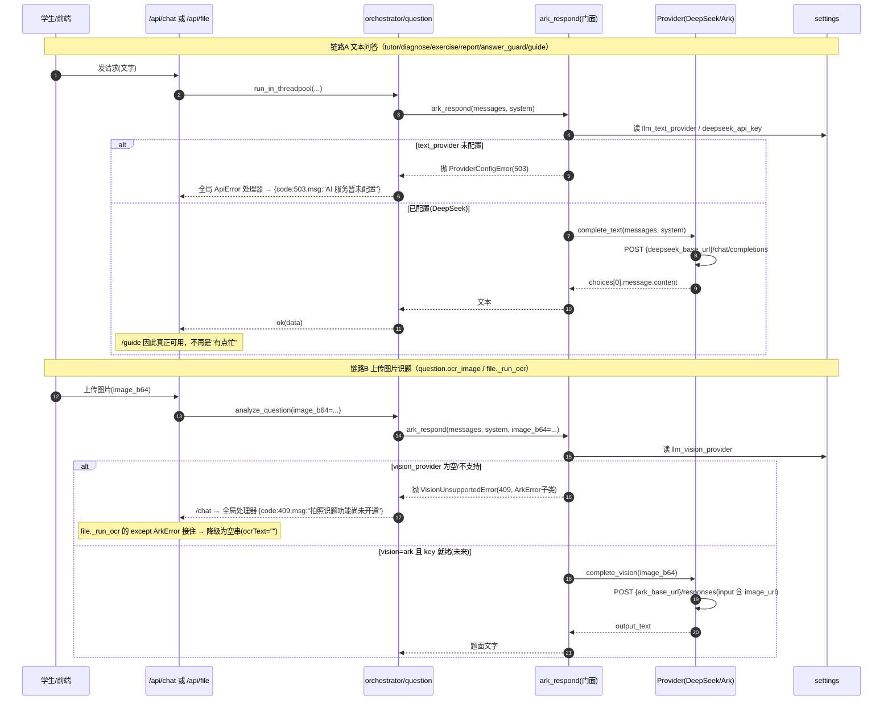

# 增量架构设计：AI 供应商切换（火山方舟 → DeepSeek）

> 作者：架构师 高见远（Gao） · 团队 `software-tiku-consumer`
> 触发：主理人齐活林指派（AI 后端因 `ark_api_key` 为空而全瘫，需切到本机现成可用的 DeepSeek）
> **性质：纯设计，不动代码、不动 git。** 交付物仅此文档 `docs/llm-provider-migration-design.md`。
> 约束：不规划改 `judge_engine.py` / `practice_service.py` / `schemas/practice.py` / `tests/test_practice.py`（与软件工程师并行，避免撞车）；守响应外壳 `{code,msg,data}`、Schema 直承 `pydantic.BaseModel`（禁 `schemas/common.BaseSchema`）、出参 snake_case。

---

## 0. 现状与根因（实测核对）

- 全站 AI 调用**唯一出口**是 `ark_respond(*, messages, system=None, image_b64=None, timeout=60.0) -> str`（定义在 `app/ai/ark_client.py`），共 **7 处调用 + `practice_service` 的 `/guide`** 都走它 → **只要保持此签名不变，7 处调用点与 practice_service 一律零改动**。
- `ArkError` 是**裸 `Exception`**（`ark_client.py:50`），不是 `ApiError`。`/guide` 现在的"老师有点忙"是它在未捕获时落到前端的兜底文案——本质是永久未配置却假装临时故障，**这是今天要消除的反面教材**。
- 视觉（`image_b64`）只出现在 `question.py:72`(`ocr_image`) 与 `file.py:117`(`_run_ocr`)，其余 6 处全文本。DeepSeek 官方 API **纯文本、拒收 `image_url`、实测 400**（本机已验证）。
- 协议差异：方舟 Responses API（`input[]` + `output_text`）vs DeepSeek Chat Completions（`messages[]` + `choices[0].message.content`）。
- 配置 `config.py:62-65`：`ark_api_key=""` / `ark_base_url`（**死配置，端点硬编码**）/ `ark_timeout_sec`（**未被读取，用的是模块常量 `DEFAULT_TIMEOUT`**）。

---

## 1. 方案选型与理由（逐条回答 6 个问题）

### Q1 抽象边界：provider 抽象，but 保留 `ark_respond` 门面 → **零调用点改动**
- **结论**：新增 `app/ai/llm_client.py`，内含 `BaseLLMProvider` + `ArkProvider` + `DeepSeekProvider` + **对外门面 `ark_respond`（签名不变）** + 新异常层次；`ark_client.py` 退化为**仅 re-export** 的兼容壳（保留 `ark_respond`/`ArkError`/`ARK_ENDPOINT` 导出）。
- **理由**：7 个调用点（含 practice_service 的 `/guide`）都 `from app.ai.ark_client import ark_respond/ArkError`。保留门面 = 不改任何调用点；抽象内部让"未来再换供应商"只需加一个 Provider 类 + 一个 env 开关，而非再动 7 处。若直接把 `ark_client` 原地改成 DeepSeek，则下次换供应商又得再改一次，且无法同时保留方舟视觉能力。
- **双赢**：既满足"最小改动成本"（本次 0 调用点改动），又满足"未来换供应商成本低"（加类即可）。

### Q2 能力路由：文本/视觉分离，**诚实失败**（`VisionUnsupportedError`）
- **结论**：门面按 `image_b64` 是否存在分派到 `vision_provider` / `text_provider`：
  - 文本：`settings.llm_text_provider`（默认 `deepseek`）→ `DeepSeekProvider`。
  - 视觉：`settings.llm_vision_provider`（默认 **空 = 未开通**）→ 若为空或该 provider 不支持视觉，抛 `VisionUnsupportedError`。
- **诚实失败**（杜绝"有点忙"）：`VisionUnsupportedError` 继承 `ArkError`（即继承 `ApiError`），带固定文案 **「拍照识题功能尚未开通，请改用文字描述题目或手动输入」**，HTTP 映射 409。全局 `ApiError` 处理器自动渲染为 `{code:409,msg:...,data:{}}`，**调用点（chat.py）无需 try/except 改动**。
  - `file.py:_run_ocr` 现有 `except ArkError` 会自然接住 `VisionUnsupportedError`（因其是 `ArkError` 子类）→ 上传场景 OCR 优雅降级为空串（OCR 是 best-effort）；而 `chat.py` 拍题开场走图像时该异常不被捕获 → 上抛 409 诚实告知。两条链行为都正确。
- 文本 provider 未配置（如 `DEEPSEEK_API_KEY` 缺失）抛 `ProviderConfigError`（HTTP 503，文案「AI 服务暂未配置，请联系管理员」），同样诚实、非"有点忙"。

### Q3 命名与兼容：保留 `ArkError`，新增 `LLMError` 体系（**不重命名**）
- **结论**：**不重命名** `ArkError`。新增 `LLMError(ApiError)` 作为基类，派生 `ProviderConfigError` / `ProviderAPIError` / `ProviderTimeout` / `VisionUnsupportedError` / `JSONParseError`；`ArkError` 保留为 `LLMError` 子类（默认 code 400），语义等同"参数/结构类方舟错误"。
- **⚠️ 致命缺陷（已修订）& 强制修复**：`ApiError.__init__` 的**第一个位置参数是 `code: int`（会 `int()` 强转）**。若 `ArkError` 直接继承 `ApiError` 却**不覆写 `__init__`**，则现网 **14 处 `raise ArkError("字符串")`** 会全部崩在 `int("字符串")` → 抛 `ValueError: invalid literal for int()`，**用莫名其妙的 ValueError 盖掉真实错因**。这 14 处全在错误路径，平时不炸、只在 AI 已出问题时炸，排查极难。
  **强制修复**：`LLMError` 必须**显式覆写 `__init__`**，保持"第一个位置参数是消息字符串"的既有契约；子类只改 `default_code`（详见 §3.3）。参考实现：
  ```python
  class LLMError(ApiError):
      default_code = CODE_SERVER_ERROR
      def __init__(self, msg=None, *, code=None, data=None, http_status=None):
          super().__init__(code=code if code is not None else self.default_code,
                           msg=msg, data=data, http_status=http_status)
  ```
  子类仅需 `class ProviderConfigError(LLMError): default_code = CODE_SERVICE_UNAVAILABLE` 等。**这样 14 处 `raise ArkError("...")` 一个字都不用改**，且 `.msg`=原字符串、`.code`=预期值——"零调用点改动"才真正成立（见 §5 M5 验收）。
- **`ArkError` 属性路径可达性约束（针对 `practice_service.py:952` 的 `except ark_client.ArkError`）**：`ark_client.py` 退化成的 re-export 壳必须 `from app.ai.llm_client import ArkError`，使 `ArkError` 成为 `ark_client` 的模块级名字 → **`ark_client.ArkError` 属性路径依然可达**（practice_service 经模块路径引用，不能只在 `app/ai/__init__.py` 再导出）；`app/ai/__init__.py` 的 `from app.ai.ark_client import ArkError` 也照常可用。本设计**不规划改 `practice_service.py`**，仅说明壳如何保证该路径。**另两处 `except ArkError`**：`app/api/file.py:122` 与 `app/ai/orchestrator.py:193`，均因 `ArkError` 仍是真实类而正常捕获。
- **理由（不重命名）**：重命名要动 7 个文件（`_json_utils.py:79` 固定消息 `"AI 返回无法解析为JSON"`、exercise.py、report.py、diagnose.py、tutor.py、answer_guard.py、file.py），且会撞上正在改 `practice_service` 的工程师。保留 `ArkError` = **零调用点改动**；新层次靠 `default_code` 补齐"能力不可用 vs 配置缺失 vs 瞬时故障"的语义区分。`ArkError` 仅在名字上略过时，留一行 `# deprecated: 历史名，新代码用 LLMError 体系` 即可。

### Q4 配置模型：**按能力分别配**（`llm_text_provider` / `llm_vision_provider`）
- **结论**：不用单一 `llm_provider` 枚举。因为文本(DeepSeek)与视觉(仅方舟)可用性天然不同，单一枚举会强制视觉随文本一起断裂。采用**双能力开关**，视觉默认空（诚实关闭）。
- **完整环境变量清单**（新增项；既有 `ARK_*` 保留并**改为真正被读取**以修两处瑕疵）：

| 变量 | 默认值 | 说明 |
|---|---|---|
| `LLM_TEXT_PROVIDER` | `deepseek` | 文本供应商：`deepseek` / `ark` |
| `LLM_VISION_PROVIDER` | `""`(空=未开通) | 视觉供应商：`ark` 或留空 |
| `DEEPSEEK_API_KEY` | `""` | 文本密钥（**本机现成可用，已实测 200/1.4s**） |
| `DEEPSEEK_BASE_URL` | `https://api.deepseek.com` | DeepSeek API 基址 |
| `DEEPSEEK_MODEL` | `deepseek-chat` | 文本模型 |
| `DEEPSEEK_TIMEOUT_SEC` | `60` | 文本超时 |
| `ARK_API_KEY` | `""` | 视觉密钥（可选；填了 `LLM_VISION_PROVIDER=ark` 才用） |
| `ARK_BASE_URL` | `https://ark.cn-beijing.volces.com/api/v3` | **修瑕疵：端点由它拼 `/responses`，不再硬编码** |
| `ARK_MODEL` | `doubao-seed-1-6-250615` | 视觉模型 |
| `ARK_TIMEOUT_SEC` | `60` | **修瑕疵：真正传给 ArkProvider 的 timeout** |

> `.env` 已在 `.gitignore` 第 2 行，写 key 不泄密；两个 `.env` 当前不存在，由部署方填入 `DEEPSEEK_API_KEY`。

### Q5 教学效果漂移风险与验证方案（最关键）
**两个脆弱点评估：**
1. **`_json_utils.extract_json` 三级提取**：与具体模型无关（去围栏→`json.loads`→贪婪切片），DeepSeek 输出 JSON 习惯不同但能被三级策略兜住。**MVP 不引入 `response_format`，不改动 diagnose/exercise/report/question 四个 Agent**（保持最小改动面）。理由：DeepSeek Chat Completions 的 `json_object` 模式要求 prompt 含 "json"，而 tutor/answer_guard/guide 是**自然语言非 JSON**调用， blanket 开启会破坏它们；按调用开 `json_mode` 又要改 4 个 Agent——故 MVP 先靠既有三级提取，验证通过即可，验证不通过再作为 P1 快修（给 `ark_respond` 加 `json_mode: bool` 入参并改 4 个 Agent 传 `True`）。
2. **`answer_guard.generate_guarded_reply` 泄题重试循环**：循环逻辑与模型无关（只检测 reply 是否命中泄漏正则），换模型后仍成立；唯一变量是"换模型后泄题率可能变化" → 用 **V7 抽检 20 轮 0 泄题** 卡住（已在题库消费层设计 C11/V7 约定，此处复用同一口径）。
3. **prompts 照豆包调的漂移**：门面切换不改变 prompt 文本、不改变调用顺序、不改变 `_json_utils`/guard 逻辑，故"教学流程结构"不漂移；差异仅在底层模型输出风格，由下方验证方案兜底。

**验证方案（怎么证明质量没退）：**
- **V-A 金标准语料回归**：构建 N=40 条代表性 `(prompt, 期望结构)` 基线（diagnose/exercise/report/question 各 10），切换后跑同一批 prompt，比较**结构化**输出（JSON schema 合法性、必填 key 存在、字段归一化值），非逐字比对；结构偏离交人工复核。
- **V-B JSON 解析率闸门**：contract 测试断言对真实 DeepSeek 输出 `_extract_json` 成功率 = 100%（或 ≥ 基线）；任一失败即阻断合并。
- **V-C 泄题率闸门（V7）**：20 轮抽检，`has_answer_leak` 命中数 = 0；对比切换前后基线泄漏率。
  ⚠️ **统计口径（严格）**：只统计**引导语**——即 tutor / answer_guard / guide 等自然语言回复，这是唯一会"不小心说出答案"的载体；选择题/判断题的题干与解析**绝不计入泄漏样本**（否则保守检测会把正常判断题当泄题，导致误杀、虚高）。**任何情况下不许为了指标好看去放宽 `leaks_answer` 的检测阈值或正则**——`answer_guard` 的保守检测是教学安全底线，宁可偶发误拦（用户可重试），不可漏放真泄题。V-C 的"0 泄题"必须在"不放松 `leaks_answer`"前提下取得，二者缺一不可。
- **V-D prompt 兼容 lint**：单测断言所有 JSON 型 prompt 文本包含 "json" 字样（为将来开 `response_format` 扫雷，避免 400）。
- **V-E 苏格拉底质量人工 rubric**：10 道留底数学题（已知合格引导），2 人按 rubric 评分（是否避免给最终答案、是否每次只推进一步），DeepSeek 均值 ≥ Ark 均值 − δ 阈值。
- **V-F 既有 295 测试不破**：因 `ark_respond` 签名不变，原 mock 目标不变 → 全绿；新增 contract 测试覆盖"真实客户端接线"（见 Q6）。

### Q6 测试策略：**环境自检（doctor 命令）+ 契约测试** 双保险
- **根因**：295 测试把 `ark_respond` monkeypatch 掉，永远发现不了"环境没配好"。
- **结论（采纳主理人倾向并增强）**：
  1. **`python -m app.scripts.doctor`（独立命令，主椎）**：一次性查 ①LLM key 可用性（按 `llm_text_provider`/`llm_vision_provider` 校验 provider 是否 `is_configured`，视觉为空则如实报告"disabled"而非假绿）②DB schema drift（连通 + 期望表/列存在）③L1 池非空（`SELECT COUNT(*) FROM questions WHERE ... L1 安全池 > 0`，复用 §4.4.1 规则）。输出人类可读报告 + 退出码（0/1）。CI 单独一步跑、本地也可跑。
  2. **`tests/contract/test_llm_client.py`（契约测试，补漏关键）**：**不** mock `ark_respond` 本身，而是用 `unittest.mock.patch` 在**传输层**桩 `httpx.Client.post`，跑**真实** `ark_respond`/`DeepSeekProvider`：断言请求体形状（DeepSeek `chat/completions` + `messages[]`）、响应解析（`choices[0].message.content`）、重试与错误映射。这下"环境没配好/协议漂移"会被真正兜住。
  3. **`tests/smoke/test_doctor.py`**：以 report-only 模式调 `doctor.run_checks()`，断言检查函数能跑且诚实报告（如 `DEEPSEEK_API_KEY` 缺失时文本检查报 not-configured，不要求 CI 真有 key）。
- **零新依赖**：契约测试用标准库 `unittest.mock` 桩 `httpx.Client`，不引入 respx 等新包。
- **可选 P2**：`main.py` 启动探针——`LLM_TEXT_PROVIDER` 未 `is_configured` 时 `logging.warning` 一条，避免"上线才发现 AI 瘫"。属于小增强，不阻塞 MVP。

---

## 2. 文件清单（🆕 新增 / ✏️ 修改 / 🗑 删除）

| 文件 | 操作 | 说明 | 是否触碰禁改 4 文件 |
|---|---|---|---|
| `backend/app/ai/llm_client.py` | 🆕 | provider 抽象：`BaseLLMProvider`/`ArkProvider`/`DeepSeekProvider` + 门面 `ark_respond`(签名不变) + 异常体系(`LLMError`/`ArkError`别名/`ProviderConfigError`/`ProviderAPIError`/`ProviderTimeout`/`VisionUnsupportedError`/`JSONParseError`) | 否 |
| `backend/app/ai/ark_client.py` | ✏️ | 正文替换为 re-export 壳（`from app.ai.llm_client import ark_respond, ArkError, ARK_ENDPOINT, DEFAULT_TIMEOUT, MAX_RETRY`），保留 7 处导入兼容 | 否 |
| `backend/app/core/config.py` | ✏️ | Settings 加 `llm_text_provider`/`llm_vision_provider`/`deepseek_*`/`ark_*` 字段；`ark_base_url`/`ark_timeout_sec` **改为真正被读取** | 否 |
| `backend/app/scripts/doctor.py` | 🆕 | 环境自检 CLI（`run_checks()` + `__main__`），覆盖 LLM key / DB schema / L1 池 | 否 |
| `backend/tests/contract/test_llm_client.py` | 🆕 | 传输层桩 httpx，跑真实 `ark_respond`，验证 DeepSeek 请求/响应/重试/错误映射 | 否（新文件） |
| `backend/tests/smoke/test_doctor.py` | 🆕 | report-only 调 doctor，断言诚实报告 | 否（新文件） |
| `docs/llm-provider-migration-design.md` | 🆕 | 本设计文档 | — |

**明确不改动**（含禁改 4 文件）：`app/ai/ark_client` 之外 7 个调用点（diagnose/exercise/question/report/tutor/answer_guard/_json_utils）、`practice_service.py`(含 `/guide`)、`judge_engine.py`、`schemas/practice.py`、`tests/test_practice.py`、`app/api/chat.py`、`app/api/file.py`、`app/core/response.py`、`app/ai/__init__.py`（它经 ark_client 壳仍导出旧符号，无需改）。

---

## 3. 接口定义

### 3.1 对外门面（签名向后兼容，调用点零改）
```python
# backend/app/ai/llm_client.py
def ark_respond(
    *,
    messages: List[Dict[str, Any]],
    system: Optional[str] = None,
    image_b64: Optional[str] = None,
    timeout: float = 60.0,
) -> str:
    """门面：按能力分派到 text/vision provider。
    - image_b64 非空 → vision_provider（为空/不支持则抛 VisionUnsupportedError）
    - 否则 → text_provider（未配置则抛 ProviderConfigError）
    """
```

### 3.2 Provider 抽象
```python
class BaseLLMProvider:
    name: str
    supports_vision: bool
    def is_configured(self) -> bool: ...
    def complete_text(self, *, messages, system=None, timeout=None) -> str: ...
    def complete_vision(self, *, messages, image_b64, system=None, timeout=None) -> str:
        # 不支持时抛 VisionUnsupportedError

class DeepSeekProvider(BaseLLMProvider):   # supports_vision = False
    # POST {deepseek_base_url}/chat/completions
    # body: {"model": deepseek_model, "messages":[{role, content:str}], "stream": False}
    # resp: choices[0].message.content

class ArkProvider(BaseLLMProvider):         # supports_vision = True
    # POST {ark_base_url}/responses   # ← 修瑕疵：端点由 ark_base_url 拼，不再硬编码
    # body: {"model": ark_model, "input":[{role, content:[{type:input_text,text}]}]}
    # resp: output_text 或 output[*].content[*].text
```

### 3.3 异常层次（全部最终是 `ApiError` → 全局处理器渲染诚实文案）
```python
from app.core.response import ApiError

class LLMError(ApiError): ...                       # 基类
class ArkError(LLMError):                           # 兼容别名，默认 code=400
    """历史名，新代码用下方细分类型"""
class ProviderConfigError(LLMError):                # 503 永久未配置（诚实）
class ProviderAPIError(LLMError):                  # 502 上游非2xx
class ProviderTimeout(LLMError):                    # 504 超时
class VisionUnsupportedError(ArkError):             # 409 拍照识题未开通（诚实）
    # 继承 ArkError → file.py 的 except ArkError 自动接住并降级
class JSONParseError(LLMError):                    # 400 "AI 返回无法解析为JSON"
```

### 3.4 配置字段（config.py 完整清单，已含 Q4 表）
新增：`llm_text_provider: str = "deepseek"`、`llm_vision_provider: str = ""`、`deepseek_api_key: str = ""`、`deepseek_base_url: str = "https://api.deepseek.com"`、`deepseek_model: str = "deepseek-chat"`、`deepseek_timeout_sec: int = 60`、`ark_base_url: str = "https://ark.cn-beijing.volces.com/api/v3"`（改为被读取）、`ark_model`/`ark_timeout_sec` 保留并改为被读取；既有 `ark_api_key` 保留（仅 vision=ark 时生效）。

### 3.5 doctor 自检接口
```python
# backend/app/scripts/doctor.py
def run_checks() -> DoctorReport:  # 返回 {llm: {...}, db: {...}, l1_pool: {...}, ok: bool}
if __name__ == "__main__":
    report = run_checks(); print(report.render()); raise SystemExit(0 if report.ok else 1)
```

---

## 4. 调用流程时序图（Mermaid）



---

## 5. 有序任务列表（含依赖 / 可并行）

| ID | 任务 | 源文件 | 依赖 | 可并行 | 优先级 |
|---|---|---|---|---|---|
| **M1** | config 加 LLM provider 字段（`llm_text_provider`/`llm_vision_provider`/`deepseek_*`/`ark_*` 真正读取） | `core/config.py` | — | 首任务 | P0 |
| **M2** | 新建 `llm_client.py`：Provider 抽象 + 门面 `ark_respond`(签名不变) + 异常体系 | `ai/llm_client.py` | M1 | 依赖 M1 | P0 |
| **M3** | `ark_client.py` 退化为 re-export 壳（保留 7 处导入兼容） | `ai/ark_client.py` | M2 | 与 M4/M5 并行 | P0 |
| **M4** | 新建 `doctor.py` 环境自检（LLM key / DB schema / L1 池） | `ai/scripts/doctor.py` | M1,M2 | 与 M3/M5 并行 | P0 |
| **M5** | 契约测试：传输层桩 httpx 跑真实 `ark_respond`（DeepSeek 请求/响应/重试/错误映射）；**必含断言 K1**：现网 14 处 `raise ArkError("字符串")`（ark_client 12 处 + `exercise.py:127` + `_json_utils.py:79`）全部能正常抛出、`.msg`=原字符串、`.code`=预期值（验证 `LLMError.__init__` 覆写生效，见 §1 Q3 / §3.3）。**不写进测试，以后有人重构异常层次会再踩一遍 `int()` 强转的坑** | `tests/contract/test_llm_client.py` | M2 | 与 M3/M4 并行 | P0 |
| **M6** | smoke 测试：report-only 调 doctor，断言诚实报告 | `tests/smoke/test_doctor.py` | M4 | 依赖 M4 | P0 |
| **M7** (P1) | 若 V-B 解析率不达标：给 `ark_respond` 加 `json_mode` 入参 + 4 个 JSON Agent 传 `True`（开启 DeepSeek `response_format`） | `llm_client.py`+4 Agent | M2 | — | P1 |
| **M8** (P1) | 若 V-C 泄题率升高：调 `answer_guard.LEAK_RETRY_HINT`/`MAX_GUARD_RETRIES` | `answer_guard.py` | M2 | — | P1 |
| **M9** (P2) | `main.py` 启动探针：text provider 未配置时 WARN | `main.py` | M1,M2 | — | P2 |

> 依赖图：M1 → M2 → {M3, M4, M5} 并行；M4 → M6。M7/M8 由验证闸门（V-B/V-C）触发，属快修不阻塞 MVP。**MVP 交付 = M1~M6**（均不触碰禁改 4 文件，且与并行中的 judge_engine/practice_service 改造零冲突）。
> **验收硬门槛 K1（对应 §1 Q3 致命缺陷修复）**：M5 的契约测试必须断言现网 14 处 `raise ArkError("字符串")` 不崩在 `int()` 强转、`.msg` 保留原串、`.code` 为预期值。该断言落进 `tests/contract/test_llm_client.py`，作为异常层次重构的回归护栏——未通过则 M5 不视为完成。

---

## 6. 风险清单与回滚

| 风险 | 影响 | 缓解 / 回滚 |
|---|---|---|
| DeepSeek JSON 格式漂移 | diagnose/exercise/report/question 解析失败 | `_json_utils` 三级提取本就模型无关兜底；V-B 闸门卡 100%；不达标走 M7 开 `response_format`。回滚=配置翻回 `LLM_TEXT_PROVIDER=ark`(若有 key) |
| 视觉永久不可用（DeepSeek 拒图） | 拍照识题失败 | **设计内**：`VisionUnsupportedError` 诚实 409，非静默。回滚=填 `ARK_API_KEY` + `LLM_VISION_PROVIDER=ark` 恢复方舟视觉 |
| 切换后泄题率上升 | 违反 G2 教学原则 | `answer_guard` 循环模型无关；V-C(V7) 20 轮 0 泄题卡死；不达标走 M8 调提示/重试 |
| 契约测试需桩 httpx | 引入新依赖？ | 用标准库 `unittest.mock` 桩 `httpx.Client.post`，**零新依赖** |
| "环境没配好"仍被 mock 掩盖 | 重现今日瘫痪 | doctor 命令 + 契约测试双保险；CI 单独跑 doctor |
| 撞车并行工程师 | practice_service/judge_engine 改动冲突 | 本设计**不改**这 4 个文件；`/guide` 经不变 `ark_respond` 门面自动获得 DeepSeek 能力 |

**整体回滚策略 = 纯配置翻面，无代码回滚**：provider 由 `LLM_TEXT_PROVIDER`/`LLM_VISION_PROVIDER` 驱动，翻回 `ark`(+key) 即还原方舟；翻空 `DEEPSEEK_API_KEY` 则文本路径诚实 503（fail-safe，绝不假装"有点忙"）。代码改动（llm_client 新增 + ark_client 壳 + config 字段）全部 additive，保留无副作用，无需 revert。

---

## 7. 与铁律的对齐
- 响应外壳：`{code,msg,data}` 经 `app.core.response.ok()`；新异常继承 `ApiError` → 全局处理器自动渲染。
- Schema：本设计不新增对外响应 Schema；若 doctor/自检需 HTTP 接口，其响应体直承 `pydantic.BaseModel`（snake_case），不继承 `schemas/common.BaseSchema`。
- 出参 snake_case：doctor 报告字段、错误 data 均 snake_case。
- 跨方言/零 DDL：本设计不涉及 DB 表变更；doctor 的 L1 池核查走只读 `SELECT COUNT`。
