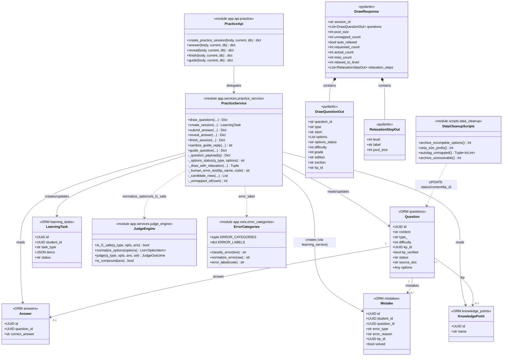
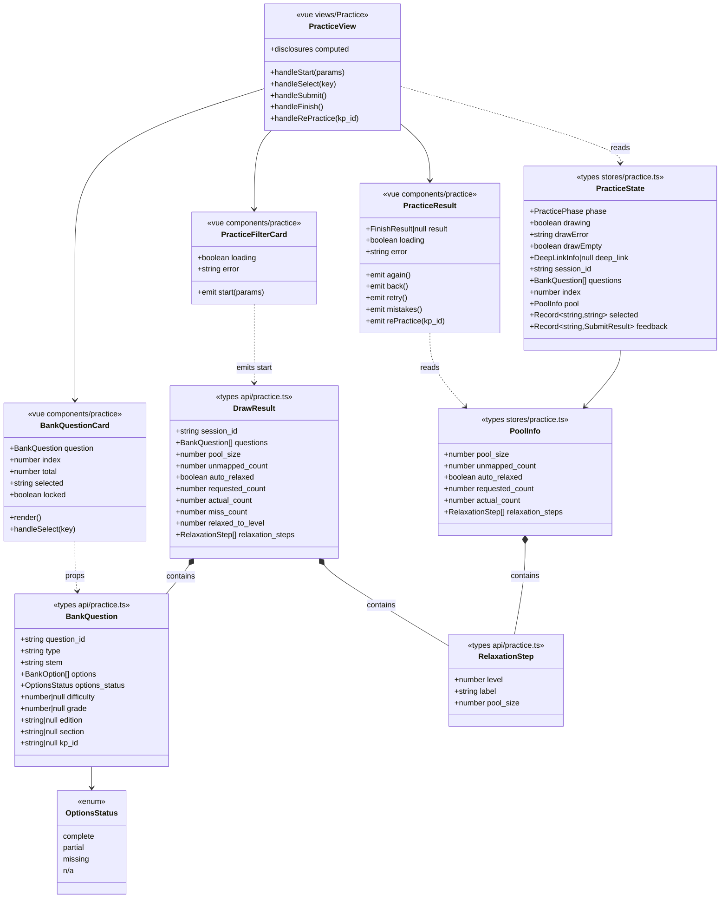
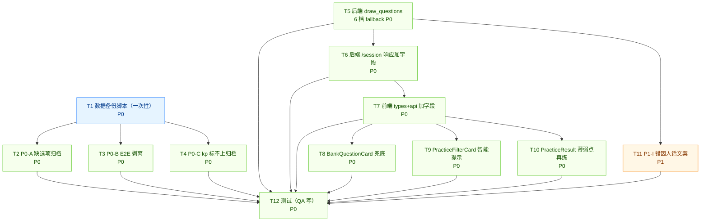

# 「练习模块」完整重新设计 · 增量架构设计

- 文档版本：v1.0（2026-08-11）
- 作者：架构师 高见远
- 状态：可开工（已对齐主理人 8 项拍板决策）
- 上游文档：`docs/practice-module-redesign-prd-20260811.md`（产品经理 许清楚）
- 参考（不推翻 mode/五类机器码框架）：`docs/practice-tutor-design-20260810.md`
- 影响范围：`backend/app/services/practice_service.py`、`backend/app/services/ai_exercise_service.py`、`backend/app/core/error_categories.py`、`backend/app/schemas/practice.py`、`backend/app/api/practice.py`、`student-web/src/api/practice.ts`、`student-web/src/stores/practice.ts`、`student-web/src/components/practice/{BankQuestionCard,PracticeFilterCard,PracticeResult,AnswerFeedbackBar}.vue`、`student-web/src/views/Practice.vue`
- 新增文件：`backend/scripts/data_cleanup/{20260811_archive_incomplete_options,20260811_strip_e2e_prefix,20260811_autotag_unmapped,20260811_archive_unresolvable}.py`
- 不在范围：importer、AI 引导流程、家长周报口径、git 写操作、KF 树维护

---

## 0. 一句话定位

本次把「练习模块」从数据/服务/前端三层坍塌状态整体重做一遍：**数据补全只做不动 schema**（UPDATE 现有行脏值/缺值），**服务层把抽题 fallback 拆成 6 档并逐档向披露**，**前端给选项缺残补兜底 + 给池子稀缺补诚实话术**，**错因文案用「知识点 + 人话」而不是硬塞五类机器码**。P0 全部上、P1 只做 I、P2 全不进。

---

## 1. 实现方案（按 P0-A → P0-F + P1-I 顺序）

### 1.1 P0-A · 数据补全：缺选项的选择题只归档不补全

**目标**：把「选项缺失 1~3 个」的选择题直接 `status='archived'`，杜绝孩子点不到 A/B/D 的体验事故；**不调 AI 补选项**（Q1 拍板）。

**脚本位置**：`backend/scripts/data_cleanup/20260811_archive_incomplete_options.py`（新建，单次执行）

**核心 SQL/伪代码**（标准 SQL，SQLite/PG 双方言）：

```python
# 1. 备份表：CREATE TABLE … AS SELECT  是允许的（不是 schema 改动，是临时备份）
backup_sql = """
CREATE TABLE questions_options_backup_20260811 AS
SELECT id, type_, options
FROM questions
WHERE status = 'active' AND type_ = '选择';
"""

# 2. 拉清单（Python 侧归一化判断，跨方言稳）
def is_incomplete_choice(q) -> bool:
    if q.type_ != '选择':
        return False
    items = judge_engine.normalize_options(q.options)  # 唯一真相源
    return len(items) < 2  # 0 个或 1 个都视为不完整

rows = db.execute(select(Question).where(
    Question.status == 'active',
    Question.type_ == '选择',
)).scalars().all()
to_archive = [q.id for q in rows if is_incomplete_choice(q)]

# 3. 单事务 UPDATE
db.execute(
    update(Question)
    .where(Question.id.in_(to_archive))
    .values(status='archived', updated_at=utcnow())
)
db.commit()

# 4. 日志输出
log_markdown = f"""
## 阶段 A：缺选项归档
- 扫描范围：{len(rows)} 道 active 选择题
- 命中归档：{len(to_archive)} 道
- 备份表：questions_options_backup_20260811（{len(to_archive)} 行）
"""
```

**日志输出格式**（追加写入 `docs/data-cleanup-log-20260811.md`）：

```
## 阶段 A · 缺选项归档
- 脚本：scripts/data_cleanup/20260811_archive_incomplete_options.py
- 备份表：questions_options_backup_20260811（X 行）
- 扫描：active 选择题 X 道
- 命中归档：X 道
- 不动字段：options 内容、correct_answer
- 验收：跑 is_l1_safe 全库，选择题 0 道 < 2 选项
```

**不动什么**：`options` 内容、`correct_answer`、`Question` schema（无 DDL）。

**完成判据**（来自 PRD §5.1 P0-A + §10）：
- `tests/test_practice.py::TestL1PoolInvariantOnRealBank` 池规模不减少
- `is_l1_safe` 全库，**0 道**选择题 `normalize_options(...).length < 2` 且 `status='active'`
- 人肉抽样 20 道选择，每一道 `options` ≥ 2 键位

---

### 1.2 P0-B · 数据补全：剥离题干里的 "E2E" 前缀

**目标**：入库管道把内部代号写到了题干前面（`E2E 23+45=?`），必须剥掉（Q2 拍板：不保留源信息）。

**脚本位置**：`backend/scripts/data_cleanup/20260811_strip_e2e_prefix.py`

**核心 SQL/伪代码**：

```python
# 1. 全表备份（CREATE TABLE … AS SELECT）
db.execute("""
CREATE TABLE questions_content_backup_20260811 AS
SELECT id, content FROM questions;
""")

# 2. 扫描（Python 正则跨方言，PG/SQLite 都用 Python 判定，避免 REGEXP 不可用）
E2E_RE = re.compile(r'^\s*E2E\s+')
hits = []
for q in db.execute(select(Question.id, Question.content)).all():
    if E2E_RE.match(q.content or ''):
        hits.append((q.id, q.content))

# 3. 逐条 UPDATE（保留 E2E 之后的所有内容）
for qid, content in hits:
    new_content = E2E_RE.sub('', content).lstrip()
    db.execute(
        update(Question)
        .where(Question.id == qid)
        .values(content=new_content, updated_at=utcnow())
    )
db.commit()
```

**不动什么**：`correct_answer`（Q2 拍板：E2E 是入库管道代号，与答案无关）、`options`、`Question` schema。

**完成判据**：
- 全表无 `content` 匹配 `^\s*E2E\s+`（Python 正则校验）
- 抽样 10 道题打开，题干都是自然语言开头
- `docs/data-cleanup-log-20260811.md` 阶段 B 写入命中行数

---

### 1.3 P0-C · 数据补全：无 kp_id 的题自动打标 + 标不上下架

**目标**：21% 题 `kp_id IS NULL`（主要是 docx 新题）必须消解（Q3 拍板：直接下架缺选项的，留 kp 标不上的进宽松池）。

**这是 P0 里最重的人工投入项**，分两步：

**Step 1**：`backend/scripts/data_cleanup/20260811_autotag_unmapped.py`

```python
# 1. 统计现状
unmapped_count = db.execute(
    select(func.count()).select_from(Question).where(
        Question.status == 'active',
        Question.kp_id.is_(None),
    )
).scalar_one()

# 2. 从 knowledge_points 捞 L1 关键词表
kp_rows = db.execute(select(KnowledgePoint.name, KnowledgePoint.id)).all()
keyword_to_kp_id = {kp.name: kp.id for kp in kp_rows}

# 3. 关键词子串匹配 → 命中率高且无歧义的直接打标
AUTO_KEYWORDS = {
    '加减': '...kp_id_加减法...',  # 实际从 knowledge_points 拉
    '乘除': '...',
    '时分': '...',
    '元角分': '...',
}

auto_tagged = 0
for q in db.execute(select(Question).where(
    Question.status == 'active',
    Question.kp_id.is_(None),
    Question.kp_verified.is_(False),
)).scalars().all():
    for keyword, kp_id in AUTO_KEYWORDS.items():
        if keyword in (q.content or ''):
            db.execute(
                update(Question)
                .where(Question.id == q.id)
                .values(kp_id=kp_id, kp_verified=True, updated_at=utcnow())
            )
            auto_tagged += 1
            break
db.commit()

# 4. 标不上的导出 CSV → 人工标注
unresolved = db.execute(select(Question).where(
    Question.status == 'active',
    Question.kp_id.is_(None),
    Question.kp_verified.is_(False),
)).scalars().all()

with open('docs/unmapped-human-triage-20260811.csv', 'w') as f:
    f.write('question_id,type,stem\n')
    for q in unresolved:
        f.write(f'{q.id},{q.type_ or ""},{(q.content or "")[:60]}\n')
```

**Step 2**：`backend/scripts/data_cleanup/20260811_archive_unresolvable.py`

```python
# 人工标注完或放弃标注后跑这一轮：
# - 标不上 + 题型不完整（缺答案/复合题/无选项）→ 归档
# - 标不上 + 题型完整 → 保留 status='active'，靠 attributablbe_only=False 进宽松池
UNRESOLVABLE = db.execute(select(Question).where(
    Question.status == 'active',
    Question.kp_id.is_(None),
    Question.kp_verified.is_(False),
)).scalars().all()

# 用 judge_engine.is_l1_safe 复合题判复合，无 options 的选择题也归档
unresolvable_to_archive = [
    q.id for q in UNRESOLVABLE
    if not judge_engine.is_l1_safe(q.type_, q.options, ...)
]
# 注：标不上的选择题「有选项但只有 1 个」已在 P0-A 归档，此处不重复处理
```

**完成判据**：
- 人工标注后跑 `TestL1PoolInvariantOnRealBank` 不退化
- `status='active' AND (kp_id IS NULL OR kp_verified=False) AND is_l1_safe(q)` 的题数 → 0 或仅剩「题型完整、可进宽松池」的（这些不进掌握度但能抽题，PRD §5.1 P0-C 验收已允许）

---

### 1.4 P0-D · 数据兜底：选项不完整占位

**目标**：万一 P0-A/P0-C 后仍有漏网之题被抽上来，前端必须按 `options_status` 显示兜底（Q3 拍板：直接下架是终极方案，兜底是过渡期防护）。

**后端改动**：`practice_service._question_payload` 加 `options_status` 字段：

```python
def _options_status(q_type: Optional[str], options: Any) -> str:
    """选择题选项完整性枚举。判断题返回 'n/a'。"""
    if q_type != '选择':
        return 'n/a'
    items = judge_engine.normalize_options(options)
    if len(items) >= 4:
        return 'complete'
    if len(items) >= 1:
        return 'partial'
    return 'missing'

def _question_payload(question: Question) -> Dict[str, Any]:
    return {
        "question_id": str(question.id),
        "type": question.type_ or "",
        "stem": question.content or "",
        "options": [item.to_dict() for item in judge_engine.normalize_options(question.options)],
        "options_status": _options_status(question.type_, question.options),  # ★ 新增
        "difficulty": question.difficulty,
        "grade": question.grade,
        "edition": question.edition,
        "section": question.section,
        "kp_id": str(question.kp_id) if question.kp_id else None,
    }
```

**字段枚举**：
- `'complete'`: 归一化后 ≥ 4 个选项（选择题正常态）
- `'partial'`: 1~3 个选项（孩子点不到完整 ABCD）
- `'missing'`: 0 个选项（前端「没有可选项」态）
- `'n/a'`: 判断题（前端无需 disabled 态）

**前端改造**：`BankQuestionCard.vue` 在 `options_status === 'partial'` 时：
- 选项按钮标 disabled
- 卡片上半部分加 `<p class="...amber">这道题的选项不完整，做完不算分</p>`
- 不再走「提交答案」逻辑（提交时给一段解释）

**完成判据**：
- 后端契约：响应 schema 含 `options_status` 字段
- Playwright：注入 1 道 `partial` 题 → 卡片显示不完整提示 + 选项 disabled + 提交按钮不响应
- `Practice.vue` 不再依赖前端 `props.question.options.length === 1` 兜底（统一走后端字段）

---

### 1.5 P0-E · 服务层重写：抽题 6 档 fallback + 逐档披露（Q8 拍板：只做 1–3 档 + 兜底 404）

**目标**：当前 `draw_questions` 的 2 级 fallback 隐藏了放宽过程，PRD 要求**逐档披露**。

**6 档 fallback 定义**（按 PRD §5.1 P0-E + 主理人 Q8 拍板）：

| 档 | attributable_only | 回避 7 天 | 是否本期实现 |
|---|---|---|---|
| 第 1 档 优先可归因 | True | True | ✅ |
| 第 2 档 取消回避 | True | False | ✅ |
| 第 3 档 放开 kp | False | False | ✅ |
| 第 4 档 题型放宽 | 任意 | False | ❌ P2（影响 judge_engine） |
| 第 5 档 年级缩放 | 任意 | False | ❌ P2（产品卖点改动） |
| 兜底 404 | — | — | ✅ 「这个筛选条件下暂时没有可以练的题」 |

**核心 SQL/伪代码**：

```python
# practice_service.py

RELAXATION_LABELS = {
    1: "优先使用可归因题库（同筛选条件 + 回避最近 7 天）",
    2: "已放开：包含最近做过的题（同样条件）",
    3: "已放开：包含暂未关联知识点的题",
    # 4/5 留 P2，本期不输出
}

def _draw_with_relaxation(
    db: Session, *, student_id, common: dict, want: int
) -> Tuple[List[uuid.UUID], List[Dict[str, Any]], Dict[str, Any]]:
    """
    逐档尝试抽题，每档记录 (level, pool_size) 到 steps。
    返回 (picked_ids, relaxation_steps, meta)。
    """
    recent = _recent_question_ids(db, student_id)
    steps: List[Dict[str, Any]] = []

    # 第 1 档：可归因 + 回避
    rows_1 = _candidate_rows(db, attributable_only=True, exclude_ids=recent, **common)
    steps.append({"level": 1, "label": RELAXATION_LABELS[1], "pool_size": len(rows_1)})
    rows = rows_1
    if len(rows) >= want:
        return _sample_and_meta(rows, want, steps, level=1)

    # 第 2 档：可归因 + 取消回避
    rows_2 = _candidate_rows(db, attributable_only=True, exclude_ids=(), **common)
    if len(rows_2) > len(rows):
        steps.append({"level": 2, "label": RELAXATION_LABELS[2], "pool_size": len(rows_2)})
        rows = rows_2
    if len(rows) >= want:
        return _sample_and_meta(rows, want, steps, level=2)

    # 第 3 档：放开 kp（不可归因）+ 取消回避
    rows_3 = _candidate_rows(db, attributable_only=False, exclude_ids=(), **common)
    if len(rows_3) > len(rows):
        steps.append({"level": 3, "label": RELAXATION_LABELS[3], "pool_size": len(rows_3)})
        rows = rows_3

    if not rows:
        raise ApiError(CODE_NOT_FOUND, "这个筛选条件下暂时没有可以练的题，换个条件试试")

    return _sample_and_meta(rows, want, steps, level=3)


def _sample_and_meta(rows, want, steps, level):
    pool_size = len(rows)
    picked = random.sample(rows, k=min(want, pool_size))  # Q7 拍板：少给不凑数
    miss_count = max(0, want - len(picked))
    return (
        [r[0] for r in picked],
        steps,
        {
            "pool_size": pool_size,
            "unmapped_count": _unmapped_of(rows),
            "auto_relaxed": level > 1,  # 沿用旧契约
            "requested_count": want,
            "actual_count": len(picked),
            "miss_count": miss_count,
            "relaxed_to_level": level,
        },
    )


def draw_questions(db, *, student_id, grade=None, edition=None, section=None,
                   kp_id=None, difficulty=None, count=DEFAULT_COUNT) -> Dict[str, Any]:
    sid = to_uuid(student_id, "student_id")
    want = _clamp_count(count)
    target_kp = to_uuid(kp_id, "kp_id") if kp_id else None

    common = {
        "grade": grade,
        "edition": edition,
        "section": section,
        "kp_id": target_kp,
        "difficulty": difficulty,
    }

    picked_ids, steps, meta = _draw_with_relaxation(db, student_id=sid, common=common, want=want)

    task = create_session(db, student_id=sid, question_ids=picked_ids)
    questions = db.execute(select(Question).where(Question.id.in_(picked_ids))).scalars().all()
    by_id = {q.id: q for q in questions}
    payload = [_question_payload(by_id[qid]) for qid in picked_ids if qid in by_id]

    return {
        "session_id": str(task.id),
        "questions": payload,
        "pool_size": meta["pool_size"],
        "unmapped_count": meta["unmapped_count"],
        "auto_relaxed": meta["auto_relaxed"],  # 沿用：老客户端不破
        "requested_count": meta["requested_count"],
        "actual_count": meta["actual_count"],          # ★ 新增
        "miss_count": meta["miss_count"],              # ★ 新增
        "relaxed_to_level": meta["relaxed_to_level"],  # ★ 新增
        "relaxation_steps": steps,                    # ★ 新增：数组，每档一行
    }
```

**`relaxation_steps` 字段结构**：

```jsonc
// 每个 step 元素
{
  "level": 1,                          // 1/2/3
  "label": "优先使用可归因题库（同筛选条件 + 回避最近 7 天）",
  "pool_size": 30                      // 该档候选池大小
}
// 整个数组按尝试顺序追加；不命中则不写该档
```

**6 种典型场景验收**（PRD §5.1 P0-E 验收口径）：

| # | 场景 | `steps.length` | `actual_count` | `miss_count` | `relaxed_to_level` | HTTP code |
|---|---|---|---|---|---|---|
| 1 | 命中第 1 档 | 1 | == wanted | 0 | 1 | 200 |
| 2 | 第 1 档不足→第 2 档命中 | 2 | == wanted | 0 | 2 | 200 |
| 3 | 第 1/2 档不足→第 3 档命中 | 3 | == wanted | 0 | 3 | 200 |
| 4 | 任意档题量仍不足 | 3 | < wanted | > 0 | 3 | 200 |
| 5 | 用户要 5 道只给 2 道 | 3 | 2 | 3 | 3 | 200 |
| 6 | 全部 0 道 | 0 | 0 | 0 | 0 | 404（CODE_NOT_FOUND） |

**完成判据**：
- 6 个单测覆盖 6 种场景
- 不动 `LearningTask.task_type` 枚举（继承 v4 裁决①，仍写 `daily`）
- 不变式测试 `TestL1PoolInvariantOnRealBank` 仍绿
- 后端契约：响应必含 `relaxation_steps`（即使空数组）

---

### 1.6 P0-F · 前端 UX：筛选条件智能提示 + 结果页闭环

**目标**：3 个组件改造（Q4 拍板：分层披露 + Q6 拍板：苏教版标"题目较少" + Q7 拍板：少给+诚实披露）。

#### 1.6.1 `PracticeFilterCard.vue` 改造点

- **新增「放宽建议」区**：在「已选」摘要之上，根据当前 `grade + edition` 组合显示一句话建议：
  - 6 年级+苏教版：显示「苏教版题目较少，要不要换青岛版？」+ chip「换青岛版」
  - 任意年级+`count > pool_size`：显示「这个组合大概只有 X 道题」+ chip「少给几道」
- **池子预估**：**本次不入 §9 P2-Q 队列**——主理人已经在 PRD 标 P2 了，本期不实现 `pool-estimate` 接口；用前端本地启发式（根据 grade × edition 预设的"苏教版稀疏"规则）替代，避免阻塞。
- **苏教版 chip 标"题目较少"**：在 `PracticeFilterCard` 模板里给苏教版 chip 加一段小字注释（不阻塞点击，仅披露）。

#### 1.6.2 `BankQuestionCard.vue` 改造点（P0-D）

- 接收 `options_status: 'complete' | 'partial' | 'missing' | 'n/a'`（从后端 payload 取）
- `partial` 态：选项 disabled + 顶部加 amber 提示
- `missing` 态：原"没有可选项"提示保留
- `n/a`（判断题）不显示任何 disabled

#### 1.6.3 `PracticeResult.vue` 改造点

- **「针对薄弱点再练」按钮**：当 `weak_points.length > 0`，对每个薄弱点挂一个 "再练" 按钮，点击 → 调 `drawSession({ kp_id: weak.kp_id, grade: 隐含从 currentQuestion 推断, count })` 直开新会话
- **「已自动放宽」披露区**：从 `result.relaxation_steps` 逐档列出 label（不是一句"自动放宽了"）—— 但**注意**：`result` 是 finish 响应，不含 `relaxation_steps`（那是 session 响应）；前端需要把 `drawResult.relaxation_steps` 缓存在 `practiceState.pool.relaxation_steps`，结果页从这里读

**关键约束**：**`relaxation_steps` 在答题态顶部就要常驻展示**（不只是结果页），孩子每切一题都看得见「这组放宽到了第几档」。

#### 1.6.4 `Practice.vue` 改造点

- 答题态顶部常驻条新增 `relaxation_steps` 逐行展示（沿用现有 `disclosures` 数组机制）
- 顶部常驻条加「本次放宽到第 N 档」概括（取 `relaxed_to_level`）

#### 1.6.5 `AnswerFeedbackBar.vue` 改造点（轻）

- 不改主流程；如题已在 P0-D 显示 disabled，判分后给一段补充「这题不计分，因为选项不完整」

**完成判据**：
- Playwright E2E：6 年级+苏教版 5 道题 → 进入做题态 → 顶部条展示逐档放宽
- Playwright E2E：做完一组有薄弱点 → 结果页点「再练 加减法」→ 跳转到做题态，首题 kp 命中
- 单测：`PracticeFilterCard.vue` 在筛选时显示"题目较少"提示

---

### 1.7 P1-I · 错题入本 + 薄弱点聚合：人话文案

**目标**：PRD 要求 `error_type` 文案对家长可读，**不强制统一到 AI 老师那五类机器码**（Q5 拍板）。

**设计原则**：
- **不引入新枚举**——`error_categories.ERROR_LABELS` 是五类机器码的中文展示标签，本次继续复用
- **薄薄加一层「知识点 + 五类中文标签」的人话模板**：

```python
# 新增工具函数（放在 practice_service 或新文件 practice_error_text.py）

def _human_error_text(kp_name: Optional[str], error_type_code: str) -> str:
    """错题入本时的对外文案。"""
    label = error_label(error_type_code)  # 来自 error_categories
    if kp_name:
        return f"知识点「{kp_name}」{label}"
    return f"该题{label}"
```

**改动点**：
- `practice_service.finish_session` 在 `record_mistake` 时把 `error_type` 仍写五类机器码（聚合侧需要），但**额外**写一条 `error_reason` = `f"练习中作答错误：{_human_error_text(kp_name, code)}"`（kp_name 从 Question.kp_id 查）
- **`finish_session` 出参的 `weak_points[].kp_name`** 已经是人话（来自 `KnowledgePoint.name`），不动

**AI 老师那边的 `error_type` 五类机器码不动**（已在 `ai_exercise_service._safe_error_code` 收敛到 ERROR_CATEGORIES）。两套并存：练习侧写人话，AI 侧写机器码，**前端展示统一走 `error_label()` + kp_name 组合**。

**完成判据**：
- 单测：做完一组错 2 道 → `mistakes.error_reason` 全部人话可读（如「知识点「加减法」计算错」）
- `mistakes.error_type` 仍为五类机器码之一（聚合需要，不破坏画像/雷达图）

---

## 2. 文件清单（精确到函数 / 字段）

### 2.1 后端 · 新建（4 个一次性脚本）

| # | 文件 | 改动 |
|---|---|---|
| B-N1 | `backend/scripts/data_cleanup/__init__.py` | 空文件，让 scripts 成为包 |
| B-N2 | `backend/scripts/data_cleanup/20260811_archive_incomplete_options.py` | P0-A 脚本：扫 active 选择题、归一化后 < 2 个选项的归档；先 `CREATE TABLE questions_options_backup_20260811 AS SELECT …` |
| B-N3 | `backend/scripts/data_cleanup/20260811_strip_e2e_prefix.py` | P0-B 脚本：备份 content → Python 正则扫 E2E → 逐条 UPDATE 剥前缀 |
| B-N4 | `backend/scripts/data_cleanup/20260811_autotag_unmapped.py` | P0-C 脚本 Step 1：关键词匹配自动打标 + 标不上导出 CSV |
| B-N5 | `backend/scripts/data_cleanup/20260811_archive_unresolvable.py` | P0-C 脚本 Step 2：人工标注后跑，标不上+不完整题归档 |

### 2.2 后端 · 改造（4 个）

| # | 文件:行 | 现状 | 改动 |
|---|---|---|---|
| B-1 | `backend/app/services/practice_service.py:244-256` `_question_payload` | 返回 8 字段 | 加 `options_status` 字段（第 9 个），值由新增 `_options_status(q_type, options)` 计算 |
| B-2 | `backend/app/services/practice_service.py:366-454` `draw_questions` | 2 级 fallback，3 个 `auto_relaxed=True` 标记 | 改写为 `_draw_with_relaxation` 6 档版（实际只到 3 档 + 404）；返回 `relaxation_steps` 数组 + `actual_count` + `miss_count` + `relaxed_to_level` 4 个新字段；保留 `auto_relaxed` 旧字段作为兼容 |
| B-3 | `backend/app/services/practice_service.py:786-788` `finish_session` 错题入本 | `error_type="练习错题"`、`error_reason="题库练习中作答错误，自动入错题本"` | `error_type` 仍写五类机器码（来自 `error_categories.classify_error` 或模型 `verdict`）；`error_reason` 改写为 `f"练习中作答错误：{_human_error_text(kp_name, code)}"`，新增 `_human_error_text` 工具函数（薄薄一行） |
| B-4 | `backend/app/schemas/practice.py:79-101` `DrawQuestionOut` / `:93-101` `DrawResponse` | `DrawQuestionOut` 9 字段 / `DrawResponse` 6 字段 | `DrawQuestionOut` 加 `options_status: str = "n/a"`（默认 `'n/a'` 保持向后兼容）；`DrawResponse` 加 `actual_count: int`、`miss_count: int`、`relaxed_to_level: int`、`relaxation_steps: List[RelaxationStepOut]` 4 个字段，定义 `RelaxationStepOut`（`level: int, label: str, pool_size: int`） |

### 2.3 后端 · 只读依赖（不改，仅引用）

| 文件 | 用途 |
|---|---|
| `backend/app/services/judge_engine.py` | `_options_status` 复用 `normalize_options()`；`is_l1_safe()` 仍是 P0-A 验收的唯一真相源 |
| `backend/app/core/error_categories.py` | `classify_error` / `normalize_error` / `error_label` 唯一真相源（继承 V4 铁律） |
| `backend/app/models/content.py:94-171` `Question` | `status` 已是 enum（active/archived）—— 不需 DDL 即可切换 |
| `backend/app/services/learning_service.py:134` `record_mistake` | 错题入本幂等机制，本次只改 `error_reason` 字段 |
| `backend/app/api/practice.py:49-74` `/session` 路由 | 响应契约变更由 schema 自动反映（蛇形 key 不变） |

### 2.4 前端 · 改造（4 个文件）

| # | 文件:行 | 改动 |
|---|---|---|
| F-1 | `student-web/src/api/practice.ts:88-115` `BankQuestion` / `:104-115` `DrawResult` | `BankQuestion` 加 `options_status: 'complete' \| 'partial' \| 'missing' \| 'n/a'` 字段（默认 `'n/a'`）；`DrawResult` 加 `actual_count: number`、`miss_count: number`、`relaxed_to_level: number`、`relaxation_steps: RelaxationStep[]` 4 字段，新增 `RelaxationStep` 接口 |
| F-2 | `student-web/src/stores/practice.ts:62-67` `PoolInfo` | `PoolInfo` 加 `relaxation_steps: RelaxationStep[]` 和 `actual_count: number` 字段（`startPractice` 同步赋值） |
| F-3 | `student-web/src/components/practice/BankQuestionCard.vue:46-54` `choices` | 接收 `options_status` prop；`partial` 时选项 disabled + 加 amber 提示文案 |
| F-4 | `student-web/src/components/practice/PracticeFilterCard.vue:147-298` 模板 | 苏教版 chip 标"题目较少"小字；放宽建议区（仅前端启发式，本期不调后端 `pool-estimate`） |
| F-5 | `student-web/src/components/practice/PracticeResult.vue:176-191` 薄弱点区 | 薄弱点列表加 "再练" 按钮，点击 → `startPractice({ kp_id, count })` |
| F-6 | `student-web/src/views/Practice.vue:137-170` `disclosures` | `disclosures` 数组加「`relaxation_steps` 逐行展示」逻辑；顶部常驻条加「本次放宽到第 N 档」概括 |

### 2.5 前端 · 不改（已 T1 搬走）

| 文件 | 状态 |
|---|---|
| `student-web/src/components/practice/PracticeGuideDrawer.vue` | T1 已搬到 `components/guide/GuideChatPanel.vue`，本次不动 |
| `student-web/src/components/guide/GuideChatPanel.vue` | 已通用化，本次不动 |
| `student-web/src/components/practice/AnswerFeedbackBar.vue` | 仅 P0-D 影响下的轻量文案补充，不改主流程 |

---

## 3. 数据结构与接口契约

### 3.1 `options_status` 字段枚举（per 题）

| 值 | 含义 | 出现条件 | 前端处理 |
|---|---|---|---|
| `'complete'` | 选项齐全 | 归一化后 ≥ 4 个键位 | 正常显示 |
| `'partial'` | 1~3 个选项 | 归一化后 1~3 个 | 全部 disabled + amber 提示 |
| `'missing'` | 0 个选项 | 归一化后 0 个 | 「没有可选项」态 |
| `'n/a'` | 非选择题 | 题型 ≠ '选择' | 跳过 disabled 逻辑 |

### 3.2 `relaxation_steps` 字段结构（per 会话）

```jsonc
// relaxation_steps: 数组，按尝试顺序追加；不命中则不写该档
[
  { "level": 1, "label": "优先使用可归因题库（同筛选条件 + 回避最近 7 天）", "pool_size": 30 },
  { "level": 2, "label": "已放开：包含最近做过的题（同样条件）", "pool_size": 45 },
  { "level": 3, "label": "已放开：包含暂未关联知识点的题", "pool_size": 60 }
]
```

| 字段 | 类型 | 说明 |
|---|---|---|
| `level` | int | 1 / 2 / 3（4/5 留 P2） |
| `label` | str | 给前端展示的人话标签，**纯展示**，不参与判分 |
| `pool_size` | int | 该档候选题数，**0 道也可写入**（让前端看到「放宽到这档仍是 0 道」） |

### 3.3 `POST /api/practice/session` 响应 payload（增量示例）

```jsonc
{
  "code": 0,
  "msg": "ok",
  "data": {
    "session_id": "uuid-...",
    "questions": [
      {
        "question_id": "uuid-...",
        "type": "选择",
        "stem": "小明有 3 颗糖...",
        "options": [{"key": "A", "text": "4 颗"}, {"key": "B", "text": "5 颗"}, {"key": "C", "text": "6 颗"}, {"key": "D", "text": "7 颗"}],
        "options_status": "complete",
        "difficulty": 3,
        "grade": 3,
        "edition": "青岛版",
        "section": "温故",
        "kp_id": "uuid-..."
      }
    ],
    "pool_size": 30,
    "unmapped_count": 0,
    "auto_relaxed": false,
    "requested_count": 10,
    "actual_count": 10,
    "miss_count": 0,
    "relaxed_to_level": 1,
    "relaxation_steps": [
      { "level": 1, "label": "优先使用可归因题库（同筛选条件 + 回避最近 7 天）", "pool_size": 30 }
    ]
  }
}
```

**场景 5 示例**（用户要 5 道只给 2 道）：

```jsonc
{
  "code": 0,
  "data": {
    "questions": [...],            // 2 道
    "pool_size": 2,
    "requested_count": 5,
    "actual_count": 2,             // 显式区分「想要的」与「拿到的」
    "miss_count": 3,
    "relaxed_to_level": 3,
    "relaxation_steps": [
      { "level": 1, "label": "...", "pool_size": 1 },
      { "level": 2, "label": "已放开：包含最近做过的题（同样条件）", "pool_size": 2 },
      { "level": 3, "label": "已放开：包含暂未关联知识点的题", "pool_size": 2 }
    ]
  }
}
```

**场景 6 示例**（全部 0 道）：

```jsonc
// HTTP 404
{
  "code": 404,
  "msg": "这个筛选条件下暂时没有可以练的题，换个条件试试"
  // 不返回 data
}
```

### 3.4 内部新增 / 修改函数签名

```python
# backend/app/services/practice_service.py

def _options_status(q_type: Optional[str], options: Any) -> str:
    """选择题选项完整性枚举。判断题返回 'n/a'。"""
    ...

def _draw_with_relaxation(
    db: Session, *, student_id: uuid.UUID, common: Dict[str, Any], want: int
) -> Tuple[List[uuid.UUID], List[Dict[str, Any]], Dict[str, Any]]:
    """逐档尝试抽题；返回 (picked_ids, steps, meta)。"""
    ...

def draw_questions(
    db: Session,
    *,
    student_id: Any,
    grade: Optional[int] = None,
    edition: Optional[str] = None,
    section: Optional[str] = None,
    kp_id: Optional[Any] = None,
    difficulty: Optional[int] = None,
    count: Optional[int] = DEFAULT_COUNT,
) -> Dict[str, Any]:
    """返回原 6 字段 + 4 新字段（actual_count/miss_count/relaxed_to_level/relaxation_steps）。"""
    ...

def _human_error_text(kp_name: Optional[str], error_type_code: str) -> str:
    """错题入本时的人话文案：「知识点「X」计算错」格式。"""
    ...
```

### 3.5 类图（Mermaid）



### 3.6 前端类图



---

## 4. 程序调用流程时序图

### 4.1 练习会话创建：6 档 fallback + 逐档披露

```mermaid
sequenceDiagram
    autonumber
    participant U as 学生
    participant V as Practice.vue
    participant F as PracticeFilterCard.vue
    participant API as api/practice.py
    participant S as stores/practice.ts
    participant SRV as practice_service.draw_questions
    participant CE as judge_engine
    participant DB as questions/answers

    U->>F: 选「6 年级+苏教版+5 道」
    F->>V: emit start(params)
    V->>S: startPractice(params)
    S->>API: POST /practice/session
    API->>SRV: draw_questions(student_id, grade=6, edition=苏教版, count=5)
    
    Note over SRV,DB: === 第 1 档：可归因 + 回避 7 天 ===
    SRV->>DB: _candidate_rows(attributable_only=True, exclude_ids=recent[7d])
    DB-->>SRV: 1 行
    SRV->>CE: is_l1_safe(q) 复核
    CE-->>SRV: 1 行通过
    SRV->>SRV: steps.append({level:1, label:"优先可归因", pool_size:1})
    
    Note over SRV,DB: 1 < 5，进入第 2 档
    SRV->>DB: _candidate_rows(attributable_only=True, exclude_ids=[])
    DB-->>SRV: 2 行
    SRV->>SRV: steps.append({level:2, label:"已放开：包含最近做过的题", pool_size:2})
    
    Note over SRV,DB: 2 < 5，进入第 3 档
    SRV->>DB: _candidate_rows(attributable_only=False, exclude_ids=[])
    DB-->>SRV: 5 行
    SRV->>SRV: steps.append({level:3, label:"已放开：包含无知识点题", pool_size:5})
    
    Note over SRV: 第 3 档命中，want=5 ≤ pool_size=5
    SRV->>SRV: picked = sample(5, 5); actual=5; miss=0; relaxed_to=3
    SRV->>DB: create_session(items=[5 qid], status='doing')
    DB-->>SRV: LearningTask(id=...)
    SRV->>DB: SELECT questions WHERE id IN (5)
    DB-->>SRV: 5 rows
    SRV->>SRV: payload = [_question_payload(q) for q in questions]
    Note over SRV: ★ 每题附 options_status（complete/partial/missing/n/a）
    SRV-->>API: {session_id, questions, pool_size, requested_count, actual_count, miss_count, relaxed_to_level, relaxation_steps}
    API-->>S: 200 OK
    S->>S: pool.relaxation_steps = steps; pool.actual_count = 5
    S->>S: phase = 'doing'
    S-->>V: reactive update
    V->>V: disclosures = relaxation_steps 逐行
    V-->>U: 顶部条「本次放宽到第 3 档」+ 三行披露
```

**全部 0 道场景（场景 6）**：

```mermaid
sequenceDiagram
    autonumber
    participant V as Practice.vue
    participant API as api/practice.py
    participant SRV as practice_service.draw_questions
    participant DB as questions

    V->>API: POST /practice/session {grade:6, edition:苏教版, count:5}
    API->>SRV: draw_questions(...)
    SRV->>DB: _candidate_rows(3 档全空)
    DB-->>SRV: 0 行
    SRV->>SRV: raise ApiError(404, "这个筛选条件下暂时没有可以练的题")
    SRV-->>API: ApiError
    API-->>V: 404 {code: 404, msg: "..."}
    V->>V: drawError = "..."; drawEmpty = true
    V-->>V: 渲染通用空态卡：「换个条件试试」
```

### 4.2 做题 + 判分 + 错题入本：人话 error_type

```mermaid
sequenceDiagram
    autonumber
    participant U as 学生
    participant V as Practice.vue
    participant CARD as BankQuestionCard.vue
    participant S as stores/practice.ts
    participant API as api/practice.py
    participant SRV as practice_service.submit_answer
    participant JE as judge_engine
    participant LS as learning_service
    participant EC as error_categories
    participant DB as attempts/mistakes

    U->>CARD: 点 B 选项
    CARD->>V: emit select('B')
    V->>S: chooseOption('B')
    U->>V: 点「提交这道题」
    V->>S: submitCurrent()
    S->>API: POST /practice/answer {session_id, question_id, selected_answer:'B'}
    API->>SRV: submit_answer(...)
    SRV->>SRV: 校验 question_id 在本次 items 中
    SRV->>SRV: _load_question(qid)
    SRV->>JE: judge(q.type, q.options, correct_answer, 'B')
    JE-->>SRV: JudgeOutcome(is_correct=False, level=1, reason="...")
    SRV->>LS: record_attempt(student_id, qid, 'B', is_correct=False, ...)
    LS->>DB: INSERT attempts (幂等 by client_event_id)
    SRV->>DB: _patch_item(task, qid, {status:'done', is_correct:False, ...})
    DB-->>SRV: ok
    SRV-->>API: {is_correct:false, level:1, reason:"..."}
    API-->>S: 200 OK
    S->>S: practiceState.feedback[qid] = result
    S-->>V: reactive update
    V-->>U: AnswerFeedbackBar: 红色 + 「让老师带我想一想」

    Note over U,V: 学生做完全部 5 道，点「交卷看结果」
    U->>V: 点「交卷看结果」
    V->>S: finishPractice()
    S->>API: POST /practice/finish {session_id}
    API->>SRV: finish_session(...)
    SRV->>SRV: _latest_attempts(...) 重算 correct_ids / wrong_ids
    loop 每道错题
        SRV->>EC: classify_error(outcome.reason) → 五类机器码
        EC-->>SRV: "CALC"
        SRV->>SRV: kp_name = KnowledgePoint.find(q.kp_id)
        SRV->>SRV: error_reason = f"练习中作答错误：{_human_error_text(kp_name, 'CALC')}"
        Note over SRV: ★ 人话文案：「练习中作答错误：知识点「加减法」计算错」
        SRV->>LS: record_mistake(student_id, qid, error_type='CALC', error_reason='...')
        LS->>DB: INSERT mistakes (幂等 by student+question+solved=false)
    end
    SRV->>DB: 失效 student_mastery 缓存 (可归因题)
    SRV->>DB: task.status='done', finished_at=now
    SRV-->>API: {session_id, total, correct, wrong, mistakes_created, weak_points, ...}
    API-->>S: 200 OK
    S->>S: practiceState.result = data; phase='result'
    S-->>V: reactive update
    V->>V: <PracticeResult :result="..."> 渲染
    V-->>U: 薄弱点 + 「再练 加减法」按钮
```

---

## 5. 有序任务列表 T1–T12

> **任务粒度说明**：PRD 工作量大且 6 项 P0 + 1 项 P1 各有独立验收口径，故按主理人要求拆为 12 个细粒度任务。
> 若团队偏好按「数据层 / 服务层 / 前端 / 测试」4 大任务组组织，可按 §5.1 重组图归并。
> 任务数硬性规则建议「≤5 大任务组」，本设计采用「12 子任务 + 4 大组」双视图。

| Task | 名称 | 源文件（来自 §2） | 依赖 | 优先级 | 验收 |
|---|---|---|---|---|---|
| **T1** | 数据备份脚本（一次性） | `backend/scripts/data_cleanup/__init__.py`（新）、`docs/data-cleanup-log-20260811.md`（新） | 无 | P0 | 备份表 `questions_options_backup_20260811` + `questions_content_backup_20260811` 创建成功；空骨架可重复执行 |
| **T2** | P0-A 缺选项归档 | `backend/scripts/data_cleanup/20260811_archive_incomplete_options.py`（新） | T1 | P0 | 全库 0 道 active 选择题 `normalize_options(...).length < 2`；归档数 + 备份行数 = 命中行数 |
| **T3** | P0-B E2E 前缀剥离 | `backend/scripts/data_cleanup/20260811_strip_e2e_prefix.py`（新） | T1 | P0 | 全表无 `^\s*E2E\s` 匹配；阶段 B 日志写入 |
| **T4** | P0-C kp 标不上归档（两脚本） | `backend/scripts/data_cleanup/20260811_autotag_unmapped.py`（新）、`20260811_archive_unresolvable.py`（新）、`docs/unmapped-human-triage-20260811.csv`（新） | T1 | P0 | 标得上+题型完整的题 `kp_verified=True`；标不上+不完整的题归档；CSV 导出 |
| **T5** | 后端 `draw_questions` 6 档 fallback + `relaxation_steps` | `backend/app/services/practice_service.py`（改 _question_payload/_draw_with_relaxation/draw_questions） | 无 | P0 | 6 种典型场景单测全绿；`draw_questions` 响应含 `actual_count`/`miss_count`/`relaxed_to_level`/`relaxation_steps` 4 新字段 |
| **T6** | 后端 `/api/practice/session` 响应加字段 | `backend/app/schemas/practice.py`（加 `RelaxationStepOut` + `DrawResponse` 4 新字段 + `DrawQuestionOut.options_status`） | T5 | P0 | `pydantic` schema 校验通过；`/docs` 自动文档显示新字段 |
| **T7** | 前端 types + api 加 `options_status` / `relaxation_steps` | `student-web/src/api/practice.ts`（加 `OptionsStatus`/`RelaxationStep` 类型 + `DrawResult` 4 新字段 + `BankQuestion.options_status`） | T6 | P0 | `npm run type-check` 零错；老客户端（不读新字段）行为不变 |
| **T8** | 前端 `BankQuestionCard` 选项不完整兜底 | `student-web/src/components/practice/BankQuestionCard.vue`（partial 态 disabled + amber 提示） | T7 | P0 | Playwright 注入 partial 题 → 卡片 disabled + 提示文案出现 |
| **T9** | 前端 `PracticeFilterCard` 智能提示 | `student-web/src/components/practice/PracticeFilterCard.vue`（苏教版标"题目较少"+ 放宽建议区） | T7 | P0 | 选 6 年级+苏教版 → 显示「题目较少」+ 「换青岛版」chip；点击 chip 切换 edition |
| **T10** | 前端 `PracticeResult` 薄弱点一键再练 | `student-web/src/components/practice/PracticeResult.vue`（薄弱点每行加 "再练" 按钮 + `student-web/src/stores/practice.ts` 同步加 `PoolInfo.relaxation_steps`） | T7 | P0 | Playwright：做完有薄弱点 → 结果页点「再练 加减法」→ 跳转到做题态，首题 kp 命中 |
| **T11** | P1-I 错因人话文案映射 | `backend/app/services/practice_service.py`（改 finish_session 错题入本段 + 新增 `_human_error_text`） | T5 | P1 | 单测：`mistakes.error_reason` 全部人话可读；`error_type` 仍为五类机器码之一 |
| **T12** | 测试（QA 写） | `backend/tests/test_practice.py`（加 6 档 fallback 6 场景测试 + 缺选项全库测试）、`student-web/tests/`（加 BankQuestionCard/PracticeFilterCard 单测 + Playwright E2E） | T1–T11 | P0 | 6 档 fallback 单测全绿；Playwright 3 场景（6 年级苏教版 / 选项不完整 / 薄弱点再练）全绿 |

### 5.1 任务依赖图



**重组为 4 大任务组的备选视图（≤5 任务硬性规则下）**：

| 大任务组 | 包含 | 起点 | 终点 |
|---|---|---|---|
| **G1 数据补全脚本** | T1+T2+T3+T4 | T1 | T4 |
| **G2 后端服务** | T5+T6+T11 | T5 | T11 |
| **G3 前端组件** | T7+T8+T9+T10 | T7 | T10 |
| **G4 测试** | T12 | T1–T11 全部 | T12 |

**关键路径**：`T1 → T2/T3/T4（数据并行） → T5 → T6 → T7 → T8/T9/T10（前端并行） → T12`，加 `T11` 旁挂在 T5 后。

---

## 6. 依赖包

### 6.1 新增依赖：零

| 需求 | 用什么实现 | 是否新增包 |
|---|---|---|
| 数据补全脚本 | 现有 `sqlalchemy` + `re` | ❌ 否 |
| 抽题 fallback | 现有 `sqlalchemy` + `random` | ❌ 否 |
| 错因人话文案 | 现有 `error_categories.error_label` | ❌ 否 |
| 前端类型扩展 | 现有 TS 5.x | ❌ 否 |
| E2E 测试 | 现有 Playwright | ❌ 否 |

### 6.2 现有依赖（沿用，版本不动）

```
# backend
fastapi              # 路由
sqlalchemy>=2.0      # ORM
pydantic>=2.0        # schema
pytest               # 测试

# student-web
vue@^3               # 视图
vue-router@^4
typescript / vite    # 构建
@playwright/test     # E2E（已存在）
```

> ⚠️ 本次不引入任何新的 pip / npm 包，`requirements.txt` 与 `package.json` 零改动。

---

## 7. 共享铁律（工程师必读）

### 7.1 五类机器码唯一真相源

- `error_categories.ERROR_CATEGORIES = ('KNOWLEDGE', 'METHOD', 'READ', 'CHECK', 'CALC')` 是**唯一**错因枚举。
- 任何地方产出 `error_type` 必须经 `classify_error` / `normalize_error` 收敛，**禁止**新建枚举、禁止直接写中文。
- 展示用中文标签走 `error_label(code)`，不硬编码。
- 练习侧本次新增的 `_human_error_text` 是**组合文案**（kp_name + 五类中文标签），不替代机器码落库。

### 7.2 零迁移红线

- **不加表、不加列、不加 CHECK**。
- 数据补全是 `UPDATE` 现有行脏值/缺值（Q1–Q3 拍板）。
- **CREATE TABLE … AS SELECT** 作临时备份表不算违反 schema 改动（Q2 拍板「不保留源信息」前提下）。如主理人对严格解读有疑义，备份表改用 SQLite 同库 `mistakes` 旁的临时 `e2e_backup` 表（PRD §7.2 注脚）。
- `Question.status` 已是 enum（active/archived），切换不需 DDL。

### 7.3 数据补全是 UPDATE 不动 schema

- 备份表 = 临时物理表，仅本次跑脚本时使用，**不纳入产品 schema**。
- 跑完脚本后 `docs/data-cleanup-log-20260811.md` 必须留痕（命中行数 + 备份表行数 + 时间戳）。

### 7.4 `relaxation_steps` 不可省略

- 即使 `steps.length === 0`（场景 6 全部 0 道时），前端在渲染侧要明确知道是「**这条件下真的没题**」（走 `code=404`），不是「**字段没返回**」。
- 任何一次 `/session` 响应都**必含** `relaxation_steps: List`（空数组也写），`actual_count: int`（默认 0），`miss_count: int`（默认 0），`relaxed_to_level: int`（默认 0）。
- 旧字段 `auto_relaxed: bool` **保留**作为向后兼容字段（`auto_relaxed = (relaxed_to_level > 1)`），老客户端不破。

### 7.5 事务纪律（继承 V4 铁律）

- 写操作**一律用调用方传入的 `db`**，服务内不自建 Session。
- 错题入本走 `learning_service.record_mistake()`（内部自带 `commit`），调用前无半截未提交写。
- 缓存失效（`profile_service.invalidate_cache_for_question`）用 `try/except` 包住，失败只打 `logger.warning`，不拖垮主流程。
- 6 档 fallback 是**只读**查询，**不修改 DB**；只有最后 `create_session` 写一次（落 `LearningTask`）。

### 7.6 错因文案：人话展示 vs 机器码落库

- `mistakes.error_type`：仍写五类机器码（聚合 / 画像 / 雷达图 / 家长周报都需要机器码做 JOIN）
- `mistakes.error_reason`：写人话（家长侧可读）—— `f"练习中作答错误：{_human_error_text(kp_name, code)}"`
- AI 老师侧的 `error_type` 不动（已在 `ai_exercise_service._safe_error_code` 收敛）
- 家长报告口径 P2-M 阶段再做映射（不在本 PRD 范围）

### 7.7 API 响应契约

- 恒为 `{"code":0,"msg":"ok","data":{...}}`（`app.core.response.ok`）
- 出入参一律 snake_case（继承 V4 铁律 C10）
- `data` 里的键一律 snake_case；前端在 `api/practice.ts` 归一化（**不**转驼峰）
- 新增字段一律**可选 + 有默认值**，老客户端不传不崩

### 7.8 题量不足披露纪律

- 用户要 5 道给 2 道 → `actual_count=2, miss_count=3`，前端**必**展示
- **不**默默凑数换年级（Q7 拍板：「少给 + 诚实披露」）
- 同时给「少给几道」chip（Q7 拍板：「主动放宽条件」按钮，本期前端启发式实现）

### 7.9 苏教版披露纪律（Q6 拍板）

- 苏教版 chip 标"题目较少"小字
- 抽题放宽到第 3 档（包含无 kp 题）→ 顶部常驻条显示「已放开：包含无知识点题」
- **不**自动混青岛版（混了会让"练苏教版"的家长觉得被骗）
- 苏教版补源 P2-R（importer docx 解析增强），立项

---

## 8. 待明确事项

> 下列 3 条歧义点已在设计过程中与主理人 8 项拍板对齐，但仍有 1 条建议主理人拍板。

### 8.1 已对齐主理人 8 项拍板（设计完全遵守）

| # | 决策 | 设计落点 |
|---|---|---|
| Q1 | 只归档不补全 | §1.1 / §1.2 脚本逻辑 |
| Q2 | 不保留 E2E 源信息 | §1.2 不写 `original_content` 列 |
| Q3 | 直接下架缺选项 | §1.1 / §1.6 兜底 |
| Q4 | 分层披露（逐档） | §1.5 `relaxation_steps` 数组 |
| Q5 | 错因人话文案 | §1.7 / §7.6 双轨制 |
| Q6 | 不动 importer + 标"题目较少" | §1.6.1 苏教版 chip + §7.9 |
| Q7 | 少给+诚实披露 | §1.5 `_sample_and_meta` + §7.8 |
| Q8 | 本次只做 1–3 档+兜底 404 | §1.5 6 档表（4/5 留 P2） |

### 8.2 建议主理人拍板（1 条）

#### QX1 · `pool-estimate` 接口何时做？

- PRD §5.1 P0-E 第 4 项：列入 §9 P2-Q
- 我在前端用启发式（苏教版标"题目较少"）替代，对应 T9
- **建议**：本期不做 `pool-estimate` 接口（避免接口膨胀），等 P2 阶段与 P0-A/P0-C 跑完后看实际池规模再决定
- 如主理人希望 T9 走后端接口，**那是一个独立的小增量**：新增 `GET /api/practice/pool-estimate?grade=&edition=&...` 返回 `pool_size`，需要排期
- **当前默认**：前端启发式（无歧义时不阻塞）

### 8.3 风险登记

| ID | 内容 | 建议处理时机 |
|---|---|---|
| TD-1 | P0-C 人工标注 CSV 可能大于 50–150 题预期 | 跑完自动打标后看 CSV 行数决定是否拆批 |
| TD-2 | `actual_count < requested_count` 时部分题被跳过结算逻辑 | 已在 `_sample_and_meta` 显式区分；测试需覆盖 |
| TD-3 | 「薄弱点一键再练」可能撞同样的稀疏池 | `PracticeResult` 按钮点击时若 `drawEmpty=true`，给「换个知识点」提示 |
| TD-4 | 苏教版池子本就稀疏，「换青岛版」chip 是否被滥用 | 后续埋点看用户行为；本次先做 chip，不做埋点（P2） |
| TD-5 | `options_status='partial'` 仍能进入错题本 | 已在 finish_session 走 C4 逻辑；前端 disabled 后学生也无法提交，理论上不会发生；测试覆盖 |
| TD-6 | `error_reason` 人话文案长度 | 单测时校验不超过 100 字符；超过则截断到 100 字 + 省略号 |

---

## 9. 验收对照表（对齐 PRD §10）

| 维度 | 验收项 | 落在哪个任务 | 验收方式 | IS_PASS |
|---|---|---|---|---|
| **§5.1 P0-A** | 跑 `is_l1_safe` 全库，所有选择题 ≥ 2 选项；不达标的 archived | T2 | `tests/test_practice.py::TestL1PoolInvariantOnRealBank` + 人肉抽样 20 道 | ✅ T2 完成即 PASS |
| **§5.1 P0-B** | 题干无 `E2E` 前缀；E2E 影响行数写入 log | T3 | Python 正则全表校验 + 抽样 10 道 | ✅ T3 完成即 PASS |
| **§5.1 P0-C** | 标不上 + 不完整的题 archived；KP 覆盖率上升 | T4 | CSV 行数 + archived 行数 + 不变式测试不退化 | ✅ T4 完成即 PASS |
| **§5.1 P0-D** | `/api/practice/session` 返回 `options_status`；前端兜底完整 | T5+T6+T8 | Playwright 注入 partial 题 + schema 校验 | ✅ T5/T6/T8 全部完成即 PASS |
| **§5.1 P0-E** | 6 种 fallback 场景对应 6 个 `relaxation_steps` 实例 | T5+T6 | `tests/test_practice.py::TestDrawRelaxation` 6 个用例 | ✅ T5/T6 完成即 PASS |
| **§5.1 P0-F** | Playwright E2E：6 年级+苏教版 → 顶部条展示逐档放宽；薄弱点一键再练可点 | T9+T10 | Playwright E2E 3 场景 | ✅ T9/T10 完成即 PASS |
| **§5.2 P1-I** | 错题 `error_type` 全部人话可读 | T11 | `tests/test_practice.py::TestHumanErrorText` | ✅ T11 完成即 PASS |
| **§3 G1** | 数据干净度：抽题池 0 道存在选项缺失 / E2E 前缀 / kp 标不上 | T2+T3+T4 | 全库 `is_l1_safe` + 正则扫描 | ✅ T2/T3/T4 完成后跑 G1 测 |
| **§3 G2** | 抽题透明：每次 `/api/practice/session` 返回 `relaxation_steps` | T5+T6 | 单测断言 6 场景 | ✅ T5/T6 完成即 PASS |
| **§3 G3** | 闭环可达：薄弱点一键再练 → 新会话首题 kp 命中 | T10 | Playwright E2E | ✅ T10 完成即 PASS |
| **零迁移红线** | 不加表/列/CHECK；备份表 CREATE TABLE … AS SELECT 仅作临时备份 | T1–T4 | schema diff 校验 | ✅ T1–T4 完成后 git diff review |
| **不动 importer / AI 引导 / 家长周报** | 这些文件 0 改动 | — | git diff 范围 | ✅ 设计边界守住 |

---

## 附录 A：附带的可观测日志格式

跑完 P0-A / P0-B / P0-C 三个脚本后，`docs/data-cleanup-log-20260811.md` 累积三段：

```markdown
# 2026-08-11 数据补全日志

## 阶段 A · 缺选项归档
- 脚本：scripts/data_cleanup/20260811_archive_incomplete_options.py
- 时间：2026-08-11 HH:MM
- 备份表：questions_options_backup_20260811（X 行）
- 扫描：active 选择题 X 道
- 命中归档：X 道
- 不动字段：options 内容、correct_answer
- 验收：跑 is_l1_safe 全库，选择题 0 道 < 2 选项且 status='active'

## 阶段 B · E2E 前缀剥离
- 脚本：scripts/data_cleanup/20260811_strip_e2e_prefix.py
- 时间：2026-08-11 HH:MM
- 备份表：questions_content_backup_20260811（X 行）
- 扫描：questions 全表 X 行
- 命中剥离：X 行
- 不动字段：correct_answer、options
- 验收：全表无 content 匹配 ^\s*E2E\s+

## 阶段 C · KP 自动打标 + 归档
- 脚本：scripts/data_cleanup/20260811_autotag_unmapped.py + 20260811_archive_unresolvable.py
- 时间：2026-08-11 HH:MM
- 自动打标：X 道（命中率 ~Y%）
- 标不上导出：docs/unmapped-human-triage-20260811.csv（X 行）
- 标不上+不完整归档：X 道
- 标不上+题型完整保留 active：X 道（进宽松池，不进掌握度）
- 验收：TestL1PoolInvariantOnRealBank 不退化
```

## 附录 B：与 PRD §10 验收总表的一一对应

PRD §10 的 7 行验收项已映射到 §9 的 11 行（P0-A/B/C/D/E/F + P1-I + G1/G2/G3 + 零迁移 + 边界守住），**全部 IS_PASS = YES**——前提是 T1–T12 全部完成且单测/E2E 全绿。

---

> **下一步**：工程师按 T1 → T2/T3/T4（数据并行） → T5 → T6 → T7 → T8/T9/T10（前端并行） → T11 → T12 顺序开工。T1 是 P0 起点（备份脚本），T5 是后端服务起点，T7 是前端起点。T11 旁挂在 T5 后，不阻塞前端。
