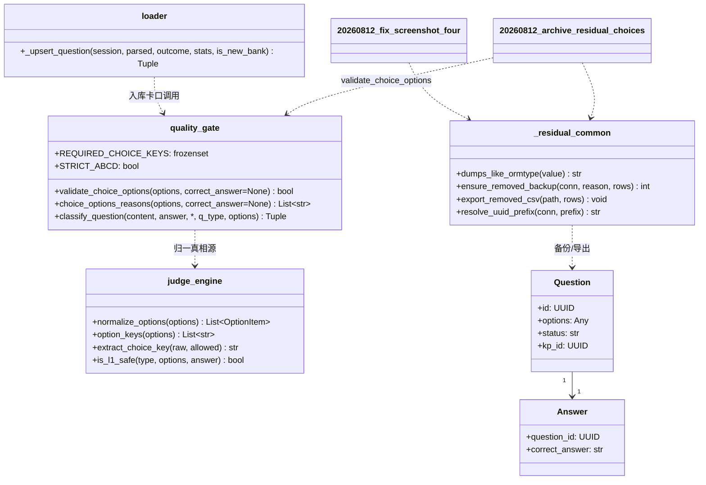
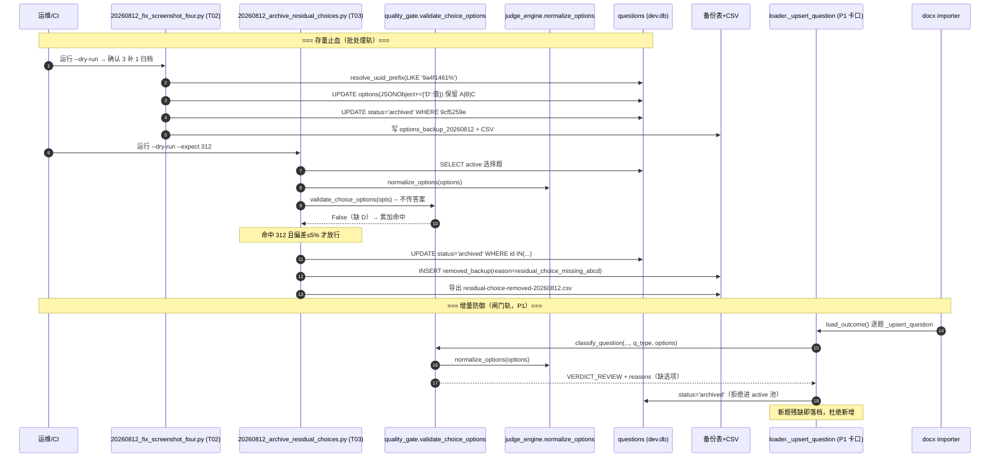

# 练习页残缺选择题治理 · 系统设计与任务分解

- **文档版本**：v1.0
- **日期**：2026-08-12
- **作者**：Bob（架构师）
- **上游 PRD**：`docs/practice-residual-questions-prd-20260812.md`
- **关联**：`docs/practice-module-redesign-design-20260811.md`、`docs/data-cleanup-log-20260811.md`、`docs/removed-questions-20260812.csv`、`docs/v4-db-api.md`
- **本期范围**：N0.1（截图 4 题）+ N0.2（全库 312 道残缺选择题）+ P1（入库卡口 & CI 门禁）。**P2 前端降级本期不做**，`options_status` 三态与前端 disabled 兜底原样保留。

---

## 0. 主理人已决策事项（本设计的输入前提，不再论证）

| # | 决策 | 对设计的约束 |
|---|---|---|
| 1 | 不可补题**直接 archive**，不留 `needs_review` flag | `status` 只用 `active/archived` 二值；留痕靠**库内备份表 + CSV**，不加列 |
| 2 | 补 D **保留原 A/B/C 顺序**，D 追加末位 | 只 `UPDATE questions.options`，`answers.correct_answer` 一个字节不动 |
| 3 | 必须导出删除清单 CSV | 列顺序对齐既有 `removed-questions-20260812.csv` |
| 4 | 选择题**不允许**合法 3 选项 | 判定口径 = key 集合严格等于 `{A,B,C,D}` |
| 5 | P2 前端降级不做 | `practice_service._options_status` **禁止改动**（见 §5 待明确 U2） |

### 0.1 以 dev.db 实况为准的口径校正（覆盖 PRD 笔误）

PRD §4 与关联文档写的 `status ∈ {draft, published, archived}` 是 `v4-db-api.md` 的**规范草案**，与实际库不一致。**本设计一律以 dev.db 实况为准**：

- `questions.status` 枚举 = `active` / `archived`（见 `app/models/content.py::QUESTION_STATUS_VALUES`）
- 因此 PRD 验收 2「全库所有 `status='published'` 的选择题…」在本设计中读作「全库所有 `status='active'` 的选择题…」
- PRD 验收 4「拒绝其进入 `published`（失败或转 `draft`）」在本设计中读作「拒绝其进入 `active`，落 `archived`」——这与 `loader.py` 既有质量闸门模型天然同构，**零改造成本**。

---

## 1. 实现方案

### 1.1 核心技术难点

| 难点 | 说明 | 对策 |
|---|---|---|
| **D1 判定口径分裂** | 「残缺」在库里有 4 种物理形态：`{"A":..,"B":..,"C":..}` dict、`["50","55","35"]` list、`[{"key":"A",...}]` list-of-dict、`["A. 50",...]` 带前缀 list。三处代码（抽题 `_options_status`、清洗脚本 `_is_incomplete_choices`、待建卡口）各判一套必然漂移 | **单点真相**：新增 `quality_gate.validate_choice_options()`，内部一律走 `judge_engine.normalize_options()` 归一。批处理脚本与入库卡口**共用同一个函数**，不各自写 SQL `LIKE '%"D"%'` |
| **D2 既有清洗脚本阈值是 `< 2`** | `20260811_archive_incomplete_options.py` 判定 `len(normalize_options(...)) < 2` 才归档——这正是 312 道「3 选项」题活到今天的根因 | 不改老脚本（已跑完、有日志、动它等于改历史），新脚本用新口径 `keys != {A,B,C,D}` |
| **D3 命中数误杀风险** | 商业题库，口径写错一个字符可能从 312 道扩到上千道，`archive` 虽可逆但会当场打穿题库覆盖度 | 脚本内置 `--expect 312` **量级熔断**：实际命中与期望偏差 > 5% 即 abort（exit 2）并打印明细，绝不静默执行 |
| **D4 零迁移红线** | `questions` 表结构一列都不能加 | 留痕全部走**独立备份表**（`CREATE TABLE IF NOT EXISTS`），不属 schema 变更；无需新增 `migrations/006_*.sql`；`test_schema_guard` 只做「模型→库」单向校验，库里多几张备份表不会红 |
| **D5 补 D 的 JSON 字节一致性** | `JSONType.process_bind_param` 用 `json.dumps(v, ensure_ascii=False, separators=(",",":"))`。脚本若用裸 `json.dumps` 会写出带空格 / `\uXXXX` 转义的文本，ORM 读得回来但 diff 噪音大、后续比对全废 | 脚本共用 `_residual_common.dumps_like_ormtype()`，与 `JSONType` 逐字节一致 |
| **D6 执行顺序耦合** | N0.1 的 3 道待补 D 题在补 D **之前**同样满足 N0.2 的残缺条件——顺序反了会被先归档 | Runbook 硬约束：**T02 必须先于 T03**；T03 脚本额外内置「跳过 `questions_options_backup_20260812` 中已补 D 的 id」双保险 |

### 1.2 框架选型

**零新增依赖**。全部复用现有栈：

- **SQLAlchemy 2.x Core `text()` + `engine.begin()`**：批处理脚本沿用 `scripts/data_cleanup/` 既定风格（Core 而非 ORM——脚本操作的是备份表等非模型对象，ORM 反而碍事）
- **`app.services.judge_engine.normalize_options()`**：选项归一唯一真相源，已被抽题/判分/老清洗脚本三方复用，继续复用
- **`app.services.importers.quality_gate`**：既有「纯函数质量闸门」模块，`loader.py` 已在调用。入库卡口**长在这里**，而不是新建模块——避免第二个闸门入口
- **Python stdlib `csv` / `json` / `argparse`**：CSV 导出与 dry-run 开关

### 1.3 架构模式

**闸门 + 批处理双轨（Gate & Batch，共用判定内核）**：

```
                    ┌─────────────────────────────────────┐
                    │  quality_gate.validate_choice_options│  ← 单点真相（纯函数）
                    └───────┬──────────────────────┬───────┘
                            │                      │
          （存量止血）批处理轨               （增量防御）闸门轨
                            │                      │
   scripts/data_cleanup/20260812_*.py    importers/loader._upsert_question
                            │                      │
        UPDATE status / options            status = active | archived
                            │                      │
              备份表 + CSV 留痕            LoadStats.gated_review + 原因回写解析
                            │                      │
                            └──────────┬───────────┘
                                       │
                       CI 门禁：全库不变式（pytest 常驻）
```

- **纯函数内核**：判定不依赖 DB / 上下文，可随时对存量重算 → 口径改一次，两轨同步生效
- **只读不改写**：闸门只裁决 `status`，**绝不自动改写 options**（自动补 D 的误伤风险远大于收益；补 D 是人工核过的定值脚本）
- **宁可错杀不可放过**：命中即 `archived`。归档可逆（备份表 + CSV），学生刷到残缺题不可逆

### 1.4 判定口径（本设计的宪法条文）

```
残缺选择题 ⟺ type == '选择'
            且 set(judge_engine.option_keys(options)) != {'A','B','C','D'}
```

三条刻意的收窄，改任何一条都要回来改这份文档：

1. **严格相等，不是 `>= 4`**：`{A,B,C,E}` 是 4 个 key，`_options_status` 判 `complete`，本口径判**残缺**（缺 D 就是缺 D）
2. **严格相等，不是 `⊇`**：`{A,B,C,D,E}` 五选项题本口径也判残缺。决策 4「必须完整 A-D」的直译；若日后确认题库存在合法 5 选项题，把模块常量 `STRICT_ABCD` 置 `False` 即切换为 `⊇` 语义（一行开关，见 §5 U1）
3. **`correct_answer` 命中校验默认不参与批量判定**：`validate_choice_options(options)` 不传答案 → 纯 key 口径，与主理人查实的 312 道**严格对齐**；`validate_choice_options(options, correct_answer)` 传答案 → 全量口径，仅入库卡口使用（PRD P1.1 明确要求）。**一个函数两种用法，口径不分裂**

> ⚠️ 为什么批量归档不查 `correct_answer`：库里存量选择题的 `correct_answer` 存在「`√`」「复合多小问」等历史形态，一旦纳入批量判定，命中数会从 312 暴涨到不可控量级，等于把「答案格式问题」和「选项残缺问题」两件事混在一次归档里做。本期只治选项残缺。答案侧问题由 `judge_engine.is_l1_safe` 在抽题层已经拦住（不进 L1 池），不构成用户可见故障。

---

## 2. 文件列表

### 2.1 新增

| 路径 | 类型 | 说明 |
|---|---|---|
| `backend/scripts/data_cleanup/_residual_common.py` | 模块 | 本期脚本共用工具：备份表 DDL / 幂等 upsert、CSV 导出、`dumps_like_ormtype`、UUID 前缀唯一解析 |
| `backend/scripts/data_cleanup/20260812_fix_screenshot_four.py` | 脚本 | N0.1：3 题补 D + 1 题 archive，`--dry-run` 可重跑 |
| `backend/scripts/data_cleanup/20260812_archive_residual_choices.py` | 脚本 | N0.2：全库残缺选择题批量归档，`--dry-run` / `--expect` / `--limit` |
| `backend/tests/test_residual_choice_gate.py` | 测试 | `validate_choice_options` 纯函数单测 + `loader` 卡口集成测 |
| `backend/tests/test_residual_choice_cleanup.py` | 测试 | 两个脚本的 `--dry-run` 子进程端到端（隔离 tmp_path DB） |
| `docs/residual-choice-removed-20260812.csv` | 产物 | N0.2 删除清单（脚本生成，**勿手写**） |
| `docs/residual-choice-patched-20260812.csv` | 产物 | N0.1 补 D 留痕（脚本生成） |
| `docs/residual-choice-acceptance-20260812.md` | 文档 | 验收记录：SQL 复核结果 + pytest 摘要 |
| `docs/class-diagram-residual-choice-20260812.mermaid` | 图 | §3 类图抽取 |
| `docs/sequence-diagram-residual-choice-20260812.mermaid` | 图 | §4 时序图抽取 |

### 2.2 修改

| 路径 | 改动要点 | 风险 |
|---|---|---|
| `backend/app/services/importers/quality_gate.py` | 新增 `REQUIRED_CHOICE_KEYS` / `STRICT_ABCD` / `validate_choice_options()` / `choice_options_reasons()`；`classify_question()` 追加**可选 kwargs** `q_type` / `options` | 低。新参数带默认值，既有调用（`is_clean`、测试）零改动 |
| `backend/app/services/importers/loader.py` | `_upsert_question` 调闸门时多传 `q_type=parsed.q_type, options=parsed.options`（4 行） | 低。命中即走既有 `archived` 分支，`LoadStats.gated_review` 自动计数 |
| `backend/tests/test_practice.py` | `TestL1PoolInvariantOnRealBank` 新增 `test_no_choice_question_with_missing_options`（全库不变式） | 无 |
| `backend/tests/test_practice_module_redesign.py` | G 段 `TestDataCleanupScriptsDryRun` 追加两个新脚本的 dry-run 冒烟 | 无 |
| `docs/data-cleanup-log-20260811.md` | 由脚本 `append_log()` 自动追加，**不手写** | 无 |

### 2.3 明确不动的文件（红线）

- `backend/app/services/practice_service.py` —— `_options_status` 阈值 `>= 4` 原样保留（P2 不做）
- `backend/app/models/content.py` —— `questions` 表结构零变更
- `backend/migrations/` —— 不新增迁移文件
- `backend/scripts/data_cleanup/20260811_archive_incomplete_options.py` —— 历史脚本，已跑完有日志，不追改
- `student-web/**` —— 前端零改动
- `backend/app/services/ai_exercise_service.py` —— 该路径落库恒 `options=None` + `status=archived`，天然不产生残缺 active 选择题，无需加卡口

---

## 3. 数据结构和接口

### 3.1 备份表 DDL（非 schema 变更，零迁移）

> 与既有 `questions_options_backup_20260811` / `questions_content_backup_20260811` 同构——`CREATE TABLE IF NOT EXISTS ... AS SELECT` 不进 `migrations/`，不触发 `test_schema_guard`。

```sql
-- N0.2 归档留痕（表已存在 154 行 reason=audit_error，本次用 reason=residual_choice_missing_abcd 追加）
CREATE TABLE IF NOT EXISTS questions_removed_backup_20260812 (
    id          TEXT    NOT NULL,   -- 题目 UUID 字符串
    old_status  TEXT    NOT NULL,   -- 归档前 status，恒 'active'
    old_kp_id   TEXT,               -- 归档前知识点（NULL 可空）
    removed_at  TEXT    NOT NULL,   -- UTC ISO8601 时间戳
    reason      TEXT    NOT NULL    -- 'residual_choice_missing_abcd' 或 'audit_error'
);

-- N0.1 补 D 留痕（记录原 options，便于回滚补丁）
CREATE TABLE IF NOT EXISTS questions_options_backup_20260812 (
    id          TEXT    NOT NULL,   -- 题目 UUID 字符串
    old_options TEXT,               -- 补 D 前的原始 options JSON 串
    new_options TEXT,               -- 补 D 后的 options JSON 串
    patched_at  TEXT    NOT NULL,   -- UTC ISO8601 时间戳
    reason      TEXT    NOT NULL    -- 恒 'residual_choice_patch_d'
);
```

### 3.2 判定内核 / 入库卡口接口（签名即契约）

```python
# ===== backend/app/services/importers/quality_gate.py =====

#: 商业落地要求：选择题选项必须正好 A/B/C/D 四键
REQUIRED_CHOICE_KEYS: frozenset[str] = frozenset({"A", "B", "C", "D"})

#: True = 严格相等 {A,B,C,D}；False = 子集语义（含额外键如 E 也放过）
STRICT_ABCD: bool = True   # ← 决策 4 的开关（U1：确认无合法 5 选项题后可继续置 True）

def validate_choice_options(
    options: Any,
    correct_answer: Optional[str] = None,
) -> bool:
    """选择题 options 完整性单点真相。

    Args:
        options: ``Question.options`` 原始值（dict / list / list-of-dict / None）。
        correct_answer: 可选。传入时额外要求 correct_answer 落在归一化 key 集合内
            （入库卡口 P1.1 强制口径）；批量归档不传 → 纯 key 口径（与 312 严格对齐）。

    Returns:
        合法（完整 A-D 且的答案命中）返回 True；否则 False。
    """
    if (options is None) or (not options):
        return False
    keys = set(judge_engine.option_keys(options))
    if STRICT_ABCD:
        if keys != REQUIRED_CHOICE_KEYS:
            return False
    else:  # 子集语义
        if not REQUIRED_CHOICE_KEYS.issubset(keys):
            return False
    if correct_answer is not None:
        return judge_engine.extract_choice_key(correct_answer, allowed=tuple(keys)) is not None
    return True


def choice_options_reasons(options: Any, correct_answer: Optional[str] = None) -> List[str]:
    """返回不合法原因列表（空列表代表合法）。供 classify_question / 日志复用。"""
    reasons: List[str] = []
    if (options is None) or (not options):
        return ["选择题无选项"]
    keys = set(judge_engine.option_keys(options))
    missing = REQUIRED_CHOICE_KEYS - keys
    extra = keys - REQUIRED_CHOICE_KEYS
    if missing:
        reasons.append(f"选择题缺选项键{missing}")
    if extra and STRICT_ABCD:
        reasons.append(f"选择题含非法选项键{extra}")
    if correct_answer is not None and not validate_choice_options(options, correct_answer):
        reasons.append("正确答案未命中任一选项")
    return reasons
```

`classify_question` 扩展（**向后兼容，既有调用零改动**）：

```python
def classify_question(
    content: str,
    answer: Optional[str] = None,
    *,
    q_type: Optional[str] = None,    # 新增可选 kwarg
    options: Optional[Any] = None,   # 新增可选 kwarg
) -> Tuple[str, List[str]]:
    reasons: List[str] = []
    text = content or ""
    compact = normalize(text)
    # ... 既有题干规则（题干为空 / 过长 / 泄漏 / 占位 / 重复 / 题号）保持不变 ...
    if q_type == "选择" and options is not None:        # 选择题硬性卡口
        reasons.extend(choice_options_reasons(options, None))  # 批处理同口径：不传答案
    if reasons:
        return VERDICT_REVIEW, reasons
    return VERDICT_CLEAN, []
```

`loader._upsert_question` 接线（4 行，命中即走既有 `archived` 分支）：

```python
if is_new_bank:
    verdict, reasons = classify_question(
        parsed.content, parsed.correct_answer,
        q_type=parsed.q_type, options=parsed.options,   # ← 新增
    )
```

### 3.3 批处理脚本接口

```python
# ===== backend/scripts/data_cleanup/_residual_common.py =====

def dumps_like_ormtype(value: Any) -> str:
    """与 JSONType.process_bind_param 逐字节一致：ensure_ascii=False, separators=(",",":")。"""
    return json.dumps(value, ensure_ascii=False, separators=(",", ":"))

def ensure_removed_backup(conn, reason: str, rows: List[Dict[str, Any]]) -> int:
    """幂等把 (id,old_status,old_kp_id,removed_at,reason) 写入 questions_removed_backup_20260812。
    仅 INSERT 不存在的 (id, reason) 组合（NOT EXISTS 去重）。返回新写入行数。"""

def export_removed_csv(path: Path, rows: List[Dict[str, Any]]) -> None:
    """写 docs/residual-choice-removed-20260812.csv。
    列顺序：question_id, old_status, old_kp_id, reason, removed_at（对齐既有 CSV）。"""

def resolve_uuid_prefix(conn, prefix: str) -> str:
    """用 LIKE 'prefix%' 解析题目 UUID；命中恰好 1 行返回全 UUID，否则抛 ValueError。
    防误伤：前缀漂移命中 0 行或 ≥2 行立即 abort。"""
```

### 3.4 类图（mermaid）



---

## 4. 程序调用流程（时序图）



> ⚠️ 顺序铁律（D6）：**Fix(T02) 必须先于 Arc(T03)**。因为 3 道待补 D 题在补 D 前同样满足残缺条件，T03 脚本内置「跳过已存在 `questions_options_backup_20260812` 的 id」双保险，但**主理人侧 Runbook 仍须先跑 T02**。

---

## 5. 任务列表（有序 + 依赖 + owner + 验收）

> 约定 owner：`engineer`（寇豆码 / kou）负责脚本与代码落地；`qa`（高见远 / yan）负责 CI 门禁复核与验收回归。所有任务均**不碰数据库执行权限**——脚本由运维侧按 Runbook 跑，工程师只交付可重跑、带 `--dry-run` 的代码。

| 序 | 任务 ID | 描述 | 依赖 | owner | 验收点 |
|---|---|---|---|---|---|
| 1 | **T01** | 残缺判定单点真相 + 入库卡口：在 `quality_gate.py` 落地 `validate_choice_options` / `choice_options_reasons` / `STRICT_ABCD`；`classify_question` 加可选 `q_type`/`options` kwarg；`loader._upsert_question` 把两参传进闸门；新建 `_residual_common.py`（备份 upsert / CSV / JSONType 一致 dumps / UUID 前缀解析）；新增 `test_residual_choice_gate.py` 纯函数 + 集成测 | 无 | engineer | ①单元测覆盖严格相等/子集/不传答案/传答案四种组合全绿 ②`loader` 集成测：构造缺 D 选择题导入 → `status=archived` 且 `gated_review+1` ③既有 `quality_gate` 调用方零回归 |
| 2 | **T02** | N0.1 截图 4 题即时修复脚本 `20260812_fix_screenshot_four.py` + 产物：3 题补 D（保留 A/B/C 顺序，D 末位追加：`9a4f1461→65`、`a3275f03→30张`、`855ae9b6→5-4`），1 题 archive（`9cf5259e`）；`--dry-run` 可重跑；UUID 前缀须恰好命中 1 行否则 abort；写 `questions_options_backup_20260812` + `docs/residual-choice-patched-20260812.csv` + 追加日志 | T01 | engineer | ①`--dry-run` 统计 = 3 补 + 1 归档且 4 个 UUID 前缀各命中 1 行 ②`correct_answer` 补 D 前后逐字节不变（断言）③`options` 键序为 A,B,C,D（JSON 字节一致） |
| 3 | **T03** | N0.2 全库残缺选择题批量归档 `20260812_archive_residual_choices.py`：`--dry-run` / `--expect 312` / `--limit`；先备份到 `questions_removed_backup_20260812`（reason=`residual_choice_missing_abcd`，NOT EXISTS 去重避免与既有 154 行冲突），再 `UPDATE status='archived'`，导出 `docs/residual-choice-removed-20260812.csv`（列序对齐既有）；新增 `test_residual_choice_cleanup.py` dry-run 子进程端到端 | T01, **T02** | engineer | ①`--expect 312` 命中偏差 >5% 立即 exit 2 不执行 ②备份表 + CSV 行数 == 命中数 ③CSV 列序 = `question_id,old_status,old_kp_id,reason,removed_at` ④3 道已补 D 题**不在**归档清单 |
| 4 | **T04** | CI 常驻门禁 + 验收回归：`test_practice.py::TestL1PoolInvariantOnRealBank` 新增 `test_no_choice_question_with_missing_options`（全库 active 选择题 key 集合必须 == {A,B,C,D}）；`test_practice_module_redesign.py` G 段追加两个新脚本 dry-run 冒烟（注意 PYTHONPATH 用 `os.pathsep`）；写 `docs/residual-choice-acceptance-20260812.md` 验收记录 | T01, T02, T03 | qa | ①全库不变式 pytest 全绿（active 选择题零残缺）②两个新脚本 `+ --dry-run` 子进程断言扫描/命中 >0 ③验收文档含 SQL 复核 + pytest 摘要 |

**执行时序（关键路径）**：

```
T01 (判定内核+卡口) ──┬──> T02 (补 D 4 题) ──> T03 (全库归档 312) ──┐
                     │                                              ├─> T04 (CI门禁+验收)
                     └──────────────────────────────────────────────┘
```

- T02 **必须**先于 T03（D6 顺序铁律）；T04 依赖前三者全部完成，且可顺带复核 P1 闸门生效。
- P1 入库卡口（T01 的 loader 改动）与 N0.2 存量归档（T03）**并行不冲突**：卡口只管增量新题，归档只管存量，共用 `validate_choice_options` 一个真相源。

---

## 6. 依赖包

**零新增依赖**。

- 运行期：Python 3.11+ 标准库 `csv` / `json` / `argparse` / `sqlite3`（脚本）；`sqlalchemy`（既有，engine/connect 复用 `app.core.config`）
- 测试期：既有 `pytest` / `pytest.ini`；隔离 DB 用 `tmp_path` + `StaticPool`（既有 fixture 同款）
- **不需要**任何新 pip 包、不需要新前端依赖、不需要改 `requirements.txt`

---

## 7. 共享知识（跨文件约定 · 工程师与 QA 必读）

1. **`options` JSON 格式（库内真相）**
   - 归一真相源 = `judge_engine.normalize_options()`，兼容四种物理形态：`{"A":..}` dict / `["50",..]` list / `[{"key":..,"text":..}]` / `["A. 50",..]` 带前缀 list
   - 落库序列化字节格式 = `json.dumps(v, ensure_ascii=False, separators=(",",":"))`（与 `app/models/base.py::JSONType.process_bind_param` 一致）。**脚本写回 options 必须复用 `_residual_common.dumps_like_ormtype()`**，否则 diff 噪音 + 后续比对失效
   - 补 D 规则：保留原 A/B/C 顺序，D 追加末位；`correct_answer` 指向**绝不改动**

2. **`status` 枚举（dev.db 实况）**
   - 仅 `active` / `archived` 二值（`app/models/content.py::QUESTION_STATUS_VALUES`）
   - PRD 里的 `draft/published` 是旧规范草案，**本设计一律以 dev.db 为准**；验收中「published」读成「active」

3. **`validate_choice_options` 签名与两种用法（单一真相源）**
   ```python
   validate_choice_options(options, correct_answer=None) -> bool
   ```
   - **批量归档口径**：不传 `correct_answer` → 纯 key 集合判定（严格相等 `{A,B,C,D}`），与查实的 312 道严格对齐
   - **入库卡口口径**：传 `correct_answer` → 额外要求答案命中选项键，满足 PRD P1.1
   - `STRICT_ABCD=True`：严格相等；若有合法 5 选项题需放开，置 `False` 切子集语义（见 U1）

4. **CSV 列顺序（删除清单，对齐既有 `removed-questions-20260812.csv`）**
   - `docs/residual-choice-removed-20260812.csv`：`question_id, old_status, old_kp_id, reason, removed_at`
   - ⚠️ 备份表 `questions_removed_backup_20260812` 列序 **不同**：`(id, old_status, old_kp_id, removed_at, reason)`——写 SQL 与写 CSV 是两套顺序，脚本里用字段名映射，切勿按位置硬拷
   - 追加备份用 `reason` 分流：`residual_choice_missing_abcd`（本期 N0.2）/ `audit_error`（既有 154 行），`NOT EXISTS (id, reason)` 去重

5. **时间戳**：统一 UTC ISO8601（`datetime.now(timezone.utc)`），与 `app.models.base.utcnow` 对齐；落库/CSV 用同格式便于事后复核

6. **脚本运行约定**
   - 入口：在 `backend/` 目录执行 `python scripts/data_cleanup/<脚本>.py [--dry-run]`
   - `_BACKEND_ROOT = Path(__file__).resolve().parents[2]` → `backend/`，`sys.path.insert(0, ...)` 让 `from app...` 可用
   - 所有脚本必须支持 `--dry-run`（只统计不写库），幂等可重跑

---

## 8. 待明确事项（U1 / U2）

- **U1（低风险，可默认）**：题库是否存在**合法 5 选项**（或 A-E）选择题？
  当前设计 `STRICT_ABCD=True`（严格 `{A,B,C,D}`），5 选项题会被判残缺并归档。主理人决策 4「不允许合法 3 选项」未明确覆盖 5 选项。**默认按 True 执行**；若 T04 全库跑出预期外的归档量，先查是否 5 选项题所致，把 `STRICT_ABCD` 置 `False` 即可切子集语义，**无需改其他代码**。已在 §5 T04 验收点埋了核对项。

- **U2（已按红线冻结，仅记一笔）**：`practice_service._options_status` 阈值是否要改？
  该函数 `>= 4` 即 `complete`，与本次「严格 `{A,B,C,D}`」判定**两码事**（前者管前端展示兜底，后者管入库/归档口径）。主理人决策 5「P2 前端降级本期不做」已冻结——**本期绝不改 `_options_status`**，保留 `partial/missing` 三态与前端 disabled 兜底作长期防御。若日后 P2 启动，再单独评估是否收敛口径。

- **U3（运维侧 Runbook，非设计阻塞）**：执行顺序硬约束 T02 → T03 已写入 §4 / §5；实际 `archive` 操作由运维按 Runbook 在 dev.db 执行，工程师只交付带 `--dry-run` 的脚本，本设计不触碰数据库（符合工作边界）。

