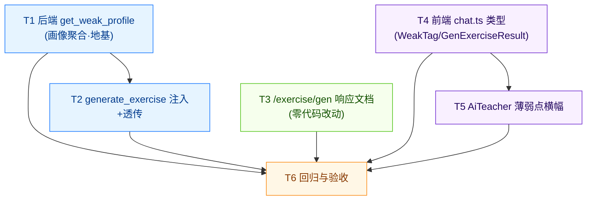
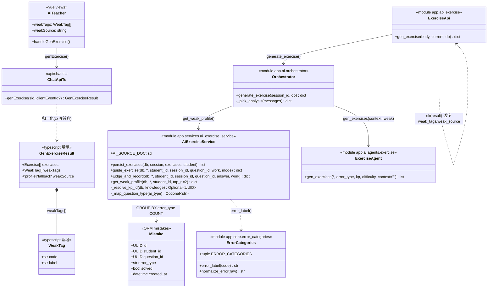

# AI 老师「按错因定向推题」· 增量架构设计 + 任务分解

- 文档版本：v1.0（2026-08-11）
- 作者：架构师 高见远
- 类型：**增量设计**（仅描述本次变更，不重写整体设计）
- 上游文档：`docs/practice-tutor-adaptive-prd-20260811.md`（产品经理 许清楚）、`docs/practice-tutor-design-20260810.md`（已落地的对话式引导 + 意图识别 + 错题自动入库）
- 影响范围（均已在既有代码上改，不推翻 mode 框架）：
  - `backend/app/services/ai_exercise_service.py`（新增 `get_weak_profile`）
  - `backend/app/ai/orchestrator.py`（`generate_exercise()` 注入弱项 + 透传 `weak_tags`/`weak_source`）
  - `backend/app/api/exercise.py`（`/exercise/gen` 响应透传确认 + docstring）
  - `student-web/src/api/chat.ts`（`GenExerciseResult` 加 `weakTags`/`weakSource` + `WeakTag` 类型 + 归一化）
  - `student-web/src/views/AiTeacher.vue`（薄弱点横幅渲染）

---

## 0. 本次变更定位（一句话）

把 `/exercise/gen` 的练习题从「按当前错题错因泛泛出相似题」升级为「**先按学生历史错题库聚合 Top-2 主导弱项 → 注入出题提示词 → 在保持当前错题知识点不变的前提下专门 drill 弱项 → 把弱项标签带回前端渲染横幅**」的自适应推题闭环。

**零迁移、零新增依赖、复用五类机器码作为错因唯一真相源。**

---

## 1. 实现方案

### 1.1 薄弱画像如何计算（纯本地 SQL 聚合）

数据源 = 全部错题库 `mistakes`（按 `student_id` 聚合），复用既有 `Mistake` 模型（`backend/app/models/learning.py:37`）。

- 聚合口径：
  ```sql
  SELECT error_type, COUNT(*) AS cnt
  FROM mistakes
  WHERE student_id = :sid
    AND error_type IN ('READ','METHOD','CALC','KNOWLEDGE','CHECK')  -- 五类机器码，同时过滤掉 TD-3 的 "练习错题" 与 NULL
  GROUP BY error_type
  ORDER BY cnt DESC, error_type          -- 计数降序取主导；同计数稳定 tie-break
  LIMIT 2                                  -- Top-2（决策 #2）
  ```
- ⚠️ `Mistake.error_type` 是 `String(32)` 且**可空**。`error_type IN (五类)` 在 SQL 中天然排除 `NULL`（NULL 不在任何 IN 列表里），也排除 TD-3 的 `"练习错题"` 脏值——**聚合层无需任何写操作即可绕开脏数据**。
- AI 练习判错路径（`judge_and_record` → `_safe_error_code`）写入的 `error_type` 已是五类机器码，故本次零迁移聚合天然覆盖「库题练习 + AI 练习」全量错题（决策 #1「全部错题库」）。

### 1.2 画像函数放哪（决策对齐 + 主理人拍板）

→ 放在 **`backend/app/services/ai_exercise_service.py`**（与 `persist_exercises`/`judge_and_record` 同模块，复用 `to_uuid` 与 `Mistake` 模型），**不**放在 PRD 原草案的 `learning_service.py`。

关键函数签名（给工程师照抄）：

```python
# backend/app/services/ai_exercise_service.py  —— 新增
from sqlalchemy import func, select            # select 已 import，补 func
from app.models.learning import Mistake        # 新增 import
from app.core.error_categories import (        # 已有 import 里补 ERROR_CATEGORIES / error_label
    ERROR_CALC, ERROR_CATEGORIES, normalize_error, error_label,
)

def get_weak_profile(
    db: Session,
    *,
    student_id: Any,
    top_n: int = 2,
) -> Dict[str, Any]:
    """按 student_id 聚合错题库，取 Top-N 主导弱项错因。

    Returns:
        {
          "weak_tags": [{"code": "METHOD", "label": "方法错"}, ...],  # 含中文标签，前端直接渲染
          "source":    "profile" | "fallback"   # profile=来自历史画像；fallback=画像为空走兜底
        }
    """
    sid = to_uuid(student_id, "student_id")
    rows = db.execute(
        select(Mistake.error_type, func.count().label("cnt"))
        .where(
            Mistake.student_id == sid,
            Mistake.error_type.in_(ERROR_CATEGORIES),  # 五类机器码过滤；NULL/"练习错题" 自动排除
        )
        .group_by(Mistake.error_type)
        .order_by(func.count().desc(), Mistake.error_type)
    ).all()
    top_codes = [r.error_type for r in rows[:top_n]]
    if not top_codes:
        # 兜底：新学生 / 无合规错题
        return {"weak_tags": [], "source": "fallback"}
    weak_tags = [{"code": code, "label": error_label(code)} for code in top_codes]
    return {"weak_tags": weak_tags, "source": "profile"}
```

- `error_label(code)` 走 `error_categories` 唯一真相源（决策 #3），**前端不必硬编码中文**，直接渲染 `weak_tags[i].label`。
- 该函数**只读** `SELECT`，挂在调用方传入的 `db` 上，不 `commit`、不破事务纪律（对齐 design §7.5）。

### 1.3 画像如何注入 `generate_exercise()` 的出题提示词

`orchestrator.generate_exercise()` 现状（`backend/app/ai/orchestrator.py:266-274`）：取当前错题的 `kp`/`error_type`/`difficulty`，调 `exercise.gen_exercises(error_type=error_type, kp=kp, difficulty=difficulty)`。

`gen_exercises` 已有 `context: str = ""` 参数，会被拼进 `_USER_TEMPLATE` 的 `{context}` 占位（见 `backend/app/ai/agents/exercise.py:31-34`）。**本次不改 `gen_exercises` 签名**，把弱项指令通过 `context` 注入——这是最小侵入、且符合决策 #5「额外偏向弱项、知识点锚定当前错题」的口径。

改动片段（给工程师）：

```python
# backend/app/ai/orchestrator.py —— generate_exercise() 内
from app.services import ai_exercise_service   # 既有延迟导入

session = _get_session(session_id, db)
messages = _load_messages(session.id, db)

analysis = _pick_analysis(messages)
kp = str(analysis.get("knowledge") or "").strip() or DEFAULT_KP
error_type = str(analysis.get("error") or "").strip() or DEFAULT_ERROR_TYPE
try:
    difficulty = int(float(str(analysis.get("difficulty")).strip()))
except (TypeError, ValueError):
    difficulty = DEFAULT_DIFFICULTY

# ★ 新增：算薄弱画像
weak = ai_exercise_service.get_weak_profile(db, student_id=session.student_id)
weak_context = ""
if weak["source"] == "profile" and weak["weak_tags"]:
    labels = "、".join(t["label"] for t in weak["weak_tags"])   # 如 "方法错、计算错"
    weak_context = (
        f"【定向推题】该学生历史上反复出错的薄弱错因是：{labels}。"
        f"请在保持薄弱知识点「{kp}」不变的前提下，让这两道练习题的变式"
        f"专门去反复练习和踩这些薄弱错因的坑，帮他把易错点练扎实。"
    )

exercises = exercise.gen_exercises(
    error_type=error_type,        # 仍锚定当前错题的 drill 目标
    kp=kp,                        # 知识点锚定当前错题，主题不跑偏（决策 #5）
    difficulty=difficulty,
    context=weak_context,         # ★ 弱项 Top-2 注入点（为空即不注入，走现有行为）
)

# …… persist_exercises 等既有逻辑不变 ……

# ★ 返回值新增 weak_tags / weak_source（snake_case，见 §3 共享铁律）
return {
    "exercises": exercises,
    "weak_tags": weak["weak_tags"],
    "weak_source": weak["source"],
}
```

> **关于决策 #5「error_type 取弱项 Top-2」的实现口径说明**：`gen_exercises` 只接受单个 `error_type` 字符串，且 Top-2 是两个码。本设计**不替换** `error_type` 入参（保留它作为当前错题的 drill 目标），而是把 Top-2 弱项以「在 X 知识点下专门练你常错的 Y」语义注入 `context`。这正是决策 #5 原文「**额外**偏向弱项」「kp 取当前错题」的含义；弱项为空时 `weak_context=""`、原样出相似题（现有行为，G3 兜底）。

### 1.4 前端横幅的数据流（决策 #4）

```
后端 get_weak_profile()
   └─► generate_exercise() 把 weak_tags / weak_source 随 /exercise/gen 响应带回
         └─► api/chat.ts  genExercise() 归一化成 { exercises, weakTags, weakSource }
               └─► AiTeacher.vue  handleGenExercise() 存进 weakTags / weakSource ref
                     └─► 模板在「练习区 section」顶部渲染一道整批横幅
```

- 横幅位置：**对话引导区（GuideChatPanel）上方、整批一道**（决策 #4）。即放在 `<section v-if="canGenerate || exercises.length">` 内部、`生成练习` 按钮**之前**。
- 横幅内容：标题「本次练习针对你的薄弱点 🎯」+ 一行圆角 chip（`weakTags[i].label`）。
- 兜底（弱项为空）：`weakSource === "fallback"` 且 `weakTags` 为空时，横幅显示柔和文案「这次先按当前这道题的类型练一练」（不报错、不渲染空 chip，G3）。

---

## 2. 文件清单（精确到函数 / 字段）

> 行号以 2026-08-11 代码为准，实施时以函数名定位。

### 2.1 后端 · 新增 / 改造

| # | 文件 | 改动点 |
|---|---|---|
| A-1 | `backend/app/services/ai_exercise_service.py` | **新增** `get_weak_profile(db, *, student_id, top_n=2) -> Dict[str, Any]`；补 `from sqlalchemy import func`、补 `from app.models.learning import Mistake`、在既有 `from app.core.error_categories import (...)` 里补 `ERROR_CATEGORIES, error_label` |
| A-2 | `backend/app/ai/orchestrator.py` | `generate_exercise()`（`:239-309`）：在算出 `kp/error_type/difficulty` 之后、调 `gen_exercises` 之前插入「算 `weak` → 拼 `weak_context`」；`gen_exercises(...)` 调用加 `context=weak_context`；`return` 字典追加 `weak_tags` / `weak_source` 两个键 |
| A-3 | `backend/app/api/exercise.py` | `gen_exercise()`（`:80-102`）：**代码零改动**（`ok(result)` 已透传）；仅更新 docstring，注明 `data` 含 `weak_tags` / `weak_source` |

### 2.2 前端 · 改造

| # | 文件 | 改动点 |
|---|---|---|
| F-1 | `student-web/src/api/chat.ts` | 新增 `interface WeakTag { code: string; label: string }`；`GenExerciseResult` 增加 `weakTags: WeakTag[]` 与 `weakSource: 'profile' \| 'fallback'`；新增 `RawGenExercise` 归一化（读 `weak_tags ?? weakTags`、`weak_source ?? weakSource`）；`genExercise()` 末尾 `return { exercises, weakTags: ..., weakSource: ... }` |
| F-2 | `student-web/src/views/AiTeacher.vue` | 新增 `weakTags` / `weakSource` 两个 `ref`；`handleGenExercise()` 里从 `result` 取出并赋值；模板在练习区 `<section>` 顶部新增「薄弱点横幅」块（含兜底文案分支） |

> **不改动**：`gen_exercises` 签名、`exercise.PROMPT`（提示词零改动，弱项走 `context` 后缀，不违反 design §7.3 资产纪律）、`Mistake` 模型、`questions` 表、任何迁移。

---

## 3. 数据结构与接口变更

### 3.1 `get_weak_profile` 内部签名

```python
def get_weak_profile(db: Session, *, student_id: Any, top_n: int = 2) -> Dict[str, Any]:
    """返回 {"weak_tags": [{"code","label"}], "source": "profile"|"fallback"}"""
```

### 3.2 `orchestrator.generate_exercise()` 内部变化

- 调用前：新增本地变量 `weak`（`get_weak_profile` 结果）与 `weak_context`（字符串）。
- 调用：`exercise.gen_exercises(error_type=error_type, kp=kp, difficulty=difficulty, context=weak_context)`。
- 返回：`{"exercises": list, "weak_tags": list[dict], "weak_source": str}`（在原 `{"exercises": ...}` 基础上**追加**两键）。

### 3.3 `/exercise/gen` 响应增量

> ⚠️ **键名约定（重要）**：为遵循 design §7.6「`data` 里的键沿用各模块现状——`exercise` 是 snake_case 透传」，**后端返回值用 `weak_tags` / `weak_source`（snake_case）**，与既有 `question_id` 等键风格一致。前端 `GenExerciseResult` 仍用 camelCase `weakTags` / `weakSource`，在 `genExercise()` 归一化时**同时兼容** `weak_tags/weak_source` 与 `weakTags/weakSource` 两种写法，避免任何「打穿前端」风险。这是与 PRD 草案 camelCase 书写的有意偏差，理由见 §7 共享铁律第 4 条。

响应 `data`（全部字段可选 + 默认，老客户端不崩）：

```jsonc
{
  "exercises": [ { "questionId": "...", "q": "...", "a": "...", /* 既有字段 */ } ],
  "weak_tags":  [ { "code": "METHOD", "label": "方法错" }, { "code": "READ", "label": "读题错" } ],
  "weak_source": "profile"   // "profile"=来自历史画像；"fallback"=画像为空走兜底
}
```

### 3.4 前端 `chat.ts` 类型增量

```typescript
/** 薄弱错因标签（code 为五类机器码，label 走后端 error_label，前端不硬编码中文）。 */
export interface WeakTag {
  code: string
  label: string
}

/** POST /api/exercise/gen 结果（增量：weakTags / weakSource）。 */
export interface GenExerciseResult {
  exercises: Exercise[]
  /** 这批练习题定向 drill 的薄弱错因标签；为空表示走兜底（新学生 / 无历史错题）。 */
  weakTags: WeakTag[]
  /** "profile"=来自历史画像；"fallback"=画像为空，仅按当前错题练。 */
  weakSource: 'profile' | 'fallback'
}
```

> 既有 `Exercise` 接口**不加字段**（PRD §4 卡片内「这题在练你常错的：X」二次强调属 P2 增强，本期不做；本期仅整批横幅）。

---

## 4. 程序调用流程（时序图）

完整链路：`生成练习题时：先算薄弱画像 → 注入出题 → 返回 weakTags → 前端横幅展示`。

```mermaid
sequenceDiagram
    autonumber
    participant S as 学生
    participant V as AiTeacher.vue
    participant API as api/exercise.py
    participant O as orchestrator.generate_exercise
    participant AES as ai_exercise_service.get_weak_profile
    participant DB as mistakes（只读）
    participant EX as agents/exercise.gen_exercises
    participant M as ark_client

    S->>V: 点【再出两道】
    V->>API: POST /exercise/gen {sessionId}
    API->>O: generate_exercise(session_id, db)
    O->>O: _get_session() + _pick_analysis() → kp/error_type/difficulty（当前错题）

    Note over O,AES: ★ ① 先算薄弱画像（纯本地 SQL，零外网）
    O->>AES: get_weak_profile(db, student_id=session.student_id, top_n=2)
    AES->>DB: SELECT error_type, COUNT(*) ... WHERE student_id=? AND error_type IN (五类) GROUP BY error_type ORDER BY cnt DESC LIMIT 2
    DB-->>AES: [(METHOD,12),(READ,9)] / 空
    AES-->>O: {"weak_tags":[{"code":"METHOD","label":"方法错"},{"code":"READ","label":"读题错"}], "source":"profile"}
    Note over O: 空画像 → source="fallback"，weak_context=""

    Note over O,EX: ★ ② 注入弱项（context 后缀，知识点仍锚定当前错题）
    O->>O: weak_context = "【定向推题】该学生历史上反复出错的薄弱错因是：方法错、读题错。请在保持薄弱知识点「{kp}」不变的前提下，让这两道练习题的变式专门去反复练习和踩这些薄弱错因的坑…"（source=profile 时）
    O->>EX: gen_exercises(error_type=当前错因, kp=当前kp, difficulty=, context=weak_context)
    EX->>M: ark_respond(...)

    Note over O: ★ ③ 照旧落库（D1：archived + ai_gen，零迁移）
    O->>O: persist_exercises(...)；写 EXERCISE_PREFIX 消息；session_state=practicing

    Note over O,API: ★ ④ 返回 weak_tags / weak_source
    O-->>API: {"exercises":[...], "weak_tags":[...], "weak_source":"profile"}
    API-->>V: 200 ok({exercises, weak_tags, weak_source})

    Note over V: ★ ⑤ 前端整批横幅展示
    V->>V: weakTags=result.weakTags; weakSource=result.weakSource
    alt source=profile 且 weakTags 非空
        V-->>S: 🎯 本次练习针对你的薄弱点：[方法错][读题错]（横幅，引导区上方）
    else source=fallback（新学生/无历史错题）
        V-->>S: 🎯 这次先按当前这道题的类型练一练（柔和兜底横幅）
    end
    V->>V: 打开第 1 题 GuideChatPanel（既有对话式作答流程不变）
```

---

## 5. 有序任务列表（T1–T6）

> 排序原则：**后端先建画像函数、再接线注入；前端独立并行改类型与横幅；最后回归**。T1/T2 与 T4/T5 可并行（一后端一前端）。

### T1 · 后端薄弱画像聚合函数（地基）

- **优先级**：P0
- **依赖**：无
- **文件**：`backend/app/services/ai_exercise_service.py`（新增 `get_weak_profile` + 3 处 import 补充）
- **要点**：
  - SQL 用 `func.count()` + `error_type.in_(ERROR_CATEGORIES)` 过滤；`ORDER BY cnt DESC` 取 Top-2。
  - `source` 字段：聚合有结果 → `"profile"`；空 → `"fallback"`，`weak_tags=[]`。
  - `weak_tags` 里 `label` 一律走 `error_label(code)`，**禁止**前端/后端硬编码中文。
  - 只读 `SELECT`，不 `commit`，挂在传入的 `db` 上。
- **完成判据**：单测「同一学生对 `mistakes` 按五类聚合，结果 = `get_weak_profile` 的 `weak_tags` 且顺序按计数降序」；`error_type="练习错题"` 与 `NULL` 不出现在结果里。

### T2 · `generate_exercise` 注入弱项 + 透传

- **优先级**：P0
- **依赖**：T1
- **文件**：`backend/app/ai/orchestrator.py`（`generate_exercise`）
- **要点**：
  - 调 `gen_exercises` 前算 `weak`、`weak_context`；`gen_exercises(..., context=weak_context)`。
  - `return` 追加 `weak_tags` / `weak_source`（snake_case）。
  - `weak_context` 仅在 `source=="profile"` 且 `weak_tags` 非空时拼接；否则空串（现有行为）。
- **完成判据**：`/exercise/gen` 返回体含 `weak_tags`/`weak_source`；`weakSource=="fallback"` 时 `weakTags==[]` 且出题不 500。

### T3 · `/exercise/gen` 响应透传确认（文档 + 零代码改动）

- **优先级**：P0（极低工作量）
- **依赖**：无（可与 T1/T2 并行）
- **文件**：`backend/app/api/exercise.py`（`gen_exercise` docstring）
- **要点**：确认 `ok(result)` 已把 `weak_tags`/`weak_source` 透传；仅更新 docstring 注明 `data` 含两字段。无逻辑改动。
- **完成判据**：文档与实现一致；`curl /exercise/gen` 响应里能看到 `weak_tags`/`weak_source`。

### T4 · 前端类型扩展（`chat.ts`）

- **优先级**：P0
- **依赖**：无（与 T1/T2 并行）
- **文件**：`student-web/src/api/chat.ts`
- **要点**：
  - 新增 `WeakTag` 接口；`GenExerciseResult` 加 `weakTags: WeakTag[]`、`weakSource: 'profile' | 'fallback'`。
  - `genExercise()` 归一化**兼容** `weak_tags/weak_source` 与 `weakTags/weakSource` 两种键名。
  - `Exercise` 接口**不动**。
- **完成判据**：`npm run type-check` 零错；`grep genExercise(` 调用点无需改签名（仍 `genExercise(sessionId)`）。

### T5 · `AiTeacher.vue` 薄弱点横幅

- **优先级**：P0
- **依赖**：T4
- **文件**：`student-web/src/views/AiTeacher.vue`
- **要点**：
  - 新增 `weakTags`/`weakSource` ref；`handleGenExercise` 里从 `result` 取数。
  - 模板：在练习区 `<section>` 顶部、`生成练习` 按钮之前渲染**一道整批横幅**。
  - `source==profile && weakTags.length` → 标题 + chip 行（`weakTags.map(t => t.label)`）。
  - `source==fallback`（或空）→ 柔和兜底文案「这次先按当前这道题的类型练一练」，不渲染空 chip。
  - chip 用圆角 Tailwind 样式（参考既有 `CHAT_QUICK_ACTIONS` 按钮外观），超宽自动换行。
- **完成判据**：手测——有历史错题的学生点「再出两道」看到「方法错 / 读题错」横幅；新学生看到兜底文案且不报错；既有对话式作答流程不变。

### T6 · 回归与验收

- **优先级**：P1
- **依赖**：T1、T2、T4、T5
- **文件**：`backend/tests/test_weak_profile.py`（新）、`student-web` 手动验收
- **要点**：
  - G1 注入一致率：抽检 20 题，生成题实际 drill 的弱项与 `weak_tags` 一致率 ≥90%（可人工或模型抽检）。
  - G2 标签可见率：`/exercise/gen` 有历史错题时 100% 携带 `weak_tags`；前端横幅 100% 渲染。
  - G3 兜底可用性：画像为空 100% 走兜底、不 500、不阻断出题意图。
  - 回归：`pytest backend/tests` 全绿；`test_practice.py` 仍绿（证明 `archived` 隔离未被破坏）。
- **完成判据**：三条业务目标口径实测达标 + 全仓测试绿。

### 5.1 任务依赖图



**关键路径**：`T1 → T2 → T6`；`T4 → T5 → T6`；`T3` 全程可并行插入。

---

## 6. 依赖包

### 6.1 新增依赖：**零**

| 需求 | 实现 | 新增包？ |
|---|---|---|
| 薄弱画像聚合 | `sqlalchemy.func.count` + `Mistake.error_type.in_(ERROR_CATEGORIES)`（标准聚合） | ❌ 否 |
| 弱项注入出题 | 复用 `gen_exercises(context=)` 既有参数 + 拼字符串 | ❌ 否 |
| 弱项标签 | 复用 `error_categories.error_label()`（既有） | ❌ 否 |
| 前端横幅 | 原生 `<div>` + Tailwind chip | ❌ 否 |

### 6.2 现有依赖（沿用，版本不动）

```
# backend
fastapi / sqlalchemy>=2.0 / pydantic>=2.0 / pytest   # 全部既有
# student-web
vue@^3 / vue-router@^4 / pinia / axios / tailwindcss@^3 / typescript / vite
```

> `requirements.txt` 与 `package.json` **零改动**。

---

## 7. 共享铁律（跨文件约定 · 工程师必读）

1. **五类机器码唯一真相源**：聚合只认 `error_categories` 的 `READ/METHOD/CALC/KNOWLEDGE/CHECK`；`weak_tags[i].code` 必为这五个之一；展示中文走 `error_label(code)`，**禁止**前端/后端新建错因枚举或硬编码中文（对应 design §7.2）。
2. **零迁移红线**：不加表 / 不加列 / 不改 CHECK。画像 = 对既有 `mistakes.error_type` 做本地 `GROUP BY`；`/exercise/gen` 仅给 `data` 加可选字段。本次**未触碰** `Mistake` 模型与 `questions` 表任何字段。
3. **提示词是核心教学资产**：弱项注入走 `gen_exercises` 的 `context` 参数（用户消息后缀），**不改动** `prompts/exercise.PROMPT`，不升 VERSION、不触发 design §7.3 评审流程（因为是加法且不在提示词本体里）。
4. **API 响应键名 = snake_case 透传**：`/exercise/gen` 的 `data` 键沿用 exercise 模块现状（`question_id` 等），故本增量用 `weak_tags` / `weak_source`（非 PRD 草案的 camelCase）。前端 `GenExerciseResult` 用 camelCase，归一化时**双写兼容**两种键名。任何新字段一律可选 + 有默认，老客户端不崩（design §7.6）。
5. **事务纪律**：`get_weak_profile` 只读，不 `commit`；`generate_exercise` 的写路径（`persist_exercises`）完全沿用既有，本次不新增任何写操作（design §7.5）。
6. **国内环境 / 不依赖外网**：画像计算是纯本地 SQL，零 LLM 调用；`gen_exercises` 本身已调模型，注入一句弱项提示**不新增任何外网往返**。本期所有 AI 调用沿用既有 `ark_client`（国内），**不引入新模型**；如未来切 DeepSeek，属独立变更，不在本次范围。

---

## 8. 待明确事项

> 以下均不与主理人已拍板的 5 项决策冲突，仅作风险/假设登记。

| # | 事项 | 结论 / 假设 |
|---|---|---|
| Q1 | 弱项注入是否要「完全替换」`gen_exercises` 的 `error_type` 入参？ | **否**。本设计保留 `error_type` 为当前错题错因（drill 目标），Top-2 弱项以 `context` 后缀「额外偏向」注入（决策 #5「额外偏向」语义）。若后续评审要求「替换」，再改 `gen_exercises` 签名传组合字符串，属增量变更。 |
| Q2 | `weak_tags` 顺序 | 按聚合 `COUNT(*)` 降序，`weak_tags[0]` 为最强主导弱项；前端横幅按数组顺序从左到右渲染。无需额外约定。 |
| Q3 | 时间衰减（PRD P1-1） | **本期不做**。`Mistake.created_at` 已存在，后续要做加权聚合时按 `created_at` 指数衰减即可，改 `get_weak_profile` 内部实现，对外签名不变。 |
| Q4 | 卡片内「这题在练你常错的：X」二次强调（PRD §4 卡片内行） | **本期不做**（属 P2 增强）。本期仅整批横幅（决策 #4）。如要做，在 `Exercise` 接口加 `weakTag?: WeakTag` 字段即可，不影响横幅。 |
| Q5 | 标签可解释点击弹说明（PRD P1-3） | **本期不做**。横幅仅静态展示 `label`；后续点击弹「为什么给我出这题」可在 `AiTeacher.vue` 横幅加 `@click` 弹 `error_reason` 风格说明。 |
| Q6 | 弱项为空兜底文案 | 统一为「这次先按当前这道题的类型练一练」；如产品想要更口语化（如「先帮你把这道类似的练熟」），属文案微调，不改逻辑。 |
| Q7 | 画像聚合是否要限 `kp_id` 非空 / 仅 ai_gen？ | **否**。决策 #1 明确「全部错题库」，`WHERE error_type IN (五类)` 已过滤脏值，不再加其它过滤条件，保证画像最全面。 |

---

## 9. 验收对照（PRD 需求池 → 本设计）

| PRD 编号 | 需求 | 落在哪个任务 | 验收口径 |
|---|---|---|---|
| P0-1 | 薄弱错因画像计算（Top-2、五类过滤、纯 SQL） | T1 | 同学生对 `mistakes` 聚合结果与 `get_weak_profile` 一致；`"练习错题"`/NULL 被过滤 |
| P0-2 | 出题提示词注入弱项 | T2 | 抽检 20 题，生成题实际 drill 弱项与注入一致率 ≥90%（G1）；kp 仍锚定当前错题 |
| P0-3 | `/exercise/gen` 响应 + 前端标签展示 | T2、T3、T4、T5 | 有历史错题 100% 渲染横幅（G2）；画像为空显示兜底不报错（G3） |
| P1-1 | 弱项时间衰减/加权 | 本期不做（Q3） | 记入下期 |
| P1-2 | 弱项为空兜底 | T1、T5 | `source=fallback` 时走现有出题意图，功能不中断 |
| P1-3 | 标签可解释 | 本期不做（Q5） | 记入下期 |

---

## 附录：类图（增量 delta）


