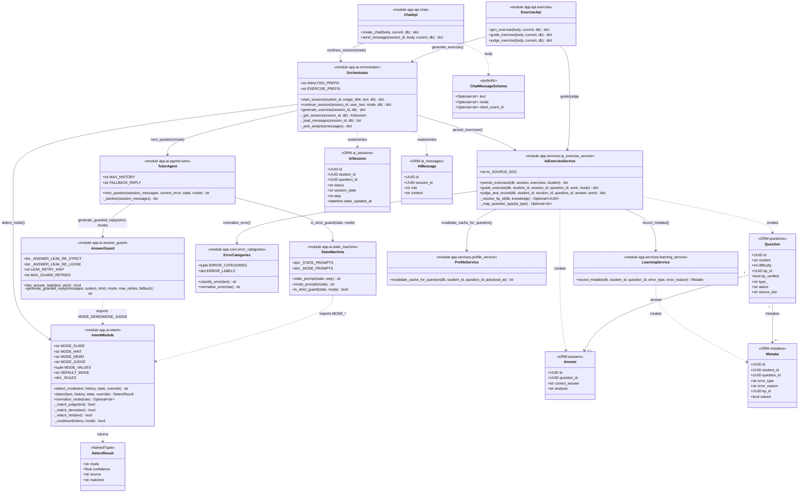
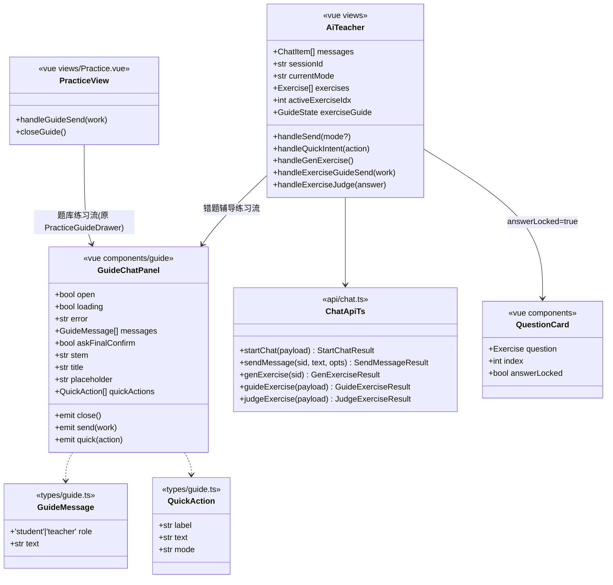
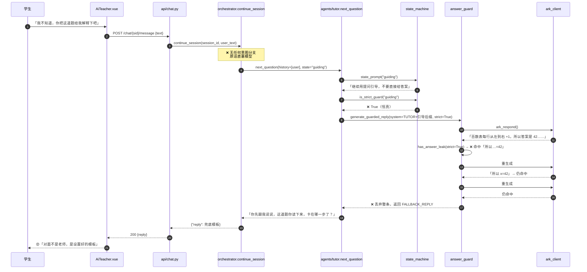
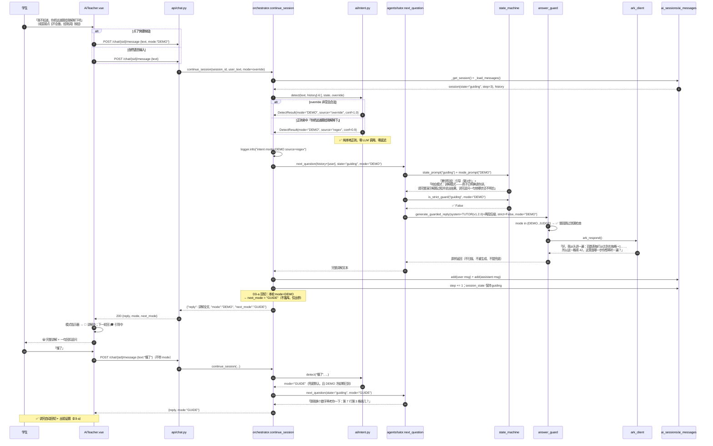
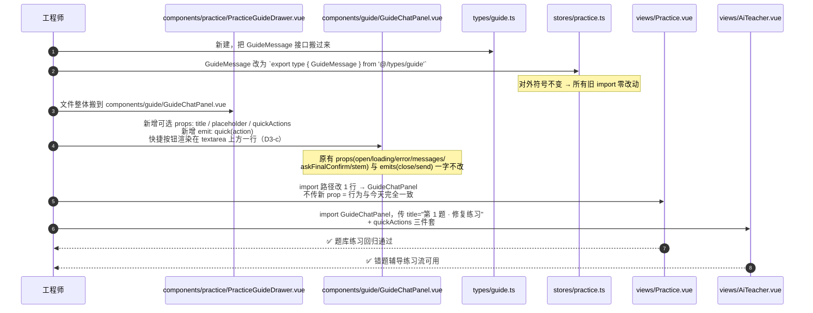
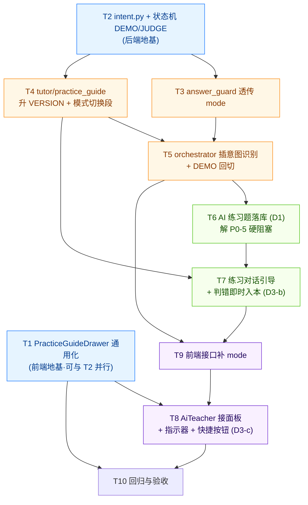

# AI 老师「更像真人老师」机制升级 · 系统设计与任务分解

- 文档版本：v1.0（2026-08-10）
- 作者：架构师 高见远
- 状态：待评审 / 可直接开工
- 上游文档：`docs/practice-tutor-prd-20260810.md`（产品经理 许清楚）
- 影响范围：`backend/app/ai/*`、`backend/app/api/{chat,exercise}.py`、`backend/app/models/ai.py`（不改表）、`student-web/src/{views,components,api,stores}/*`

---

## 0. 三个决策点：拍板结论（先给结论，理由见 §7）

| 决策 | 结论 | 一句话理由 |
|---|---|---|
| **D1 落库策略** | **落库**。AI 练习题写入 `questions` + `answers`，用 `source_doc='ai_gen'` + `status='archived'` 打标，**不新增任何列、不做迁移** | 复用 `record_mistake` 外键 + `kp_id` 画像链路；`archived` 保证它永不进题库抽题池，零污染 |
| **D2 意图识别** | **双通道**。①前端快捷按钮**显式**传 `mode`（100% 准确，直接覆盖）；②后端新建 `app/ai/intent.py`，**纯正则 + 关键词**本地识别，**不额外调 LLM** | 显式 > 猜测；本地识别零延迟零 token，误判由显式通道兜底 |
| **D3-a DEMO 后回切** | **是**。讲解完整题后自动回切 `GUIDE`，并在回复尾部追加一道「同类小验证题」 | 讲完就走等于白讲；回切+验证是真人老师的标准动作 |
| **D3-b 错题入库时机** | **判错即时入库**（不等两题做完） | AI 练习无 `finish_session` 收口节点，学生随时可能退出；即时入库 + `record_mistake` 天然幂等 |
| **D3-c 快捷按钮位置** | **输入框上方一行**，横向滚动，3 个按钮 | 发现率是本次改版的第一目标；折叠在「+」里等于没做 |
| **复用结论** | `PracticeGuideDrawer.vue` **可直接复用**，只需搬家 + 加 3 个可选 prop | 它是纯展示组件，唯一外部依赖是 `import type { GuideMessage }`（类型导入，运行时零耦合） |

---

## 1. 实现方案与框架选型

### 1.1 核心技术难点

| 难点 | 本质 | 破法 |
|---|---|---|
| N1 三重锁死 | 提示词 / 代码闸门 / 状态机三层各自独立写死「不许给答案」，改一层没用 | 引入贯穿三层的 **`mode` 单一维度**，三层全部改为「按 mode 取严格度」，不再各自硬编码 |
| N2 零意图识别 | `continue_session()` 无分支，学生说什么都走同一条路 | 在 `continue_session()` 里插一个**纯本地**的识别函数，产出 `mode` 后再往下走 |
| N3 练习题不落库 | `record_mistake()` 的 `question_id` 外键无法满足 | AI 题落 `questions`，用既有列打标（`source_doc` / `status`），**零迁移** |
| N4 练习题无对话面板 | `AiTeacher.vue` 用静态 `QuestionCard` | 复用 `PracticeGuideDrawer.vue` |
| N5 改动碰的是「核心教学资产」 | `prompts/tutor.py` 头部明写「改前评审并升 VERSION」 | 提示词**只做加法**（新增【模式切换】段），铁律 1 改为条件式而非删除；两份 prompt 均升 `1.1.0 → 1.2.0` |

### 1.2 框架选型（沿用 V4，零新增）

| 层 | 选型 | 说明 |
|---|---|---|
| 后端 | FastAPI + SQLAlchemy 2.x + SQLite | 不变 |
| AI | 火山方舟 `ark_client.ark_respond` | 不变，**意图识别不新增任何模型调用** |
| 前端 | Vue 3 + Vite + TypeScript + Tailwind + Pinia | 不变 |
| 新增依赖 | **无**（`re` / `typing` 全是标准库） | 见 §6 |

### 1.3 架构模式

- 后端沿用现有 **API → orchestrator（编排）→ agents（能力）→ prompts / guard（约束）** 四层；`intent.py` 作为**纯函数模块**挂在 `app/ai/` 下，与 `state_machine.py` 同级同性质（无 DB、无网络、可离线单测）。
- `mode` 作为**跨层参数**沿一条链单向透传，任何一层都不得自行猜测或改写（见 §7 共享知识）。

### 1.4 mode 透传链路（本次改造的主动脉）

```
[前端快捷按钮 mode?] ──┐
                       ├─► POST /chat/{sid}/message (body.mode 可选)
[学生自然语言        ] ─┘
        │
        ▼
 orchestrator.continue_session(mode_override=?)
        │  ① 显式 mode 有值 → 直接采用
        │  ② 否则 intent.detect_mode(text, history) → mode
        ▼
 tutor.next_question(state=..., mode=...)
        │
        ├─► state_machine.mode_prompt(mode)   → 追加到 system 提示
        └─► state_machine.is_strict_guard(state, mode=...) → strict
                    │
                    ▼
        answer_guard.generate_guarded_reply(strict=..., mode=...)
                    │
                    ▼
        返回 {"reply": ..., "mode": ...} → 前端模式指示器
```

---

## 2. 文件清单（相对路径 · 精确到函数 / 行号）

> 行号以 2026-08-10 当前代码为准，实施时以函数名定位为准（行号会漂）。

### 2.1 后端 · 新建（2 个）

| # | 文件 | 内容 |
|---|---|---|
| B-N1 | `backend/app/ai/intent.py` | 意图识别纯函数模块。导出 `MODE_GUIDE/HINT/DEMO/JUDGE`、`MODE_VALUES`、`detect_mode()`、`normalize_mode()`。**无 DB、无网络** |
| B-N2 | `backend/app/services/ai_exercise_service.py` | AI 练习题落库 + 对话式引导 + 判错入本。导出 `persist_exercises()`、`guide_exercise()`、`judge_and_record()` |

### 2.2 后端 · 改造（8 个）

| # | 文件:行 | 现状 | 改动 |
|---|---|---|---|
| B-1 | `backend/app/ai/state_machine.py:63-68` `is_strict_guard(state)` | `state in (intro, guiding)` 恒 True | 签名改 `is_strict_guard(state, *, mode=None)`；`mode` 为 `DEMO`/`JUDGE` → **恒 False**；`mode` 为 `None`/`GUIDE`/`HINT` → 保持原逻辑。**`mode` 为关键字参数且默认 None，老调用与 `test_t04b_state.py` 全部不破** |
| B-2 | `backend/app/ai/state_machine.py:28-46` `_STATE_PROMPTS` | 5 条阶段提示 | **新增** `_MODE_PROMPTS: Dict[str, str]`（4 条）与 `mode_prompt(mode) -> str`；`_STATE_PROMPTS` 一字不改 |
| B-3 | `backend/app/ai/answer_guard.py:78-115` `generate_guarded_reply()` | 参数 `strict` | 新增关键字参数 `mode: Optional[str] = None`；`mode in (DEMO, JUDGE)` 时**整段跳过泄漏检查**（`return reply or fallback`），不重生成、不替 `FALLBACK_REPLY` |
| B-4 | `backend/app/ai/answer_guard.py:58` `_DEFAULT_FALLBACK` | 写死一句 | 不删（GUIDE 仍需要），但补 docstring 注明「仅 strict 路径可达」 |
| B-5 | `backend/app/ai/agents/tutor.py:56-99` `next_question()` | 参数 `session_messages/current_error/state` | 新增关键字参数 `mode: Optional[str] = None`；`system` 拼接顺序改为 `TUTOR_PROMPT + state_suffix + mode_suffix`；`strict = is_strict_guard(state, mode=mode)`；透传 `mode` 给 `generate_guarded_reply` |
| B-6 | `backend/app/ai/prompts/tutor.py:10` `VERSION` / `:24` 铁律 1 | `VERSION="1.1.0"`；「第一轮绝不直接给答案」 | 升 `VERSION="1.2.0"`；铁律 1 改为「**在引导模式（GUIDE）下**，第一轮不直接给答案……**当系统把你切到讲解模式（DEMO）时，本条不适用**」；新增【模式切换】整段（4 个 mode 的行为说明）。**其余一字不动** |
| B-7 | `backend/app/ai/prompts/practice_guide.py:20` `VERSION` / `:39` 铁律 5 | `VERSION="1.1.0"`；「即使孩子问你答案也不公布」 | 升 `VERSION="1.2.0"`；铁律 5 增加 DEMO 例外；输出 JSON 增加 `"verdict"` 字段（`correct`/`wrong`/`pending`）与 `"errorType"`（五类机器码之一，见 §7） |
| B-8 | `backend/app/ai/orchestrator.py:144-183` `continue_session()` | 无分支直塞模型 | 签名加 `mode: Optional[str] = None`；调 `tutor.next_question()` 前插意图识别；DEMO 回复后自动回切 GUIDE（D3-a）；返回值加 `"mode"` |
| B-9 | `backend/app/ai/orchestrator.py:199-230` `generate_exercise()` | 「**不落库**」 | 生成后调 `ai_exercise_service.persist_exercises()` 落库，返回的每道题**新增 `question_id` 字段**；把 `role→question_id` 映射写一条 `AiMessage`（前缀 `EXERCISE_PREFIX`）便于回捞 |
| B-10 | `backend/app/api/chat.py:47-56` `ChatMessage` / `:108-131` `send_message()` | 无 `mode` | 请求体加 `mode: Optional[str] = None`；响应体透传 `mode` |
| B-11 | `backend/app/api/exercise.py:9` 注释 / `:42-63` | 注释「不落题库」 | 改注释；新增两个路由：`POST /exercise/guide`、`POST /exercise/judge` |
| B-12 | `backend/app/api/__init__.py` | 已注册 exercise | 无需改（复用 `exercise.router`） |

### 2.3 后端 · 只读依赖（不改，仅引用）

| 文件 | 用途 |
|---|---|
| `backend/app/core/error_categories.py` | 错因五类**唯一真相源**，用 `normalize_error()` 收敛，**禁止另起枚举** |
| `backend/app/services/learning_service.py:134` `record_mistake()` | 错题入本（幂等 + kp_id 快照 + 内部 `db.commit()`） |
| `backend/app/services/profile_service.py:133` `_VERIFIED_KP_EXPR` | 画像只统计 `kp_verified IS TRUE` 的题（决定 D1 的 `kp_verified` 取值） |
| `backend/app/services/practice_service.py:772-828` | 错题入本 + 缓存失效的**参考实现**，AI 侧对齐这套口径 |
| `backend/app/services/practice_service.py:195-236` `_candidate_rows()` | 抽题池硬条件 `status='active'` → 决定 D1 用 `archived` 隔离 |
| `backend/app/models/content.py:94-171` `Question` | **无 `source` 列**！只有 `source_doc/source_type/edition/section/status/kp_verified`；`difficulty` 有 CHECK `IN (1,3,5)` |

### 2.4 前端 · 新建 / 搬家（3 个）

| # | 文件 | 内容 |
|---|---|---|
| F-N1 | `student-web/src/types/guide.ts` | 把 `GuideMessage` 从 `stores/practice.ts` 抽出来做共享类型（`stores/practice.ts` 改为 re-export，Practice.vue 零改动） |
| F-N2 | `student-web/src/components/guide/GuideChatPanel.vue` | 由 `components/practice/PracticeGuideDrawer.vue` **原样搬家**，新增 3 个**可选** prop：`title?`、`placeholder?`、`quickActions?: {label,text}[]`；新增快捷按钮渲染（输入框上方一行）。**原有 props/emits 全部保持不变** |
| F-N3 | `student-web/src/components/practice/PracticeGuideDrawer.vue` | 保留文件，改为 3 行的薄封装 `export { default } from '@/components/guide/GuideChatPanel.vue'` 形式（或直接改 `Practice.vue` 的 import 路径，二选一，推荐后者更干净） |

### 2.5 前端 · 改造（4 个）

| # | 文件:行 | 改动 |
|---|---|---|
| F-1 | `student-web/src/api/chat.ts:36-39` `SendMessageResult` / `:150-159` `sendMessage()` | 加 `mode: string`；`sendMessage(sessionId, text, opts?: {mode?, clientEventId?})`（**第 3 参改为可选对象，旧调用点只有 AiTeacher.vue 一处，同批改**） |
| F-2 | `student-web/src/api/chat.ts:41-56` `Exercise` / `:161-164` `genExercise()` | `Exercise` 加 `questionId: string`；新增 `guideExercise()`、`judgeExercise()` 两个函数；`createMistake` 的 ⚠️ 注释（:171-176）更新为「AI 练习题已落库，可直接建档」 |
| F-3 | `student-web/src/views/AiTeacher.vue:142-158` `handleGenExercise()` / `:204-209` 模板 | 出题后进入**对话式练习**；顶部加模式指示器；输入框上方加 3 个快捷意图按钮；挂 `GuideChatPanel` |
| F-4 | `student-web/src/components/QuestionCard.vue:16` `showAnswer` / `:57-67` | 新增 prop `answerLocked?: boolean`（默认 `false`，题库侧行为不变）；`true` 时「看答案」按钮置灰 + 文案改「先和老师把它做完」 |

---

## 3. 数据结构与接口

### 3.1 `mode` 枚举与严格度映射表（本次改造的核心契约）

```python
# backend/app/ai/intent.py —— mode 枚举的唯一真相源
MODE_GUIDE: str = "GUIDE"   # 引导（默认）
MODE_HINT:  str = "HINT"    # 提示
MODE_DEMO:  str = "DEMO"    # 演示讲解
MODE_JUDGE: str = "JUDGE"   # 评判
MODE_VALUES = (MODE_GUIDE, MODE_HINT, MODE_DEMO, MODE_JUDGE)
DEFAULT_MODE = MODE_GUIDE
```

| mode | 含义 | `is_strict_guard` | `answer_guard` 行为 | tutor 行为 | 前端指示器 |
|---|---|---|---|---|---|
| `GUIDE` | 苏格拉底引导（默认，现状） | 跟随 `state`（intro/guiding=True） | 严格正则，命中重生成 ≤2 次，仍命中→`FALLBACK_REPLY` | 一次一问 | 🎓 引导中 |
| `HINT` | 给方向性提示，不给结论 | 跟随 `state`（同 GUIDE） | 同 GUIDE | 给一条线索 + 一个小问题 | 💡 提示中 |
| `DEMO` | 完整演示讲解 | **恒 False** | **完全跳过检查**（不扫描、不重生成、不替兜底） | 从头讲完整思路 + 结果，讲完追问「这一步为什么」 | 📖 讲解中 |
| `JUDGE` | 接收并评判学生给的答案 | **恒 False** | **完全跳过检查** | 明确说对/错 + 错在哪一步 | ✓ 评判中 |

> ⚠️ `DEMO`/`JUDGE` 是**完全跳过**而非「用 LOOSE 正则」。理由：LOOSE 仍拦 `答案：`／`最终答案`，而 DEMO 的正确行为就是要说出「所以答案是 12」。半放开等于没放开——这正是用户投诉「写死的模板」的根因。

### 3.2 `backend/app/ai/intent.py` 输入 / 输出 Schema

```jsonc
// 输入（Python 关键字参数，非 HTTP）
{
  "text":     "string  必填。学生本轮原话",
  "history":  "Array<{role:'user'|'assistant'|'system', content:string}>  可选。最近 N 轮，N=6",
  "state":    "string  可选。当前教学阶段 intro/guiding/practicing/summarizing/closed",
  "override": "string  可选。前端显式传来的 mode；非空且合法时直接返回它，不做任何识别"
}
// 输出
{
  "mode":       "GUIDE | HINT | DEMO | JUDGE",
  "confidence": "float 0.0~1.0",
  "source":     "override | regex | keyword | default",
  "matched":    "string  命中的规则片段，仅用于日志排障，可为空"
}
```

对外主函数签名（**返回值收敛为 `str`，`DetectResult` 供日志用**）：

```python
def detect_mode(*, text: str, history=None, state=None, override=None) -> str
def detect(*, text, history=None, state=None, override=None) -> DetectResult  # NamedTuple
def normalize_mode(raw) -> Optional[str]   # 任意脏输入 → 合法 mode 或 None
```

识别规则（**按优先级从上到下，先命中先返回**）：

| 优先级 | mode | 正则 / 关键词（示例，实施时补全） |
|---|---|---|
| 1 | `override` | 前端显式传值，`normalize_mode` 合法即直接采用 |
| 2 | `JUDGE` | `r"(答案|结果|我算出来|我得到|我觉得是|应该是)\s*[是为:：=]?\s*\S+"`、`我做完了`、`我算完了`、`对不对`、`是不是这样` |
| 3 | `DEMO` | `我不会`、`不知道怎么做`、`你(给我)?(讲|说|解释|演示|做)一(遍|下)`、`直接(告诉|给)我`、`把(整道|这道)题(给我)?(解答|讲解|做)`、`完整(过程|步骤)`、`看演示`、`教我怎么做` |
| 4 | `HINT` | `给点提示`、`提示一下`、`提醒`、`给个思路`、`从哪(儿|里)(开始|下手)`、`第一步(是什么|怎么)` |
| 5 | `GUIDE` | 兜底默认 |

> **JUDGE 优先于 DEMO 的理由**：「我算出来是 12，对不对」同时含「对不对」和数值，学生诉求是评判不是重讲。
> **反例保护**：`我不会`(DEMO) 与 `不会吧`(非 DEMO) 用词边界正则区分；连续 2 轮识别为同一非 GUIDE mode 时，第 3 轮强制回 `GUIDE`，防止学生一句「不会」把整场对话锁死在 DEMO（对应 PRD P1-1）。

### 3.3 `POST /api/chat/{sid}/message` 契约变更

请求体（`ChatMessage`，camelCase 入参）：

```jsonc
{
  "text": "我不会，你给我讲一遍",
  "mode": "DEMO",            // ★新增，可选。前端快捷按钮填；自然输入时省略
  "clientEventId": "..."     // 不变
}
```

响应体：

```jsonc
{
  "code": 0, "msg": "ok",
  "data": {
    "reply": "好，我从头讲一遍：百数表每行从左到右 +1……",
    "mode": "DEMO",          // ★新增，本轮实际生效的 mode，前端渲染指示器
    "next_mode": "GUIDE"     // ★新增，下一轮建议 mode（D3-a 回切用），前端只读展示
  }
}
```

- **兼容性**：`mode` 非法/未知一律降级为 `GUIDE`，不报错（前端旧版本不传 `mode` 时行为与现在完全一致）。
- 前端 `api/chat.ts` 的 `SendMessageResult` 同步加 `mode`、`nextMode` 两个字段（`normalize` 时给默认值 `'GUIDE'`）。

### 3.4 AI 练习题新增接口（2 个）

**① `POST /api/exercise/guide`** —— 对话式逐步引导（对齐 `/api/practice/guide`）

```jsonc
// req
{ "sessionId": "uuid", "questionId": "uuid", "work": "我先算 3×4=12", "mode": "DEMO" }
// resp.data
{
  "question_id": "uuid",
  "reply": "✓ 这步对了，接下来……",
  "ask_final_confirm": false,
  "verdict": "pending",          // correct | wrong | pending
  "error_type": null,            // verdict=wrong 时给五类机器码之一
  "mode": "GUIDE",
  "prompt_version": "1.2.0"
}
```

**② `POST /api/exercise/judge`** —— 学生提交最终答案，判对错 + 判错即时入本

```jsonc
// req
{ "sessionId": "uuid", "questionId": "uuid", "answer": "12", "work": "3×4=12" }
// resp.data
{
  "question_id": "uuid",
  "correct": false,
  "verdict_text": "方向对了，但 3×4 这一步再看看",
  "error_type": "CALC",          // 五类机器码，来自 error_categories.normalize_error()
  "mistake_id": "uuid",          // 判错时才有；判对为 null
  "mastery_refreshed": true
}
```

### 3.5 `POST /api/exercise/gen` 响应变更

```jsonc
// data.exercises[i] 新增 questionId
{
  "questionId": "uuid",   // ★新增：落库后的 questions.id
  "q": "...", "a": "...", "type": "计算",
  "knowledge": "两位数乘法", "difficulty": 3, "role": "fix", "tag": "..."
}
```

### 3.6 D1 落库字段映射表（**零迁移**，全部用既有列）

| `Question` 列 | AI 练习题取值 | 理由 |
|---|---|---|
| `content` | `exercise["q"]` | — |
| `subject` | `"数学"`（默认） | — |
| `grade` | `Student.grade`（取不到留 `None`） | — |
| `difficulty` | `exercise["difficulty"]` | `agents/exercise.py:_normalize_difficulty` 已收敛到 1/3/5，**满足 DB CHECK `difficulty IN (1,3,5)`** |
| `kp_id` | `KnowledgePoint.name == exercise["knowledge"]` 精确匹配；匹配不到 → `None` | 无现成 name→id 解析器，精确匹配最稳；匹配不到时错题仍能入本，只是不进画像（可接受，见 §8） |
| `kp_verified` | `True`（**仅当 `kp_id` 非空**） | `profile_service._VERIFIED_KP_EXPR` 只统计 `kp_verified IS TRUE`；设 `False` 会让 G3 目标（按 kp_id 聚合薄弱点）直接断流 |
| `type` | `计算`/`应用` 原样；`几何`→`图形`；`函数`/`证明` → `None` | AI 枚举(`计算/应用/几何/函数/证明`) ≠ DB 白名单(`选择/填空/应用/计算/图形/判断`)，`content.py:37-38` 明令「切勿顺手对齐」，只做安全子集映射 |
| `status` | **`archived`** | `practice_service._candidate_rows()` 硬条件 `status='active'` → AI 题**永不进题库抽题池**，零污染 |
| `source_doc` | **`"ai_gen"`** | 非 NULL，绕开 `schema_guard` 的「`source_doc IS NULL` 必须 `kp_verified=TRUE`」守卫；`idx_questions_source_doc` 索引现成可用于统计/清理 |
| `edition` / `source_type` / `section` | 全 `None` | 不碰运营口径枚举 |
| `options` | `None` | AI 题非选择题 |

配套 `Answer` 行（1:1，`cascade` 已有）：`correct_answer = exercise["a"]`，`analysis = exercise["tag"]`，`distractor_analysis = {}`。

AI 侧元数据（`role`/`tag`/原始 `type`）**不入 questions 表**，写一条 `AiMessage`：

```python
EXERCISE_PREFIX: str = "练习题："   # 与既有 ANALYSIS_PREFIX 同款回捞惯例
# content = f'{EXERCISE_PREFIX}{json.dumps([{"question_id":..., "role":"fix", "tag":...}], ensure_ascii=False)}'
```

### 3.7 `ai_sessions` 是否新增 `current_mode` 字段 —— **结论：不新增**

理由（3 条，任一成立即不该加）：

1. **`mode` 是单轮瞬时量，不是会话持久状态**。它每轮由 `intent.detect_mode()` 重新判定，下一轮不复用；持久化只会引入「上轮 DEMO 污染本轮 GUIDE」的脏状态。
2. **加列 = 迁移**。`ai_sessions` 有 `CheckConstraint('session_state IN (...)')`，SQLite 改表要重建；本次「零迁移」是硬约束。
3. **需要跨轮的信息只有「连续同 mode 计数」**，它可以从 `_load_messages()` 已有的历史里现算（PRD P1-1 的「连续 2 轮无进展」同理），不需要新列。

> 如果后续要做「模式停留时长」这类埋点分析，走日志（`logger.info("intent mode=%s source=%s")`）即可，不占数据库。

### 3.8 类图



前端组件关系：



---

## 4. 程序调用流程时序图

### 4.1 现状（问题复现）：学生说「你讲一遍」被三重锁死



### 4.2 改造后（主链路）：意图识别 → DEMO → guard 放行 → 完整演示 → 回切 GUIDE



### 4.3 AI 练习题：落库 → 对话式作答 → 判错即时入本（D1 + D3-b）

```mermaid
sequenceDiagram
    autonumber
    participant S as 学生
    participant V as AiTeacher.vue
    participant P as GuideChatPanel.vue
    participant API as api/exercise.py
    participant O as orchestrator.generate_exercise
    participant EX as agents/exercise.gen_exercises
    participant AES as ai_exercise_service
    participant LS as learning_service
    participant PS as profile_service
    participant DB as questions/answers/mistakes

    S->>V: 点【再出两道】
    V->>API: POST /exercise/gen {sessionId}
    API->>O: generate_exercise(session_id, db)
    O->>O: _pick_analysis(messages) → kp/难度/错因
    O->>EX: gen_exercises(error_type, kp, difficulty)
    EX-->>O: [{q,a,type,knowledge,difficulty,role,tag} ×2]
    O->>AES: persist_exercises(db, session, exercises, student)
    loop 每道题
        AES->>AES: _resolve_kp_id(knowledge) 精确匹配 KnowledgePoint.name
        AES->>AES: _map_question_type(计算/应用→原样, 几何→图形, 其余→None)
        AES->>DB: INSERT questions(status='archived', source_doc='ai_gen',<br/>kp_verified = kp_id is not None, difficulty∈{1,3,5})
        AES->>DB: INSERT answers(correct_answer=a, analysis=tag)
    end
    AES-->>O: [question_id ×2]
    O->>DB: INSERT ai_messages(role='assistant',<br/>content='练习题：[{question_id, role, tag}]')
    O->>DB: session_state = 'practicing'; commit
    O-->>API: {"exercises":[{questionId, q, a, ...}]}
    API-->>V: 200
    V->>V: exercises[0] 设为当前题；QuestionCard(answerLocked=true)
    V->>P: open=true, stem=exercises[0].q,<br/>quickActions=[不会做给我讲/给点提示/看演示]
    P-->>S: 对话式作答面板

    S->>P: 「我先算 3×4=12」
    P->>V: emit send("我先算 3×4=12")
    V->>API: POST /exercise/guide {sessionId, questionId, work}
    API->>AES: guide_exercise(...)
    AES->>AES: practice_guide.PROMPT(v1.2.0)<br/>.replace(QUESTION).replace(WORK)
    AES->>AES: ark_respond → extract_json<br/>{reply, askFinalConfirm, verdict, errorType}
    alt mode 非 DEMO/JUDGE
        AES->>AES: sanitize：泄题则换兜底话术
    else mode = DEMO/JUDGE
        AES->>AES: ✅ 跳过泄题检查
    end
    AES-->>V: {reply:"✓ 这步对了，接下来…", verdict:"pending", ask_final_confirm:false}
    P-->>S: 老师回复（第 1 步反馈）
    Note over S,P: 多轮往复 ≥3 轮（P0-4）

    S->>P: 「我算出来是 15」
    P->>V: emit send(...)
    V->>API: POST /exercise/judge {sessionId, questionId, answer:"15", work}
    API->>AES: judge_and_record(...)
    AES->>DB: SELECT answers.correct_answer WHERE question_id
    AES->>AES: 归一化比对 → correct = False
    AES->>AES: error_categories.normalize_error(模型给的错因) → "CALC"
    AES->>LS: record_mistake(student_id, question_id,<br/>error_type="CALC", error_reason="AI 练习作答错误：…")
    Note over LS: 幂等：同(student,question)未攻克记录直接复用<br/>kp_id 从 Question 快照拷贝
    LS->>DB: INSERT mistakes（含 kp_id 快照）
    LS-->>AES: Mistake
    alt question.kp_id 非空
        AES->>PS: invalidate_cache_for_question(student_id, question_id)
        PS->>DB: 失效 student_mastery 缓存
    end
    AES-->>V: {correct:false, error_type:"CALC", mistake_id, verdict_text}
    V->>P: 追加老师消息「这一步再看看：3×4 等于多少？」+ ✗ 视觉标记
    V-->>S: 明确对错 + 错在哪一步（US-A3）
    Note over V: ✅ 判错即时入本（D3-b），学生此刻退出也不丢数据
```

### 4.4 `PracticeGuideDrawer` 通用化（不影响题库练习）



---

## 5. 有序任务列表

> 排序原则：**先建地基（枚举/组件），再改闸门，最后接线**。T1 与 T2 可并行（一前端一后端）。
> 每个任务的「完成判据」都是可跑的，不满足不许进下一个。

### T1 · `PracticeGuideDrawer` 通用化（前端地基）

- **优先级**：P0
- **依赖**：无
- **文件**：`student-web/src/types/guide.ts`(新)、`student-web/src/components/guide/GuideChatPanel.vue`(新·搬家)、`student-web/src/components/practice/PracticeGuideDrawer.vue`(删或薄封装)、`student-web/src/stores/practice.ts`(re-export 1 行)、`student-web/src/views/Practice.vue`(import 1 行)
- **要点**：新增 prop 一律**可选带默认值**；不传新 prop 时渲染结果必须与今天像素级一致
- **完成判据**：题库练习页「让老师带我想一想」全流程回归通过，抽屉外观 / 行为无变化

### T2 · `intent.py` + 状态机加 DEMO/JUDGE 挡（后端地基）

- **优先级**：P0
- **依赖**：无
- **文件**：`backend/app/ai/intent.py`(新)、`backend/app/ai/state_machine.py`(加 `_MODE_PROMPTS`/`mode_prompt()`，改 `is_strict_guard` 签名)
- **要点**：
  - `is_strict_guard(state, *, mode=None)` —— `mode` 必须是**关键字参数 + 默认 None**，老调用零改动
  - `intent.py` 零 DB / 零网络 / 零新依赖；`_RULES` 用模块级预编译正则
  - `state_machine` 从 `intent` import mode 常量（**单向依赖，禁止反向**）
- **完成判据**：`pytest backend/tests/test_t04b_state.py` 全绿；新写的 `test_intent.py` 覆盖 §3.2 表格里每条规则 + 「不会吧」反例 + 冷却回切

### T3 · `answer_guard` 透传 mode

- **优先级**：P0（对应 PRD P0-2）
- **依赖**：T2
- **文件**：`backend/app/ai/answer_guard.py`（`generate_guarded_reply` 加 `mode` 参数）
- **要点**：`mode in (DEMO, JUDGE)` → **在调用 `ark_respond` 之后、`has_answer_leak` 之前直接 return**，不做任何扫描
- **完成判据**：`pytest backend/tests/test_t04b_answer_guard.py` 全绿；新增用例：`mode="DEMO"` 时含「答案：x=5」的回复原样返回、`ark_respond` 只被调用 1 次

### T4 · 两份 prompt 升版 + 加模式切换段

- **优先级**：P0
- **依赖**：T2
- **文件**：`backend/app/ai/prompts/tutor.py`（`VERSION` 1.1.0→1.2.0，铁律 1 改条件式，新增【响应模式切换】段）、`backend/app/ai/prompts/practice_guide.py`（1.1.0→1.2.0，铁律 5 加 DEMO 例外，输出 JSON 加 `verdict`/`errorType`）
- **要点**：
  - **只做加法**。除铁律 1 / 铁律 5 两句外其余一字不动（这是核心教学资产）
  - 【响应模式切换】段必须逐条写清 4 个 mode 的行为，且强调「模式由系统给定，你不要自己切换」
  - `practice_guide` 的 `errorType` 取值必须写死为 `READ/METHOD/CALC/KNOWLEDGE/CHECK` 五选一
- **完成判据**：两文件 `VERSION` 已升；`PLACEHOLDERS` 自检不破；人工评审 diff（改动行数 tutor ≤ 25 行、practice_guide ≤ 20 行）

### T5 · `orchestrator.continue_session` 插意图识别 + DEMO 回切

- **优先级**：P0（对应 PRD P0-1、D3-a）
- **依赖**：T2、T3、T4
- **文件**：`backend/app/ai/orchestrator.py:144-183`、`backend/app/ai/agents/tutor.py:56-99`
- **要点**：
  - `continue_session(*, session_id, user_text, mode=None, db)`；`mode` 走 `intent.detect_mode(override=mode)`
  - `tutor.next_question(..., mode=mode)`
  - 返回 `{"reply", "mode", "next_mode"}`；`next_mode` 在本轮 DEMO 时为 `GUIDE`，其余等于本轮 mode
  - `logger.info("intent session=%s mode=%s source=%s", ...)` 便于线上验准确率（G1 ≥90%）
- **完成判据**：`pytest backend/tests/test_t03_chat.py test_t04b_state.py` 全绿；新增集成用例「发『我不会，你给我讲一遍』→ resp.data.mode=='DEMO' 且 reply 不等于 FALLBACK_REPLY」

### T6 · AI 练习题落库（D1 · 解 P0-5 硬阻塞）

- **优先级**：P0
- **依赖**：T5（同改 `orchestrator.py`，避免冲突）
- **文件**：`backend/app/services/ai_exercise_service.py`(新，只做 `persist_exercises` + 两个私有 helper)、`backend/app/ai/orchestrator.py:199-230`、`backend/app/api/exercise.py:9`(改注释)
- **要点**：严格按 §3.6 映射表；`status='archived'`、`source_doc='ai_gen'`、`kp_verified = (kp_id is not None)`；`difficulty` 已被 agent 收敛到 1/3/5，仍要**加一道断言**防 CHECK 违约；写库用**调用方传入的 db**，与 orchestrator 现有事务纪律一致
- **完成判据**：`/api/exercise/gen` 返回带 `questionId`；DB 里 `SELECT count(*) FROM questions WHERE source_doc='ai_gen' AND status='archived'` = 2；`pytest backend/tests/test_practice.py` 全绿（**证明抽题池没被污染**）

### T7 · 练习对话引导 + 判错即时入本（D3-b）

- **优先级**：P0（对应 PRD P0-4、P0-5）
- **依赖**：T4、T6
- **文件**：`backend/app/services/ai_exercise_service.py`(补 `guide_exercise`/`judge_and_record`)、`backend/app/api/exercise.py`(加 2 个路由)
- **要点**：
  - `guide_exercise` 参照 `practice_service.guide_question:923-1009` 的结构，但**不依赖 `practice_sessions`**，改为校验 `question.source_doc=='ai_gen'` 且该 `question_id` 在本 `ai_session` 的 `EXERCISE_PREFIX` 消息里
  - `judge_and_record` 判错后调 `learning_service.record_mistake(error_type=五类机器码)`，再对 `kp_id` 非空的题调 `profile_service.invalidate_cache_for_question`（用 try/except 包住，缓存失败不拖垮主流程——对齐 `practice_service:819`）
  - ⚠️ `record_mistake` 内部会 `db.commit()`，调用前确保没有半截未提交的写
  - 两个路由都用 `run_in_threadpool` 包同步函数
- **完成判据**：判错后 `GET /api/mistake/list` 能查到该题，`errorType ∈ {READ,METHOD,CALC,KNOWLEDGE,CHECK}`；同一题重复判错不产生第二条未攻克记录（幂等）

### T8 · `AiTeacher.vue` 接对话面板 + 模式指示器 + 快捷按钮（D3-c）

- **优先级**：P0（对应 PRD P0-3、P1-2、P1-3、P1-4）
- **依赖**：T1、T9
- **文件**：`student-web/src/views/AiTeacher.vue`、`student-web/src/components/QuestionCard.vue`
- **要点**：
  - 顶部常驻模式指示器（🎓/💡/📖/✓），数据来自 `sendMessage` 返回的 `mode`
  - 输入框上方一行 3 个快捷按钮：`不会做，给我讲`(DEMO) / `给点提示`(HINT) / `看演示`(DEMO)，点击 = 填入话术 + 显式带 `mode` 发送
  - `handleGenExercise()` 改为：拿到题 → 设 `activeExerciseIdx=0` → 打开 `GuideChatPanel`
  - `QuestionCard` 传 `answerLocked=true`（未走完对话不给展开 `a`）
  - 题目状态指示器「第 1/2 题 · 作答中/评判中/已完成」
- **完成判据**：手测 US-B1/B2/B4 三条用户故事各走一遍；点【再出两道】后**看不到**可直接展开答案的按钮

### T9 · 前端接口补 `mode` 与练习对话方法

- **优先级**：P0
- **依赖**：T5、T7（后端契约先定）
- **文件**：`student-web/src/api/chat.ts`
- **要点**：`SendMessageResult` 加 `mode`/`nextMode`（归一化默认 `'GUIDE'`）；`sendMessage` 第 3 参改可选对象；`Exercise` 加 `questionId`；新增 `guideExercise()`/`judgeExercise()`；更新 `createMistake` 的过期 ⚠️ 注释
- **完成判据**：`npm run type-check` 零错；全仓 grep `sendMessage(` 无残留旧签名调用

### T10 · 回归与验收（P1 收尾）

- **优先级**：P1
- **依赖**：T1~T9
- **文件**：`backend/tests/test_intent.py`(新)、`backend/tests/test_ai_exercise.py`(新)
- **要点**：G1 意图准确率抽样 20 条 ≥90%；G2 练习可回溯 ≥2 步；G3 入库成功率 100%
- **完成判据**：`pytest backend/tests` 全绿 + 三条业务目标口径实测达标

### 5.1 任务依赖图



**关键路径**：`T2 → T3/T4 → T5 → T6 → T7 → T9 → T8 → T10`（T1 可全程并行插入）。

---

## 6. 依赖包列表

### 6.1 新增依赖：**零**

| 需求 | 用什么实现 | 是否新增包 |
|---|---|---|
| 意图识别 | `re`（标准库）+ 模块级预编译正则 | ❌ 否 |
| mode 枚举 | 模块级 `str` 常量 + `tuple`（对齐 `state_machine.py` 现有写法，**不引 `enum.Enum`**，保持全项目一致） | ❌ 否 |
| AI 题落库 | 现有 SQLAlchemy ORM（`Question`/`Answer`） | ❌ 否 |
| 练习对话面板 | 现有 Vue3 + Tailwind 组件搬家 | ❌ 否 |
| 快捷按钮 | 原生 `<button>` + Tailwind | ❌ 否 |

### 6.2 现有依赖（沿用，版本不动）

```
# backend
fastapi              # 路由
sqlalchemy>=2.0      # ORM
pydantic>=2.0        # BaseSchema 出入参
pytest               # 测试

# student-web
vue@^3               # 视图
vue-router@^4        # 路由
pinia                # 状态
axios                # api/http.ts
tailwindcss@^3       # 样式
typescript / vite    # 构建
```

> ⚠️ 本次改造**不引入任何新的 pip / npm 包**，`requirements.txt` 与 `package.json` 零改动。评审时若有人提议引入 NLU 库 / 状态机库（`transitions`、`compromise` 等），一律驳回：识别规则不足 60 行正则，引库是负收益。

---

## 7. 共享知识（跨文件约定 · 工程师必读）

### 7.1 `mode` 透传链路 —— 单向、不可篡改

```
前端(可选显式) → api/chat.py(ChatMessage.mode) → orchestrator.continue_session(mode=)
   → intent.detect_mode(override=mode) → 定稿 mode
   → tutor.next_question(mode=) → state_machine.is_strict_guard(state, mode=)
                                → state_machine.mode_prompt(mode)
                                → answer_guard.generate_guarded_reply(mode=)
   → 回传 resp.data.mode → 前端模式指示器
```

**三条铁律**：

1. **只有 `intent.detect_mode()` 有权定稿 mode**。下游任何一层（tutor / guard / prompt）都**不许**再猜、再改、再降级。
2. **`mode` 一律是关键字参数且默认 `None`**。`None` 语义 = 「未指定」= 走老逻辑，保证所有存量调用点和存量测试零改动。
3. **mode 枚举常量的唯一定义处是 `app/ai/intent.py`**。`state_machine.py` / `answer_guard.py` / `orchestrator.py` 一律 `from app.ai.intent import MODE_DEMO, ...`，**禁止任何文件重新写一遍字符串字面量 `"DEMO"`**。

### 7.2 错因分类：`error_categories.py` 是唯一真相源

- 任何地方产出 `error_type` 都必须过 `error_categories.normalize_error(raw)`，落库值只能是 `READ / METHOD / CALC / KNOWLEDGE / CHECK` 五个机器码之一。
- **禁止**新建枚举、禁止写中文错因入库、禁止抄一份关键词表。
- ⚠️ 历史遗留：`practice_service.finish_session:786` 传的是 `error_type="练习错题"`（不合规）。**本次不修它**（超出范围，会动题库练习），但**新代码绝不许照抄**。
- 展示用中文标签走 `error_label(code)`，不要在前端硬编码映射。

### 7.3 提示词是核心教学资产

- `prompts/tutor.py`、`prompts/practice_guide.py` 改动**必须升 `VERSION`**，且只做加法。
- 改动 diff 需人工评审。禁止「顺手优化措辞」——每一句都是调过的。
- `practice_guide.PROMPT` 含 `{{QUESTION}}` / `{{WORK}}` 占位符，`PLACEHOLDERS` 元组是自检清单，新增占位符要同步加进去。

### 7.4 数据库红线（本次零迁移）

- **不加列、不加表、不改 CHECK**。`ai_sessions` 不加 `current_mode`（理由见 §3.7）。
- `questions.difficulty` 有 CHECK `IN (1,3,5)`，写入前必须收敛。
- `questions` **没有 `source` 列**，用 `source_doc='ai_gen'` 打标（PRD 里写的 `source='ai_gen'` 是笔误，以本文档为准）。
- `source_doc IS NULL` 的行必须 `kp_verified=TRUE`，否则 `schema_guard` 会拒绝后续 docx 导入 —— 我们写的是 `source_doc='ai_gen'`（非 NULL），不触发该守卫。
- AI 题一律 `status='archived'`，保证 `practice_service._candidate_rows()`（硬条件 `status='active'`）抽不到它。**这条是题库不被污染的唯一防线，改动前必须重跑 `test_practice.py`。**

### 7.5 事务纪律（沿用 `orchestrator.py:3-8` 的模块契约）

- 写操作**一律用调用方传入的 `db`**，服务内不自建 Session。
- `learning_service.record_mistake()` 内部会 `db.commit()` —— 调用它之前必须确保没有半截未提交的写，调用之后不要假设 identity map 还持有旧对象。
- 缓存失效（`profile_service.invalidate_cache_for_question`）用 `try/except` 包住，失败只打 `logger.warning`，绝不能拖垮判题主流程（对齐 `practice_service.py:819`）。
- 所有含方舟调用的同步函数，API 层一律 `run_in_threadpool` 包裹。

### 7.6 API 响应契约

- 恒为 `{"code":0,"msg":"ok","data":{...}}`（`app.core.response.ok`）。
- 请求体用 `BaseSchema`（camelCase 入参 / `populate_by_name`）；**`data` 里的键沿用各模块现状**：`chat`/`exercise` 是 snake_case 透传，前端在 `api/chat.ts` 里归一化成 camelCase。**不要为了「统一」去改存量键名**，那会打穿前端。
- 新字段一律**可选 + 有默认值**，老客户端不传不崩。

### 7.7 前端约定

- `GuideChatPanel` 的新增 prop 全部可选带默认；`Practice.vue` 不传 = 行为与今天完全一致。
- 数学表达式渲染统一走 `@/utils/formatMath`（防止 LaTeX 漏给孩子）。
- 快捷按钮点击 = 「填入一句自然语言 + 显式带 `mode` 发送」，**两者都要**：自然语言进对话历史让模型有上下文，`mode` 保证 100% 命中。

---

## 8. 待明确事项（已拍板，列出假设与风险）

### 8.1 三个决策点的最终结论

**D1 落库策略 —— 落库为 `source_doc='ai_gen'` + `status='archived'` 的 `Question`**

- **落库时机**：`orchestrator.generate_exercise()` 内、`gen_exercises()` 返回之后、`db.commit()` 之前，一次性落 2 道题 + 2 条 `Answer`。**不延迟到「学生答错时才落」**——延迟落库会让判题接口同时承担写题职责，事务边界变脏。
- **字段**：见 §3.6 完整映射表。
- **为什么不选备选方案 (b)「不依赖 question_id 的错题路径」**：`mistakes` 表 `question_id` 是 NOT NULL 外键，绕过它就得加列或加表 = 破零迁移红线；且错题本/画像/家长周报三处读侧全都 JOIN `questions`，绕过等于这道错题在下游全是空洞，G3 目标直接失败。
- **残留风险**：AI 题会让 `questions` 表持续增长（每次辅导 +2 行）。**缓解**：`source_doc='ai_gen'` 有索引，后续可加一个「清理 90 天前无关联 mistake 的 ai_gen 题」的运维脚本（**本期不做**，记为技术债 TD-1）。

**D2 意图识别 —— 前端显式 `mode` + 后端本地正则双通道，不额外调 LLM**

- **不选「独立 LLM 调用」**：多一次 90s 超时风险的网络往返，用户体感直接翻倍变慢，且这类短句意图识别正则准确率本就 >90%。
- **不选「让 tutor 自己在回复里输出 mode」**：鸡生蛋问题 —— 回复要先经过 `answer_guard`，而 guard 的严格度正取决于 mode。自举不可行。
- **误判兜底**：快捷按钮是显式通道，学生误判时点一下按钮即 100% 纠正；同时连续 2 轮同一非 GUIDE mode 后强制冷却回 GUIDE。

**D3-a DEMO 后回切 —— 是，自动回 GUIDE 并出一道验证题**

- 实现方式：`next_mode` 出参（不落库）+ prompt 里要求 DEMO 回复**结尾必须带一句回扣追问**。下一轮学生说「懂了」自然被 `intent` 判为 GUIDE。

**D3-b 错题入库时机 —— 判错即时入库**

- 与题库练习的 `finish_session` 统一入库**不同口径**，原因：AI 练习没有「交卷」这个收口动作，学生随时可能关页面。
- 幂等由 `record_mistake` 保证（同 `(student_id, question_id)` 存在未攻克记录时复用），即时入库不会重复建档。

**D3-c 快捷按钮位置 —— 输入框上方一行**

- 3 个按钮：`不会做，给我讲`(DEMO)、`给点提示`(HINT)、`看演示`(DEMO)。横向排列，超宽时横向滚动，高度 36px，只占一行。

### 8.2 已知限制与假设（写清楚，避免验收时扯皮）

| # | 事项 | 结论 / 假设 |
|---|---|---|
| A1 | AI 题 `kp_id` 靠**知识点名称精确匹配** | 匹配不上时 `kp_id=None` → 该错题进得了错题本，但**不进学习画像**。当前知识树 L1 只有 13 个节点，AI 给的 `knowledge`（如「两位数乘法」）大概率匹配不上 → **G3「可按 kp_id 聚合薄弱点」在名称对不上时会打折**。缓解：本期先精确匹配，命中率不足再上 `backfill_kp.py` 的规则匹配（记为 TD-2） |
| A2 | AI 题型枚举 ≠ DB 题型白名单 | `几何→图形`，`函数`/`证明` 写 `None`。因为 AI 题恒 `archived`、不进抽题池，`type` 只作展示，留空无副作用 |
| A3 | `judge_and_record` 的对错判定 | AI 生成题多为主观计算题，**不走 `judge_engine`**（那是给题库选择/填空题设计的）。改为「文本归一化比对 `answers.correct_answer`」+ 「模型 `verdict` 字段」双信号，**两者冲突时以模型 `verdict` 为准**（它看得到解题过程） |
| A4 | 意图识别准确率 G1 ≥90% | 按 §3.2 规则表，用 PRD 1.2 节的真实用户语料 + 20 条抽样验收。**低于 90% 时的动作是补正则，不是改架构** |
| A5 | `mistakes` 的 `dialog_diagnosis` / `student_steps` 列（PRD 5.3 建议） | **本期不加**（破零迁移）。P2-1 的诊断摘要暂时塞进 `error_reason`（Text 列，够用），格式：`AI 练习作答错误｜学生步骤：{摘要}｜错因：{中文标签}` |
| A6 | `practice_service.finish_session` 写的 `error_type="练习错题"` 不合规 | **本期不修**，避免动题库练习。记为 TD-3 |
| A7 | 前端 `mode` 指示器的「评判中」态 | JUDGE 是瞬时态，渲染后 3 秒或收到下一条回复即自动回 🎓，避免一直挂着 |
| A8 | 多设备 / 并发同一 session | 沿用现状（无锁）。`mode` 不落库反而规避了并发写冲突 |

### 8.3 技术债登记

| ID | 内容 | 建议处理时机 |
|---|---|---|
| TD-1 | `ai_gen` 题的过期清理脚本 | 上线 1 个月后视表增长决定 |
| TD-2 | AI `knowledge` → `kp_id` 的规则匹配（复用 `scripts/backfill_kp.py` 的关键词表） | G3 命中率实测不足时 |
| TD-3 | `practice_service` 的 `error_type="练习错题"` 收敛到五类枚举 | 下次动题库练习时顺手 |
| TD-4 | `mistakes` 增加 `dialog_diagnosis` / `student_steps` 结构化列 | 有迁移窗口时（P2-1） |

---

## 9. 验收对照表（PRD 需求池 → 本设计）

| PRD 编号 | 需求 | 落在哪个任务 | 验收口径 |
|---|---|---|---|
| P0-1 | 意图识别 + 模式切换 | T2、T5 | 输入「我不会，你给我讲一遍」→ `resp.data.mode=="DEMO"` 且返回完整演示 |
| P0-2 | DEMO 下放开 `answer_guard` | T3 | `mode="DEMO"` 时含「答案是 X」不被替换为 `FALLBACK_REPLY`，`ark_respond` 只调 1 次 |
| P0-3 | 「再出两道」进对话式练习 | T8 | 点击后打开 `GuideChatPanel`；`QuestionCard` 的看答案按钮 `answerLocked=true` 不可用 |
| P0-4 | 逐步作答 + 每步评判 | T7、T8 | 至少 3 轮来回；最终答案有明确对/错结论 |
| P0-5 | 判错即入错题本 | T6、T7 | `GET /api/mistake/list` 查得到，`errorType` 属五类枚举 |
| P1-1 | 偏题/卡顿拉回主线 | T2（冷却回切） | 连续 2 轮同一非 GUIDE mode → 第 3 轮强制 GUIDE |
| P1-2 | 每步评判视觉反馈 | T8 | ✓ / ⚠ / ✗ 三态图标，数据来自 `verdict` |
| P1-3 | 快捷意图按钮 | T8 | 输入框上方一行 3 个按钮 |
| P1-4 | 练习题状态指示器 | T8 | 「第 1/2 题 · 作答中/评判中/已完成」 |
| P2-1 | 错题诊断摘要 | T7（降级方案） | 摘要写进 `error_reason`，不加列（A5） |
| P2-2 | 画像反推薄弱点 | T7 | `kp_id` 非空时调 `invalidate_cache_for_question`（受 A1 限制） |
| P2-3 | DEMO 按年级调详细度 | **本期不做** | 记入下期 |

