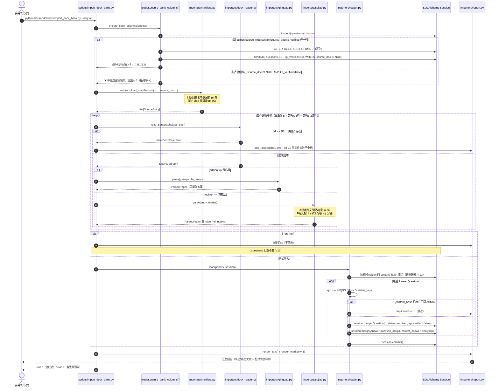
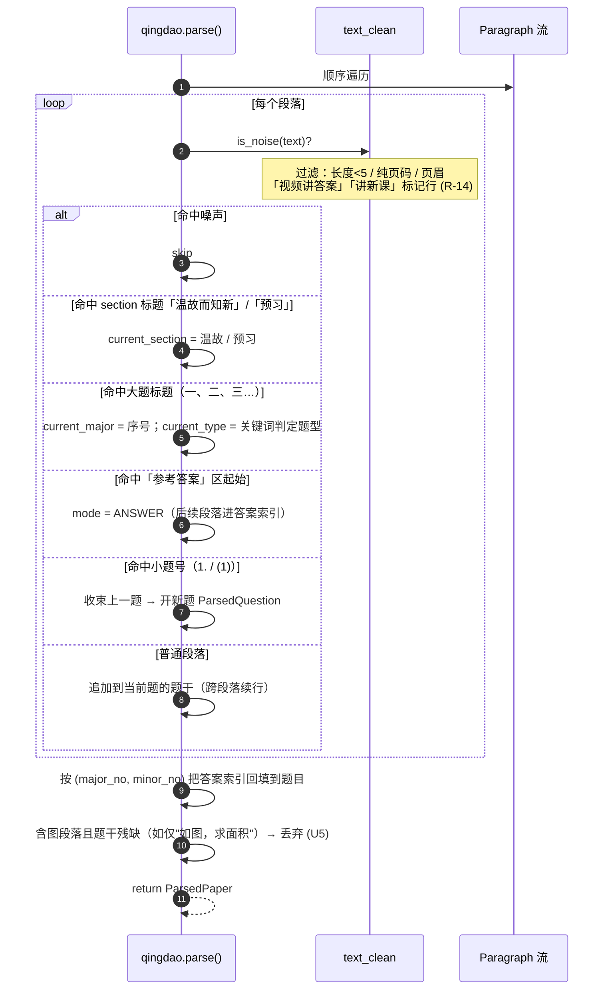
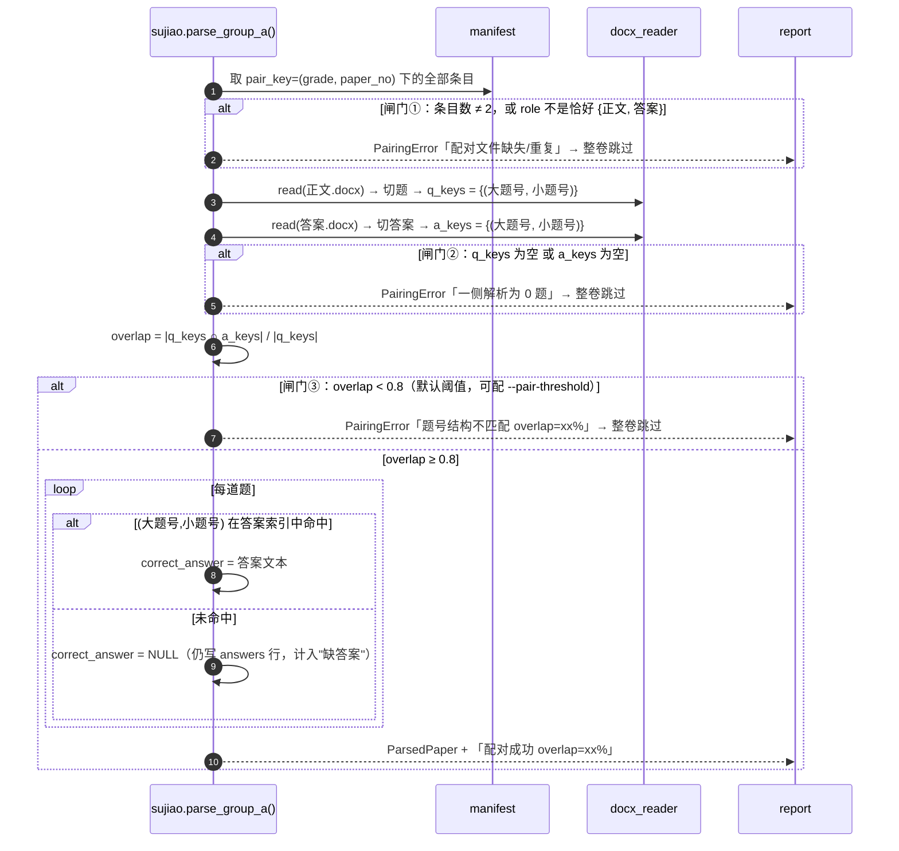
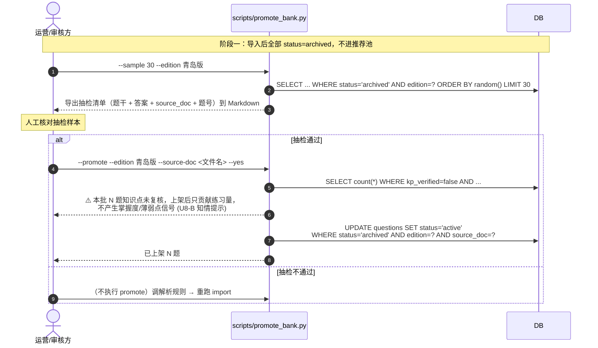
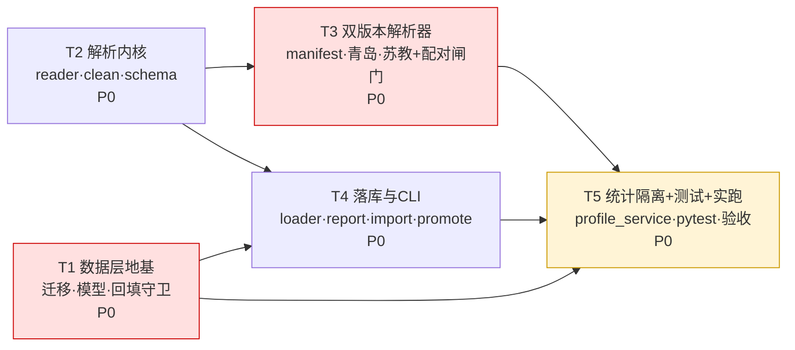

# 题库导入模块 · 增量架构设计（Exercise Bank Import）

> 版本 v1.5 ｜ 撰写：架构师 高见远 ｜ 日期：D4（续查轮次 v1.5）
> 上游输入：`docs/question-bank/prd-incremental.md`（增量 PRD）、`docs/question-bank/qingdao-docx-manifest.md`（源文件登记）
> 代码核查基线：`backend/app/models/content.py`、`backend/scripts/seed_db.py`、`backend/app/services/profile_service.py`、`backend/migrations/002|003_*.sql`、`backend/app/ai/agents/exercise.py`
> 性质：**增量设计**。只描述本次相对现有系统「新增 / 修改」的部分，不重写整体架构、不引入新框架。

---

## 0. 给主理人的四句话（v1.5 新增第 4 条）

| # | 结论 | 一句话解释 |
|---|---|---|
| 1 | **零新增依赖、零新增框架、零新增接口** | 全部用标准库（`zipfile` + `xml.etree`）解析 docx，落库沿用 SQLAlchemy ORM。不动 FastAPI 路由，不动 Vue，不动 `ai/agents/exercise.py`。 |
| 2 | **迁移脚本必须「加列 + 回填」原子完成** | `kp_verified` 加列后若不立刻 `UPDATE ... WHERE source_doc IS NULL` 回填 true，存量 909 题会被打成"未确认"，现有掌握度 / 画像 / 家长周报**当场断流**。本设计把回填做成迁移脚本的第 2 条语句 + 导入器启动前置守卫，两道保险。 |
| 3 | **未复核题的隔离用「归因置空」而非「记录剔除」** | 在 `profile_service` 两处查询把 `kp_id` 包一层 `CASE WHEN kp_verified THEN kp_id ELSE NULL END`。未复核题的作答记录仍在，但不归到任何知识点，直接复用现有「kp 为空 → unmapped」既有分支，**其余链路零改动**。 |
| 4 | **「重灌」操作有第二个数据摧毁面：幂等重导入会静默回退运营决策** | `merge()`/`on_conflict_do_update` 若把 `status='archived'`、`kp_verified=False` 一起写回，会把已上架题静默降级、把已复核题静默取消复核（并再次触发 §6.3 缓存前提空洞）。本期「规则大改后直接重跑导入」是**受支持的标准操作**，故须用 `on_conflict_do_update` **只更新源派生列**（见 §6.9 R-22/R-23）。 |

---

## 1. 实现方案与框架选型

### 1.1 核心技术难点与对策

| # | 难点 | 对策 | 对应需求 |
|---|---|---|---|
| D1 | **docx 是压缩包不是文本**，且原书含大量图片、Run 碎片、分页/页眉标记 | `zipfile` 解出 `word/document.xml` → `xml.etree` 遍历 `w:p`（段落）→ 拼接段落内所有 `w:t`（文本 Run）→ 得到「段落文本流」。图片/公式对象直接忽略，仅在段落上打 `has_drawing` 标记供脏数据过滤用 | R-01/R-14, U5/U6 |
| D2 | **题块边界识别**：一个段落 ≠ 一道题，题干可能跨段落 | 采用「**大题号锚点 + 小题号切分**」两级状态机：先用正则识别大题标题行（`^[一二三四五六七八九十]+[、.．]`），确定当前大题的题型；再在大题内用小题号（`^\d+[、.．)）]` / `^\(\d+\)`）切分题块，未命中题号的段落**追加到上一题**（题干续行） | R-01/R-02/R-03 |
| D3 | **苏教版 A 组正文/答案跨文件配对，错配比缺答案更危险** | **不做文件名模糊匹配**。配对关系在 `manifest.py` 中**硬登记**（`pair_key = (grade, paper_no)`），运行时做三重闸门校验（见 §4.3），任一不过 → 整卷跳过 + 记入失败清单，绝不 best-effort 猜配 | R-02（🔴 最高风险） |
| D4 | **幂等重灌**：解析规则必然多轮迭代，脚本要能无限次重跑 | 完整沿用 `backend/scripts/seed_db.py` 的范式：`uuid5(NS_QUESTION_BANK, 稳定键)` 派生主键 + `session.merge()` upsert。稳定键**只由「文件名 + 卷号 + 题号」构成，不含题干内容** → 解析规则改了、题干变了，id 不变，重跑是覆盖而非新增 | R-08, V2 |
| D5 | **加列不能伤存量** | 迁移脚本双方言 + 回填语句同事务；导入器启动时二次探测（缺列自动 ALTER + 回填），防止有人跳过迁移直接跑导入 | R-05/R-10, V7（🔴） |
| D6 | **未复核题不得污染统计** | 单点改造 `profile_service` 的两处 `kp_id` 取值（§6.3），语义收敛为「未复核 → 视同无知识点」 | R-07, V8 |

### 1.2 框架与库选型

| 层 | 选型 | 说明 |
|---|---|---|
| docx 解析 | **标准库 `zipfile` + `xml.etree.ElementTree`** | 采纳 PRD §6.2 **U6 建议默认值**。理由见 §7.1，**拒绝引入 `python-docx`** |
| 中间格式 | **`dataclasses` + JSON** | docx → `ParsedQuestion` 列表 →（可选落 JSON）→ 落库。`--dry-run` 只走到中间格式为止 |
| 落库 | **SQLAlchemy 2.0 ORM `session.merge()`** | 与 `seed_db.py` 完全同构，方言中立（PG / SQLite 双跑） |
| CLI | **`argparse`** | 与 `scripts/seed_db.py`、`scripts/init_db.py` 同风格 |
| 迁移 | **手写双方言 SQL**（项目无 Alembic） | 参照 `002_question_status.sql` / `003_weekly_reports*.sql` 既有风格 |
| 测试 | **pytest + SQLite 内存库** | 参照 `tests/test_epic6_report_qa.py` 的「双方言 DDL 实跑」范式 |

### 1.3 架构模式：三层管道（Pipeline）

```
[Manifest 白名单]  →  [Reader 读]  →  [Parser 解析]  →  [Loader 落库]  →  [Report 汇总]
     只读登记表        docx→段落流      段落流→题目对象      题目对象→两表      统计→stdout/文件
     (R-09 闸门)      (无业务语义)     (版本差异全在这层)   (幂等+去重)       (R-11/R-12)
```

**分层收益**：版本差异（青岛版 / 苏教版 A / 苏教版 B）**只在 Parser 层分叉**，Reader 与 Loader 完全共用；新增第三个版本（如未来人教版）只加一个 parser 文件 + manifest 条目，其余零改动。

### 1.4 明确不做（继承 PRD §1.3）

`ai/agents/exercise.py` 零改动 ｜ 无前端页面 ｜ 无新 API 路由 ｜ docx 不入 git ｜ 图片不提取 ｜ 知识点自动打标算法本期留空（仅留 hook，见 §6.4）

---

## 2. 文件列表

> 路径均相对仓库根 `cuotixiaolaoshi/`。🆕【新增】共 14 个文件，✏️【修改】共 3 个文件。

### 2.1 🆕 新增 · 解析与落库内核（`backend/app/services/importers/`）

| # | 路径 | 职责 | 关键约定 |
|---|---|---|---|
| N1 | `backend/app/services/importers/__init__.py` | 包出口，导出 `run_import()` / `ImportReport` / `ensure_bank_columns()` | 供 CLI 与 pytest 统一入口 |
| N2 | `backend/app/services/importers/docx_reader.py` | **读**：`zipfile` 解 `word/document.xml` → `List[Paragraph]` | 无业务语义；文件损坏抛 `DocxReadError` |
| N3 | `backend/app/services/importers/text_clean.py` | **洗**：全半角归一、空白折叠、脏块过滤、内容指纹 | R-13 的 `content_hash()`、R-14 的 `is_noise()` 都在这 |
| N4 | `backend/app/services/importers/schema.py` | **中间结构**：`Paragraph` / `ParsedQuestion` / `ParsedPaper` / `FileResult` / `ImportReport` 全部 dataclass | 唯一的跨层数据契约，parser 与 loader 都只认它 |
| N5 | `backend/app/services/importers/manifest.py` | **源文件白名单登记表**（15 条），含绝对路径、edition、source_type、grade、section、paper_no、role、pair_key | **R-09 强制闸门**：导入器只读此表列出的文件，禁止 `glob` 扫目录 |
| N6 | `backend/app/services/importers/qingdao.py` | 青岛版衔接卷解析器（5 册，题干答案同册） | 输出 `ParsedPaper`；识别「温故而知新 / 预习」→ `section` |
| N7 | `backend/app/services/importers/sujiao.py` | 苏教版解析器：A 组（正文/答案分离，跨文件配对）+ B 组（一文件含 5 套，先分卷再切题） | **配对三重闸门在此**（§4.3） |
| N8 | `backend/app/services/importers/loader.py` | **落库**：`ParsedQuestion` → `questions` + `answers`；uuid5 派生主键、`merge()` upsert、content 去重；含 `ensure_bank_columns()` 列守卫 | R-04/R-08/R-13/D5 |
| N9 | `backend/app/services/importers/report.py` | 报告聚合与渲染（stdout / Markdown 文件） | R-11/R-12，格式对齐 PRD §4.2 |

### 2.2 🆕 新增 · CLI 入口（`backend/scripts/`）

| # | 路径 | 职责 |
|---|---|---|
| N10 | `backend/scripts/import_docx_bank.py` | 导入 CLI（`--source-dir` / `--only` / `--dry-run` / `--report` / `--reset-bank`） |
| N11 | `backend/scripts/promote_bank.py` | **抽检后批量上架 CLI**（U2）：`archived → active`，支持 `--sample N` 导出抽检样本、`--promote` 执行上架 |

> ⚠️ **落点选择说明**：PRD §4.2 写的是 `python -m app.scripts.import_docx_bank`。本设计改为 `backend/scripts/`，理由：
> 1. 现有可运行脚本（`init_db.py` / `seed_db.py` / `extract_bank.py`）**全部**在 `backend/scripts/`，`backend/app/scripts/` 只有一份陈旧的 `seed_db.py` 副本（见 §7.2 技术债 A2）；
> 2. `backend/app/scripts/` 无 `__init__.py`，`python -m` 调用不稳；
> 3. 解析器**内核**放在 `app/services/importers/`（可被 pytest / 未来 API 直接 import），CLI 只是薄壳 —— 这正是 PRD §8「由架构师定」授予的裁量。
> **实际调用**：`python backend/scripts/import_docx_bank.py --dry-run`

### 2.3 🆕 新增 · 迁移与测试

| # | 路径 | 职责 |
|---|---|---|
| N12 | `backend/migrations/004_question_bank_fields.sql` | **PostgreSQL 方言**：加 5 列 + 🔴 存量回填 + 2 个索引 + COMMENT |
| N13 | `backend/migrations/004_question_bank_fields_sqlite.sql` | **SQLite 方言**：同上（BOOLEAN→0/1，无 COMMENT，无 `ADD COLUMN IF NOT EXISTS`） |
| N14 | `backend/tests/test_t05_docx_import.py` | 覆盖：双方言 DDL 实跑、回填正确性(V7)、幂等(V2)、配对闸门(V6)、脏数据过滤(V3)、dry-run 不写库(V12)、未复核题不进 mastery(V8) |

### 2.4 ✏️ 修改 · 存量文件（改动面严格最小化）

| # | 路径 | 改动内容 | 行数级别 |
|---|---|---|---|
| M1 | `backend/app/models/content.py` | ① `Question` 加 5 个 `mapped_column`；② `QUESTION_TYPE_VALUES` 从 4 类扩到 **6 类**（决策 U3）；③ `__table_args__` 加 2 个 Index；④ `__all__` 追加导出 | ~20 行 |
| M2 | `backend/app/services/profile_service.py` | 定义 `_VERIFIED_KP_EXPR`，替换 `_question_kp_map()`(L187-195) 与 `_load_attempts()`(L272-278) 两处的 `Question.kp_id` | ~8 行 |
| M3 | `backend/scripts/seed_db.py` | `ensure_schema()` 的列探测从「只查 status」扩展为「查 status + 5 个新列」，缺则 ALTER + 回填 | ~10 行 |

> **不改**：`requirements.txt`（零新增依赖）、`app/ai/agents/exercise.py`（本期零改动）、任何 API 路由、任何前端文件。

---

## 3. 数据结构设计

### 3.1 `questions` 表改动后字段全表

| 字段 | 类型 | 可空 | 存量 909 题 | 本次新导入题 | 状态 |
|---|---|---|---|---|---|
| `id` | GUID PK | ✗ | `uuid5(NS, "qbank:{bankId}")` | `uuid5(NS, "docx:{稳定键}")` | 沿用 |
| `content` | Text | ✗ | 题干 | 题干（清洗后） | 沿用 |
| `image_url` | String(512) | ✓ | — | **NULL**（本期不提图，U5） | 沿用 |
| `subject` | String(16) | ✗ | `数学` | `数学` | 沿用 |
| `grade` | SmallInt | ✓ | 1~9 | 2~6（见 §3.3） | 沿用 |
| `difficulty` | SmallInt | ✓ | 1/3/5 | **NULL**（docx 无难度信息，⚠️ 切勿填 2/4，违反 CHECK） | 沿用 |
| `kp_id` | GUID FK | ✓ | 已标注 | **NULL**（本期不打标，R-17 留 P2） | 沿用 |
| `type_`（列名 `type`） | String(16) | ✓ | 4 类内 | **6 类内**（§3.4） | 沿用 |
| `options` | JSON | ✓ | 选择题有 | 选择题有 | 沿用 |
| `status` | String(16) | ✗ | `active`/`archived` | **`archived`**（决策 U2） | 沿用 |
| `created_at` | DateTime(tz) | ✗ | — | `utcnow` | 沿用 |
| 🆕 `edition` | String(16) | ✓ | **NULL** | `青岛版` / `苏教版` | **新增** |
| 🆕 `source_type` | String(16) | ✓ | **NULL** | `衔接` / `期末` | **新增** |
| 🆕 `section` | String(16) | ✓ | **NULL** | `温故`/`预习`/`摸底`/`专项` | **新增** |
| 🆕 `source_doc` | String(255) | ✓ | **NULL**（← 回填判据！） | 源 docx 文件名 | **新增** |
| 🆕 `kp_verified` | Boolean | ✗ | **`true`**（🔴 回填） | `false` | **新增** DEFAULT false |

**新增索引**：
- `idx_questions_edition_grade (edition, grade)` —— 支撑「按版本+年级出题」主查询路径
- `idx_questions_kp_verified (kp_verified)` —— 支撑「筛出待复核题」运维查询

### 3.2 🔴 `kp_verified` 回填约定（本设计最关键的一条）

```
判据：source_doc IS NULL  ⇔  存量题（909 题从 seed JSON 进来，无 docx 来源）
动作：ALTER 加列后，同事务内立即执行
      UPDATE questions SET kp_verified = true WHERE source_doc IS NULL;
```

**三条铁律**：

| # | 铁律 | 违反后果 |
|---|---|---|
| B1 | 回填语句必须与 `ADD COLUMN` 在**同一个迁移文件、同一事务**内 | 中间任何一次查询都会读到 909 题 `kp_verified=false` → 掌握度瞬时全空 |
| B2 | 回填必须在**任何一次导入之前**执行 | 一旦新题带着 `source_doc` 进库，判据依然成立（新题 `source_doc` 非 NULL 不会被误回填），但若顺序颠倒且中途有人跑了统计，会产生一次脏窗口 |
| B3 | 导入器启动时**二次探测**：若 `questions` 缺任一新列 → 自动 `ALTER` + 回填；若列已存在但 `SELECT count(*) FROM questions WHERE source_doc IS NULL AND kp_verified = false` > 0 → **打印醒目告警并退出（exit 2）**，要求人工确认 | 防止有人跳过迁移直接跑导入，或迁移执行了一半 |

> 验收项 **V7** 直接对应本节，断言口径（**不依赖具体存量数字**）：
> ```sql
> -- ① 存量题必须全部回填为 true（不硬编码 909，见 T1 风险提示②）
> SELECT count(*) FROM questions WHERE source_doc IS NULL AND kp_verified = false;  -- 必须 = 0
> -- ② 新导入题必须全部为 false
> SELECT count(*) FROM questions WHERE source_doc IS NOT NULL AND kp_verified = true;  -- 必须 = 0
> ```

### 3.3 `grade` 语义（决策 U1 · 已由主理人拍板）

**统一口径**：`grade` = **做这道题时学生所处的年级**（不做任何 `grade-1` 换算）。

| 源 | `grade` | 推导 | 使用时点 |
|---|---|---|---|
| 青岛版 一升二 | **2** | 升入年级 | 暑假做、开学后仍在用 → 此时 `students.grade = 2` |
| 青岛版 二升三 / 三升四 / 四升五 / 五升六 | **3 / 4 / 5 / 6** | 升入年级 | 同上 |
| 苏教版 4下 专项复习卷 | **4** | 当前年级 | 四年级下学期期末 → `students.grade = 4` |
| 苏教版 5下 摸底(一)(二) / 专项 | **5** | 当前年级 | 同上 |
| 苏教版 6下 摸底(一)(二) | **6** | 当前年级 | 同上 |

**匹配约定（供推荐链路遵循）**：`推荐条件 = (q.grade == student.grade)`。
- 青岛版衔接题在**开学后生效**（学生已升入该年级），符合"衔接"定位；
- 整册统一一个 `grade`，册内「温故」（上一学年内容）与「预习」（本学年内容）靠 **`section` 字段**区分，**不拆年级**；
- ⚠️ **明令禁止**在任何查询里写 `grade - 1` 之类的换算，口径只有一处、就在本表。

### 3.4 题型枚举扩容（决策 U3 · 4 类 → 6 类）

```
QUESTION_TYPE_VALUES = ("选择", "填空", "应用", "计算", "图形", "判断")
                                                    ↑ 新增两类
```

DB 层**无 CHECK 约束**（`content.py` 的 CheckConstraint 只管 `difficulty`），故改动成本 = 改一个常量元组。

| docx 题型表述 | 收敛到 `type_` | 判定依据 |
|---|---|---|
| 口算 / 直接写得数 / 计算 / 竖式 / 脱式 / 简便运算 / 递等式 | `计算` | 大题标题关键词 |
| 填空 / 在括号里填 / 按要求填数 | `填空` | 大题标题关键词 |
| 选择 / 选一选 / 把正确答案的序号填在括号里 | `选择` | 关键词 **或** 检测到 `A. B. C. D.` 选项（同时抽 `options`） |
| 应用题 / 解决问题 / 列式解答 / 解决实际问题 | `应用` | 大题标题关键词 |
| 图形 / 操作 / 画一画 / 量一量 / 折一折 / 涂一涂 | **`图形`** 🆕 | 大题标题关键词 |
| 判断 / 对的画√错的画× / 判断对错 | **`判断`** 🆕 | 大题标题关键词 |
| 连线 / 其他无法归类 | **NULL** | 宁可留空，不硬套 |

> ⚠️ **不要动** `app/ai/agents/question.py:21` 的 `QUESTION_TYPES = ("计算","应用","几何","函数","证明")` —— 那是 **AI 出题 Agent 的独立枚举**，与题库落库枚举同名不同物，本期零改动（见 §7.2 技术债 A3）。

### 3.5 中间结构类图

```mermaid
classDiagram
    class Paragraph {
        +int index
        +str text
        +str style
        +bool has_drawing
        +bool is_heading
    }

    class SourceEntry {
        +str filename
        +str abs_path
        +str edition
        +str source_type
        +int grade
        +str section_default
        +str paper_no
        +str role
        +tuple pair_key
        +str parser
    }

    class ParsedQuestion {
        +str stable_key
        +str content
        +str type_
        +dict options
        +str section
        +str major_no
        +str minor_no
        +str correct_answer
        +str analysis
        +str content_hash
        +bool key_is_fallback
        +to_stable_key() str
    }

    class ParsedPaper {
        +str source_doc
        +str edition
        +str source_type
        +int grade
        +str paper_no
        +List~ParsedQuestion~ questions
        +List~str~ warnings
    }

    class FileResult {
        +str label
        +int parsed
        +int loaded
        +int missing_answer
        +int unverified_kp
        +int duplicated
        +bool ok
        +str error
    }

    class ImportReport {
        +str source_dir
        +bool dry_run
        +List~FileResult~ results
        +List~FileResult~ failures
        +float elapsed
        +totals() dict
        +render_text() str
        +render_markdown() str
    }

    class Question {
        +UUID id
        +str content
        +int grade
        +str type_
        +str status
        +str edition
        +str source_type
        +str section
        +str source_doc
        +bool kp_verified
        +UUID kp_id
    }

    class Answer {
        +UUID id
        +UUID question_id
        +str correct_answer
        +str analysis
        +dict distractor_analysis
    }

    SourceEntry "1" --> "1" ParsedPaper : 解析产出
    ParsedPaper "1" *-- "n" ParsedQuestion : 包含
    Paragraph "n" --> "1" ParsedPaper : 段落流输入
    ParsedQuestion "1" --> "1" Question : loader 映射
    ParsedQuestion "1" --> "1" Answer : loader 映射(必写1行)
    Question "1" -- "1" Answer : 1:1 CASCADE
    ParsedPaper "1" --> "1" FileResult : 统计
    ImportReport "1" *-- "n" FileResult : 汇总
```

### 3.6 uuid5 派生规则（幂等基石）

```python
NS_QUESTION_BANK = uuid.UUID("6f1b1a1e-6b3f-5c2b-9a44-0d5f1c0a7e21")   # 复用 backend/scripts/seed_db.py

题目主键 = uuid5(NS_QUESTION_BANK, f"docx:{stable_key}")
答案主键 = uuid5(NS_QUESTION_BANK, f"docx-answer:{stable_key}")

stable_key = f"{source_doc}#{paper_no}#{major_no}-{minor_no}"
# 例：实验班暑假衔接一升二数学青岛版h_decrypted.docx#-#三-2
# 例：2026年（下册）5年级 数学 苏教版 期末摸底诊断卷（一）正文(1).docx#一#二-5
```

| 规则 | 说明 |
|---|---|
| **命名空间统一** | 与存量 909 题**同命名空间**（`NS_QUESTION_BANK`），前缀 `docx:` 与存量 `qbank:` 天然不撞 |
| **稳定键不含题干** | 解析规则迭代导致题干变化时，id 不变 → `merge()` 是**更新**而非**新增**，这是 V2 幂等的前提 |
| **题号缺失兜底** | 识别不出题号时用文档内全局序号 `seq{n}` 兜底，同时置 `key_is_fallback=True` 并计入报告的「序号兜底」计数。⚠️ 兜底键对解析规则改动**敏感**（顺序漂移会产生孤儿题），故大改规则后应配合 `--reset-bank` 清理重灌 |

---

## 4. 程序调用流程

### 4.1 主时序图：一次完整导入



### 4.2 青岛版解析分支（同册答案）



### 4.3 🔴 苏教版 A 组配对分支（最高风险路径）

**配对三重闸门**——任一不通过即 `raise PairingError` → **整卷跳过 + 记入失败清单**，绝不产生错配答案。



**明令禁止的兜底**（写进代码注释）：

| ❌ 禁止行为 | 原因 |
|---|---|
| 按**顺序**对齐（第 i 题配第 i 个答案） | 正文/答案任一侧漏切一题，后面全部错位，且**静默**发生 |
| 按文件名**模糊匹配**找配对文件 | manifest 已硬登记 15 个文件，模糊匹配只会引入不确定性 |
| overlap 不足时**部分入库** | 结构已不可信，部分入库 = 部分错配 |

> **口径**：错配答案会让系统判学生错、让 AI 讲错，**危害远大于没有答案**。宁可整卷不入库，也不入错。

### 4.4 抽检上架流程（决策 U2）



> **等价 SQL 手段**（不想用 CLI 时，直接跑）：
> ```sql
> -- 上架某一源文件的全部题目
> UPDATE questions SET status = 'active'
>  WHERE status = 'archived' AND source_doc = '实验班暑假衔接一升二数学青岛版h_decrypted.docx';
> -- 回滚
> UPDATE questions SET status = 'archived' WHERE source_doc = '...';
> ```
>
> 🔴 **本节等价 SQL 的适用边界（务必读，PRD OPS-1）**：
>
> | 字段 | 能否手搓 SQL | 原因 |
> |---|---|---|
> | `status`（上架/下架） | ✅ **可以** | 纯推荐池开关，**不参与掌握度计算，不涉及任何缓存** |
> | `kp_verified`（复核标记） | ❌ **严禁** | 它是**归因开关**，翻转后必须连带失效掌握度缓存（§6.3）。裸 UPDATE 会导致「复核完了但掌握度 15 分钟内不动」，且无任何提示。**必须走 `promote_bank.py --mark-verified`** |
>
> ⚠️ 之所以专门写这张表：本节提供 `status` 的等价 SQL 会自然建立「可以手搓 SQL」的印象，运维方极易照葫芦画瓢去手搓 `kp_verified` —— 那正中陷阱。**两个字段的可手搓性完全不同，不可类推。**

---

## 5. 任务列表（按实现顺序，共 5 个任务）

> 粒度原则：按**层次**分组，不按单文件拆。T1/T2 无依赖可并行开工，T3~T5 依次收口。

### T1 · 数据层地基：迁移 + 模型 + 回填守卫 【P0】

| 项 | 内容 |
|---|---|
| **依赖** | 无（第一个动工） |
| **源文件** | 🆕 `backend/migrations/004_question_bank_fields.sql`<br>🆕 `backend/migrations/004_question_bank_fields_sqlite.sql`<br>✏️ `backend/app/models/content.py`<br>✏️ `backend/scripts/seed_db.py`（`ensure_schema()` 扩列探测） |
| **要做的事** | ① 双方言迁移：`questions` 加 `edition`/`source_type`/`section`/`source_doc`/`kp_verified` 五列 + 2 个索引；<br>② 🔴 **同事务立即回填** `UPDATE questions SET kp_verified = true WHERE source_doc IS NULL;`（PG 用 `true`，SQLite 用 `1`）；<br>③ `Question` 模型加 5 个 `mapped_column`（`kp_verified` 需 `nullable=False, default=False, server_default="false"`）；<br>④ `QUESTION_TYPE_VALUES` 扩到 6 类（追加 `图形`、`判断`），同步 `__all__`；<br>⑤ `seed_db.ensure_schema()` 的列探测从「只查 status」扩到「查 status + 5 新列」，缺则 ALTER + 回填。 |
| **完成判据** | `pytest` 全绿（R-10/V10）；PG 与 SQLite 各跑一遍 DDL 无语法错；<br>🔑 **回填断言用动态基线，禁止硬编码 909**：<br>`迁移前 baseline = SELECT count(*) FROM questions;`<br>`迁移后断言 SELECT count(*) FROM questions WHERE kp_verified = true` **== baseline**<br>且 `SELECT count(*) FROM questions WHERE source_doc IS NULL AND kp_verified = false` **== 0**（V7 前半） |
| **风险提示** | ① SQLite **不支持** `ADD COLUMN IF NOT EXISTS`，重复执行会报错 —— 在 SQL 文件头注释里写明「幂等请走 `ensure_bank_columns()`」，与 `002_question_status.sql` 的既有注释风格一致；<br>② ⚠️ **不要硬编码 909**：受技术债 A1（两份 `seed_db.py` 命名空间不同）影响，若线上曾被两份脚本各灌一次，实际存量会是 1818 而非 909，硬编码断言会**假阳性失败**并误导排查方向。用上面的动态基线断言，对存量行数不做任何假设。 |

### T2 · 解析内核：读取 / 清洗 / 中间结构 【P0】

| 项 | 内容 |
|---|---|
| **依赖** | 无（可与 T1 并行） |
| **源文件** | 🆕 `backend/app/services/importers/__init__.py`<br>🆕 `backend/app/services/importers/docx_reader.py`<br>🆕 `backend/app/services/importers/text_clean.py`<br>🆕 `backend/app/services/importers/schema.py` |
| **要做的事** | ① `docx_reader.read_paragraphs(path) -> List[Paragraph]`：`zipfile` 取 `word/document.xml`，`xml.etree` 遍历 `w:p`，拼接其下全部 `w:t`；记录 `style`(`w:pStyle`)、`has_drawing`(`w:drawing`/`w:object` 存在)；文件缺失/损坏抛 `DocxReadError`；<br>② `text_clean`：全半角归一 + `unicodedata.normalize('NFKC')` + 空白折叠 + `is_noise()`（长度<5、纯页码页眉、「视频讲答案/讲新课/扫码」标记行）+ `content_hash()`（规范化后 sha1，供 R-13 去重）；<br>③ `schema.py`：`Paragraph`/`SourceEntry`/`ParsedQuestion`/`ParsedPaper`/`FileResult`/`ImportReport` 六个 dataclass + `PairingError`/`DocxReadError` 异常类。 |
| **完成判据** | 用真实 docx 手工跑通 `read_paragraphs()` 拿到段落流；`is_noise()` 与 `content_hash()` 有单测 |
| **风险提示** | 段落文本必须**按 Run 顺序拼接**，否则数学式会乱序；`w:tab`/`w:br` 需转成空格，不能丢 |

### T3 · 双版本解析器：青岛版 + 苏教版（含配对闸门）【P0】

| 项 | 内容 |
|---|---|
| **依赖** | T2 |
| **源文件** | 🆕 `backend/app/services/importers/manifest.py`<br>🆕 `backend/app/services/importers/qingdao.py`<br>🆕 `backend/app/services/importers/sujiao.py` |
| **要做的事** | ① `manifest.py`：把 manifest 文档 §二/§A.2 的 **15 个真身文件**硬编码成 `SourceEntry` 列表（含 `edition`/`source_type`/`grade`(按 §3.3)/`section_default`/`paper_no`/`role`/`pair_key`/`parser`）；提供 `load_manifest(source_dir=None, only='all')`；**禁止 glob 扫目录**（R-09）；<br>② `qingdao.py`：两级状态机切题（§4.2），识别 `温故/预习` section、6 类题型、同册答案区回填；<br>③ `sujiao.py`：A 组跨文件配对（**三重闸门 §4.3**）+ B 组「专项复习卷 N」先分卷再切题、同册取答案。 |
| **完成判据** | 5 册青岛版单册题数 > 0；苏教 A 组 4 卷配对全成功且 overlap 打印在报告里；B 组 2 文件切出 10 套；故意错配 manifest 时能抛 `PairingError` |
| **风险提示** | 🔴 **禁止 best-effort 猜配对**（顺序对齐 / 文件名模糊匹配 / overlap 不足部分入库，三者均禁）。这是全模块最高风险点，对应验收 V6 |

### T4 · 落库与 CLI：幂等 upsert + 报告 + 上架工具 【P0】

| 项 | 内容 |
|---|---|
| **依赖** | T1、T2（T3 完成后才能跑真实数据） |
| **源文件** | 🆕 `backend/app/services/importers/loader.py`<br>🆕 `backend/app/services/importers/report.py`<br>🆕 `backend/scripts/import_docx_bank.py`<br>🆕 `backend/scripts/promote_bank.py` |
| **要做的事** | ① `loader.ensure_bank_columns(engine)`：列守卫（§3.2 B3，含 exit 2 拒绝分支）；<br>② `loader.load()`：`uuid5` 派生主键（§3.6）做幂等 upsert；<br>🔒 **R-22（P0）**：**必须用 PK 保留式 upsert**（PG/SQLite 均用 `Insert.on_conflict_do_update(index_elements=[id], set_=源派生列)`），**严禁 delete+insert / bulk_delete+bulk_insert**——`Question` 对 `attempts/mistakes/ai_sessions` 是 `cascade="all, delete-orphan"`，删行即摧毁学生数据（R-21 的"日常版"）；<br>🔒 **R-23（P0）**：冲突更新时**只 SET 源派生列**（`content`/`type_`/`options`/`section`/`source_doc`/`edition`/`source_type`/`correct_answer`/`analysis`，answers 表同理只更新 `correct_answer`/`analysis`/`distractor_analysis`），**绝不碰 `status` / `kp_verified` / `kp_id` / `created_at`**——否则重导入会静默回退运营的上架/复核决策，且取消复核会再次触发 §6.3 的缓存前提空洞；<br>**每题必写 1 行 answers**（哪怕 `correct_answer` 为 NULL，R-04/V4）；新题首写 `status='archived'`、`kp_verified=False`、`difficulty=None`、`kp_id=None`；同 `edition` 内 `content_hash` 去重（R-13）；<br>③ `report.py`：按 PRD §4.2 格式渲染，含「失败清单」「配对失败明细」「序号兜底计数」；<br>④ `import_docx_bank.py`：`--source-dir/--only/--dry-run/--report/--reset-bank/--pair-threshold`；单文件失败不中断（R-12），有失败则 exit 1；<br>🔴 **`--reset-bank` 必须实现 R-21 学习数据保护**（§6.6）：删除前反查 `attempts`/`mistakes`/`ai_sessions` 引用，**有引用的题一律拒绝删除、改为 `status='archived'` 下架**（RB1），报告打印「N 题已被练习，已跳过删除」（RB2），且 **`--yes` 不得绕过该保护**（RB3）；<br>⑤ `promote_bank.py`：`--sample N` 导出抽检样本、`--promote --source-doc/--edition --yes` 批量 `archived→active`（U2）；<br>⑥ 🔑 **上架知情提示**（§4.4）：`--promote` 执行前统计本批 `kp_verified=false` 的题数，打印醒目告警「本批 N 题知识点未复核，上架后只贡献练习量，**不产生掌握度/薄弱点信号**」，让运营方在知情状态下上架（U8-B）；<br>⑦ 🔴 **`--mark-verified` 子命令**（复核确认 + 缓存失效，V8-c 的前提）：`UPDATE kp_verified=true` 后**必须**反查受影响的 `(student_id, kp_id)` 并逐个调 `touch_mastery_practiced()` 让掌握度缓存失效，否则 TTL(900s) 内历史作答回不到统计里；<br>🔒 **必须原子化**（§6.3 M1~M3，B1 铁律同类）：UPDATE 与 touch **同事务**、大批量**分批提交批内原子**（建议 N=200）、报告打印「已复核 N 题 / 失效 M 个缓存」且 **N>0 而 M==0 时告警**。 |
| **完成判据** | `--dry-run` 后 `questions` 行数不变（V12）；连跑 2 次正式导入行数一致（V2）；每道新题 JOIN answers 无孤儿（V4）；`--promote` 输出含未复核题数告警；`--mark-verified` 后**不带 force** 调 `get_mastery()` 即可看到历史作答回归（V8-c）；**中途注入异常时 UPDATE 与 touch 一起回滚**（M1）；🔑 **重导入须保留运营决策**：上架 1 题并 `--mark-verified` → 重跑其卷导入 → 断言 `status` 仍为 `active`、`kp_verified` 仍为 `true`、`attempts` 行数不变、`get_mastery()` 默认路径下历史作答仍在统计（**V14**）；🔑 **upsert 必须 PK 保留式**：注入"题已存在"冲突 → 断言 `attempts/mistakes/ai_sessions` 行数**不变**、题内容被覆盖（**V15**） |
| **风险提示** | 🔴 **`--reset-bank` 是本模块唯一的数据摧毁级操作**。`Question` 到 `mistakes`/`attempts`/`ai_sessions` 是 `cascade="all, delete-orphan"`（`content.py:117-119`），**ORM 删题会直接删掉学生的作答/错题/辅导记录**；走裸 SQL 也因 `attempts.question_id` 被 SET NULL + `_load_attempts()` 用 INNER JOIN 而实质丢数据。<br>**必须先实现 R-21 保护再实现删除逻辑**（§6.6），并二次确认 `--yes` + 打印将删除/将跳过的行数 |

### T5 · 统计链路隔离 + 测试 + 实跑验收 【P0】

| 项 | 内容 |
|---|---|
| **依赖** | T1、T3、T4 |
| **源文件** | ✏️ `backend/app/services/profile_service.py`<br>🆕 `backend/tests/test_t05_docx_import.py`<br>🆕 `docs/question-bank/import-report.md`（实跑报告归档） |
| **要做的事** | ① 按 §6.3 加 `_VERIFIED_KP_EXPR`，替换 `_question_kp_map()`(L187-195) 与 `_load_attempts()`(L272-278) 两处 `Question.kp_id`；**第三处 `invalidate_cache_for_question()`(L803) 保持原样不改**；<br>② 测试覆盖 V2/V3/V4/V6/V7/**V8-a/V8-b/V8-c/V8-c-neg/V8-c-atomic**/V11/V12/**V13** + 双方言 DDL 实跑（参照 `tests/test_epic6_report_qa.py::test_both_migrations_*` 范式）。<br>🔑 **V8-c 必须走默认缓存路径（禁用 `force=True`）**；**V8-c-neg 是负向对照**——断言「裸 UPDATE 不失效缓存 ⇒ 掌握度不变」，把 `--mark-verified` 的存在必要性钉成契约，防止日后有人认为 touch 循环冗余而删掉它；<br>③ 对 15 个真实 docx 跑一次正式导入，报告归档到 `docs/question-bank/import-report.md`。 |
| **完成判据** | V1~V12 全过（V8 按 a/b/c 三条分别验）；`pytest` 既有用例零回归（V10）；新增用例断言 `unmapped_mistakes` 随未复核题作答而递增（§6.3 监控信号） |
| **风险提示** | ① 🔴 **两处替换必须同时做，不可只改一处**（原因见 §6.3「为什么必须成对替换」）；<br>② 改 `profile_service` 时**不要**动 `error_patterns` 的条目保留逻辑 —— 只让 `kp_id` 变 NULL，条目本身仍统计（Q1 已确认，见 §6.3） |

### 5.1 任务依赖图



> 🔴 红色 = 含最高风险项（T1 的存量回填、T3 的答案配对）。
> **T1 与 T2 可并行**，是本模块唯一的并行窗口。

---

## 6. 共享知识（跨文件约定，工程师必读）

### 6.1 命名与常量落点

| 约定 | 唯一落点 | 说明 |
|---|---|---|
| uuid5 命名空间 | `backend/scripts/seed_db.py::NS_QUESTION_BANK` | 值 `6f1b1a1e-6b3f-5c2b-9a44-0d5f1c0a7e21`，**永不修改**；importers 从此处 import，不要复制字面量 |
| 题目主键前缀 | `"docx:"` ／ 答案 `"docx-answer:"` | 存量题用 `"qbank:"` / `"qbank-answer:"`，互不冲突 |
| 题型枚举 | `backend/app/models/content.py::QUESTION_TYPE_VALUES` | 6 类；**不要**动 `app/ai/agents/question.py::QUESTION_TYPES`（那是 AI Agent 的独立枚举） |
| 状态枚举 | `content.py::QUESTION_STATUS_ACTIVE / _ARCHIVED` | 新导入题一律 `archived` |
| 学科默认值 | `content.py::SUBJECT_DEFAULT` = `"数学"` | 直接 import，不写字面量 |
| edition 取值 | `"青岛版"` / `"苏教版"` | 存量 909 题为 **NULL**（表示通用/未标注） |
| source_type | `"衔接"`（青岛）/ `"期末"`（苏教） | |
| section | `"温故"` / `"预习"` / `"摸底"` / `"专项"` | |
| grade 语义 | 见 **§3.3**（唯一口径，禁止任何 `grade-1` 换算） | |

### 6.2 落库硬约束（踩了必出事）

| # | 约束 | 违反后果 |
|---|---|---|
| C1 | `difficulty` **只能是 1/3/5 或 NULL** | `ck_questions_difficulty` CHECK 约束，填 2/4 直接 INSERT 失败 |
| C2 | 每道 `questions` 行**必须**配 1 行 `answers`（1:1 UNIQUE，`correct_answer` 可 NULL） | V4 孤儿检查不过；且 `distractor_analysis` 是 `NOT NULL DEFAULT dict`，必须传 `{}` |
| C3 | `kp_id` 为**外键**（`ON DELETE SET NULL`），本期一律 NULL | 乱填不存在的 UUID 会触发 FK 违约（PG 严格，SQLite 视 `PRAGMA foreign_keys` 而定） |
| C4 | 不要新建表、不要加 `stem` 列 | 题干字段是 `questions.content` |
| C5 | `source_doc` 存**文件名**（不含路径），长度 ≤ 255 | 它同时是「存量 vs 新增」的判据（§3.2）与 `--reset-bank` 的删除键 |
| C6 | 迁移文件命名 `004_xxx.sql` + `004_xxx_sqlite.sql` 成对出现 | 现有 `003_weekly_reports*.sql` 就是这个范式，测试会按文件名断言 |

### 6.3 🔑 `kp_verified` 过滤落点（U7 的架构答复）

**决策：落在 `profile_service.py`，用「SQL 表达式包一层」而非「WHERE 过滤掉记录」。**

```python
# backend/app/services/profile_service.py 顶部新增
from sqlalchemy import case

#: 未复核题（kp_verified=false）视同"无知识点"：作答记录保留，但不归因到任何 kp。
#: 决策② / R-07：脏标签不得污染掌握度与薄弱点统计。
_VERIFIED_KP_EXPR = case((Question.kp_verified.is_(True), Question.kp_id), else_=None)
```

**两处替换点（全模块仅此两处）**：

| 位置 | 原代码 | 改为 |
|---|---|---|
| `_question_kp_map()` L193 | `select(Question.id, Question.kp_id)` | `select(Question.id, _VERIFIED_KP_EXPR)` |
| `_load_attempts()` L275 | `select(Attempt.question_id, Attempt.is_correct, Attempt.created_at, Question.kp_id)` | `...,  _VERIFIED_KP_EXPR)` |

**为什么这样最优**：

| 备选方案 | 评价 |
|---|---|
| ✅ **CASE 包一层（本方案）** | 未复核题的 `kp_id` 取到 `None` → 直接落进 `_kp_ids_of()` 的既有空值分支 → 归入 `unmapped_mistakes`。**下游 `mastery_engine` / `get_mastery()` / 薄弱点 / 周报全部零改动**，且行为与「本来就没打标的题」完全一致（这条路径已被现有测试覆盖）。<br>🔑 **且隔离是可逆的**：作答记录始终保留在库，`kp_verified` 一翻成 true，历史数据即刻重新参与统计（V8-c）—— 这正是决策②说「**待**复核」而非「丢弃」的应有之义 |
| ❌ `WHERE kp_verified = true` 剔除记录 | **直接违反代码里成文的 R5 规则**（见下），学生做 30 题周报显示 10 题，与 Epic6「计数必须 100% 真实」冲突。<br>**且不可逆**：复核通过后历史作答无法回补 → **V8-c 根本无法通过** |
| ❌ 在 `mastery_engine` 里过滤 | `mastery_engine` 是纯算法层（只认 `kp_id: str`），不该感知数据库字段，破坏分层 |
| ❌ 在 SQL 视图 / DB 层做 | 项目无视图管理机制，双方言维护成本高 |

#### 本方案不是新增语义，而是落回既有规则 R5

`profile_service.py:24-28` 的模块 docstring 里早已写死了「kp_id 为空」的处理规则：

```
R5 未关联知识点的错题？
    ``questions.kp_id`` 可空。kp_id 为空的错题：
      * **不进**掌握度计算（没有归属知识点，算不了）；
      * **计入** ``/error-patterns`` 的 ``total_mistakes``，
        并在 summary 里单独报 ``unmapped_mistakes``，避免数据「凭空消失」。
```

`_VERIFIED_KP_EXPR` 让「未复核题」的行为与「本来就没打标的题」**完全一致** → 精确落进 R5 的既有语义，**不引入任何新分支**。

**代码级佐证**：`profile_service.py:319` 的 `self.all_error_evidence.append(evidence)` 发生在 `L321 if not targets: continue` **之前**，因此 kp 为空的错题仍进 `total_mistakes` 与错因分桶 —— **错因分布的分母不会被本改动影响**。（已实读代码确认。）

> ✅ **Q1 已确认**：错因条目保留、仅 `kp_id` 归因置空。产品经理许清楚已在 PRD §6.1 立更正节，以本方案为准。

#### ⚠️ 为什么必须成对替换（两处一起改，不能只改一处）

`_load_attempts()` 与 `_question_kp_map()` 服务于**同一道题的两条事件源**（作答流水 / 错题本），且二者通过 `_attempted_question_ids` 集合联动去重（`L348`：该题已有 attempt 记录则不再补负样本）。

两条路径喂给掌握度的**样本类型不同**（PM 许清楚核实）：

| 路径 | 位置 | 喂进 `events_by_kp` 的样本 |
|---|---|---|
| 作答路径 `_load_attempts()` | L272-291，JOIN 取 `Question.kp_id` | 正样本 **+** 负样本（`is_correct` 直接来自 attempt） |
| 错题路径 `_question_kp_map()` | L187-195，被 `_load_mistakes()` L304 调用 | 负样本 + 「已攻克」正样本（L335-345） |

若只改一处，会出现**半隔离的错乱状态**：

| 只改了 | 后果 | 严重度 |
|---|---|---|
| 只改 `_load_attempts()` | attempt 侧不归因，但 mistake 侧仍按原 `kp_id` 归因 → **未复核题的错题依然污染掌握度**，R-07 形同虚设 | 高 |
| 只改 `_question_kp_map()` | mistake 侧不归因，但 attempt 侧仍归因 → 未复核题的**正确作答**变成正样本 → 掌握度被虚高拉升 → **系统误判学生已掌握，进而停止推送该知识点的练习，用脏数据把学生的薄弱项藏起来** | **更高** |

**因此这两处替换是一个原子改动**，T5 的验收必须同时覆盖 attempt 路径与 mistake 路径（见 V8-a / V8-b）。

#### ✅ 第三处 `Question.kp_id`：`invalidate_cache_for_question()` —— **明确不改**

`profile_service.py:803` 还有一处 `select(Question.kp_id)`，位于缓存失效函数内：

```python
def invalidate_cache_for_question(db, *, student_id, question_id, practiced_at=None) -> int:
    kp_id = db.execute(select(Question.kp_id).where(Question.id == question_id)).scalar_one_or_none()  # L803
    if kp_id is None:
        return 0
    return touch_mastery_practiced(db, student_id=student_id, knowledge_point_ids=[kp_id], ...)
```

**结论：保持原样，不要包 `CASE WHEN`。**

| 理由 | 说明 |
|---|---|
| 语义不同 | 这里的 `kp_id` 用于**让缓存失效**，不是用于**归因统计**。失效多算一次是无害的（重算结果照样不含未复核题）；失效少了才会出问题 |
| 🔴 **包了会主动制造陈旧缓存路径**（PM 许清楚补充，已实读验证） | 若包上 CASE WHEN：未复核题被练习时 `kp_id` 取到 `None` → **`L804-805` 直接 `return 0` 短路** → **一行缓存都不失效**。等这题日后复核转正，它此前关联的缓存**从来没被动过**，反而更容易读到陈旧值。<br>所以不改**不只是「保守」，包了是主动引入一条新的陈旧缓存路径**，是净损失 |
| ⚠️ 防「顺手改」 | 工程师做全局搜索 `Question.kp_id` 时会命中这三处，**必须只改前两处**。本条专门写出来防止连带修改 |

#### 🔒 两处替换之间无隐藏耦合（已实读验证）

替换后需确认不破坏 `_attempted_question_ids` 的去重逻辑（L348）。实读结论：**干净，无副作用**。

| 检查点 | 代码事实 | 结论 |
|---|---|---|
| `_attempted_question_ids.add()` 的位置 | **L281，在 `_kp_ids_of(kp_id)`（L282）之前，无条件执行** | kp 被置空**不影响**该集合的填充，去重底表完整 |
| mistake 侧能否走到 L348 | targets 为空时 **L323 就 `continue`** 了 | 未复核题根本走不到 L348，不存在去重错乱 |
| 同一题两条路径是否一致 | 两处用**同一个** `_VERIFIED_KP_EXPR` | 对同一道题的 kp 判定必然一致，不会一边归因一边不归因 |

#### 🔴 V8-c 可逆性的**缓存前提**（新发现，必须处理，否则该验收必挂）

PM 新增的 **V8-c**「把 `kp_verified` 置 true → 之前的作答重新进入统计」在**当前实现下会失败**。原因是掌握度是**物化缓存**的：

```python
# profile_service.py:362-367  _is_cache_valid()
两个条件同时满足才算有效：
    1. computed_at + TTL > now          # TTL = MASTERY_CACHE_TTL_SECONDS = 900 秒（15 分钟）
    2. last_practiced_at <= computed_at # 算完之后没有新的练习/攻克
```

**失败链路**：

```
学生做了 10 道未复核题 → 缓存算过一次（这 10 次不计入）
→ 运营把 kp_verified 置 true（一条 UPDATE，不产生任何"练习"事件）
→ last_practiced_at 不更新、computed_at 未过期
→ _is_cache_valid() == True → get_mastery() 直接返回旧缓存
⇒ 那 10 次作答在 15 分钟内「回不来」，V8-c 挂
```

**根因**：缓存失效判据只感知「练习行为」，**感知不到「元数据变更」**。而 `kp_verified` 翻转正是一次元数据变更。

**解法（并入 T4 第 ⑦ 项）**：`kp_verified` 从 `false → true` 的操作**必须同时主动失效缓存**：

```
① UPDATE questions SET kp_verified = true WHERE <条件>;
② 反查受影响的 (student_id, kp_id) 组合：
   SELECT DISTINCT a.student_id, q.kp_id
     FROM attempts a JOIN questions q ON a.question_id = q.id
    WHERE q.id IN (<本批题目>) AND q.kp_id IS NOT NULL;
   （错题侧同理 JOIN mistakes）
③ 对每个组合调 touch_mastery_practiced(db, student_id=..., knowledge_point_ids=[kp_id])
   → 推高 last_practiced_at → 缓存判定失效 → 下次 get_mastery() 重算
```

> ⚠️ **手工执行 SQL 翻转 `kp_verified` 时同样适用**。只跑 UPDATE 而不失效缓存，会出现「复核完了但掌握度 15 分钟内纹丝不动」的诡异现象，极易被误判为 bug。因此 **`kp_verified` 严禁手搓 UPDATE，一律走 `promote_bank.py --mark-verified`**（对应 PRD **OPS-1**）。
>
> 📌 T5 写 V8-c 用例时可用 `get_mastery(..., force=True)` 绕过缓存验证**算法层**正确性，但**必须另有一条用例走默认路径**（不带 force）验证**缓存失效链路**，否则等于没测到这个坑（对应 PRD **OPS-2**）。

##### 🔒 B1 铁律在此处同样适用：`--mark-verified` 必须原子化

> PM 许清楚指出：这与 §3.2 的 **B1 铁律**（回填语句必须与 `ADD COLUMN` 同事务）是**同一类问题的同一种解法**——**元数据变更与其连带的缓存失效必须原子完成，否则中间态无人可见**。已采纳。

若 ①`UPDATE` 已提交、②`touch` 跑一半失败（批量复核上千题时反查面很大，超时/中断都可能），后果是：

```
kp_verified=true 已生效，但部分学生的缓存没失效
⇒ 这批学生的掌握度在 TTL(15min) 内是错的，且没有任何信号提示
```

**实现约束（并入 T4 第 ⑦ 项）**：

| # | 约束 | 说明 |
|---|---|---|
| M1 | **① 与 ② 同一事务，任一失败整体回滚** | 不允许「先全量 UPDATE，再慢慢 touch」的两段式 |
| M2 | **大批量改分批提交，批内原子** | 每批 N 道题（建议 N=200）：本批 UPDATE + 本批 touch 在同一事务内提交。避免单一超长事务，同时不产生「只做了一半」的中间态 |
| M3 | **可观测信号** | 报告打印「已复核 N 题，失效 M 个 (student, kp) 缓存」；**`N > 0` 且 `M == 0` 时打醒目告警** —— 这是「只做了一半」的唯一外部信号 |

##### ⚠️ 反向翻转（true → false）更危险，本期不做但须写明

撤销误批准的题（`kp_verified` 由 true 改回 false）**同样中招，且后果更重**：撤销前该题的作答**已经计入掌握度**，若不失效缓存，**虚高值会继续挂着**，而此时题目已被标记为未复核 —— 状态与数据彻底不一致。

| 项 | 结论 |
|---|---|
| 本期是否实现 | **否**（无复核 UI，撤销是极低频运维动作） |
| 文档约定 | **反向撤销必须手动配 `touch_mastery_practiced()` 失效缓存**，禁止裸 UPDATE。若 `promote_bank.py` 未来加 `--unmark-verified`，必须复用 M1~M3 同一套原子化约束 |

#### 📈 `unmapped_mistakes` 会上涨 —— 这是监控信号，不是 bug

新题上架后 `unmapped_mistakes` 必然随之上升。**这不是回归，而是一个免费的进度指标**：

```
unmapped_mistakes ≈ 「有多少学生作答卡在待复核题上」
→ 数值越高 = kp 复核欠账越多 = 越该推进人工复核 / 自动打标
→ 复核完成后该数值自然回落
```

请在运维看板与 code review 时按此解读，**不要**看到数字上涨就误判为统计出错。建议 T5 的测试用例显式断言这一上涨行为，把「预期上涨」固化成契约。

### 6.4 知识点自动打标的预留 hook

本期 `kp_id` 全部落 NULL（R-17 属 P2）。但 `loader.load()` 需预留可选参数：

```python
def load(papers, session, *, kp_tagger: Callable[[ParsedQuestion], Optional[uuid.UUID]] | None = None)
```

未来接入打标算法时，只需实现 `kp_tagger` 并传入，**loader 本身零改动**；打出的标签依然 `kp_verified=False`，仍需人工复核才进统计。

### 6.5 🔴 U8：U2 + U7 叠加导致的「练了但学不到」缺口

> 由产品经理许清楚发现并登记（PRD §6.3 U8）。**本设计确认成立，且本期不解决——需显式知情。**

#### 缺口链路

```
新题 kp_id=NULL, kp_verified=false      （R-17 打标排 P2，本期不打标）
  → 抽检后 status=active 上架            （决策 U2）
  → 学生练 50 道
  → _VERIFIED_KP_EXPR 归因置空           （决策 U7 / R-07）
  → 掌握度不动、薄弱点不更新、周报「能力变化」无进展
  ⇒ 学生真练了，系统学不到任何东西
```

两条决策各自都正确，**叠加后产生了单看任一条都看不见的空洞**：本期灌入的 1000+ 道题上架后**只贡献练习量，不产生任何诊断信号**，与 PRD §1.1 立项时的「错题诊断 → 薄弱点 → 定向练习」闭环存在张力。

#### 架构侧判断

| 项 | 结论 |
|---|---|
| **是否阻塞 T1~T5？** | **否**。这是产品优先级问题，不是设计缺陷。本期 5 个任务的设计**一行都不用改**。 |
| **本期处置（方案 B）** | 允许未复核即上架，但**显式记录代价**：① `promote_bank.py --promote` 打印未复核题数告警（已并入 T4 第 ⑥ 项）；② `unmapped_mistakes` 作为欠账监控指标（§6.3）。 |
| **建议同期评估（方案 C）** | 把 **R-17 自动打标 v1 从 P2 提到 P1**。 |

#### 对方案 C 的架构评估（供主理人决策）

**技术成本很低，因为 hook 已经预留好了**：

| 维度 | 评估 |
|---|---|
| 接入方式 | 实现一个 `kp_tagger(ParsedQuestion) -> Optional[UUID]` 传给 `loader.load()`（§6.4 已预留形参）→ **`loader.py` 零改动** |
| 实现量 | 关键词规则映射到现有 7 个粗类（`÷ × 竖式 脱式` → 计算；`长方形 面积 周长` → 图形；`小明…一共` → 应用题…）。约 1 个新文件 `importers/kp_tagger.py`，60~100 行 + 一张关键词表 |
| 依赖 | 零新增依赖（纯正则/关键词匹配，不引 AI 调用） |
| 落点 | 可作为 **T4 的第 ⑦ 项**带出，或独立 T6；**建议独立 T6**，避免 T4 膨胀且便于单独评估打标准确率 |
| 风险 | 打标仍是 best-effort，**打完依然 `kp_verified=false`** —— 安全性不变，因为过滤开关是 `kp_verified` 而非 `kp_id` |

**核心收益不在「自动打对」，而在把人工复核的性质改变了**：

```
不打标：人工从零标注 1000+ 题   → 几乎不可能完成 → kp_verified 永远是 false → 闭环永远转不起来
打标后：人工只需「确认 / 纠正」  → 单题秒级 → 复核可批量推进 → 闭环真能转
```

即：**自动打标的真正价值是让「人工复核」从不可行变成可行**，从而让 `kp_verified=true` 有机会真正达成。这也是决策②「自动打标 + 待复核」原本的设计意图 —— 当前把 R-17 排 P2 实际上**架空了决策②的前半句**。

> **架构结论**：支持方案 **B（本期）+ C（建议提 P1，独立 T6）**。若主理人同意提 P1，我可在 30 分钟内补出 T6 的设计（关键词表结构 + 落点 + 准确率验收口径）。当前 T1~T5 不受影响，可立即开工。

> 🟢 **用户决策（v1.5.1）**：**Q8 / U8 本期不做**——R-17 自动打标（含 T6）**整体留给出题模块**，不在本模块交付范围。上述「建议提 P1」「若主理人同意」等表述即此作废，仅作历史讨论留存。**T1~T5 为最终任务集**，无需补 T6 设计。

### 6.6 🔴 R-21：`--reset-bank` 的学习数据保护（数据摧毁级，P0）

> 由产品经理许清楚用「机制叠加」检查表发现。**本设计确认成立，且根因是我在 Q5 里给出的操作建议本身有毒。**

#### 缺口：删题会连带摧毁学生学习历史

| | 机制 | 单看 |
|---|---|---|
| A | `--reset-bank` 按 `source_doc` 删题重灌（原 Q5 建议：解析规则大改后先清后灌） | ✅ 合理 |
| B | `Question` → 学习数据的级联删除（标准引用完整性） | ✅ 合理 |
| **A × B** | **重灌摧毁学生作答 / 错题 / 辅导记录** | 🔴 **数据摧毁级** |

**实读证据（三处全部核实）**：

| 层 | 位置 | 设置 | 删题后果 |
|---|---|---|---|
| ORM | `content.py:117-119` | `mistakes` / `attempts` / `ai_sessions` **三个关系全是 `cascade="all, delete-orphan"`** | `session.delete(question)` → **三张表的行被直接删除** |
| DB | `learning.py:52` | `mistakes.question_id` → `ondelete="CASCADE"` | 裸 SQL 删题 → 错题记录一并消失 |
| DB | `learning.py:93` | `attempts.question_id` → `ondelete="SET NULL"`（`nullable=True`） | 裸 SQL 删题 → 作答行保留，但 `question_id` 置 NULL |

⚠️ **ORM 路径比 DB 路径更狠**：DB 层对 `attempts` 只是 SET NULL，但 ORM 的 `delete-orphan` 会**直接删行**。用 `session.delete()` 实现 `--reset-bank` 时，`attempts` 是真的没了。

🔍 **补充（架构师追加）：走裸 SQL 也一样丢数据，只是形式不同**。`_load_attempts()` 用的是 **INNER JOIN**：
```python
select(...).join(Question, Attempt.question_id == Question.id)   # L275-276
```
`question_id` 被置 NULL 的作答行**不会被这个查询取到** → 掌握度里照样消失。**行还在库里，但已无法参与任何统计，且关联信息永久丢失、不可恢复。**
> 结论：**ORM 与裸 SQL 两条路径都会造成实质性数据丢失**，不存在"用 SQL 就安全"的侥幸路径。

#### 为什么这条比前面几个都严重

| # | 原因 |
|---|---|
| 1 | `attempts` 是掌握度的**唯一事实源**（Epic6 明定「画像由它重算」）。删了就是**永久摧毁**，重算都没得算 |
| 2 | **不可逆 + 静默**。`--reset-bank` 字面语义是"清理题目"，**没有任何人会预期它动学生数据** |
| 3 | 🔴 **触发时机极其自然** —— §8 Q5 的原建议就是「解析规则大改后用 `--reset-bank --source-doc X --yes` 先清后灌」。而按 U2 流程，那时可能已有一批题上架并被练过。**即我们推荐的标准操作流程本身就会踩这个雷** |

#### 处置（R-21 / OPS-3，P0，并入 T4 第 ④ 项）

**核心原则：宁可留下少量孤儿题，也绝不删学生数据。**

```
--reset-bank 执行前，先对待删集合逐题反查学习引用：
  SELECT question_id FROM attempts  WHERE question_id IN (<待删>)
  UNION
  SELECT question_id FROM mistakes  WHERE question_id IN (<待删>)
  UNION
  SELECT question_id FROM ai_sessions WHERE question_id IN (<待删>)

分成两堆：
  ① 无引用 → 允许删除
  ② 有引用 → 🔴 拒绝删除，改为 status='archived' 下架，并列入报告
```

| 约束 | 说明 |
|---|---|
| **RB1** | **有学习引用的题一律不删**，只下架（`status='archived'`）。推荐链路本就过滤 `status`（见 §6.7 已核对项），下架即可达到"不再出现"的效果 |
| **RB2** | 报告必须打印「**N 题已被练习，已跳过删除（已改为下架）**」—— 与 M3 同一思路：**让危险操作把它「没做的事」也说出来** |
| **RB3** | 即使 `--yes` 已给，RB1 **也不允许被绕过**。若确需强删，需要一个独立的、文档中不推荐的开关（本期**不提供**） |

> 📌 **§8 Q5 的建议已据此修订**（见 §8）。原表述会诱导用户执行破坏性操作，属设计文档自身的缺陷。

### 6.7 已交叉核对且确认安全的机制对（登记备查）

> 用「机制叠加」检查表过了一遍，以下几对**确认无需改动**，登记以免后续重复排查。

| 机制对 | 核对结论 | 证据 |
|---|---|---|
| **U2 归档闸门 × 推荐链路** | ✅ **安全，无需改动**。未上架的新题不会漏进推荐池，U2 闸门真实有效 | `profile_service.py:738` 的 `_suggested_questions()` 已带 `Question.status == "active"` 过滤 |
| **`kp_verified` 置空 × `_attempted_question_ids` 去重** | ✅ 安全（§6.3 已验证） | L281 早于 L282；L323 早于 L348 |
| **`status` 手搓 SQL × 缓存** | ✅ 安全。`status` 不参与掌握度、不涉缓存 | §4.4 边界表 |

**次要瑕疵（不单独改动）**：`profile_service.py:738` 用的是字面量 `"active"` 而非 `QUESTION_STATUS_ACTIVE` 常量。属既有代码洁癖问题，本期不为它单开改动；**若工程师因其他原因正好改到该行，可顺手替换**。

#### 🟡 登记备查：去重 scope 与 `edition IS NULL` 的叠加（本期不处理）

| | 机制 | 单看 |
|---|---|---|
| A | 去重是「**同 edition 内**」`content_hash` 去重（避免青苏两版相似题被误 merge） | ✅ scope 选得对 |
| B | U4 倾向让 `edition IS NULL` 的存量题**对所有版本可见** | ✅ 保住存量可用题量 |
| **A × B** | 一道新青岛版题在青岛版 scope 内查重通过，却与某道 `edition=NULL` 的存量题内容重复 → **学生侧看到两道一样的** | 🟡 低概率 |

**本期不处理**。理由：要求规范化后**完全相同**才会命中，概率低；且 U4 的过滤策略本身属出题模块范畴（§8 Q3 已登记不在本期落地）。
**建议**：出题模块实现 `edition` 过滤时一并考虑——可选方案是查重时额外比对 `edition IS NULL` 这一 scope。

#### 🔴 架构师追加发现：推荐链路缺 `kp_verified` 闸门（**T6 的前置约束**）

核对 §6.7 第一行时，在 `profile_service.py:737-738` 发现**第四处 `Question.kp_id`**：

```python
select(Question.id, Question.kp_id)
  .where(Question.kp_id.in_(targets), Question.status == "active")   # 只过滤 status，不过滤 kp_verified
```

这是**定向推荐**链路：按学生薄弱知识点找题推荐。

| 阶段 | 是否有问题 |
|---|---|
| **本期**（R-17 未做，`kp_id` 全 NULL） | ✅ **无问题**。`kp_id.in_(targets)` 不会命中 NULL → 新题根本进不了定向推荐 |
| **T6 落地后**（`kp_id` 被 best-effort 填上） | 🔴 **立刻出问题** |

**T6 落地后的机制叠加**：

| | 机制 | 单看 |
|---|---|---|
| A | T6 自动打标给新题填 `kp_id`（best-effort，**可能打错**） | ✅ |
| B | 推荐链路按 `kp_id` 匹配薄弱点推题，**只过滤 `status`、不过滤 `kp_verified`** | ✅ |
| **A × B** | **未经复核的 best-effort 标签直接驱动定向推荐** → 打错标的题会被**精准推送**给"恰好薄弱在该知识点"的学生 | 🔴 |

> **结论：T6 不是「加个打标器」那么简单。** 打标一旦有输出，就会立刻流入推荐链路，而该链路当前没有 `kp_verified` 闸门。
> **若主理人拍板做 T6，此条必须同期处理**——需决策「未复核题能否进入定向推荐」：
> - 选项①（保守）：`_suggested_questions()` 加 `kp_verified == True` 过滤 → 新题需复核后才被定向推荐；
> - 选项②（激进）：不过滤，靠 U2 抽检兜底 → 打标错误会直接影响推荐精准度。
>
> **本期无需任何改动**（`kp_id` 全 NULL 时该链路天然不命中新题）。已登记为 **T6 前置约束**。

> 🟢 **v1.5.1 决策更新**：T6（R-17 自动打标 + 推荐侧闸门）**本期不做，整体留给出题模块**。该缺口维持「本期无改动 + 历史登记」状态，待出题模块动工时按 §6.7 前置约束一并落地。

### 6.8 报告与产物落点

| 产物 | 路径 | 说明 |
|---|---|---|
| 导入报告（默认） | stdout | 格式见 PRD §4.2 |
| 导入报告（归档） | `docs/question-bank/import-report.md`（`--report` 指定） | T5 实跑后归档一份 |
| 抽检样本 | `docs/question-bank/sample-<edition>-<日期>.md` | `promote_bank.py --sample N` 产出 |
| **源 docx** | **保持在 `D:\我的文档\Documents\数学题\`，不入 git** | manifest §5.4 明令；`.gitignore` 无需改（本来就在仓库外） |

### 6.9 🔴 机制叠加检查表「续查」：重导入是第二个数据摧毁面（v1.5 新增）

> 把本模块**尚未交叉核对**的机制对用 §6.6 那条「机制叠加」检查表再过一遍，又逮到两处（R-22 / R-23），其中 R-23 与 R-21 同属「数据摧毁级」，且根因同样藏在我自己写进文档的操作建议里。另有一处中等风险（R-24）。下方先列新缺陷，再补登记「已确认安全」的对，把检查表收口。

#### R-22（P0）：加载器 upsert 必须是「PK 保留式」，严禁 delete+insert

| | 机制 | 单看 |
|---|---|---|
| A | 幂等重灌用 `uuid5(NS, 稳定键)` 派生主键 + upsert（§3.6） | ✅ 合理，重跑是覆盖而非新增 |
| B | `Question` → 学习数据 `cascade="all, delete-orphan"`（`content.py:117-119`） | ✅ 引用完整性标准做法 |
| **A × B** | **若 upsert 用「先删后插 / bulk_delete+bulk_insert」实现，每次重导入都会 `DELETE` 旧 `Question` 行 → 级联抹掉学生的 `attempts/mistakes/ai_sessions`** | 🔴 数据摧毁级 |

**与 R-21 的关系**：R-21 只护住了 `--reset-bank` 这一条**显式删除**路径；而**日常导入 / 重导入**这条更常用的路径，如果工程师为"求快"把 upsert 写成"按 stable_key 删旧行再插新行"，就会踩**同一个雷**，且没有任何 `RB1~RB3` 保护。

**为什么 `session.merge()` / `on_conflict_do_update` 是安全的、而 delete+insert 不是**（已实读 SQLAlchemy 语义确认）：
- `on_conflict_do_update`（命中 PK 冲突时发 UPDATE）与 `session.merge()`（命中同 PK 发 UPDATE）都**不触碰关系集合**——加载器构造的对象不带 `mistakes/attempts` 子集合 → `delete-orphan` 永不触发 → 学生数据零影响。
- `DELETE FROM questions WHERE id=...` 再 `INSERT`：DELETE 直接点燃级联 → 学生作答/错题/辅导记录**当场消失**，且不可逆。

**处置（并入 T4 第 ② 项，P0）**：
- 🔒 **铁律**：`loader.load()` 一律走 `Insert.on_conflict_do_update(index_elements=[Question.id], set_=源派生列)`（PG 与 SQLite ≥3.24 均支持），**严禁** `session.delete()` + `session.add()`、**严禁** `bulk_delete` + `bulk_insert`、**严禁** 按 `stable_key` 反查 id 后删行。
- 🔒 该铁律与 R-21 / RB1~RB3 是**同一类问题的同一套解法**：任何"动 `questions` 行"的操作，都先问一句"这行有没有被学生练过"。
- 验收 **V15**：注入"题已存在"冲突 → 断言 `attempts/mistakes/ai_sessions` 行数**不变**、题内容被覆盖。

#### R-23（P0）：重导入（upsert）会静默回退运营决策 —— 且取消复核会再次触发缓存前提空洞

> 🔴 **这条比 R-22 更隐蔽**：即便工程师严格用了 `on_conflict_do_update`/`merge()`（满足 R-22），`merge()` 仍会**覆盖所有标量列**。而本期「规则大改后直接重跑导入」是**文档自己推荐的受支持操作**（§8 Q5 修订版），于是埋下第二个雷。

| | 机制 | 单看 |
|---|---|---|
| A | upsert 命中同 PK 即整行 UPDATE（含 `status`/`kp_verified`） | ✅ ORM 幂等语义，理所当然 |
| B | 运营用 `promote_bank.py --promote` 把题 `archived→active`（决策 U2） | ✅ 正常上架流程 |
| C | 运营用 `--mark-verified` 把题 `kp_verified=false→true`（复核确认） | ✅ 正常复核流程 |
| D | 修订后 Q5 建议「规则大改后直接重跑导入」 | ✅ 合理的重灌 SOP |
| **A × B × C × D** | **重跑导入时，加载器若把 `status='archived'`、`kp_verified=False` 一起喂给 upsert，会静默把已上架题降级回 `archived`、把已复核题取消复核** | 🔴 运营决策被无声撤销 |

**两条具体危害**：

| 危害 | 链路 | 后果 | 严重度 |
|---|---|---|---|
| ① 上架降级 | 已 `active` 的题被重导入 → `status` 被写回 `archived` | 该题从推荐池**静默消失**，运营毫无感知（没有报错、没有报告提示）；学生侧"题变少了" | 高 |
| ② 复核回退 + 缓存空洞 | 已 `kp_verified=true` 的题被重导入 → `kp_verified` 被写回 `false` | 该题历史作答**立刻不计入掌握度**（CASE WHEN 置空）；而 `kp_verified` 翻转是**元数据变更**，`_is_cache_valid()` 感知不到（§6.3 缓存前提）→ 缓存 900s 内**仍是旧值**，且这次是"该涨不涨"的反向陈旧 → **与 R-21 同级的静默数据腐化** | **更高** |

**根因（与 R-21 同源）**：又是**文档自身给出的操作建议有陷阱**——修订版 Q5 说"直接重跑导入会覆盖同 key 的题"，本意是刷新题干/答案，却没说"覆盖也会把运营的上架/复核标记一起覆盖掉"。

**处置（并入 T4 第 ② 项，P0）**：
- 🔒 **R-23 铁律**：`on_conflict_do_update` 的 `set_` 列表**只包含源派生列**：`content` / `type_` / `options` / `section` / `source_doc` / `edition` / `source_type` / `correct_answer` / `analysis`（answers 表同理只更新 `correct_answer`/`analysis`/`distractor_analysis`）。
- 🔒 **永不**在 `set_` 中出现 `status` / `kp_verified` / `kp_id` / `created_at` —— 这些列是**运营 / 复核 / 系统**管理的，源文件无权改写。
- ⚠️ **不要用 `session.merge(全字段对象)` 来"省事"**：`merge` 会把对象上所有已设属性拷回持久行，等于把 `status='archived'`/`kp_verified=False` 一起写回，**直接违反 R-23**。必须用**显式 `on_conflict_do_update` + 受控 SET 列表**，不要依赖 merge 的属性拷贝细节。
- 验收 **V14**：上架 1 题并 `--mark-verified` → 重跑其卷导入 → 断言 `status` 仍为 `active`、`kp_verified` 仍为 `true`、`attempts` 行数不变、且 `get_mastery()` 默认路径下历史作答**仍在**统计中。

> 📌 **对 Q5 修订版的补充**："规则大改后直接重跑导入"仍是**正确 SOP**，但须加一句限定——重导入**只刷新源派生内容，保留 `status`/`kp_verified` 等运营决策**（R-23）。原表述不删，仅在此补边界。

#### R-24（🟡 中风险）：`source_doc` 作全局键 × 文件名可能重名 → reset-bank / promote 串台

| | 机制 | 单看 |
|---|---|---|
| A | `source_doc` 一身三用：① 存量/新增判据（V7 `WHERE source_doc IS NULL`）② `--reset-bank` 删除键 ③ `--promote` 上架键（§4.4 / §6.6） | ✅ 复用同一字段，简单 |
| B | `source_doc` 只存**文件名不含路径**（§6.2 C5） | ✅ 简短、可读 |
| **A × B** | **若两份登记文件恰好同名（如都叫 `期末摸底.docx`），`--reset-bank --source-doc X` / `--promote --source-doc X` 会同时作用在两份文件的所有题上** → 清错卷 / 上错卷 | 🟡 中风险（取决于 15 个文件是否真有重名） |

**处置（🟡，并入 T3 manifest / T4，不阻塞）**：
- **T3 加载 manifest 时断言 `source_doc` 全局唯一**；若有重复 basename → 启动即报错退出（fail fast），不让重名悄悄进库。
- 或把 `source_doc` 存成**带消歧的值**（如 `{edition}_{basename}` 或相对路径），从根上消除碰撞。本设计倾向前者（断言唯一），因为它还能顺带拦住"同一文件被登记两次"的低级错误。
- 验收：在 manifest 里故意放两个同名 `source_doc` → 导入器启动报错。

#### 📋 机制叠加检查表「收口」：本轮续查后全模块机制对状态

| 机制对 | 状态 | 落点 |
|---|---|---|
| U2 归档闸门 × 推荐链路 | ✅ 安全 | §6.7 |
| `kp_verified` 置空 × `_attempted_question_ids` 去重 | ✅ 安全 | §6.7 / §6.3 |
| `status` 手搓 SQL × 缓存 | ✅ 安全（status 不涉缓存） | §4.4 边界表 |
| 6 类枚举扩容 × 双方言迁移 | ✅ 安全（type_ 无 DB CHECK，仅 difficulty 有） | §3.4 / §7.2 A3 |
| 存量回填 × 掌握度缓存 | ✅ 安全（kp_id 值不变，迁移期一次性） | §3.2 / §6.3 |
| `merge`/`on_conflict` UPDATE × `delete-orphan` 级联 | ✅ 安全（UPDATE 不触发关系级联） | 本节约 R-22 论证 |
| CASE WHEN × 缓存失效点 L803 | ✅ 安全（刻意不包，避免短路） | §6.3 |
| 错因保留 × 归因置空 | ✅ 安全（条目留、kp 置空，unmapped 信号） | §6.3 / R5 |
| R-21 归档 × 重导入 upsert | ✅ 安全（两者都落到 archived，一致） | §6.6 / 本节 |
| 存量回填 × 双方言迁移 | ✅ 安全（单条 UPDATE 无级联） | §3.2 |
| **重导入 upsert × `delete-orphan`** | 🔴 **需铁律 R-22**（禁 delete+insert） | 本节 R-22 |
| **重导入 × 运营决策（status/kp_verified）** | 🔴 **需铁律 R-23**（on_conflict 只 SET 源列） | 本节 R-23 |
| **`source_doc` 全局键 × 文件名重名** | 🟡 **需断言唯一（R-24）** | 本节 R-24 |
| U2 × U7（练了但学不到） | 🔴 已知，本期不修（§6.5 U8） | §6.5 |
| 半吊子替换（只改一处） | 🔴 已知，成对改（§6.3） | §6.3 |
| `kp_verified` 翻转 × 缓存前提 | 🔴 已知，`--mark-verified` 失效缓存（§6.3） | §6.3 |
| `kp_verified` 手搓 SQL 陷阱 | 🔴 已知，禁手搓（§4.4 边界表） | §4.4 |
| `--reset-bank` 删题 × 级联 | 🔴 已知，R-21（§6.6） | §6.6 |
| 推荐链路缺 `kp_verified` 闸门 | 🔴 已知，T6 前置（§6.7）；**v1.5.1 决策：T6 本期不做，留给出题模块** | §6.7 |
| 去重 scope × `edition IS NULL` | 🟡 已知，本期不修（§6.7 末尾） | §6.7 |

> 至此，本模块的"机制叠加"检查表已**全量过完**：缺陷共 **10 项**（🔴 8 ＋ 🟡 2，其中 6 项此前登记 + 本轮新增 R-22/R-23/R-24 三项）、确认安全 **10 对**。无遗漏待查项。

> 📎 **与 PRD 的交叉引用（口径一致，已对齐 v1.5）**：R-21/RB1~RB3 ↔ PRD **OPS-3** + §7.3；v1.4 推荐链路第四处 `Question.kp_id` 缺口 ↔ PRD §6.3 末尾「架构师 v1.4 追加确认」（已框为 **T6 前置约束 + U8 决策绑定证据**）；R-22/R-23/R-24 ↔ PRD **§3 P0/P2 + §7.4 + OPS-4/OPS-5**，验收 **V13/V14/V15** 双方对齐；检查表结论（10 项缺陷 🔴8+🟡2）PRD §7.4 已复述。

---

## 7. 依赖包与技术债

### 7.1 依赖包清单：**零新增**

| 用途 | 使用的库 | 来源 | 是否新增 |
|---|---|---|---|
| 解压 docx | `zipfile` | Python 标准库 | ❌ 不新增 |
| 解析 `word/document.xml` | `xml.etree.ElementTree` | 标准库 | ❌ |
| 文本规范化（全半角） | `unicodedata` | 标准库 | ❌ |
| 内容指纹去重 | `hashlib` | 标准库 | ❌ |
| 中间结构 | `dataclasses` / `typing` | 标准库 | ❌ |
| CLI | `argparse` | 标准库 | ❌ |
| 确定性主键 | `uuid` | 标准库 | ❌ |
| ORM / upsert | `sqlalchemy>=2.0.36` | **已在 `requirements.txt`** | ❌ |
| 测试 | `pytest==8.3.*` | **已在 `requirements.txt`** | ❌ |

> **结论：`backend/requirements.txt` 本期不改一行。**

**为什么拒绝 `python-docx`（U6 的架构答复）**：

| 维度 | 评估 |
|---|---|
| 依赖体积 | `python-docx` 强依赖 `lxml`（C 扩展）。Windows 虽有预编译 wheel，但会把后端镜像 / venv 体积推高约 10~15MB，且与项目「用 PyJWT 而非 python-jose、用 psycopg[binary] 而非 psycopg2」的**避编译依赖治理原则**（见 `requirements.txt` 头部注释）方向一致：能不引就不引 |
| 收益 | 我们只需要「段落文本 + 是否含图 + 段落样式名」三样信息。`python-docx` 的表格 / 样式继承 / 图片对象等能力**本期一律用不上** |
| 成本 | `zipfile` + `ElementTree` 的实现约 60~80 行，一次写好长期复用；`python-docx` 反而要额外处理它的对象模型 |
| 风险 | 若后续要提取 docx 内嵌图片（U5 的 P2 演进），再评估引入 —— **届时属独立决策，不绑架本期** |

### 7.2 顺带发现的技术债（本期**不修**，登记备查）

| # | 技术债 | 现状 | 建议 |
|---|---|---|---|
| **A1** | 🔴 **仓库存在两份 `seed_db.py`，uuid5 命名空间不同** | `backend/scripts/seed_db.py` 用 `NS_QUESTION_BANK=6f1b1a1e-...` + `"qbank:"` 前缀（功能完整，含 `ensure_schema()`）；`backend/app/scripts/seed_db.py` 用 `uuid.NAMESPACE_DNS` + `"aicoach:q:"` 前缀（简化版）。**同一份 seed JSON 用两个脚本灌会产生两套 id、双份题目** | **本期只认 `backend/scripts/seed_db.py`**（本设计全部对齐它）。建议 P2 删除 `backend/app/scripts/seed_db.py` 或改成 re-export。⚠️ **删除前必须确认线上 909 题是用哪一份灌的**，否则 id 口径会飘 |
| **A2** | PRD §3.1 R-08 写的 `uuid5(NS, "aicoach:q:"+key)` 取自 A1 中的**简化版**脚本 | 与本设计选定的 `NS_QUESTION_BANK` + `"docx:"` 不一致 | **以本设计 §3.6 为准**，已同步告知产品经理 |
| **A3** | 题型枚举有两套同名不同物 | `models/content.py::QUESTION_TYPE_VALUES`(题库落库) vs `ai/agents/question.py::QUESTION_TYPES`(AI 出题) | 本期只改前者。P2 建议重命名后者为 `AI_QUESTION_TYPES` 消歧 |
| **A4** | 无迁移版本表，迁移靠人工按序执行 | `scripts/init_db.py` 只跑 `001_init.sql`，002/003 需手工执行 | 本期沿用「手工 SQL + `ensure_*_columns()` 代码守卫」双轨。P2 可考虑最小化的 `schema_migrations` 表 |

---

## 8. 待明确事项（含建议默认值）

> 以下为我读完 PRD + 全部相关代码后**仍需主理人/产品拍板**的问题。**每项都给了建议默认值，未回复即按建议执行，不阻塞开工。**

| # | 问题 | 我的建议默认值 | 影响面 |
|---|---|---|---|
| ~~**Q1**~~ ✅ **已关闭** | ~~未复核题是否连错因统计一起屏蔽？~~ | **已确认：条目保留、仅 `kp_id` 归因置空。** 依据 `profile_service.py:24-28` 既有规则 **R5**（明写「避免数据凭空消失」）+ `L319` 代码位置佐证。PM 已在 PRD §6.1 立更正节。详见 **§6.3**。 | — 已落地 |
| **Q8** 🟢 **已决策（v1.5.1）：本期不做** | **U8 缺口**：U2（未复核即上架）+ U7（归因置空）叠加 → 本期 1000+ 新题上架后只贡献练习量、**不产生任何诊断信号**，闭环空转。 | **建议 B+C**：B（本期）显式知情——`promote_bank` 打告警 + `unmapped_mistakes` 当欠账指标；C（建议同期）**把 R-17 自动打标 v1 提到 P1，独立为 T6**。**v1.5.1 决策：C 本期不做，T6 整体留给出题模块**，详见 §6.5。 | 原「决策②前半句是否被架空」风险留待出题模块；**本模块 T1~T5 不受影响，已最终定稿** |
| **Q2** 🟡 | 青岛版「温故」部分实为**上一学年**内容，是否降一级存 `grade-1`？ | **建议：不降，整册统一 `grade=升入年级`**（§3.3），靠 `section='温故'` 区分。理由：主理人 U1 已明确「不做 grade-1 换算」；且衔接卷的使用者本来就是升入该年级的学生。 | 5 册青岛版题的可检索性 |
| **Q3** 🟡 | PRD U4：按 `edition` 筛题时，`edition IS NULL` 的存量 909 题算不算数？ | **建议：算数**，推荐链路用 `edition = ? OR edition IS NULL`。⚠️ **但本期不改推荐代码**（本模块只灌题不出题，改推荐超出交付边界）—— 仅在此登记，待出题模块动工时落地。 | 学生可练题量；不影响本期交付 |
| **Q4** 🟢 | 苏教 A 组配对的 `overlap` 阈值定多少？ | **建议默认 0.8**，通过 `--pair-threshold` 可调。首次实跑后按真实 overlap 分布再校准。 | 配对闸门的严格度 |
| **Q5** 🟢 **（v1.4 已修订，原建议有毒）** | 题号识别失败时用序号兜底（`seq{n}`），但序号对解析规则改动敏感，重跑可能产生孤儿题。 | **建议：兜底题正常入库但在报告里单列计数**；若兜底占比 > 15%，说明切题规则需重做，应先调规则再入库。<br>🔴 **关于重灌**：~~原建议「解析规则大改后用 `--reset-bank --source-doc X --yes` 先清后灌」~~ —— **该表述已撤回**。`--reset-bank` 会连带摧毁学生学习数据（§6.6 R-21）。**正确做法**：`--reset-bank` 受 RB1 保护，**已被练习过的题只下架不删除**；未被练习的题才允许清理重灌。规则大改后请直接重跑导入（uuid5 幂等会覆盖同 key 的题），仅在确需清理孤儿题时才用 `--reset-bank`。 | 幂等性的边界情况 + **数据安全** |
| **Q6** 🟢 | 抽检上架（U2）的抽检**样本量**与**通过标准**？ | **建议：每个 source_doc 抽 20 题，题干可读 + 答案正确 ≥ 19/20 才上架**；苏教 A 组因是配对答案，抽检必须**逐题比对原答案 docx**（对应 V6 的 100% 要求）。 | 上线质量闸门 |
| **Q7** 🟢 | 源目录是本机绝对路径 `D:\我的文档\Documents\数学题\`，上云/换机即失效。 | **建议：`manifest.py` 只登记文件名 + 相对结构，根目录由 `--source-dir` 或环境变量 `DOCX_BANK_DIR` 注入**，默认值指向该绝对路径。这样换机只需改一个参数。 | 可移植性 |

> 🔴 **Q5 修订版补充（v1.5 · R-23）**："`--reset-bank` 受 RB1 保护、规则大改后直接重跑导入"仍是正确 SOP，但**重导入只刷新源派生内容、必须保留 `status`/`kp_verified` 等运营决策**（§6.9 R-23）。原 Q5 表述不删，仅在此补边界，避免"重跑导入会覆盖同 key 题"被误读成"连上架/复核标记一起覆盖"。

---

## 9. 验收项 ↔ 设计落点对照

| 验收项 | 设计落点 | 承载任务 |
|---|---|---|
| V1 15 文件全处理 + 报告 | §2.1 N5 manifest 白名单 + N9 report | T3、T4 |
| V2 连跑 2 次行数一致 | §3.6 uuid5 稳定键 + `merge()` | T4 |
| V3 题干无页眉/标记残留 | §2.1 N3 `text_clean.is_noise()` | T2 |
| V4 answers 无孤儿 | §6.2 C2（每题必写 1 行） | T4 |
| V5 edition 精确隔离 | §3.1 新增列 + `idx_questions_edition_grade` | T1 |
| V6 苏教 A 组答案 100% 正确 | §4.3 **配对三重闸门**（禁 best-effort） | T3 |
| **V7 存量题 `kp_verified=true`** | §3.2 **三条铁律**（同事务回填 + 启动守卫）；断言用 `source_doc IS NULL` 判据，**不硬编码 909** | **T1** 🔴 |
| **V8-a** 错题路径：错误作答 → mastery 不受影响，但计入 `total_mistakes` / `unmapped_mistakes`+1 | §6.3 `_VERIFIED_KP_EXPR`（`_question_kp_map` 侧）+ R5 既有语义 | T5 |
| **V8-b** 作答路径：**正确**作答 → 掌握度**不得被拉升** | §6.3 `_VERIFIED_KP_EXPR`（`_load_attempts` 侧）—— **专堵「只改一处」的半吊子改法** | T5 |
| **V8-c** 可逆性：走 `--mark-verified` → 历史作答**重新进入**统计（**禁用 `force=True`**，须走默认缓存路径） | §6.3 **缓存前提**（必须 `touch_mastery_practiced` 失效缓存）+ T4 第 ⑦ 项 `--mark-verified` | **T4 + T5** 🔴 |
| **V8-c-neg** 🆕 **负向对照**：裸 `UPDATE kp_verified=true`（不调 touch）→ 断言 `get_mastery()` **仍返回旧值** | §6.3 缓存前提 —— 把「`--mark-verified` 为什么必须存在」**固化成测试契约** | T5 |
| **V8-c-atomic** 🆕 `--mark-verified` 执行中注入异常 → UPDATE 与 touch **一起回滚**，无半完成态 | §6.3 **M1**（B1 铁律同类） | T4 |
| V9 排除清单不入库 | §2.1 N5 白名单，**禁止 glob** | T3 |
| V10 pytest 零回归 | T1/T5 完成判据 | T1、T5 |
| V11 单文件失败不中断 | §4.1 `DocxReadError` 捕获 → 失败清单 | T4 |
| V12 dry-run 不写库 | §4.1 dry-run 分支不进 loader | T4 |
| **V13** 🆕 🔴 **`--reset-bank` 不摧毁学习数据**：造「学生已作答某新题」→ 执行 `--reset-bank --yes` → 断言该题**未被删除**（改为 archived）、`attempts`/`mistakes` 行数**不变**，报告含「已跳过删除」提示 | §6.6 **R-21 / RB1~RB3** | **T4** 🔴 |
| **V14** 🆕 🔴 **重导入保留运营决策**：上架 1 题并 `--mark-verified` → 重跑其卷导入 → 断言 `status` 仍 `active`、`kp_verified` 仍 `true`、`attempts` 行数不变、`get_mastery()` 默认路径下历史作答仍在统计 | §6.9 **R-23** | **T4** 🔴 |
| **V15** 🆕 🔴 **upsert 为 PK 保留式（禁 delete+insert）**：注入"题已存在"冲突 → 断言 `attempts/mistakes/ai_sessions` 行数**不变**、题内容被覆盖 | §6.9 **R-22** | **T4** 🔴 |

---

## 10. 交付边界重申

| 本期**做** | 本期**不做** |
|---|---|
| 5 类新字段迁移（双方言）+ 存量回填 | Alembic / 迁移版本表 |
| docx 解析器（青岛 + 苏教 A/B） | docx 内嵌图片 / 公式提取 |
| 幂等落库 + 去重 + 报告 CLI | 题库管理前端页面（R-18） |
| 抽检上架 CLI | 知识点自动打标算法（R-17，仅留 hook） |
| `profile_service` 未复核题隔离 | 推荐/出题链路的 `edition` 过滤（Q3，属出题模块） |
| 双方言 DDL + 12 项验收测试 | `ai/agents/exercise.py` 任何改动 |

---

---

## 11. 变更记录

| 版本 | 变更 | 来源 |
|---|---|---|
| **v1.5** | ① 🔴🔴 **机制叠加检查表「续查」新增 §6.9**：把本模块未交叉核对的机制对全量过完，逮到 **R-22（加载器 upsert 必须 PK 保留式，禁 delete+insert——R-21 的日常版）**、**R-23（重导入会静默回退运营的上架/复核决策，且取消复核再触发缓存前提空洞——与 R-21 同级静默腐化）**、**R-24（source_doc 全局键 × 文件名重名 → reset-bank/promote 串台，🟡）** 三项；<br>② 🔒 T4 第 ② 项升为两条铁律（R-22/R-23），验收新增 **V14**（重导入保留 status/kp_verified）、**V15**（PK 保留式 upsert 不丢学生数据）；<br>③ §6.7 收口：补登记 10 对「已确认安全」机制对，附全模块检查表总表；<br>④ §8 Q5 补 R-23 边界说明；<br>⑤ §0 增第 4 条给主理人结论；<br>⑥ 检查表全量过完：缺陷共 10 项（🔴8+🟡2）、确认安全 10 对。 | 架构师用「机制叠加」检查表续查（PM 许清楚发起的同口径复盘） |
| **v1.5.1** | **决策记录（无设计变更）**：用户决策 **Q8/U8 本期不做**——R-17 自动打标（T6）整体留给出题模块；**T1~T5 为最终任务集**，不补 T6 设计。同步关闭 §8 Q8 🔴 待拍板标记、§6.5 U8 / §6.7 / §6.9 中「T6 前置 / 待主理人拍板」表述改为「本期不做，留给出题模块」；技术债 A1 由主理人后续 DB 查证，不影响本次交付。 | 用户决策（经主理人转达） |
| v1.0 | 初版设计 | — |
| **v1.1** | ① **Q1 关闭**：错因条目保留方案确认，补 R5 既有规则 + `L319` 代码佐证（§6.3）；<br>② **T1 完成判据改为动态基线断言**，移除硬编码 909（受技术债 A1 影响会假阳性）；<br>③ 新增 **§6.5 U8 缺口**（U2+U7 叠加导致闭环空转）+ 对 R-17 提 P1 的架构评估；<br>④ T4 增加**上架知情提示**（第 ⑥ 项）+ §4.4 时序图同步；<br>⑤ §6.3 补**「为什么必须成对替换」**（只改一处会导致掌握度虚高）+ `unmapped_mistakes` 上涨是监控信号；<br>⑥ §8 Q1 关闭、新增 Q8。 | 产品经理许清楚评审反馈 + 架构师复核 |
| **v1.4** | ① 🔴🔴 **新增 §6.6 R-21：`--reset-bank` 学习数据保护（数据摧毁级，P0）** —— 删题会因 `cascade="all, delete-orphan"` 连带删除 `attempts`/`mistakes`/`ai_sessions`；补充论证「走裸 SQL 也丢数据」（SET NULL + INNER JOIN）。定 RB1~RB3：有引用的题只下架不删除、报告打印跳过数、`--yes` 不可绕过；<br>② 🔴 **撤回 §8 Q5 的原建议** —— 原文推荐「规则大改后 `--reset-bank` 先清后灌」，该操作会摧毁学生数据，**设计文档自身诱导破坏性操作**，已改写；<br>③ 新增 **§6.7 已交叉核对且安全的机制对**（U2×推荐链路已带 status 过滤等），登记以免重复排查；<br>④ 🔴 **架构师追加发现**：`profile_service.py:737-738` 是**第四处 `Question.kp_id`**，推荐链路**只过滤 status、不过滤 `kp_verified`` —— 本期无害（kp_id 全 NULL），但**T6 落地后 best-effort 标签会直接驱动定向推荐**，已登记为 **T6 前置约束**；<br>⑤ 登记去重 scope × `edition IS NULL` 的低概率叠加（本期不处理）；<br>⑥ 验收新增 **V13**（reset-bank 不摧毁学习数据）。 | PM 许清楚用「机制叠加」检查表复盘 + 架构师核实与追加 |
| **v1.3** | ① 🔒 **`--mark-verified` 原子化**（§6.3 M1~M3）：UPDATE 与 touch 同事务、分批提交批内原子、`N>0 且 M==0` 告警 —— **B1 铁律的同类适用**（元数据变更与连带失效必须原子）；<br>② ⚠️ 新增**反向翻转（true→false）警告**：撤销时虚高值会继续挂着，状态与数据不一致；本期不做但写明约定；<br>③ 🔴 **第三处不改的真实理由升级**：包 CASE WHEN 会让 `L804-805` 短路 `return 0` → **一行缓存都不失效 → 主动制造新的陈旧缓存路径**（净损失，非仅「保守」）；<br>④ **§4.4 加等价 SQL 适用边界表**：`status` 可手搓 / `kp_verified` 严禁手搓，防止运维照葫芦画瓢（OPS-1）；<br>⑤ 验收新增 **V8-c-neg**（负向对照：裸 UPDATE → 掌握度不变）与 **V8-c-atomic**（异常回滚），V8-c 明确禁用 `force=True`（OPS-2）。 | PM 许清楚二次评审 + 架构师核实 L804 短路 |
| **v1.2** | ① 🔴 **发现 V8-c 的缓存前提缺口**：`kp_verified` 翻转属元数据变更，`_is_cache_valid()` 感知不到（TTL 900s），不主动失效缓存则 V8-c 必挂 → 新增 **T4 第 ⑦ 项 `--mark-verified`**（UPDATE + `touch_mastery_practiced` 失效缓存）；<br>② 🔴 **补第三处 `Question.kp_id`**：`invalidate_cache_for_question()` L803，**明确标注不改**并说明理由（防全局搜索后连带修改）；<br>③ §6.3 补两条路径的**样本类型对比**（作答路径含正样本 → 只改 `_question_kp_map` 会致掌握度虚高、系统误判已掌握而停推练习）；<br>④ §6.3 补**「两处替换无隐藏耦合」**实读验证（L281 早于 L282、L323 早于 L348）；<br>⑤ **可逆性**列为 `CASE WHEN` 方案的正式优势，`WHERE` 剔除方案标注「V8-c 无法通过」；<br>⑥ §9 验收表 V8 拆为 **V8-a/b/c** 三行，T5 同步。 | PM 拆分 V8 验收 + 架构师深度复核（新发现缓存缺口） |

---

> **文档结束**。开工顺序：**T1 与 T2 并行 → T3 → T4 → T5**。
> ✅ Q1 已关闭，**T1~T5 全部可立即开工，无阻塞项**。
> ⚠️ T4 与 T5 的实现者请务必先读 **§6.3 全节**——其中「成对替换」「第三处不改」「V8-c 缓存前提」三条是本模块最容易踩且最难在 review 中发现的坑。
> 🟢 **Q8 / U8 已决策（v1.5.1）**：用户决定 **R-17 自动打标（T6）本期不做，整体留给出题模块**；**T1~T5 为最终任务集**，无需补 T6 设计。原「🔴 待主理人决策」标记即此关闭。技术债 A1（两份 `seed_db` 命名空间）由主理人后续 DB 查证，不影响本次交付。


