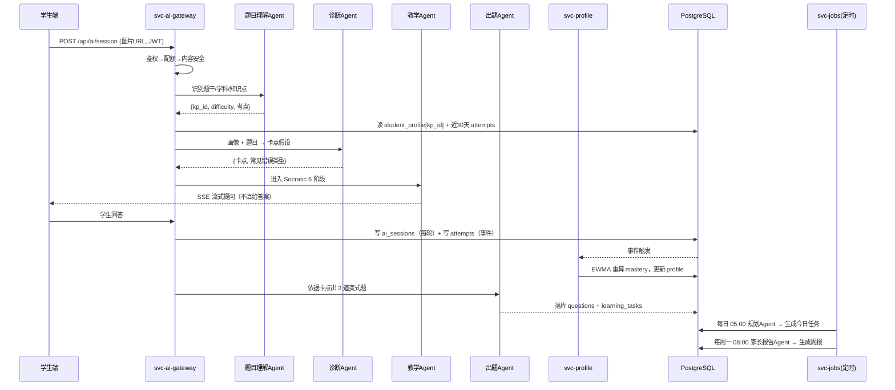
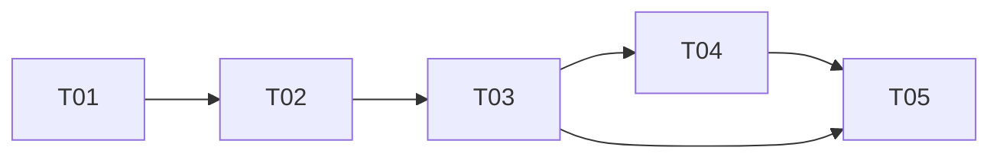

# AI数学教练 · 技术架构设计（V4 Architecture）

> 架构师：高见远 ｜ 输入：V4 PRD 定稿 ｜ 定位：从单文件 Demo → 可商业化的三端系统
> 一句话：**用「腾讯云 CloudBase 跑代码 + 腾讯云 PostgreSQL 存数据 + 服务端 AI 网关」，前端拆成一个仓库三个应用，先做 V4.1 的账号 + 真实 AI + 数据闭环。**

---

## 一、实现方案与框架选型

| 层 | 选型 | 理由 |
|---|---|---|
| 前端 | **Vite + React 18 + TypeScript + Tailwind**，pnpm monorepo | 现有 HTML 是原生 DOM，React 重写可控；Tailwind 与现有内联样式风格最接近，迁移成本最低 |
| 状态/数据 | Zustand（本地态）+ TanStack Query（服务端态） | Query 天然处理缓存/重试/离线，替代现有 localStorage 读写心智 |
| 后台 UI | **MUI X DataGrid** | 题库/用户表格类需求，自研不划算 |
| 后端运行时 | **腾讯云 CloudBase 云函数（HTTP 访问服务）** | 老板非技术、无运维；函数即服务，按量计费；已在国内云生态内 |
| 静态托管 | 保留 **EdgeOne Pages**，`/api/*` 反代到 CloudBase | 复用现有域名与 CDN，规避跨域 |
| 数据库 | **腾讯云 PostgreSQL（TDSQL-C PG Serverless）** | 见第 1.1 节拍板 |
| 鉴权 | 自建 JWT（access 2h / refresh 30d）+ 腾讯云短信验证码 | 现有"手机号登录"是纯前端假登录，必须换成服务端签发；不绑死 CloudBase 匿名登录，便于后续接小程序 |
| AI 网关 | 独立 `ai-gateway` 云函数，SSE 流式 | Key 下沉服务端，统一限流/落库/成本核算 |
| 对象存储 | CloudBase 云存储（私有读 + 签名 URL） | 题目图片含未成年人手写内容，禁止公开读 |
| 支付 | 微信支付 JSAPI/H5（V4.3 接入） | 家长端主场景在微信内 |
| 可观测 | 云函数日志 + PG 事件表 + 自建 `/admin/metrics` | 初期不上 APM，够用即可 |

### 1.1 数据库拍板：PostgreSQL（腾讯云托管），不用文档库、不用 Supabase

| 方案 | 关系模型契合 | 运维负担 | 境内合规 | 初期月成本 | 结论 |
|---|---|---|---|---|---|
| CloudBase 文档型（MongoDB 版） | ✕ 9 表强关联，JOIN 靠手写聚合 | 极低 | ✓ | 低 | ✕ 画像/知识图谱查询会很痛 |
| CloudBase MySQL(TDSQL-C) | ○ | 低 | ✓ | 低 | ○ 备选，但缺 jsonb/pgvector |
| **腾讯云 PostgreSQL Serverless** | **✓** | **低（托管）** | **✓ 境内** | **约 ¥100–300** | **✅ 推荐** |
| Supabase | ✓ | 极低 | **✕ 数据出境** | 低 | ✕ 未成年人数据不可出境，一票否决 |
| Neon | ✓ | 极低 | ✕ | 低 | ✕ 同上 |
| 自建 PG on CVM | ✓ | 高 | ✓ | 中 | ✕ 小团队无 DBA |

**决策理由**：① PRD 的 9 张表是典型关系模型，文档库会把成本转嫁给应用层；② `jsonb` 直接存画像快照与 AI 结构化输出，省掉一堆扩展表；③ 知识图谱前置/后续关系用 `WITH RECURSIVE` 一条 SQL 搞定；④ **pgvector** 为 V4.4 的"相似题推荐 + 记忆系统"预留能力；⑤ 托管在境内，满足未成年人数据本地化。
**取舍**：CloudBase 负责"函数/存储/托管"，PG 负责"事实数据"，云函数经 VPC 内网直连 PG——这是**唯一新增的一点技术复杂度，一次性配置，收益远大于成本**。

---

## 二、目标工程目录结构

```
ai-math-coach/
├─ apps/
│  ├─ web/                         # 学生端 + 家长端（同一 PWA，按 role 路由分流）
│  │  ├─ src/routes/student/       # 6 页：home / ai-teacher / mistakes / daily / ability-map / achievement
│  │  ├─ src/routes/parent/        # 5 页：home / report / weakness / advice / membership
│  │  ├─ src/features/ai-chat/     # 复用：Socratic 6 阶段对话机（从 index.html 迁移）
│  │  ├─ src/features/mistakes/    # 复用：错题本三态
│  │  └─ src/features/ability-map/ # 复用：能力地图图表
│  └─ admin/                       # 管理后台（MUI）：users / questions / knowledge-graph / ai-quality / analytics
├─ packages/
│  ├─ ui/                          # 跨端共享组件：Button/Card/Chart/Empty/题目卡
│  ├─ domain/                      # 共享 TS 类型 + zod schema（与 DB 表一一对应）
│  ├─ api-client/                  # 统一 HTTP 客户端 + DataAdapter（Local/Cloud 双实现）
│  └─ config/                      # eslint / tsconfig / tailwind preset
├─ services/                       # CloudBase 云函数（每个目录 = 一个部署单元）
│  ├─ svc-auth/                    # 验证码、登录、JWT、学生档案
│  ├─ svc-learning/                # 错题、attempts 事件、任务、成就
│  ├─ svc-ai-gateway/              # ★ AI 编排器（在线）
│  │  ├─ orchestrator.ts
│  │  ├─ agents/{understand,diagnose,teach,generate}.prompt.ts
│  │  └─ guards/{auth,quota,safety,cost}.ts
│  ├─ svc-jobs/                    # 定时：规划Agent（每日 5:00）、家长报告Agent（每周一 8:00）
│  ├─ svc-profile/                 # 画像引擎（事件消费 → 掌握度重算）
│  ├─ svc-content/                 # 题库/知识图谱 CRUD、909 题 seed
│  └─ svc-billing/                 # 订单、微信支付回调（V4.3）
├─ db/migrations/                  # SQL 版本化迁移
└─ docs/                           # 本文档、prompt 资产库
```

**是否共用组件**：学生端与家长端**共用一个应用**（共 11 页，独立部署收益低、登录态共享收益高）；后台独立，因其依赖 MUI 重组件、且不需要移动端优化。

---

## 三、数据结构与接口（9 表 + Attempt 事件表）

```mermaid
erDiagram
    users ||--o| students : has
    users ||--o{ orders : places
    users ||--o{ parent_links : guardian
    students ||--o{ parent_links : child
    students ||--o{ mistakes : owns
    students ||--o{ ai_sessions : starts
    students ||--o{ student_profile : has
    students ||--o{ learning_tasks : assigned
    students ||--o{ attempts : produces
    questions ||--o{ mistakes : in
    questions ||--o{ attempts : on
    questions ||--o{ ai_sessions : about
    knowledge_points ||--o{ questions : tags
    knowledge_points ||--o{ student_profile : measured
    knowledge_points ||--o{ knowledge_points : parent_of
    ai_sessions ||--o{ ai_quality_reviews : scored

    users { uuid id PK "phone,nickname,role,status" }
    students { uuid id PK "user_id FK,grade,stage,goal" }
    questions { uuid id PK "content,image_url,subject,grade,difficulty,kp_id FK,options jsonb" }
    knowledge_points { uuid id PK "name,parent_id FK,desc,common_errors jsonb" }
    mistakes { uuid id PK "student_id,question_id,error_type,status" }
    ai_sessions { uuid id PK "student_id,question_id,stage,messages jsonb,tokens,cost" }
    student_profile { uuid id PK "student_id,kp_id,mastery numeric,error_count,updated_at" }
    learning_tasks { uuid id PK "student_id,task_type,payload jsonb,status,due_date" }
    orders { uuid id PK "user_id,plan,amount,status,paid_at" }
    attempts { uuid id PK "student_id,question_id,kp_id,session_id,is_correct,error_type,duration_ms,hint_used,source,client_event_id UK,created_at" }
```



> **`attempts` 是本次架构的核心新增**：append-only 事件流，是唯一事实源；`student_profile` 降级为可重算的**物化视图**。任何画像错误都能靠回放事件修复——这是"结果快照"升级为"数据闭环"的关键。

---

## 四、程序调用流程（6-Agent 链路 + 作答闭环）



**6 个 Agent 的务实实现**：**逻辑角色，不独立部署**。在线 4 个（理解/诊断/教学/出题）合并在 `svc-ai-gateway` 一个编排器内，各自是"角色化 Prompt + zod 输出 Schema"；离线 2 个（规划/家长报告）放 `svc-jobs` 定时函数。理由：独立部署会带来 6 倍冷启动与链路延迟，而当前 QPS 极低。**部署单元 = 2 个，逻辑角色 = 6 个**，接口边界仍按 6 个划分，将来任一角色可平滑拆出。

---

## 五、任务列表（V4.1 为主，标注复用资产）

| ID | 任务 | 主要文件 | 依赖 | 优先级 | 复用 |
|---|---|---|---|---|---|
| **T01** | **工程基建与云底座**：monorepo 骨架、Vite/TS/Tailwind 配置、CloudBase 环境与 VPC 打通 PG、`db/migrations` 建 10 张表、EdgeOne `/api/*` 反代、CI | `pnpm-workspace.yaml`、`packages/config/*`、`apps/web/vite.config.ts`、`apps/admin/vite.config.ts`、`db/migrations/001_init.sql`、`services/_shared/db.ts` | — | P0 | 域名/EdgeOne |
| **T02** | **账号与数据层**：短信验证码+JWT、学生档案、`packages/domain` 类型、`api-client` 与 **DataAdapter 双实现**、909 题 + 知识点 seed 脚本、旧 localStorage 幂等上云 | `services/svc-auth/*`、`packages/domain/*`、`packages/api-client/{http,adapter-local,adapter-cloud}.ts`、`services/svc-content/seed/questions.ts`、`scripts/migrate-local.ts` | T01 | ✅909 题库、现有登录 UI | 
| **T03** | **AI 网关与教学闭环**：编排器、4 个在线 Agent Prompt、SSE、配额/成本/安全守卫、`ai_sessions` + `attempts` 落库；学生端「AI老师页 / 错题本」上线 | `services/svc-ai-gateway/**`、`services/svc-learning/{attempts,mistakes}.ts`、`apps/web/src/features/ai-chat/**`、`apps/web/src/routes/student/{ai-teacher,mistakes}.tsx` | T02 | ✅Socratic 6 阶段 prompt、错题本逻辑、/api/chat 中转 |
| **T04** | **画像引擎与学生端主界面**：EWMA 掌握度重算、事件回放、规划 Agent 定时任务；「学习中心首页 / 能力地图 / 每日训练 / 学习成就」 | `services/svc-profile/**`、`services/svc-jobs/plan.ts`、`apps/web/src/routes/student/{home,daily,ability-map,achievement}.tsx`、`packages/ui/Chart*` | T03 | ✅能力地图、今日计划算法 |
| **T05** | **报告、后台与灰度上线**：家长报告 Agent 周报、家长端 5 页只读版、后台题库/AI质量监控页、埋点与灰度发布 | `services/svc-jobs/weekly-report.ts`、`apps/web/src/routes/parent/**`、`apps/admin/src/pages/{questions,ai-quality,analytics}.tsx` | T03,T04 | ✅周报 7 段 prompt、学情诊断报告 |



---

## 六、依赖包

`react@^18.2` `react-router-dom@^6.22` `zustand@^4.5` `@tanstack/react-query@^5` `tailwindcss@^3.4` `@mui/material@^5.15` `@mui/x-data-grid@^7` `recharts@^2.12` `zod@^3.23` `dayjs@^1.11` `vite@^5` `typescript@^5.4` ｜ 服务端：`@cloudbase/node-sdk` `pg@^8.11` `kysely@^0.27` `jose@^5` `pino@^9` `openai@^4`（兼容方舟 Responses） ｜ 测试：`vitest` `playwright`

---

## 七、共享知识（跨模块硬约定）

1. **响应格式**：`{ code: 0, data, message, traceId }`；`code≠0` 即业务失败，HTTP 恒为 200（除 401/429/5xx）。
2. **错误码段**：`1xxx` 鉴权 / `2xxx` 参数 / `3xxx` 学习域 / `4xxx` AI 网关 / `5xxx` 支付 / `9xxx` 系统。
3. **鉴权**：Header `Authorization: Bearer <access>`；家长访问孩子数据必须经 `parent_links` 校验，**服务端强制，前端不可信**。
4. **幂等**：所有写事件带 `client_event_id`（前端 UUID），DB 唯一索引，重放安全——这是离线补传与旧数据上云的基础。
5. **限流**：AI 会话按套餐配额（免费 5 次/日、会员 50 次/日），网关侧计数；超限返 `4429`。单次 session token 上限硬截断，成本写入 `ai_sessions.cost`。
6. **命名与时间**：DB `snake_case`，API `camelCase`，时间一律 ISO 8601 UTC，前端按 `Asia/Shanghai` 渲染。
7. **Prompt 资产**：全部收归 `services/svc-ai-gateway/agents/*.prompt.ts` 并版本号化，`ai_sessions` 记录 `prompt_version`，便于 AI 质量监控做 A/B 归因。
8. **迁移开关**：`VITE_DATA_SOURCE=local|cloud`，灰度期双写，云端为准。

---

## 八、待老板确认事项

| # | 问题 | 影响 |
|---|---|---|
| 1 | **学段范围**：小学 1-6 + 初中 1-3 全覆盖，还是 V4.1 先聚焦小学 4-6？ | 决定知识图谱建设量与 909 题覆盖缺口 |
| 2 | **定价与套餐**：几档、年付月付、免费额度多少？ | 直接决定限流阈值与 AI 成本模型 |
| 3 | **未成年人合规**：是否需监护人同意弹窗、实名、青少年模式、数据删除通道？ | 影响 T02 注册流程，**上线前必须定** |
| 4 | **家长端形态**：PWA / H5 还是微信小程序？ | 小程序需独立 Taro 应用 + 审核周期，影响 V4.3 排期 |
| 5 | **6 个 Agent** 是否接受"逻辑角色 + 2 部署单元"的务实方案？ | 我方强烈推荐，避免过度工程 |
| 6 | **OCR 供应商**：继续用户自填 Key，还是平台统一采购计入成本？ | 影响 V4.4 与毛利模型 |
| 7 | **题库版权**：909 题来源是否可商用？是否需要自研出题替换？ | 商业化法律风险 |
| 8 | **AI 月度成本上限**：给一个红线数字（如 ¥3000/月） | 网关熔断策略需要该参数 |

---

**给老板的三句话总结**：技术上不推倒重来——现有 70% 的"教学大脑"（Socratic 流程、909 题库、能力地图、周报）全部作为资产迁移；真正新建的是**账号、数据库、AI 服务端网关、作答事件流**这四件地基；分五步走，前三步（T01–T03）做完就是可收费的 V4.1。
