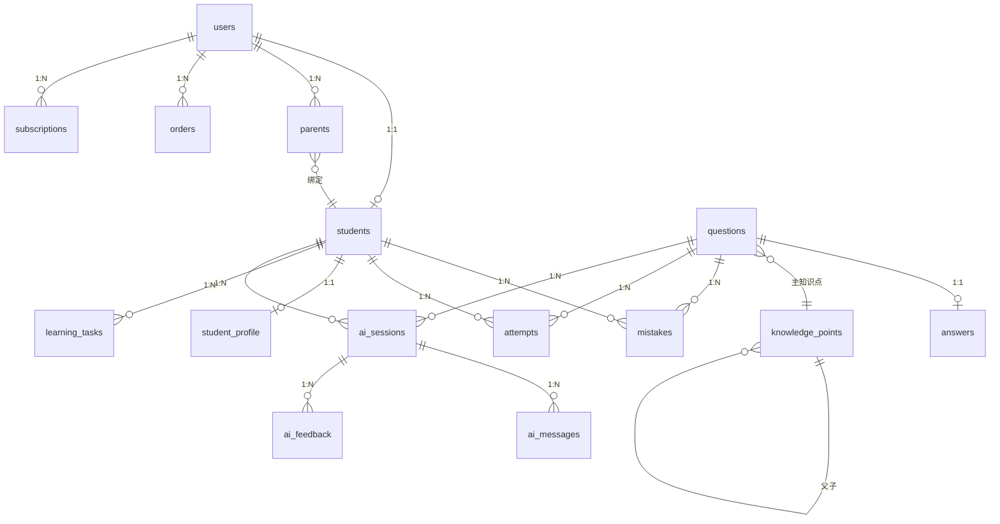

# AI数学教练 V4 · 数据库详细设计 + API 接口设计

> 架构师：高见远 ｜ 输入：V4 PRD + V4 Architecture ｜ 数据库：腾讯云 PostgreSQL 15 (TDSQL-C PG Serverless) + pgvector
> 一句话：**14 张表定事实，5 组 API 定边界，6 个 Agent 定协议，一张映射表把 localStorage 搬上云。**

---

## A. 数据库详细设计

### A.0 全局约定

| 项 | 约定 |
|---|---|
| 主键 | `uuid`，默认 `gen_random_uuid()`（pgcrypto） |
| 时间 | `timestamptz`，统一 UTC 存储；`created_at/updated_at` 默认 `now()` |
| 命名 | 表名复数 `snake_case`；外键 `<表单数>_id` |
| 软删 | 关键业务表带 `deleted_at timestamptz NULL`，查询默认过滤 |
| JSON | 一律 `jsonb`（可索引），禁用 `json` |
| 扩展 | `pgcrypto`、`vector`(pgvector)、`pg_trgm`（题干模糊搜索） |

### A.1 表清单总览（14 张）

| # | 表名 | 归属域 | 来源 | V4.1 必需 |
|---|---|---|---|---|
| 1 | `users` | 账号 | PRD | ✅ |
| 2 | `students` | 账号 | PRD | ✅ |
| 3 | `parents` | 账号 | 本版新增 | ⬜ V4.2 |
| 4 | `knowledge_points` | 内容 | PRD | ✅ |
| 5 | `questions` | 内容 | PRD | ✅ |
| 6 | `answers` | 内容 | 本版新增 | ✅ |
| 7 | `mistakes` | 学习 | PRD | ✅ |
| 8 | `attempts` | 学习 | 上版架构新增 | ✅ |
| 9 | `student_profile` | 学习 | PRD | ✅ |
| 10 | `learning_tasks` | 学习 | PRD | ✅ |
| 11 | `ai_sessions` | AI | PRD | ✅ |
| 12 | `ai_messages` | AI | 本版新增 | ✅ |
| 13 | `ai_feedback` | AI | 本版新增 | ⬜ V4.2 |
| 14 | `orders` | 商业 | PRD | ⬜ V4.3 |
| 15 | `subscriptions` | 商业 | 本版新增 | ⬜ V4.3 |

> 合计 **15 张**（PRD 9 + 架构 1 + 本版 5）。V4.1 落地 11 张，商业化与反馈类 4 张留后。

### A.2 账号域

**`users`** — 统一账号（学生/家长/管理员共用）

| 字段 | 类型 | 约束 | 说明 |
|---|---|---|---|
| id | uuid | PK | |
| phone | varchar(20) | UNIQUE, NOT NULL | 登录唯一标识 |
| nickname | varchar(50) | | 昵称 |
| avatar_url | text | | 头像 |
| role | varchar(16) | NOT NULL, CHECK in(student,parent,admin) | 主角色 |
| status | varchar(16) | NOT NULL DEFAULT 'active' | active/frozen |
| last_login_at | timestamptz | | |
| created_at / updated_at / deleted_at | timestamptz | IDX(created_at) | |

**`students`** — 学生档案

| 字段 | 类型 | 约束 | 说明 |
|---|---|---|---|
| id | uuid | PK | |
| user_id | uuid | FK→users(id) ON DELETE CASCADE, UNIQUE | 一对一 |
| real_name | varchar(50) | | |
| grade | smallint | NOT NULL, CHECK 1-9 | 年级 |
| stage | varchar(16) | NOT NULL | primary/junior |
| goal | text | | 学习目标 |
| daily_target | smallint | DEFAULT 5 | 每日目标题量 |
| streak_days | int | DEFAULT 0 | 连续打卡 |
| total_points | int | DEFAULT 0 | 成就积分 |
| created_at / updated_at | timestamptz | IDX(user_id), IDX(grade) | |

**`parents`** — 家长与孩子的绑定关系（多对多）

| 字段 | 类型 | 约束 | 说明 |
|---|---|---|---|
| id | uuid | PK | |
| user_id | uuid | FK→users(id), NOT NULL | 家长账号 |
| student_id | uuid | FK→students(id), NOT NULL | 孩子 |
| relation | varchar(16) | DEFAULT 'guardian' | father/mother/guardian |
| verified_at | timestamptz | | 绑定验证时间 |
| report_channel | varchar(16) | DEFAULT 'app' | app/sms/wechat |
| — | — | **UNIQUE(user_id, student_id)**, IDX(student_id) | 家长越权校验的唯一依据 |

### A.3 内容域

**`knowledge_points`** — 知识图谱节点（自引用树）

| 字段 | 类型 | 约束 | 说明 |
|---|---|---|---|
| id | uuid | PK | |
| code | varchar(32) | UNIQUE, NOT NULL | 如 `M4-FRAC-01` |
| name | varchar(100) | NOT NULL | 知识点名 |
| parent_id | uuid | FK→knowledge_points(id) NULL | 树形父节点 |
| grade | smallint | NOT NULL | 适用年级 |
| stage | varchar(16) | NOT NULL | |
| description | text | | |
| prereq_ids | uuid[] | DEFAULT '{}' | 前置知识点（GIN 索引） |
| common_errors | jsonb | DEFAULT '[]' | 常见错误类型库 |
| — | — | IDX(parent_id), IDX(grade), GIN(prereq_ids) | 递归查询用 `WITH RECURSIVE` |

**`questions`** — 题库（909 题入库目标表）

| 字段 | 类型 | 约束 | 说明 |
|---|---|---|---|
| id | uuid | PK | |
| source | varchar(16) | NOT NULL DEFAULT 'bank' | bank/ai_gen/user_upload |
| content | text | NOT NULL | 题干（GIN pg_trgm） |
| image_url | text | | 私有读签名 URL |
| question_type | varchar(16) | NOT NULL | choice/fill/solve |
| options | jsonb | DEFAULT '[]' | 选择题选项 |
| subject | varchar(16) | DEFAULT 'math' | |
| grade | smallint | NOT NULL | |
| difficulty | smallint | NOT NULL CHECK 1-5 | |
| kp_id | uuid | FK→knowledge_points(id), NOT NULL | 主知识点 |
| kp_ids | uuid[] | DEFAULT '{}' | 多知识点标注 |
| created_by | uuid | FK→users(id) NULL | |
| status | varchar(16) | DEFAULT 'published' | draft/published/archived |
| — | — | IDX(kp_id, grade, difficulty), GIN(content gin_trgm_ops) | |

**`answers`** — 标准答案与解析（与题目 1:1 拆表，便于权限隔离：学生端默认不下发）

| 字段 | 类型 | 约束 | 说明 |
|---|---|---|---|
| id | uuid | PK | |
| question_id | uuid | FK→questions(id) ON DELETE CASCADE, UNIQUE | |
| correct_answer | text | NOT NULL | 标准答案 |
| solution_steps | jsonb | DEFAULT '[]' | 分步解析 `[{step,text,formula}]` |
| key_insight | text | | 关键点拨（Socratic 用） |
| distractor_analysis | jsonb | DEFAULT '{}' | 错误选项归因 |

### A.4 学习域

**`mistakes`** — 错题记录

| 字段 | 类型 | 约束 | 说明 |
|---|---|---|---|
| id | uuid | PK | |
| student_id | uuid | FK→students(id) ON DELETE CASCADE, NOT NULL | 归属学生 |
| question_id | uuid | FK→questions(id) ON DELETE CASCADE, NOT NULL | 关联题目 |
| error_type | varchar(32) | | 错误类型(概念混淆/计算失误/审题不清) |
| error_reason | text | | AI 诊断原因 |
| solved | boolean | DEFAULT false | 是否已掌握 |
| solved_at | timestamptz | | 掌握时间 |
| created_at | timestamptz | DEFAULT now(), IDX(student_id, solved) | 首次出错时间 |

**`attempts`** — 作答事件流（数据闭环核心）

| 字段 | 类型 | 约束 | 说明 |
|---|---|---|---|
| id | uuid | PK | |
| student_id | uuid | FK→students(id), NOT NULL | |
| question_id | uuid | FK→questions(id) NULL | 练习题可能为 AI 生成 |
| session_id | uuid | FK→ai_sessions(id) NULL | 关联辅导会话 |
| selected_answer | text | | 学生作答 |
| is_correct | boolean | NOT NULL | 对错 |
| duration_sec | int | | 耗时 |
| created_at | timestamptz | DEFAULT now(), IDX(student_id, created_at) | 每次作答一条，画像由它重算 |

**`student_profile`** — 学生数学画像

| 字段 | 类型 | 约束 | 说明 |
|---|---|---|---|
| id | uuid | PK | |
| student_id | uuid | FK→students(id), UNIQUE, NOT NULL | |
| mastery | jsonb | DEFAULT '{}' | 知识点→掌握度(0-100) |
| weak_points | jsonb | DEFAULT '[]' | 薄弱知识点 code 列表 |
| learning_style | jsonb | DEFAULT '{}' | 偏好(提示式/探索式) |
| long_term_vector | vector(768) | | pgvector 长期记忆向量 |
| updated_at | timestamptz | DEFAULT now() | |

**`learning_tasks`** — 每日任务

| 字段 | 类型 | 约束 | 说明 |
|---|---|---|---|
| id | uuid | PK | |
| student_id | uuid | FK→students(id), NOT NULL | |
| task_type | varchar(16) | NOT NULL | daily/review/exam |
| items | jsonb | NOT NULL | 任务项 [{kp,count,kind}] |
| status | varchar(16) | DEFAULT 'pending' | pending/doing/done |
| generated_at | timestamptz | DEFAULT now() | |
| finished_at | timestamptz | | |

### A.5 AI 域

**`ai_sessions`** — 辅导会话

| 字段 | 类型 | 约束 | 说明 |
|---|---|---|---|
| id | uuid | PK | |
| student_id | uuid | FK→students(id), NOT NULL | |
| question_id | uuid | FK→questions(id) NULL | |
| status | varchar(16) | DEFAULT 'active' | active/done |
| created_at | timestamptz | DEFAULT now(), IDX(student_id) | |

**`ai_messages`** — 会话消息

| 字段 | 类型 | 约束 | 说明 |
|---|---|---|---|
| id | uuid | PK | |
| session_id | uuid | FK→ai_sessions(id) ON DELETE CASCADE, NOT NULL | |
| role | varchar(16) | NOT NULL CHECK(role in('user','assistant','system')) | |
| content | text | NOT NULL | |
| created_at | timestamptz | DEFAULT now(), IDX(session_id) | |

**`ai_feedback`** — AI 质量反馈（V4.2）

| 字段 | 类型 | 约束 | 说明 |
|---|---|---|---|
| id | uuid | PK | |
| session_id | uuid | FK→ai_sessions(id), NOT NULL | |
| rating | smallint | CHECK(1-5) | 评分 |
| note | text | | 标注(是否直给答案等) |
| created_at | timestamptz | DEFAULT now() | |

### A.6 商业域

**`orders`** — 订单（V4.3）

| 字段 | 类型 | 约束 | 说明 |
|---|---|---|---|
| id | uuid | PK | |
| user_id | uuid | FK→users(id), NOT NULL | |
| plan | varchar(16) | NOT NULL | free/pro/family |
| amount | numeric(10,2) | NOT NULL | 金额 |
| status | varchar(16) | DEFAULT 'pending' | pending/paid/refunded |
| paid_at | timestamptz | | |

**`subscriptions`** — 订阅（V4.3）

| 字段 | 类型 | 约束 | 说明 |
|---|---|---|---|
| id | uuid | PK | |
| user_id | uuid | FK→users(id), NOT NULL | |
| plan | varchar(16) | NOT NULL | |
| start_at | timestamptz | NOT NULL | |
| end_at | timestamptz | NOT NULL | |
| status | varchar(16) | DEFAULT 'active' | active/expired |

### A.7 ER 关系图



## B. API 接口设计

### B.1 接口总览（按模块）

**学生端**

| 路径 | 方法 | 鉴权 | 简述 |
|---|---|---|---|
| /api/auth/login | POST | 公开 | 手机号+验证码登录 |
| /api/student/profile | GET | student | 取数学画像 |
| /api/student/profile | PUT | student | 更新年级/目标 |
| /api/chat | POST | student | 拍题引导(Socratic) |
| /api/chat/:id/message | POST | student | 继续对话 |
| /api/mistake | POST | student | 记录错题 |
| /api/mistake/list | GET | student | 错题本(未掌握/练习中/已掌握) |
| /api/exercise/gen | POST | student | 生成修复/迁移题 |
| /api/task/today | GET | student | 今日任务 |
| /api/ability-map | GET | student | 能力地图数据 |
| /api/achievement | GET | student | 学习成就 |

**家长端**

| 路径 | 方法 | 鉴权 | 简述 |
|---|---|---|---|
| /api/parent/child/:id/report/weekly | GET | parent | 周成长报告 |
| /api/parent/child/:id/weak | GET | parent | 薄弱分析 |
| /api/parent/child/:id/suggest | GET | parent | 学习建议 |
| /api/parent/member | GET | parent | 会员中心 |

**管理后台**

| 路径 | 方法 | 鉴权 | 简述 |
|---|---|---|---|
| /api/admin/users | GET | admin | 用户管理 |
| /api/admin/questions | GET/POST | admin | 题库管理 |
| /api/admin/kp | GET/POST | admin | 知识图谱管理 |
| /api/admin/ai/quality | GET | admin | AI质量监控 |
| /api/admin/metrics | GET | admin | 数据分析(DAU/留存/付费) |

**AI 网关（内部）**

| 路径 | 方法 | 鉴权 | 简述 |
|---|---|---|---|
| /api/ai/question | POST | service | Question Agent |
| /api/ai/diagnose | POST | service | Diagnosis Agent |
| /api/ai/tutor | POST | service | Tutor Agent |
| /api/ai/exercise | POST | service | Exercise Agent |

### B.2 核心接口示例

**POST /api/chat**（拍题引导）

请求：
```json
{ "student_id":"uuid", "image":"data:image/jpeg;base64,...", "text":"孩子手写解答" }
```

响应：
```json
{ "code":0, "msg":"ok", "data":{
  "session_id":"uuid",
  "analysis":{"knowledge":"一元一次方程","stuck_at":"移项符号","difficulty":3},
  "next_question":"不要急着算，你觉得题目里哪个条件最重要？",
  "options":null
}}
```

**GET /api/student/profile**

响应：
```json
{ "code":0, "msg":"ok", "data":{
  "mastery":{"分数":70,"方程":55,"应用题":40},
  "weak_points":["应用题建模"],
  "learning_style":{"prefer":"提示式"}
}}
```

**POST /api/mistake**

请求：
```json
{ "student_id":"uuid", "question_id":"uuid", "error_type":"审题不清", "error_reason":"未建立数量关系" }
```

响应：
```json
{ "code":0, "msg":"ok", "data":{"id":"uuid","solved":false} }
```

**GET /api/parent/report/weekly?child_id=uuid**

响应：
```json
{ "code":0, "msg":"ok", "data":{
  "week":{"days":5,"questions":43,"minutes":230},
  "ability":{"分数":{"from":45,"to":70}},
  "weak_now":"应用题建模",
  "suggestion":"每天10分钟应用题训练"
}}
```

**POST /api/question/upload**

请求：multipart/form-data { image:file, student_id:uuid }
响应：
```json
{ "code":0, "msg":"ok", "data":{"image_url":"https://cos.../x.jpg","ocr_text":"..."} }
```

### B.3 统一响应与错误码

```json
{ "code":0, "msg":"ok", "data":{} }
```

| code | 含义 |
|---|---|
| 0 | 成功 |
| 401 | 未登录/Token 失效 |
| 403 | 无权限(家长越权看他人孩子) |
| 429 | 限流(免费版超次) |
| 500 | 服务错误 |

## C. AI Agent 调用协议

### C.1 六个 Agent 输入输出

- **Question Agent**：in {text|image} → out {knowledge, difficulty, type, kp_id}
- **Diagnosis Agent**：in {question, student_answer, history} → out {error, reason, gap}
- **Tutor Agent**：in {student_state, current_error, history_effect} → out {next_question, hint_style}
- **Exercise Agent**：in {error_type, kp_id, difficulty} → out {repair_question, transfer_question}
- **Planner Agent**（离线）：in {30d_learning_data} → out {future_plan}
- **Report Agent**（离线）：in {learning_records, ability_delta, error_trend} → out {weekly_report}

### C.2 编排顺序（数据流 Step3→Step9）

上传 → Question Agent(知识点) → 查 profile → Diagnosis Agent(为什么错) → Tutor Agent 循环(引导) → 完成 → Exercise Agent(2题) → 落库(attempts/mistakes/profile 更新) → Planner Agent(异步排明日任务)

### C.3 在线4+离线2

Question/Diagnosis/Tutor/Exercise 在线同步（用户等结果）；Planner/Report 由定时任务(Celery/APScheduler)离线跑，结果写入 learning_tasks / report 表。

### C.4 AI 网关治理

- 鉴权：服务端持有模型 Key（火山方舟/DeepSeek），前端不接触
- 限流：按 student_id 日配额（免费版 N 次/日），Redis 计数
- 落库：每次调用写 ai_sessions/ai_messages + attempts
- 成本：记录 token 用量，按用户聚合，超红线告警

## D. 迁移映射

| 现 localStorage 键 | 目标 |
|---|---|
| 错题本_<学生id> | mistakes + student_profile.solved |
| 今日计划_<学生id> | learning_tasks(task_type=daily) |
| 能力地图_<学生id> | student_profile.mastery / weak_points |
| 学情报告_<学生id> | 由 attempts 重算(不再快照) |
| 周报告_<学生id> | Report Agent 生成(离线) |

- 909 题入库：解析 index.html 中 QUESTION_BANK 常量 → 映射 knowledge_points → 批量 INSERT questions+answers
- Socratic prompt → 放 ai 模块 prompt 配置(服务端)，不再前端硬编码
- 老用户上云：首次登录自动把本地键 POST 到后端，幂等合并

## E. V4.1 最小集

- 必建表：users, students, knowledge_points, questions, answers, mistakes, attempts, student_profile, learning_tasks, ai_sessions, ai_messages（11 张）
- 必建接口：auth/login, chat, mistake, mistake/list, student/profile, task/today, ability-map, ai/*(4)
- 留 V4.2：parents, ai_feedback, 家长端接口, 向量检索
- 留 V4.3：orders, subscriptions, 支付/会员接口

## F. 待明确事项

1. 学段范围：V4.1 全小学还是先 4-6 年级？
2. 定价：免费版每日 AI 次数？会员月付区间(建议 29-69)？
3. 合规：未成年人实名/监护人同意弹窗是否 V4.1 做？
4. 家长端形态：微信小程序 or Web（影响 V4.2 工期）
5. Redis 是否 V4.1 必需（限流/短期记忆），还是先用 DB 顶？
6. 对象存储：阿里 OSS or 腾讯 COS？

- 冲突标注：AI 模型用火山方舟/DeepSeek（非 OpenAI，数据出境违规）；前端 Vue3（老板指定）；部署 Docker（老板指定）。